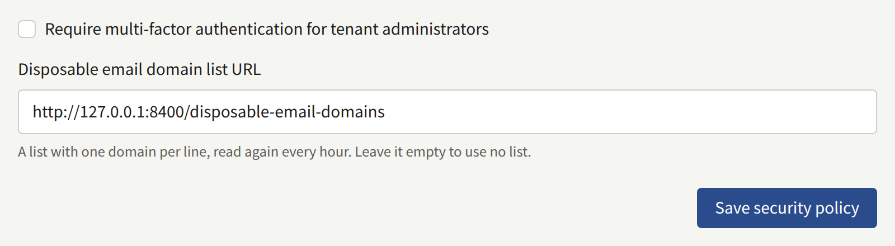

This page is for the operator: how tenant staff and Platform Console operators protect their accounts with a second factor, how to require it of them, and what to do when one is lost.

## Tenant staff

Every member of a tenant's staff can protect their console account with an authenticator app and ten recovery codes, from **Account settings** in the console, as [Your account](../../4-console/3-setup/9-your-account.md) describes for them.

Staff can also answer two-step verification with a passkey or a security key, as [Signing in with a passkey](../../4-console/3-setup/9-your-account.md#signing-in-with-a-passkey) describes. A passkey satisfies the requirement below just as an authenticator app does: a Tenant admin asked to set up two-step verification as they sign in can register a passkey instead. An account's passkeys and its authenticator share the same ten recovery codes, and a refused passkey counts toward the same lock as a wrong code.

A passkey is bound to the console's host, wherever that host is served, and never to the tenant's domain, even when the console is under it as `admin.<domain>` is. [Moving the console to another host](../2-tenants.md#moving-a-tenant-to-another-host-name) — giving it a new admin domain, or changing the domain of a tenant whose console is on `admin.<domain>` — therefore leaves every passkey its staff registered unusable. Staff with an authenticator app or a recovery code sign in with that. One whose only second factor was a passkey is asked to set two-step verification up again if the requirement covers their role, and signs in on their password alone if it does not. Moving the console back makes the old passkeys usable again.

You can require it of every Tenant admin on the install: tick **Require multi-factor authentication for tenant administrators** on **Security**, under **Policies** in the Platform Console, and choose **Save security policy**, or run:

```bash
publiractl policy set --mfa-required-for-tenant-admin
```



`--mfa-required-for-tenant-admin=false` stops requiring it. The requirement is checked when a Tenant admin signs in, so it applies from each one's next sign-in rather than to sessions already open; what it does, and whom it covers, is in [Platform defaults and policies](../9-platform-policies.md#two-step-verification-for-tenant-administrators).

A member of staff who has lost every second factor — the authenticator and their passkeys — and every recovery code cannot sign in again, and the tenant's other administrators cannot remove two-step verification from their account. You can, with `publiractl tenant member reset-mfa`, as [A tenant's staff](../3-tenant-staff.md#lost-two-step-verification) describes.

Each authenticator's secret is sealed with the encryption keys, which is why [removing an old key](./1-rotating-secrets.md#4-remove-the-old-key-only-when-nothing-uses-it) can lock staff out. Passkeys are not: the install keeps only each passkey's public key, which proves nothing to anyone who reads it, so rotating or removing a key leaves them working.

## Platform operators

Every operator can protect their Platform Console account the same way, with an authenticator app and ten recovery codes, from **Two-step verification** on **Account settings**, as [An operator's own account](../1-platform-console.md#an-operators-own-account) describes.

You can require it of every operator, whatever their role: tick **Require two-step verification for every Platform Console operator** on **Security**, under **Policies**, and choose **Save security policy**, or run:

```bash
publiractl policy set --mfa-required-for-platform-operator
```

`--mfa-required-for-platform-operator=false` stops requiring it. It is checked when an operator signs in, so it applies from each one's next sign-in rather than to sessions already open, yours included; what an operator who has not set one up sees is in [Platform defaults and policies](../9-platform-policies.md#two-step-verification-for-platform-operators). Set up your own authenticator before you require it, so you are not the first to find out what the sign-in asks for.

An operator who has lost both the authenticator and every recovery code cannot sign in again, and no other operator can remove it from their account in the Platform Console. You can, with `publiractl operator reset-mfa`, as [Lost two-step verification](../1-platform-console.md#lost-two-step-verification) describes. It needs no account, so it works when the operator who lost it is the install's only **Super admin**.

Each authenticator's secret is sealed with the encryption keys, as the tenant staff's are, so [removing an old key](./1-rotating-secrets.md#4-remove-the-old-key-only-when-nothing-uses-it) can lock operators out too.

Whether or not you require two-step verification:

- Give each operator a long password of their own, kept in a password manager.
- Give the **Super admin** role to as few operators as you can, and **Auditor** to anyone who only needs to look.
- Suspend or deactivate an operator who no longer needs the account, as [Suspending and deactivating](../1-platform-console.md#suspending-and-deactivating) describes.
- Consider serving the Platform Console's host name only to a network your operators reach, such as through a VPN or an address allowlist at your TLS terminator. Readers and tenant staff never need it.
