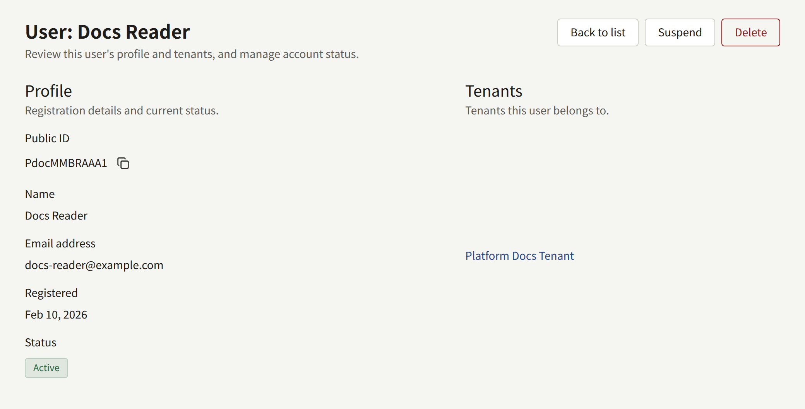
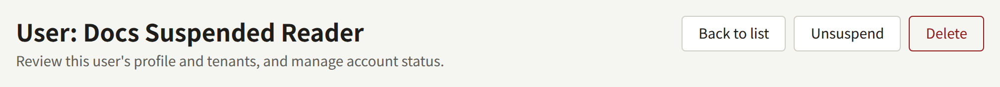

**Users**, under **Governance** in the Platform Console's sidebar, lists the readers of every tenant in one place. It exists for what a single tenant cannot handle alone: a complaint or a legal request that reaches the operator rather than the publisher, or an account a tenant's administrators cannot reach. Day to day, each tenant's administrators look after their own readers from **Readers** in the tenant console. There is no `publiractl` equivalent.

## What the list shows

Every account belongs to one tenant, so a person who reads on two tenants' sites appears twice, once for each. The list shows each account's **Name**, its **Tenant**, when it was **Registered**, and its **Status**, and narrows them by email address, by status, by tenant, and by registration date.

An address entered in the **Email address** field finds every account that holds it, one row for each tenant the person signed up on. Capital letters and a `+tag` after the name part of the address make no difference, so `John+news@Example.com` finds the account signed up as `john@example.com`. The field takes a whole address, not part of one, and there is no search by name. When no tenant has an account with the address, the list says so. The other filters narrow what the address finds: choose a status as well to see only the account that is suspended, for example.

The list holds readers only. An account that holds a role in a tenant's console is staff, and is managed from that tenant's **Members**, as [A tenant's staff](./3-tenant-staff.md) describes.

**Details** opens an account: its **Public ID**, name, **Email address**, registration date, status, and the tenant it belongs to.

## Suspending and deleting an account

An Operator or a Super admin can act on an account from its page. An Auditor sees the page without the buttons.

- **Suspend** stops the reader from signing in, on the site and in the app, and ends the sessions they already have. Nothing is removed from the account. **Unsuspend** lets them sign in again.
- **Delete** removes the account permanently, and cannot be undone. A reader who wants their own account gone can delete it themselves from the tenant's site, which is usually the better path.

Neither can be done to an account that holds a console role: take the role away first, from the tenant's **Members**.

Each action is recorded in **Audit logs**, with the operator who took it.
