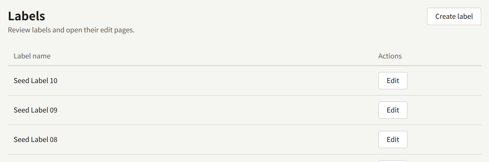
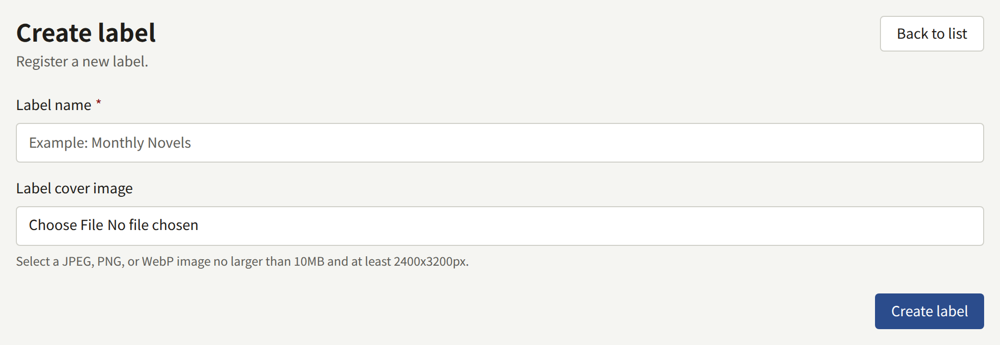
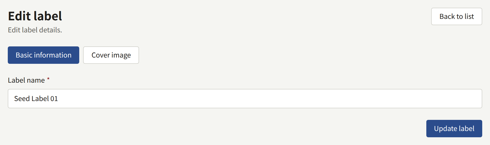
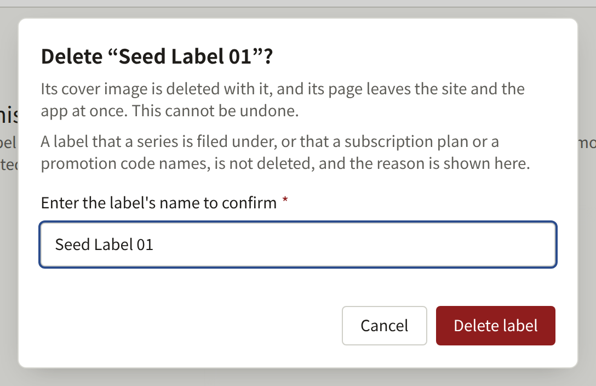

A label is an imprint: the name a publisher gives a line of its works, such as a magazine or a collection. Every series belongs to exactly one, which is why a series cannot be saved until a label exists. A publisher with a single imprint creates one label and files every series under it.

**Labels**, in the sidebar's **Catalog** group, lists them, newest first, twenty to a page.

## Creating a label

Choose **Create label**, enter a **Label name**, and choose **Create label**. A **Label cover image**, a JPEG, PNG, or WebP image of at most 10 MB and at least 2400 × 3200 pixels, is optional and can be added later.

The label's page has two tabs. **Basic information** changes its name, with **Update label**. **Cover image** replaces or removes its image, and adjusts the four shapes cut from it, as [The cover image](./1-series.md#the-cover-image) describes for a series.

Two labels can have the same name, so check the list before creating one. A label created by mistake can be deleted once nothing refers to it, as [Deleting a label](#deleting-a-label) describes.

## On the site

- **Labels**, in the site's header, lists every label with the number of its published series.
- Each label has a page with its name, its cover image as a wide banner, and its published series in title order.
- A series page names its label and links to it.
- **Featured labels** on the top page shows the six labels created most recently that have a published series, with a link to all of them.

A label is listed under **Labels**, and its page answers, from the moment it is created, before any series in it is public, showing "0 published series". It appears under **Featured labels** only once one of its series is published, so give it its name and cover image before then.

A label whose published series are all kept off one surface, by their **Shown on**, is not listed on that surface.

## Deleting a label

A Tenant admin deletes a label with **Delete this label**, at the end of the **Basic information** tab of its page; an Editor or an Auditor is not offered it. The dialog asks for the label's name, and **Delete label** stays unavailable until it is typed exactly. Choosing it deletes the label with its cover image. Its page leaves the site, the app, and the search index at once, and the console returns to the **Labels** list. A deletion cannot be undone, and **Audit logs** records it with the label's name.

A label is deleted only once nothing refers to it. While any of these does, the dialog says which instead of deleting it, with a link to where it is:

- A series filed under the label, whatever its state. Move each one to another label under **Label** on its **Basic information** tab, or delete it, as [Deleting a series](./1-series.md#deleting-a-series) describes. **View its series** opens the **Series** list narrowed to the label.
- A subscription plan whose **Opens** includes the label. Take the label out of what the plan opens, as [Subscription plans](../5-subscription-plans.md#changing-unpublishing-and-deleting-a-plan) describes. **View subscription plans** opens **Subscription plans**.
- A promotion code for the label that has not been deleted, or that a reader redeemed. Delete a code nobody redeemed, as [Selling episodes](../4-selling-episodes.md#watching-pausing-and-deleting-a-code) describes; a code that was redeemed keeps the label. **View promotion codes** opens **Promotion codes**.

The dialog names the first of these, in this order, so a label held by more than one is refused again for the next once the first is gone.
