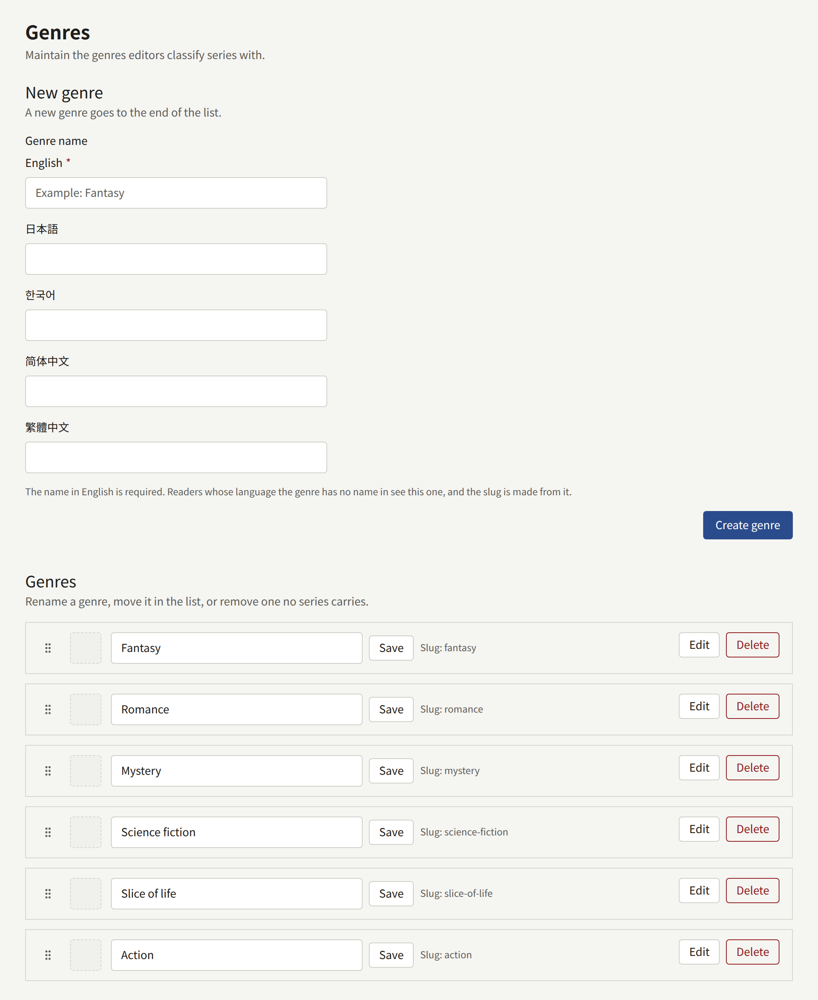
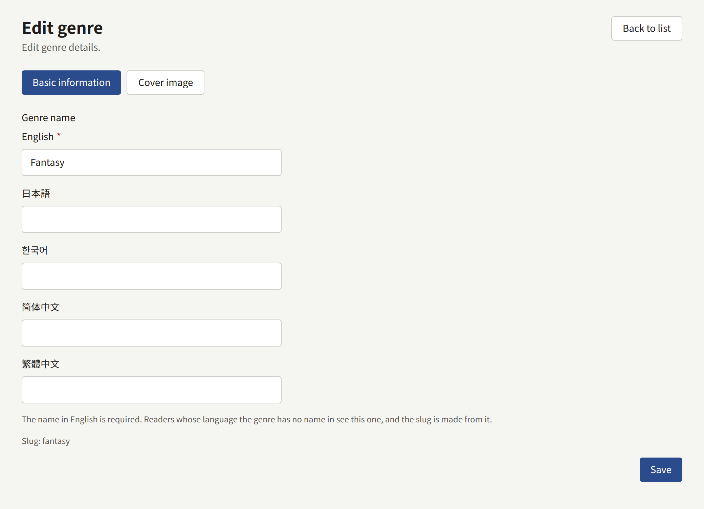

A genre is a category the tenant files its series under, such as fantasy or romance. A series can be in any number of genres, chosen on its form, and readers browse the catalog by them. The genres are the tenant's own: nothing is predefined, and there is one flat list of them.

**Genres**, in the sidebar's **Catalog** group, holds the whole list on one page.

## Managing genres

- **New genre** adds one, with **Genre name** and **Create genre**. **Genre name** has a field for each language the site offers, as [Naming a genre in each language](#naming-a-genre-in-each-language) describes. Names are up to 50 characters, and the name in the default language must be unique. A new genre goes to the end of the list.
- Each genre's name in the default language can be changed in place, with **Save**.
- Drag a genre by its handle to change its place. The order is the one the site lists genres in, and the one a series' genres are shown in.
- **Edit** opens a genre's page. Its **Basic information** tab holds the genre's name in every language the site offers, and its **Cover image** tab gives it an image, as [The cover image](./1-series.md#the-cover-image) describes for a series.
- **Delete** removes a genre no series is in. A genre still in use cannot be deleted: take it off every series first.

## Naming a genre in each language

A genre can have a name in each language the site offers, which a Tenant admin chooses under [**Settings**](../3-setup/1-settings.md#languages). **Genre name**, on **New genre** and on a genre's **Basic information** tab, has a field for each of those languages, labelled with the language's name in that language, the site's default language first.

- The name in the default language is required. Readers in a language the genre has no name in see that one.
- The genre's slug, shown with its name, is made from the name in the default language. It is what keeps two genres from being named alike: names that differ only in case or spacing make the same slug, so the second of them is refused.
- The genre's address on the site is its public ID, not its slug, so renaming the genre does not move it, and it is the same in every language.
- The other names are optional. A field filled in adds the name in that language. On a genre's **Basic information** tab, emptying a field and choosing **Save** removes that name.
- A language the site does not offer has no field. A name already saved in it is kept, and its field comes back when the language is offered again.

## On the site

- **Browse by genre** on the top page shows every genre, in the list's order, with the number of its published series. The section is hidden while the tenant has none.
- **Genres**, in the site's header, shows every genre as a tile, with its cover image or, without one, the covers of a few of its series.
- Each genre has a page with what is popular in it this week, and its series, which readers can narrow by status and other filters.
- A series page links to each of its genres.
