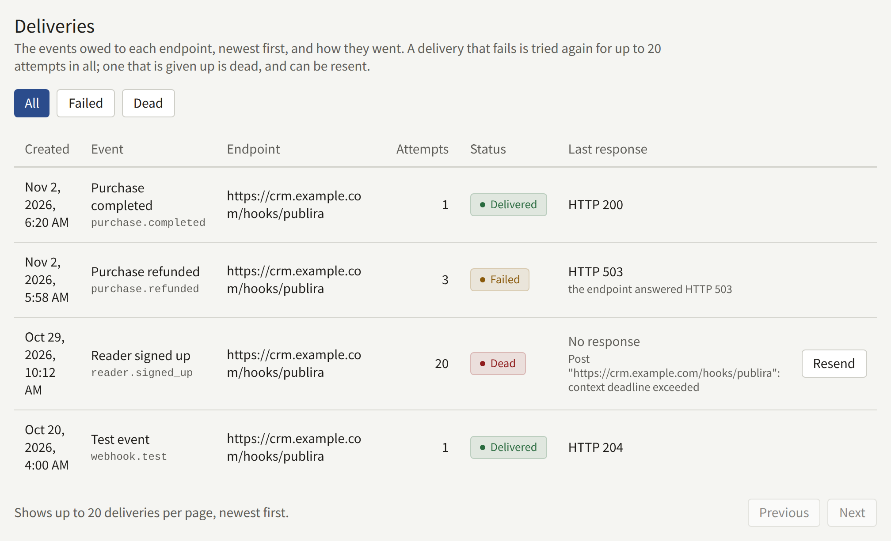

**Integrations** › **API keys and webhooks** connects the tenant to systems the publisher runs itself, such as a CRM, a data warehouse, or an accounting system. A system reads the tenant's catalog and purchases with an **API key**, and learns of a sale, a refund, a new reader, or a subscription as it happens from a **webhook endpoint**, a URL of its own that each event is sent to. **Deliveries** lists what was sent to each endpoint and what was given up.

Only a Tenant admin sees **API keys and webhooks**, and every change on it is recorded in **Audit logs**: **API key created**, **API key revoked**, **Webhook endpoint created**, **Webhook endpoint updated**, **Webhook endpoint deleted**, **Webhook signing secret rotated**, and **Webhook delivery resent**.

## API keys


A key reads the admin API for this tenant with nobody signed in. It reads only what its scopes name, and no key can change anything.

### Creating a key

1. Under **Create API key**, enter a **Name** that says what the key is for, such as the system it is handed to, of up to 100 characters.
2. Choose its **Scopes**, at least one of:

   | Scope | What the key reads |
   | --- | --- |
   | **Catalog** | Series, episodes, volumes, labels, genres, Authors, and Author roles |
   | **Purchases** | Purchases, the tenant's or one reader's, with the email address of each buyer |

   Choose only what the system needs: **Purchases** hands it every buyer's address.

3. Choose **Create API key**.

The key is shown once, under **Your new API key**, with a control that copies it. Copy it now and store it where the system that uses it can read it: only a hash of it is kept, so it cannot be shown again, and leaving or reloading the page takes it off the screen. A key that was not copied is revoked and replaced with a new one.

The list then shows the key by its **Prefix**, `pbk_` and the twelve characters after it, which is the start of the key the system holds, and **Last used**, to the minute.

### Making a request

A system sends the key as `Authorization: Bearer <key>` on the admin API, and names the tenant by the **Tenant ID** shown above the list, as in this request for the tenant's series:

```bash
curl <server>/rpc/publira.admin.v1.AdminSeriesService/ListSeries \
  -H "Authorization: Bearer pbk_…" \
  -H "Content-Type: application/json" \
  -d '{"tenant": {"tenantId": "<Tenant ID>"}}'
```

The edge in front of the install does not forward the admin API, so a key is used by a system that reaches `publira server` itself, on the network the web apps call it on. Ask the install's operator for that address.

The procedures and their fields are in the [admin API's definitions](https://github.com/publira/publira/tree/main/proto/publira/admin/v1). A key is answered:

- **`unauthenticated`** when it is revoked or unknown, or the request names another tenant.
- **`permission_denied`** on a procedure none of its scopes admits, every write included.
- **`resource_exhausted`**, with `Retry-After`, past the install's limit on requests made with a key: 600 a minute and 100,000 a day, unless the operator set another.

### Revoking a key

Choose **Revoke** beside the key, then **Revoke the key**. Every request made with it is refused from then on, and it stays in the list as **Revoked**. A revoked key cannot be used again.

To replace a key without a gap, create the new one, switch the system to it, and revoke the old one once **Last used** shows the old one has stopped being used.

## Webhook endpoints


An endpoint is an https URL of the publisher's own that is sent a signed `POST` for each event it subscribes to. A tenant keeps up to five, and each one is a form of its own.

### Adding an endpoint

Under **Add an endpoint**:

1. Enter its **URL**: `https`, with a host name, and without a user name, a password, or a fragment, of up to 2048 characters. An `http` URL is refused.
2. Choose the **Events** it is sent, at least one, as [Events](#events) describes.
3. Leave **Enabled** on to start sending at once.
4. Choose **Add the endpoint**.

The endpoint's signing secret is shown once, under **The endpoint's signing secret**. Copy it now and give it to the receiver, which checks the signature of each delivery with it, as [Verifying a delivery](#verifying-a-delivery) describes. Afterwards the endpoint shows only its hint under **Signing secret**: `whsec_`, a mask, and the secret's last four characters.

A delivery is never sent to a host that resolves to a private, loopback, link-local, or shared address, and never follows a redirect. Where the host resolves is checked at every delivery, so a URL that resolves somewhere else later is refused then.

### Changing, testing, and deleting an endpoint

- **Save the endpoint** saves the endpoint's own form: its URL, its events, and **Enabled**. An endpoint that is not enabled is sent nothing: the events that happen meanwhile are not owed to it, and a delivery still waiting when it was turned off is given up.
- **Send test event** sends the endpoint a `webhook.test` event, whether it is enabled or not and whatever it subscribes to. The test is listed under **Deliveries** with the others, which is how to check a new receiver before a real event reaches it.
- **Rotate secret**, then **Rotate the secret**, replaces the signing secret and shows the new one once, under **The new signing secret**. Every delivery is signed with the new secret from then on, the retries of earlier ones included, and a receiver that still checks with the old one refuses them. Update the receiver at once, and resend what it gave up meanwhile.
- **Delete**, then **Delete the endpoint**, deletes the endpoint and every delivery owed to it.

## Events

| Event | Sent when | `data` |
| --- | --- | --- |
| **Purchase completed** (`purchase.completed`) | A reader's purchase is recorded, whatever paid for it: a payment provider, an app store, the tenant's coins, or a promotion code that took the whole price off | The purchase |
| **Purchase refunded** (`purchase.refunded`) | A refund of a purchase is recorded, in part or in full. Each refund in part is an event of its own | The purchase as it stands after the refund |
| **Reader signed up** (`reader.signed_up`) | A reader's account is opened, with an address and a password or by signing in with Apple or Google | The reader |
| **Subscription started** (`subscription.started`) | A subscription starts to be billed | The subscription |
| **Subscription ended** (`subscription.ended`) | A subscription stops being billed | The subscription |
| **Test event** (`webhook.test`) | **Send test event** is chosen | Empty |

### The body

Every delivery is a JSON object:

```json
{
  "id": "evt_…",
  "type": "purchase.completed",
  "created_at": "2026-11-02T06:20:00Z",
  "tenant_id": "<the tenant's public ID>",
  "data": {}
}
```

`id` is the event's ID. It is the same for every endpoint the event goes to and for every attempt, so a receiver keeps it and drops an event it has already handled: an event can arrive more than once, when the answer to an earlier attempt was lost. `type` is the event's name above, and `created_at` is when it happened.

`data` names records by the IDs the admin API answers them by, never by an ID of the database's own:

| Object | Fields |
| --- | --- |
| The purchase | `purchase_id`, which `GetPurchase` takes; `kind`: `purchase`, `rental`, or `tip`; `item`: `episode`, `volume`, `series_bundle`, or `coin_pack`, with `series_public_id`, `episode_public_id`, and `volume_public_id` where they apply; `reader_public_id` and `reader_email`, both empty once the reader has deleted their account; `price`, what the reader paid, and `list_price`, before a promotion code's discount, both in the currency's minor unit, with `currency`; `refunded_amount`; `purchased_at`, `expires_at`, and `refunded_at`; `provider`, the payment provider or `coins`, and `store`, `app_store` or `google_play`, both empty for a purchase a promotion code granted; and `test` |
| The reader | `reader_public_id`, `email`, `name`, `email_verified`, false until the reader confirms the address, and `signed_up_at` |
| The subscription | `plan_public_id` and `plan_name`; `reader_public_id` and `reader_email`, both empty once the reader has deleted their account; `provider`: `stripe`, `app_store`, or `google_play`; `status`; `current_period_end` and `cancel_at_period_end`; `started_at`; and `test` |

Every delivery also carries these headers:

| Header                | Value                                               |
| --------------------- | --------------------------------------------------- |
| `X-Publira-Event`     | The event's name                                    |
| `X-Publira-Delivery`  | The delivery's ID, the same for every attempt of it |
| `X-Publira-Signature` | The signature, as below                             |
| `Content-Type`        | `application/json`                                  |
| `User-Agent`          | `Publira-Webhooks/` and the install's version       |

## Verifying a delivery

`X-Publira-Signature` is `t=<unix seconds>,v1=<hex>`, where the hex is the HMAC-SHA256, under the endpoint's signing secret, of the timestamp, a full stop, and the body exactly as it was received. A receiver recomputes it and refuses a delivery whose signature differs, or whose timestamp is more than a few minutes from its own clock, which a replayed one's is:

```js
import { createHmac, timingSafeEqual } from "node:crypto";

// body is the raw request body, before any JSON parsing.
const verify = (secret, header, body, toleranceSeconds = 300) => {
  const parts = new Map(header.split(",").map((part) => part.split("=")));
  const timestamp = Number(parts.get("t"));
  const signature = Buffer.from(parts.get("v1") ?? "", "hex");
  const expected = createHmac("sha256", secret)
    .update(`${timestamp}.${body}`)
    .digest();

  return (
    Math.abs(Date.now() / 1000 - timestamp) <= toleranceSeconds &&
    signature.length === expected.length &&
    timingSafeEqual(signature, expected)
  );
};
```

Answer a delivery the receiver has accepted with a `2xx` status, and do the work it asks for afterwards: an answer that takes longer than ten seconds counts as no answer.

## Retries and resending



How a delivery goes depends on the endpoint's answer:

- **`2xx`**: it is **Delivered**.
- **Any other `4xx` but `408` and `429`**: the receiver will not take it however often it is sent, and it is given up at once.
- **Anything else**, `3xx`, `408`, `429`, and `5xx` included, a timeout, or no answer: it is **Failed** and tried again, waiting twice as long after each attempt, from a second up to an hour. After 20 attempts in all, about eight hours after the first, it is given up.

A delivery given up is **Dead**. **Deliveries** lists every delivery, newest first, and **Failed** and **Dead** narrow the list to those: each with when it was created, the event, the endpoint, how many attempts were made, its status, and the endpoint's last answer or why there was none.

**Resend** beside a dead delivery sends it again, with the same body and event ID, and with 20 attempts of its own. Its **Attempts** keep counting from where they were. Fix what made the receiver refuse it first, or the resend is given up the same way.
