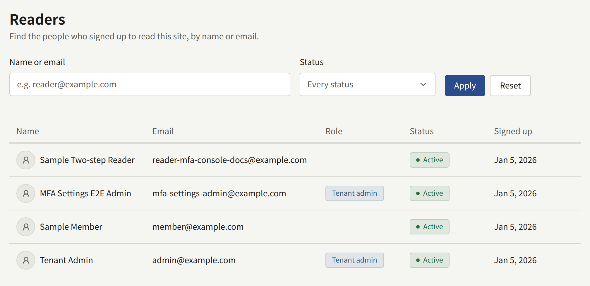
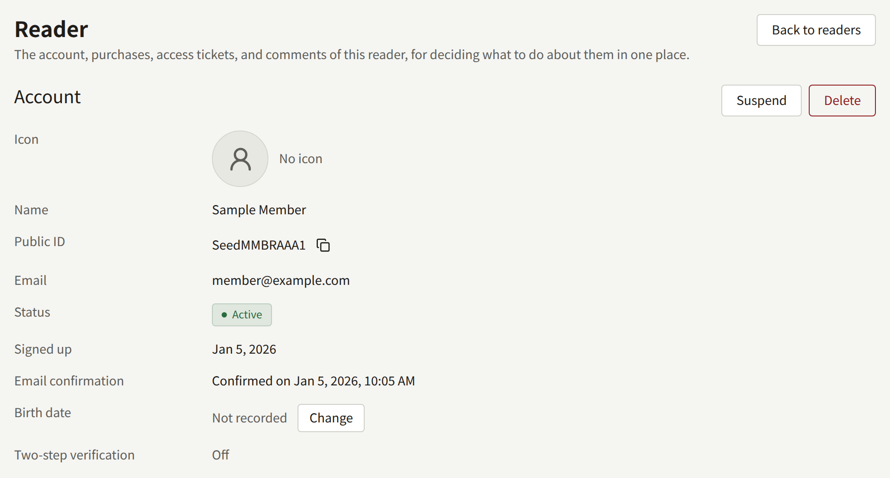
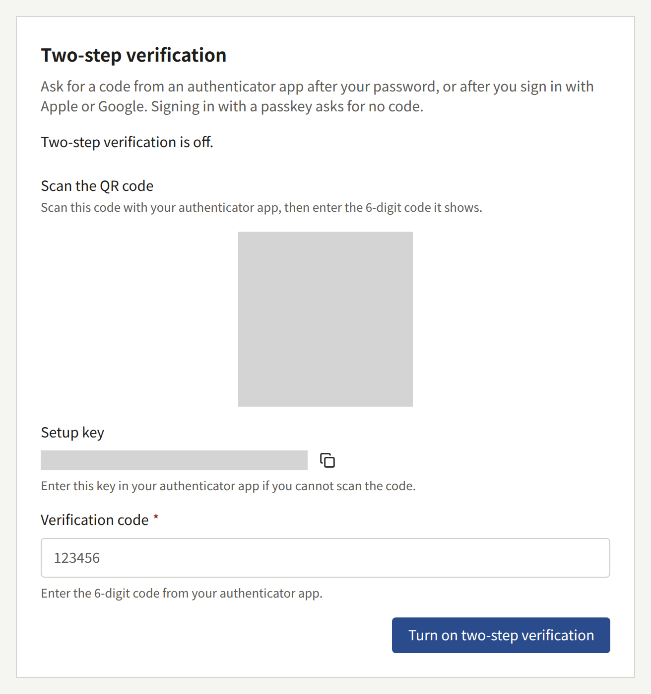
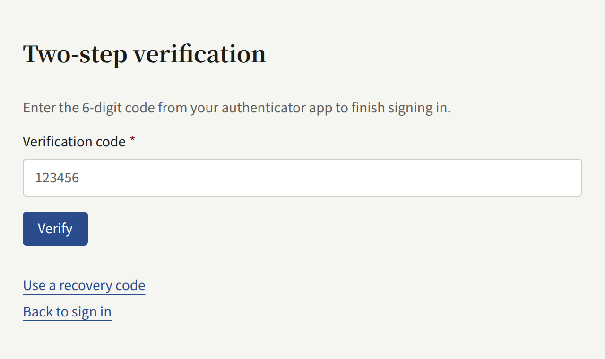

**Readers** lists every account on the tenant's site, newest sign-up first, twenty to a page. That includes the staff, since a console account is also an account on the site: **Role** shows the highest role a member of the staff holds, and is empty for a reader. Only a Tenant admin sees it.

To find someone, type part of their name or email address into **Name or email** and choose **Apply**. The search matches anywhere in either one and ignores case, so `tanaka` finds `Tanaka Hanako` and `h.tanaka@example.com`. **Status** narrows the list to one status:

| Status | What it means |
| --- | --- |
| **Active** | The account can sign in |
| **Inactive** | The reader signed up and has not confirmed their email address yet. They cannot sign in until they do |
| **Suspended** | A Tenant admin suspended the account. It cannot sign in until the suspension is lifted |

Each row starts with the icon the reader chose for their account, or a plain outline for one who has not chosen any; **Comments** shows the commenter's the same way. A reader's name in the list opens their page. So does the commenter's name on **Comments**, for a Tenant admin, and the sender of a contact message who was signed in when they wrote.

## The reader page

**Account** shows the reader's **Icon**, their name, their **Public ID** with a button to copy it, their email address, their status, when they signed up, whether and when they confirmed their email address, and their **Birth date**.

Below it, three sections list what the reader has, newest first, twenty to a page:

| Section | What it lists |
| --- | --- |
| **Purchases** | Everything they bought, with the episode, volume, rest of a series, or pack of coins it was for, the amount, what they paid through, and whether it still opens what it bought. The title opens what was bought, and **View** opens the purchase on **Purchases**, where it can be refunded |
| **Access tickets** | The tickets the staff issued to them, with the episode and the ticket's status. **Revoke** and **Issue a ticket** work as on [Access tickets](./4-access-tickets.md), without leaving the page |
| **Comments** | Everything they have written, including the comments they deleted themselves until those are purged, with the same actions as on [Comments](./2-comments.md) |

## Correcting a date of birth

A reader cannot change their date of birth once it is saved, so a reader who entered it wrongly has to ask the site, and the age checks set under [Age verification](../3-setup/1-settings.md#age-verification) follow whatever is saved. To correct it, choose **Change** beside **Birth date**, enter the date, and choose **Save**. Leave the date empty to clear it, after which the reader is asked for it again on an age-gated series. The new date applies from the reader's next read.

## Removing a reader's icon

A reader's icon shows beside their comments to everyone who reads the site, so one that breaks the site's rules is taken down from here. Choose **Remove icon** beside **Icon** and confirm with **Remove**. The image stops showing on the site and in the console at once, and the account shows the plain outline in its place. The reader can choose another icon afterwards, as they could after removing their own.

**Remove icon** is offered only while the account shows an icon.

Whether readers may upload an icon, pick one of the tenant's own, or show none at all is set under **Settings**, as [Reader icons](../3-setup/1-settings.md#reader-icons) describes.

## Suspending a reader

**Suspend** signs the reader out on every device and refuses their sign-in, with a password or with Apple or Google, until the suspension is lifted. Nothing else about the account changes: their published comments stay on the site, and their purchases and access tickets stay theirs, unusable only while they cannot sign in.

**Lift suspension**, on the same page, returns the account to **Active**, or to **Inactive** if its email address was never confirmed. The reader signs in again; the sessions the suspension ended stay ended. To find a suspended reader, set **Status** to **Suspended**.

## A reader's two-step verification

A reader can ask to be asked for a code from an authenticator app as well as their password, from **Two-step verification** under **Security** in the site's **Account settings**. **Turn on** shows a QR code to scan and the same key to type in by hand, and the reader turns it on with the 6-digit code their app then shows. The site then shows ten recovery codes, once, with a button to copy them: each one signs the reader in once when their app is not at hand. **Regenerate recovery codes** replaces all ten, used or not, with a code from the app. **Turn off** asks for the reader's password and a code from the app or a recovery code; a reader without a password confirms with one of their passkeys, or by signing in again with Apple or Google, instead of the password.

Once it is on, signing in with the password, or with Apple or Google, stops at a code before the reader is signed in, and then goes on to where they were heading. **Use a recovery code** takes one of the recovery codes instead. Signing in with a passkey asks for no code, since the passkey is already a second factor. After five wrong codes in a row, every code is refused for fifteen minutes.

An account has one second factor wherever it signs in. A member of the staff who set up an authenticator in the console is asked for its code on the site too, and one set up on the site is asked for when the same account signs in to the console. A member of the staff who has a passkey for the console sets the authenticator up from **Account settings** in the console rather than on the site, and the site says so.

Two-step verification is never required of readers: the requirement the operator can set covers Tenant admins alone, as [Two-step verification](../../3-operations/12-security/2-two-step-verification.md) describes.

## A reader's download of their data

A reader can download a copy of everything the site keeps about them, from **Account settings** on the site or the account screen in the app, so a request to see the data the site holds about them, under the APPI or the GDPR, is answered without anyone on the staff collecting it by hand. The staff cannot ask for it on a reader's behalf: point a reader who writes in at their account settings.

Once the reader asks, the copy is prepared within a minute or so. They are told it is ready in their notifications on the site and by email, whatever their notification settings say, and download it from the same place, as often as they like, for seven days. After that it is deleted, and they can ask again. A reader can ask once a day unless the operator allows more, as [Platform policies](../../3-operations/9-platform-policies.md) describes, and not while an earlier request is still being prepared. The copy is kept in the install's object storage, so a reader cannot ask for one while the operator has none set up.

The copy is a ZIP file with one JSON file for each kind of record, and the purchase history CSV the reader can already download beside them:

| File | What it holds |
| --- | --- |
| `account.json` | Their name, email address, status, date of birth, and when they signed up and confirmed their address |
| `sign_in_methods.json` | Whether the account has a password and a second factor, the Apple and Google accounts linked to it, and its passkeys |
| `follows.json` | The series, episodes, and Authors they follow |
| `reading_positions.json`, `reading_history.json` | Where they stopped in each episode, and every episode they read |
| `ratings.json` | The ratings they gave episodes |
| `comments.json`, `comment_reports.json` | Every comment they wrote, in whatever state it is now, and the comments they reported |
| `purchases.json`, `purchases.csv` | Everything they bought |
| `coin_transactions.json` | The coins they were granted and spent |
| `subscriptions.json` | Their subscriptions, on the site and in the app |
| `preferences.json` | Their notification settings and viewer preferences, if they ever saved any |
| `legal_page_consents.json` | Each version of the terms of service and the privacy policy they agreed to |
| `access_tickets.json` | The access tickets the staff issued to them |
| `contact_messages.json` | The contact messages they sent while signed in, with the replies on each |

It leaves out what is the staff's rather than the reader's: the notes staff keep on an access ticket or a contact message, which member of the staff approved, hid, or handled something, and the IDs the payment providers and stores keep the tenant's records under. It holds no password or second-factor secret either, which the site does not keep in a form anyone could read.

## Deleting a reader

**Delete** deletes the account exactly as if the reader had closed it themselves, and cannot be undone:

| What the reader had | What happens to it |
| --- | --- |
| Comments, and the reports they filed | Deleted |
| Purchases | Kept without the buyer, so sales and royalties do not change |
| Subscriptions to a plan | Canceled at once on the tenant's Stripe account, so the reader is not billed again. The period they already paid for is not refunded. A subscription the reader bought in the app is billed by the App Store or Google Play, where only the reader can cancel it: it is kept without the subscriber, and the reader cancels it in the store |
| Access tickets, follows, reading history, ratings, notifications, and linked Apple and Google sign-ins | Deleted |
| Contact messages | Kept, shown as from **Guest** |
| Roles on the staff | Removed |
| A copy of their data they asked for | Deleted within the hour |

Suspend rather than delete when you may want to undo it.

You cannot suspend or delete the account you are signed in with, nor the tenant's last active Tenant admin: make someone else a Tenant admin first. Suspending, lifting a suspension, deleting, changing or clearing a date of birth, and removing an icon are recorded in the [audit log](../3-setup/8-audit-log.md) as **Reader suspended**, **Reader suspension lifted**, **Reader deleted**, **Reader birth date changed**, **Reader birth date cleared**, and **Reader icon removed**.
