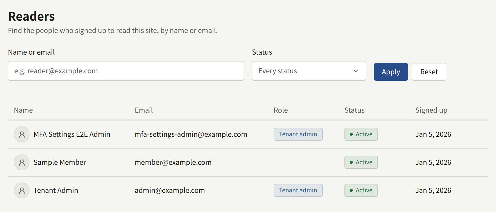
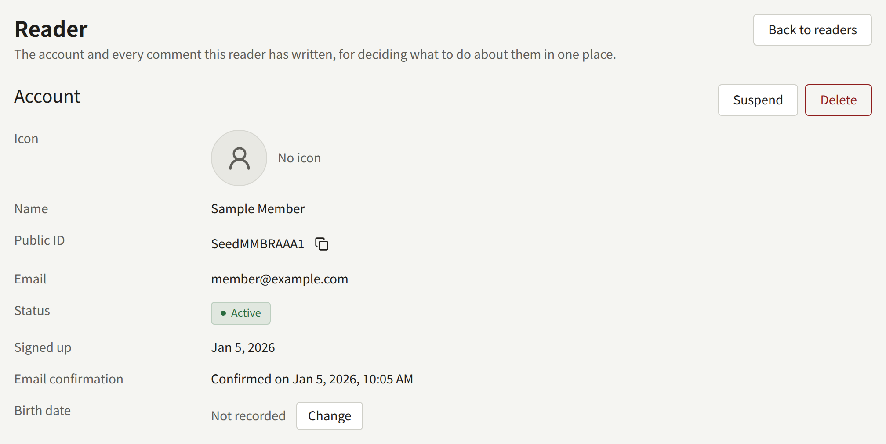

**Readers** lists every account on the tenant's site, newest sign-up first, twenty to a page. That includes the staff, since a console account is also an account on the site: **Role** shows the highest role a member of the staff holds, and is empty for a reader. Only a Tenant admin sees it.

To find someone, type part of their name or email address into **Name or email** and choose **Apply**. The search matches anywhere in either one and ignores case, so `tanaka` finds `Tanaka Hanako` and `h.tanaka@example.com`. **Status** narrows the list to one status:

| Status | What it means |
| --- | --- |
| **Active** | The account can sign in |
| **Inactive** | The reader signed up and has not confirmed their email address yet. They cannot sign in until they do |
| **Suspended** | A Tenant admin suspended the account. It cannot sign in until the suspension is lifted |

Each row starts with the icon the reader chose for their account, or a plain outline for one who has not chosen any; **Comments** shows the commenter's the same way. A reader's name in the list opens their page. So does the commenter's name on **Comments**, for a Tenant admin, and the sender of a contact message who was signed in when they wrote.

## The reader page

**Account** shows the reader's **Icon**, their name, their **Public ID** with a button to copy it, their email address, their status, when they signed up, whether and when they confirmed their email address, and their **Birth date**.

Below it, three sections list what the reader has, newest first, twenty to a page:

| Section | What it lists |
| --- | --- |
| **Purchases** | Everything they bought, with the episode, volume, rest of a series, or pack of coins it was for, the amount, what they paid through, and whether it still opens what it bought. The title opens what was bought, and **View** opens the purchase on **Purchases**, where it can be refunded |
| **Access tickets** | The tickets the staff issued to them, with the episode and the ticket's status. **Revoke** and **Issue a ticket** work as on [Access tickets](./4-access-tickets.md), without leaving the page |
| **Comments** | Everything they have written, including the comments they deleted themselves until those are purged, with the same actions as on [Comments](./2-comments.md) |

## Correcting a date of birth

A reader cannot change their date of birth once it is saved, so a reader who entered it wrongly has to ask the site, and the age checks set under [Age verification](../3-setup/1-settings.md#age-verification) follow whatever is saved. To correct it, choose **Change** beside **Birth date**, enter the date, and choose **Save**. Leave the date empty to clear it, after which the reader is asked for it again on an age-gated series. The new date applies from the reader's next read.

## Removing a reader's icon

A reader's icon shows beside their comments to everyone who reads the site, so one that breaks the site's rules is taken down from here. Choose **Remove icon** beside **Icon** and confirm with **Remove**. The image stops showing on the site and in the console at once, and the account shows the plain outline in its place. The reader can choose another icon afterwards, as they could after removing their own.

**Remove icon** is offered only while the account shows an icon.

Whether readers may upload an icon, pick one of the tenant's own, or show none at all is set under **Settings**, as [Reader icons](../3-setup/1-settings.md#reader-icons) describes.

## Suspending a reader

**Suspend** signs the reader out on every device and refuses their sign-in, with a password or with Apple or Google, until the suspension is lifted. Nothing else about the account changes: their published comments stay on the site, and their purchases and access tickets stay theirs, unusable only while they cannot sign in.

**Lift suspension**, on the same page, returns the account to **Active**, or to **Inactive** if its email address was never confirmed. The reader signs in again; the sessions the suspension ended stay ended. To find a suspended reader, set **Status** to **Suspended**.

## Deleting a reader

**Delete** deletes the account exactly as if the reader had closed it themselves, and cannot be undone:

| What the reader had | What happens to it |
| --- | --- |
| Comments, and the reports they filed | Deleted |
| Purchases | Kept without the buyer, so sales and royalties do not change |
| Subscriptions to a plan | Canceled at once on the tenant's Stripe account, so the reader is not billed again. The period they already paid for is not refunded |
| Access tickets, follows, reading history, ratings, notifications, and linked Apple and Google sign-ins | Deleted |
| Contact messages | Kept, shown as from **Guest** |
| Roles on the staff | Removed |

Suspend rather than delete when you may want to undo it.

You cannot suspend or delete the account you are signed in with, nor the tenant's last active Tenant admin: make someone else a Tenant admin first. Suspending, lifting a suspension, deleting, changing or clearing a date of birth, and removing an icon are recorded in the [audit log](../3-setup/8-audit-log.md) as **Reader suspended**, **Reader suspension lifted**, **Reader deleted**, **Reader birth date changed**, **Reader birth date cleared**, and **Reader icon removed**.
