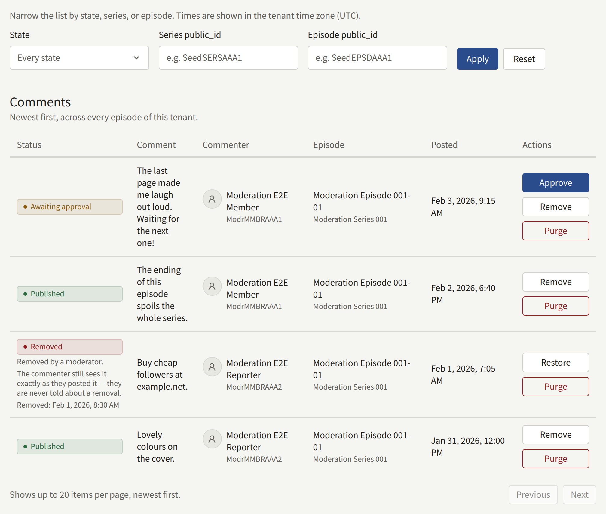
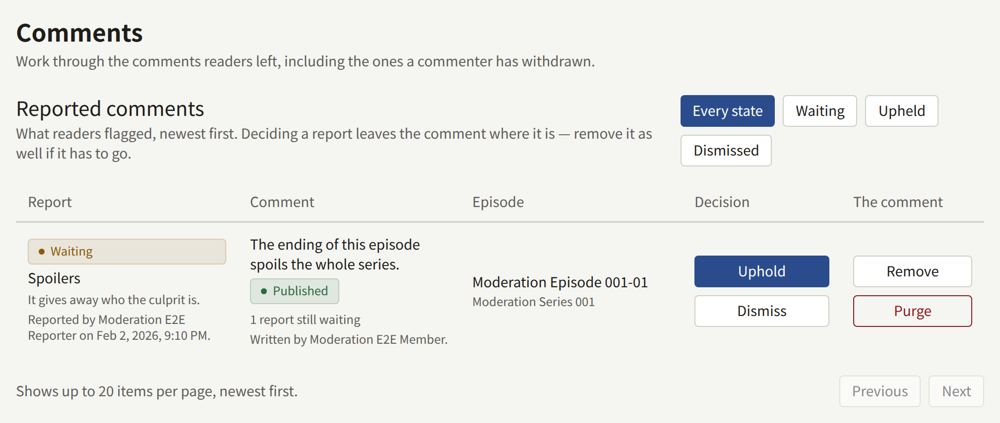

Readers can comment on an episode only when comments are turned on, under **Settings** › **Reader comments** for the whole tenant, or on a series' form for that series. [Reader comments](../3-setup/1-settings.md#reader-comments) explains the three choices, **Do not accept comments**, **Publish straight away**, and **Publish after approval**, and the number of reports that removes a comment on its own.

Only signed-in readers comment, up to 1000 characters each. A comment belongs to an episode; there are no replies or threads, so acting on one comment touches no other.

**Comments** shows two lists: **Reported comments** first, then every comment on the tenant's episodes, newest first. An Auditor sees both without the actions.

## What a comment's state means

| State | Who sees the comment |
| --- | --- |
| **Awaiting approval** | Only its commenter, marked **Awaiting approval** |
| **Published** | Everyone |
| **Removed** | Only its commenter, who sees it as they posted it |
| **Deleted by the commenter** | Nobody on the site, its commenter included. Staff see it here until it is purged |

## What each action does

| Action | Offered on | What it does |
| --- | --- | --- |
| **Approve** | **Awaiting approval** | Publishes the comment, and notifies its commenter that their comment is now public |
| **Remove** | **Awaiting approval**, **Published** | Takes the comment off the site for everyone but its commenter. A **Reason (optional)** goes into the audit log |
| **Restore** | **Removed** | Puts the comment back as it was: published again if it had been published, otherwise back to **Awaiting approval**. Every report still waiting on it is dismissed |
| **Purge** | Any state | Deletes the comment and its reports for good. A **Reason** is required, since the audit log entry is all that remains of the comment |

A removed comment's commenter is never told, whether a moderator or readers' reports removed it. They keep seeing the comment as they posted it, so someone posting to disrupt the comments gets nothing that prompts them to post again.

If another moderator acted on the same comment after you loaded the list, your action is refused with "Another moderator already handled this comment. Reload the list to see its current state."

## Working the approval queue

While any comment awaits approval, **Comments** in the menu carries the number of them. Every member of the staff also gets a notification in the console, "Comments are waiting for approval", at most once an hour for each episode; it opens the list filtered to that episode's comments awaiting approval.

1. Open **Comments**, set **State** to **Awaiting approval**, and choose **Apply**.
2. Read each comment, and choose **Approve** to publish it or **Remove** to keep it off the site.
3. Work through the pages until the list is empty.

Nobody but the commenter sees a comment until it is approved, so a queue left unworked is a comment section that stays empty. A comment removed from the queue keeps showing to its commenter as **Awaiting approval**.

## Reported comments

A signed-in reader can report a published comment that is not their own, choosing **Spam or advertising**, **Abuse or harassment**, **Spoilers**, or **Something else**, with an optional note. Each reader reports a comment once; reporting it again changes nothing. The commenter is not told.

When the reports waiting on a comment reach **Reports that remove a comment**, it is removed on its own, without waiting for staff, and its commenter is not told. It then reads "Removed automatically once the reports passed the threshold.", and the audit log records **Comment removed automatically after reports** with **Automatic** as the actor. Every member of the staff gets a console notification, "Comments were reported", at most once an hour for each episode.

**Reported comments** lists one row for each report, newest first, with its reason, note, reporter, the comment, and its commenter. A report is **Waiting** until it is decided:

- **Uphold** records that the report was right. It leaves the comment where it is: to take a published comment down, choose **Remove** as well.
- **Dismiss** records that the report was wrong. It does not put back a comment that was removed automatically: choose **Restore** for that.

To work the queue, set it to **Waiting**, then for each comment decide whether it stays. If it goes, **Remove** it and **Uphold** its reports. If it stays, **Restore** it if it was removed, which dismisses all of its waiting reports at once, or **Dismiss** each report if it was not. Deciding a report lowers the count toward the automatic removal, so dismissed reports do not carry a comment over the threshold later.

## Withdrawn comments

A reader can delete their own comment at any time. It leaves the site at once, for everyone including them, and cannot be restored by staff. **Comments** keeps showing it as **Deleted by the commenter**, with when they deleted it and when it will be purged, so that staff can still read a comment someone reported or complained about after its commenter took it down. Reports on it stay in the queue and can still be decided.

Withdrawn comments are purged, with their reports, once they have been withdrawn for the period set under **Settings** › **Limits and retention** › **Retention periods** › **Withdrawn comments**. `publira worker` purges them every hour; the row says "Purged for good in" so many days, and the date, counting from the period as it is set now. Choose **Purge** to delete one sooner. A removed comment is never purged on its own: it stays until a moderator purges it.

## Finding comments

The comment list narrows by **State**, **Series public_id**, and **Episode public_id**. A public ID is the last part of the console's address for the series or the episode, as in `/series/<series public ID>/episodes/<episode public ID>`, and the **Episode** of each comment links there. An ID that matches nothing shows an empty list.

A comment from an account linked to an Author credited on the episode carries an **Author** badge, on the site and here. It changes nothing about how the comment is moderated.

Approving, removing, restoring, and purging comments, and upholding and dismissing reports, are recorded in the audit log, with the reason you gave.
