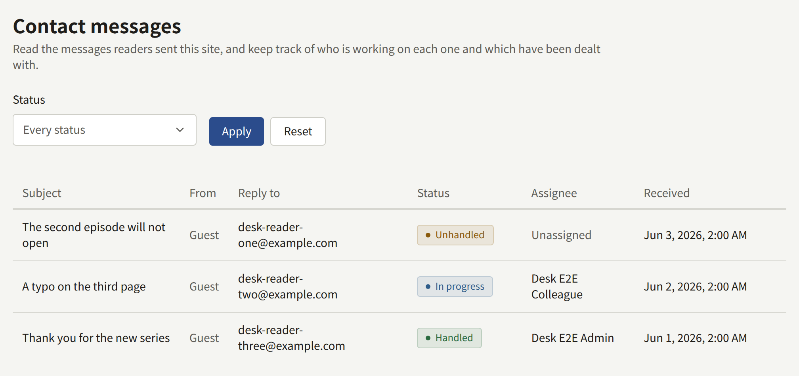
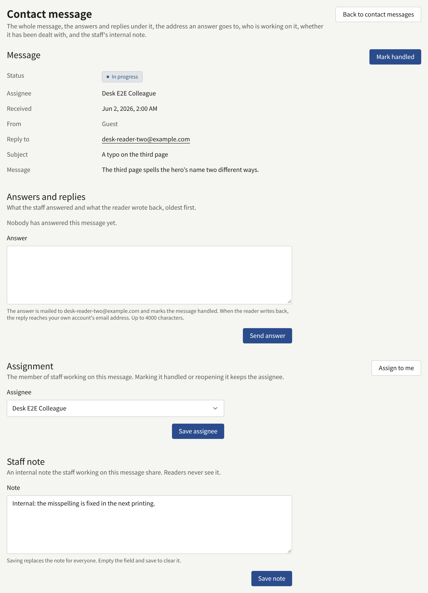

Readers write to the site from **Contact**, linked at the foot of every page of the site and in the app, signed in or not. They give the email address an answer should go to, an optional subject of up to 200 characters, and a message of up to 4000. A signed-in reader's address is filled in for them and can be changed.

A new message is mailed to every active Tenant admin at their account's address, with the reader's address, the subject, and the whole message. Editors and Auditors are not mailed, since they cannot open **Contact messages**, and neither is a suspended account. A tenant with no active Tenant admin sends the mail to nobody; the message still waits in **Contact messages**. The console itself shows no count or notification for a new message, so check **Contact messages** or keep an eye on that mail.

**Contact messages** lists the messages newest first, twenty to a page, with **Subject**, **From**, **Reply to**, **Status**, **Assignee**, and **Received**. **From** names the reader's account when they were signed in, and reads **Guest** otherwise. **Status** follows from the message, and is never set by hand:

| Status          | When                                        |
| --------------- | ------------------------------------------- |
| **Unhandled**   | Not handled, and nobody is assigned         |
| **In progress** | Not handled, and a Tenant admin is assigned |
| **Handled**     | Marked handled, or answered                 |

## Answering a message

1. Open the message from **Contact messages**.
2. Under **Assignment**, choose **Assign to me**, or pick a Tenant admin and choose **Save assignee**, so the others know it is being dealt with. Only Tenant admins can be assigned.
3. Write the answer under **Answer**, up to 4000 characters, and choose **Send answer**.

The answer is saved under **Answers and replies**, the message becomes **Handled**, and `publira worker` mails the answer to the message's **Reply to** address:

- through the mail server set up under [Email](../3-setup/7-email.md), from its address, or through the platform's until the tenant has one of its own;
- with the subject "Re:" and the reader's subject, or "Re: Your message to" the site when they gave none;
- with the reader's message quoted under the answer;
- in the tenant's default language, whatever language the reader wrote in.

The console does not show whether the mail was delivered. If the mail settings are wrong, the answer stays saved and the message **Handled** while the mail is never sent, so when the tenant sends through its own server, check it with **Test the connection** under **Outgoing email** before answering readers. Answers to one address are limited in number per hour and per day, like all mail the console sends.

## When the reader writes back

Where a reader's reply goes depends on whether the **Inbound email** section of **Integrations** › **Email** is **Ready**, which [Readers' replies to contact messages](../3-setup/7-email.md#readers-replies-to-contact-messages) walks through setting up:

- **Until it is Ready**, the answer's reply address is your own account's email address. The reader's reply arrives in your own mailbox. It is not recorded in the console, and the message stays **Handled**: answer from your mail, or from the console again.
- **Once it is Ready**, the reply address is one of the site's own, made for that message. The reader's reply is recorded under **Answers and replies** as "Reply from" their address, the message is reopened, and the Tenant admins are mailed as for a new message.

The hint under **Answer** says which of the two applies to the tenant.

## Keeping track

- **Staff note** is one note the Tenant admins share about the message, up to 4000 characters. Readers never see it. Saving replaces it for everyone, and saving it empty clears it.
- **Mark handled** marks a message dealt with without answering it, such as spam. **Reopen** returns it to **In progress** or **Unhandled**. Neither changes the assignee.

Messages are never deleted: there is no retention period for them. A message from a reader who later deletes their account is kept, and shows as from **Guest**. Marking handled, reopening, assigning, editing the note, and answering are recorded in the audit log; the text of an answer is not.
