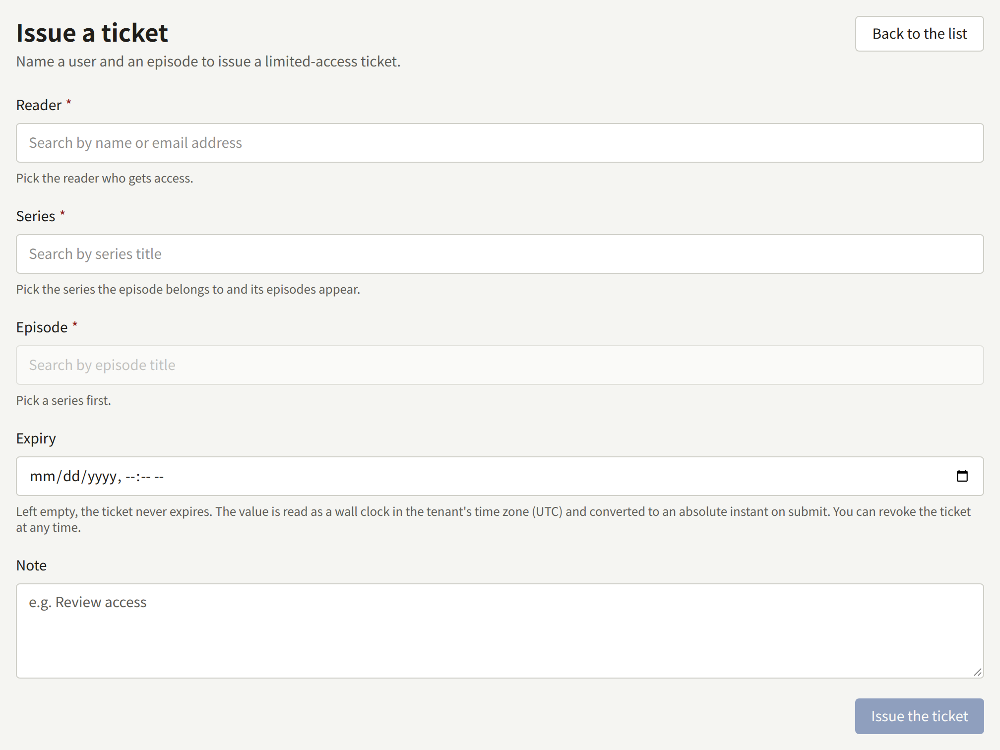
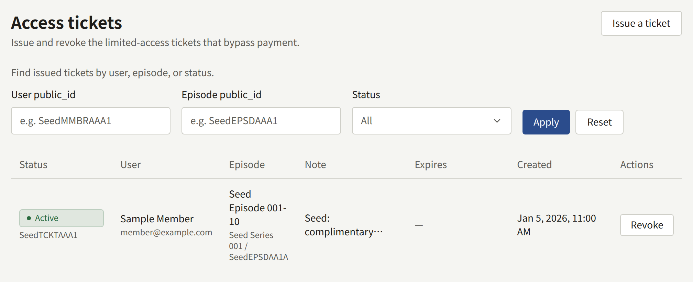

An access ticket opens one episode to one reader without payment, on the site and in the app, until it expires or is revoked. Use one where the reader should read without buying: a reviewer or a member of the press, a prize, or a reader whose purchase went wrong and who should not have to wait for a refund and a new purchase. Only a Tenant admin sees **Access tickets**.

A ticket is not a sale. It earns no Author a royalty, and the episode does not appear under the reader's **Purchases**. It does not lift age checks: a reader too young for the series stays out with a ticket. It opens only a published episode, and does nothing for a free one. The reader is not told that they have one, so tell them yourself.

## Issuing a ticket

1. Open **Access tickets** and choose **Issue a ticket**.
2. Under **Reader**, type part of the reader's name or email address and pick them. Only **Active** readers are offered.
3. Pick the **Series**, then the **Episode**.
4. Optionally, set **Expiry**, in the tenant's time zone. Left empty, the ticket never expires.
5. Optionally, write a **Note**, up to 1000 characters, such as why the ticket was issued.
6. Choose **Issue the ticket**.

To issue a ticket to a reader whose page you have open, choose **Issue a ticket** under **Access tickets** on [their page](./1-accounts.md#the-reader-page). The same form opens over the page without **Reader**, and the ticket appears in the page's list once it is issued.

A reader and an episode have one ticket from the staff at a time:

- If they already have an active one, nothing new is issued, and the existing ticket keeps its expiry and note. The console says so and names that ticket. To change a ticket's expiry or note, revoke it from the list and issue a new one.
- If they have an expired one, the console asks you to revoke it from the list first.

## Revoking a ticket

**Revoke**, on an active ticket in the list or on the reader's page, closes the episode to the reader at once. It cannot be undone: issue a new ticket to give them access again. A revoked ticket stays in the list as **Revoked**, with when it was revoked.

## Reading the list

The list holds the tickets the staff issued, and only those. The tickets readers take themselves through [**Free if you wait**](../4-selling-episodes.md#free-reading-periods-and-free-if-you-wait) are not in it and cannot be revoked here: each is a free read the reader was entitled to by the series' rule, not something the staff gave out, and a staff ticket for the same reader and episode is issued beside it rather than replacing it.

The list shows each ticket's **Status**, **User**, **Episode**, **Note**, **Expires**, and **Created**, newest first, twenty to a page. **Status** is **Active**, **Expired**, or **Revoked**, and the filter's **Active only** leaves out both the expired and the revoked. **User public_id** and **Episode public_id** take a whole public ID, copied from the reader's page or the episode's address in the console; part of an ID or a name finds nothing.

Issuing and revoking are recorded in the audit log as **Access ticket issued** and **Access ticket revoked**.
