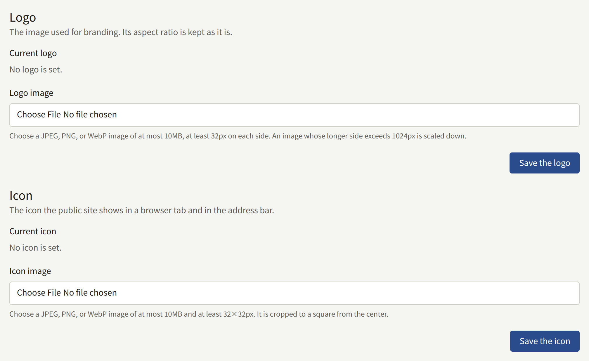
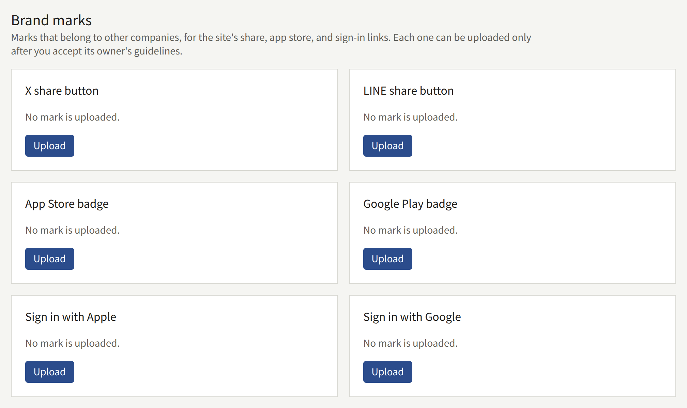
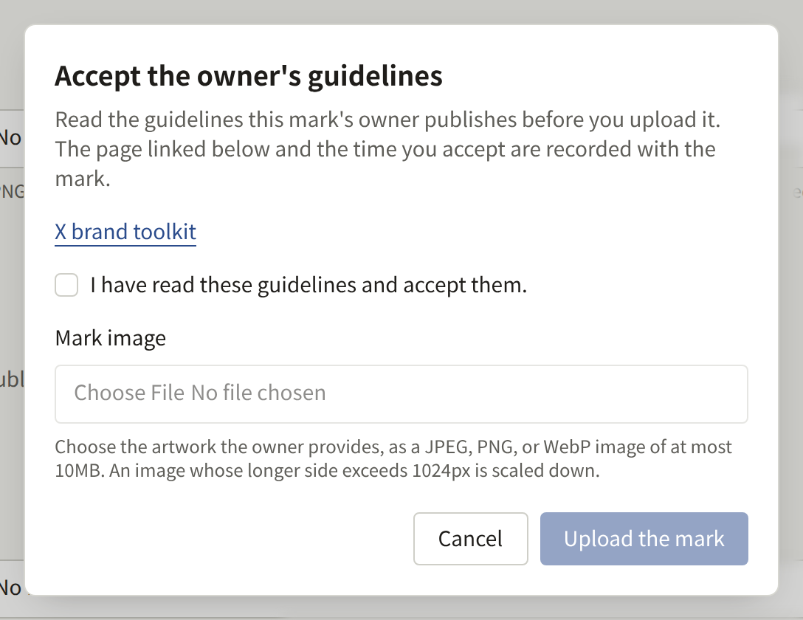
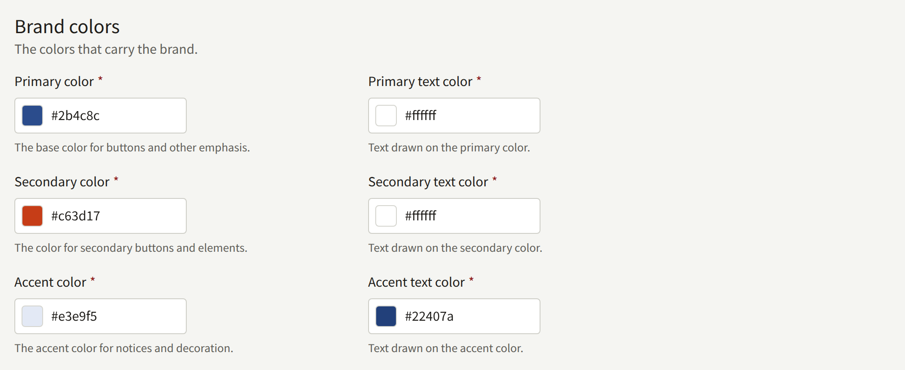
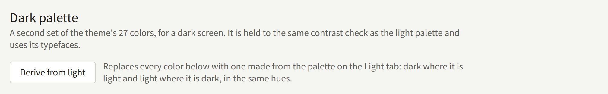
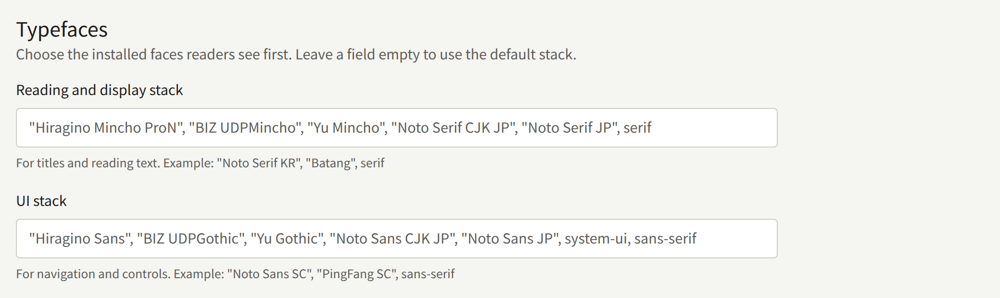
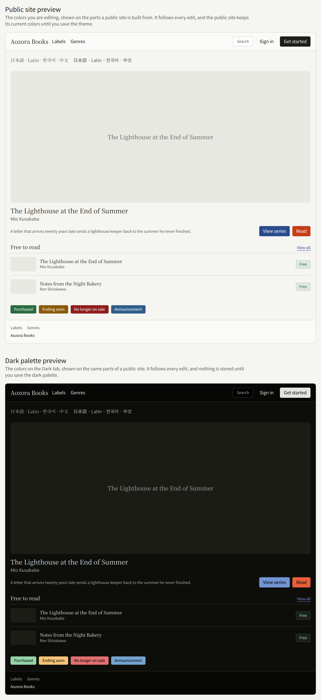

**Branding**, under **Administration**, decides how the site looks: the logo in its header, the icon in the browser's tab, the image beside its sign-in form, the marks of other companies, its colors, and the faces its text is set in. The screen has **Logo**, **Icon**, **Sign-in image**, **Brand marks**, and the theme's colors and typefaces, with a dark palette beside them. Each is saved on its own, and saving one leaves the others as they are.

Only a Tenant admin can change branding. Editors and Auditors see the same screen with its controls turned off.

## Logo, icon, and sign-in image

All three take a JPEG, PNG, or WebP image of at most 10MB. The logo and the icon are stored as PNG, so a transparent background stays transparent. The sign-in image keeps a JPEG as JPEG and stores anything else as PNG.

|  | **Logo** | **Icon** | **Sign-in image** |
| --- | --- | --- | --- |
| Where it appears | In place of the site's name at the top of every page of the site and of this console. The tenant's app shows it in place of the name on its catalog screen | In the browser's tab and address bar, and as the icon a phone uses when a reader adds the site to their home screen | Beside the form on the site's sign-in and sign-up screens, on a screen at least 1024px wide. A narrower screen shows the form alone. The tenant's app shows it on its sign-in screen: beside the form on a screen at least 840px wide, and above it on a narrower one |
| Shape | Kept as it is | Cropped to a square from the center | Kept as it is. The site and the app crop it to fill the space beside or above the form, whose shape changes with the window |
| Size | An image wider or taller than 1024px is scaled down, and must still be at least 32px on each side afterwards | At least 32×32px. An image larger than 512×512px is scaled down | An image wider or taller than 2560px is scaled down, and its shorter side must still be at least 512px afterwards |
| Without one | The site shows the tenant's name | The browser shows its default icon | The space for it is filled with the theme's colors, on the site and in the app |

Choose the file under **Logo image**, **Icon image**, or **Sign-in image file**, then **Save the logo**, **Save the icon**, or **Save the sign-in image**. Saving again replaces the image. **Delete** removes it after you confirm.

Give the icon a square image with the mark in its middle, since anything outside the central square is cut off. Give the logo an image with little empty space around the mark. The site's header shows it 32px tall and at most 144px wide, so a logo more than four and a half times as wide as it is tall is shown shorter than that.

Give the sign-in image a picture that still works with its edges cut away: keep what matters near its middle, and put no text in it that a reader has to read. Neither the logo nor a series' image stands in for it, so upload the same artwork here if you want it in both places.

An upload of any of the three is refused with "Images cannot be uploaded because image storage has not been set up on the platform yet. Ask a platform operator to set it up." when the operator has not set up object storage for the install, as [Object storage](../../3-operations/5-object-storage.md) describes.

None of the three is used in the tenant's mail, which is sent in Publira's own colors. The logo is used in the picture shown when a link to the site is shared, as [Link previews](#link-previews) describes; the icon and the sign-in image are not.

## Link previews

A link to any page of the site, shared in a chat or a post, unfurls with a picture. A series or an episode with a **Link preview (1200:630)** image shows that image as it was uploaded, as [Series](../1-catalog/1-series.md#the-cover-image) describes. Every other page, and a series or episode without one, shows a card the site draws for it:

- The page's own name, large: the series' or the episode's title, the name of the label, genre, tag, or Author, or the title of a page under **Pages**. An episode's card has its series' title above it, and a label's, genre's, or Author's card the name of the list it belongs to. The home page, and every page that names nothing of its own such as the ranking, shows the **Site tagline** from [Settings](./1-settings.md), or the site's name where there is none.
- The logo at the bottom, or the site's name in its place where no logo is uploaded.
- The light palette's background and text colors, with a band of its primary color along the top.

The card is in the language of the page linked. Text the site cannot draw, such as an emoji, is left out of the picture, though the title shared beside it keeps it. A new logo, a change of color, or a renamed series reaches the card the way it reaches the page, but a service that has already shown a link may keep its earlier picture for a while, since each keeps its own copy.

## Brand marks

**Brand marks** holds the marks of other companies, for the site's share, app store, and sign-in links: **X share button**, **LINE share button**, **App Store badge**, **Google Play badge**, **Sign in with Apple**, and **Sign in with Google**. Publira ships none of this artwork. Each mark belongs to its owner, who publishes the conditions it may be used under, so the tenant uploads the artwork the owner provides after accepting those conditions.

Each mark has a card of its own. A card with nothing uploaded says "No mark is uploaded." and offers **Upload**. **Upload** opens a dialog that links to the owner's guideline page, such as the **X brand toolkit**. The **Mark image** field and **Upload the mark** stay off until you tick "I have read these guidelines and accept them." The tick lasts only while the dialog is open, so every upload, including a replacement, asks for it again.

The image is held to the logo's limits except its minimum: a JPEG, PNG, or WebP of at most 10MB, stored as PNG and scaled down when wider or taller than 1024px. A badge much wider than it is tall is accepted. Like the logo, it is refused while the operator has not set up object storage.

Once a mark is uploaded, its card shows it, who accepted the guidelines and when, and a link to **Accepted guidelines**, the page the dialog showed at that moment. Publira records that page with the mark, so when a later release of Publira links the dialog to a different page, the marks already uploaded keep the page they were accepted under. When the account that accepted has since been deleted, the card says so instead of naming it. **Replace** uploads another image under a new acceptance, and **Delete** removes the mark and the record of its acceptance after you confirm.

The site draws an uploaded X or LINE mark at the head of that service's row in the share menu, beside the words the row already carries. An uploaded App Store or Google Play badge takes the place of that store's button on an episode sold in the app, at the image's own proportions. An uploaded Sign in with Apple or Sign in with Google mark sits at the head of that provider's button on the sign-in and sign-up screens, at the image's own proportions, beside the words the button already carries. Where a mark is not uploaded, the site shows the words alone, as it does before anything is uploaded.

Publira does not check what an uploaded image shows. Whether it is the owner's current artwork, used as the guidelines allow, is the tenant's responsibility.

## Theme colors and typefaces

The theme has three tabs: **Light**, which holds the colors and the typefaces, **Dark**, which holds the dark palette, and **Preview**.

### Colors

The theme has 27 colors on the **Light** tab, each entered as `#RRGGBB` or chosen with the swatch beside it. They come in four groups:

- **Brand colors**: the **Primary color**, **Secondary color**, and **Accent color**, each with a text color drawn on it. The primary color carries buttons and other emphasis.
- **Background and text colors**: the page's background and text, and the surfaces, cards, popovers, and muted areas drawn on it, each with its text color.
- **UI element colors**: borders, input fields, and the ring that shows which control has keyboard focus.
- **Status colors**: the colors of success, warning, error, and informational notices, each with its text color.

Each color and the text color drawn on it must contrast by at least 4.5:1, the WCAG AA level for normal text. A pair below that is refused, with the ratio it reached, under "Check these color pairs so the text stays readable." Border, input field, and focus ring colors are not checked, since no text is drawn on them.

### Dark palette

The **Dark** tab holds a second set of the same 27 colors, in the same groups, for a dark screen. It is held to the same 4.5:1 contrast check and has no typefaces of its own: it is set in the faces on the **Light** tab. **Save the dark palette** saves it apart from the light palette, and saving either one leaves the other as it is.

A tenant starts with no dark palette. Until one is saved, the tab says "No dark palette is saved." and fills its fields with colors derived from the saved light palette, ready to adjust and save.

**Derive from light** replaces every color on the tab with one made from the colors on the **Light** tab, including ones not saved yet. Each color keeps its hue and takes the opposite lightness, so the background turns dark, the text turns light, and a pale tint of a brand color becomes a deep shade of it. A pair that would then contrast by less than 4.5:1 gets white or black text instead, so the result can be saved as it stands. Choose it again to start over from the light palette.

Once a dark palette is saved, **Delete** beside **Save the dark palette** removes it after you confirm, and the tab shows the derived colors again.

The site has one set of colors until the tenant has a dark palette. Once it has one, the site is drawn in the dark palette while a reader's device is in dark mode, and its header gains **Theme**, where a reader chooses **Light**, **Dark**, or **Match system**. The choice is kept in the reader's browser, as [What the site stores in a reader's browser](./3-pages.md#what-the-site-stores-in-a-readers-browser) lists, and every page opens in it.

The tenant's app reads in the dark palette while the reader's device is set to dark. Without one, the app's dark mode makes its colors from the **Primary color**, as it does before a dark palette is saved.

### Typefaces

**Typefaces** has two fields:

- **Reading and display stack**: the faces for titles and reading text.
- **UI stack**: the faces for navigation and controls.

Each is a comma-separated list of font family names, written as in CSS, such as `"Noto Serif KR", "Batang", serif`. The reader's device uses the first face on the list it has installed. No font is downloaded, so name faces your readers' devices have, and end the list with `serif` or `sans-serif`. Left empty, a field uses Publira's default list, shown as its placeholder, which favors Japanese faces. A site for readers of another script should name faces for that script first.

The tenant's app uses the theme's colors but not its typefaces.

### Previewing and saving

While you edit the **Light** tab, the console itself takes on the new colors, so you can see them before saving. The dark palette is shown in the preview alone, since the console is drawn in light colors. The **Preview** tab shows the light palette on the parts a site is built from: a header, a featured series, a list of episodes, badges, and a footer, with a line of Japanese, Latin, Korean, and Chinese text in both stacks. Below it, **Dark palette preview** shows the colors on the **Dark** tab on the same parts. The preview does not show the logo, the icon, or the sign-in image.

Nothing reaches the site until you choose **Save the theme**. Readers then see the new theme within about a minute and a half, as their browsers and the site's cache pick it up.

The console has no button that returns the theme to Publira's defaults. Each color's default is the value the field shows on a new tenant, so note them before you change them.
