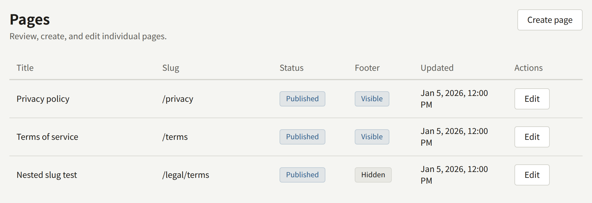
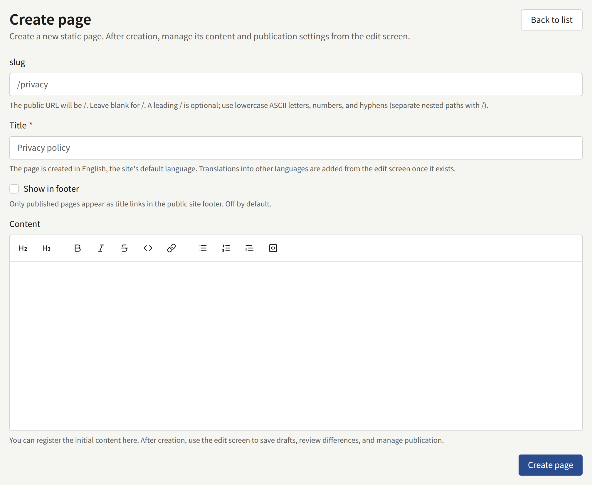
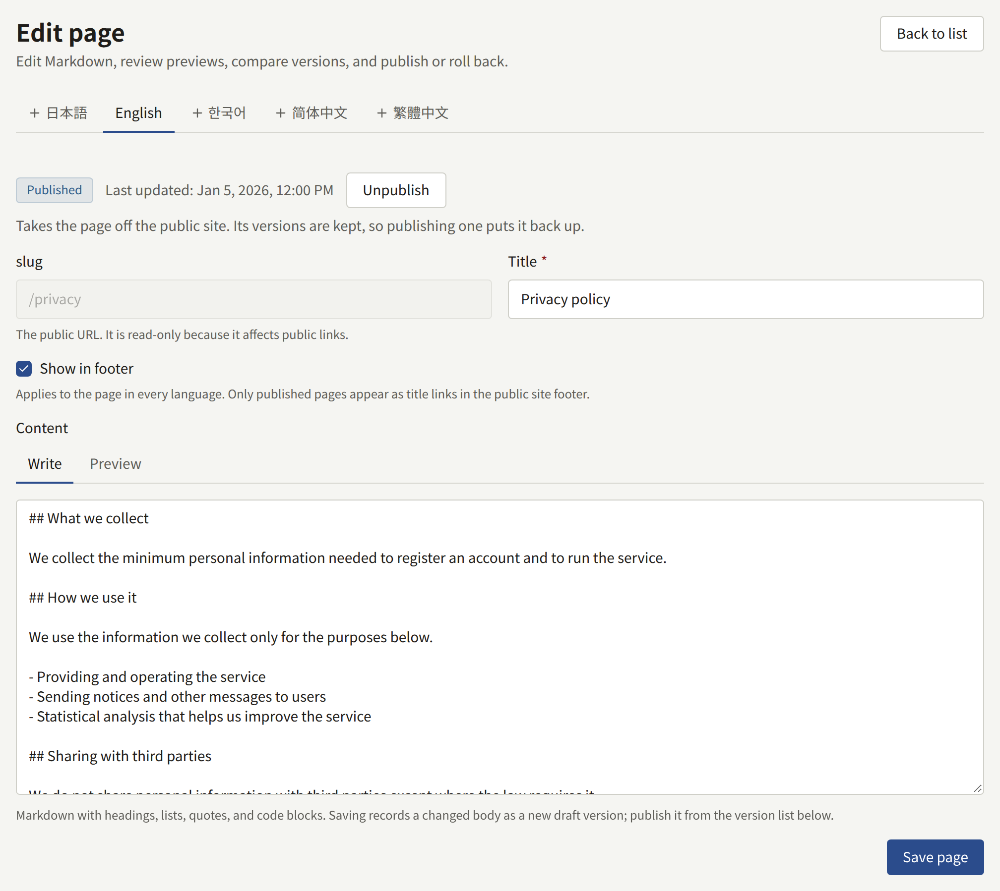
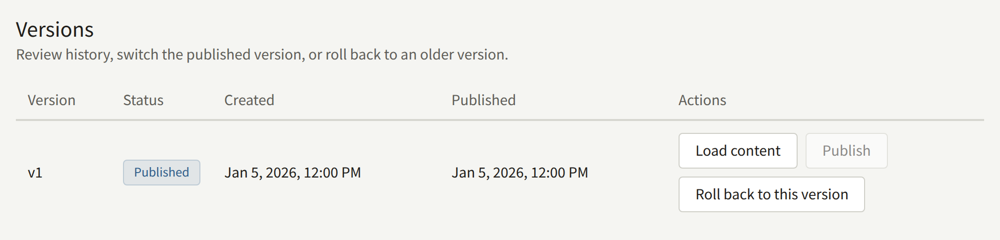

**Pages**, under **Site**, holds the pages the publisher writes for the site: the terms of service, the privacy policy, a page about the publisher, submission guidelines, and anything else that is not a series. A page is written in Markdown, kept in versions, and can be translated into each of the site's languages.

A Tenant admin and an Editor can create, edit, publish, and translate pages. An Auditor can open them without changing anything.

## Creating a page

Choose **Create page** and fill in:

- **slug**: the page's address on the site. `privacy` serves the page at `https://comics.example.com/privacy`, and `legal/terms` at `https://comics.example.com/legal/terms`. Use lowercase letters, digits, and hyphens, with `/` between the parts of a nested path. The slug cannot be changed once the page exists, because links to it would break. Paths the site uses itself, such as its sign-in and account pages, are refused.
- **Title**: shown at the top of the page and wherever it is linked. The page is created in the site's default language.
- **Show in footer**: lists the page by its title in the footer of every page of the site once it is published. It can be changed later on the edit screen.
- **Content**: the first version of the page's body, in Markdown. It may be left empty and written on the next screen.

**Create page** creates the page as a draft and opens its edit screen. Nothing appears on the site until a version is published.

Pages cannot be deleted. A page that should no longer be read is unpublished instead, as described below.

## Writing and publishing

The edit screen holds the page's body on two tabs: **Write**, where you write Markdown, and **Preview**, which shows how it will look. The body takes headings, paragraphs, lists, quotes, code blocks, bold and italic text, and links.

**Save page** saves a changed title and **Show in footer** at once. A changed body is saved as a new **Draft** version, which readers do not see. Saving never publishes.

**Show in footer** belongs to the page rather than to one of its translations, so changing it on any language's tab changes it for every language. The footer follows moments after the save, for as long as the page is published.

**Versions** lists every version of the page, numbered `v1`, `v2`, and onward, with its status: **Published** for the one readers see, **Previously published**, or **Draft**. On each one:

- **Publish** makes that version the one readers see, in place of the version published before.
- **Load content** puts that version's body back into the editor, to continue from.
- **Roll back to this version** copies that version's body into a new draft. Publish the draft to put the old text back on the site.

**Compare versions** shows the lines added and removed between any two versions, once the page has two.

**Unpublish**, beside the page's status, takes the page off the site. Its versions are kept, and publishing one puts the page back.

The site shows a change moments after it is published.

## Translations

The edit screen has a tab under **Languages** for each language the site offers, which a Tenant admin chooses under [**Settings**](./1-settings.md#languages). A translation in a language the site no longer offers has no tab, and is kept: its tab comes back, with the translation as it was, when the language is offered again. Readers are not shown it either, so a page published only in languages the site no longer offers is off the site, and out of its sitemap, until one of them is offered again or the page is published in one the site offers. A language without its own translation is marked **(not added)**, and readers browsing the site in that language see the page in another language, with a note saying so. To add one, open its tab, enter a title, and choose **Add translation**. Then write and publish its body as above.

Each translation has its own title, versions, and published version, so a correction to one does not reach the others until it is made there too. **Delete this translation** removes one, but not the last.

## The terms of service and the privacy policy

Publira has no special kind of page for legal text. The terms of service and the privacy policy are ordinary pages, which a Tenant admin then names under **Settings** › **Terms and privacy policy**:

1. Create and publish each page here, in each language the site offers if readers should read them in their own.
2. Under **Settings**, choose them as **Terms of service** and **Privacy policy**, and choose **Save the terms and privacy policy**.

From then on:

- The site and the app link to both pages, whether or not they are in the footer.
- The sign-up form shows "I have read and agree to the following." above links to the two pages, and an account cannot be created without ticking it. A reader signing up with Apple or Google for the first time is shown the same agreement on **Finish signing up**.
- The tenant records which published version of each page every reader agreed to, and when.

A page that is chosen but not published is not asked about at sign-up. If no page is chosen, sign-up asks for no agreement at all.

### Publishing a new version

Publishing a new version of either page changes what new readers agree to from then on. If a reader has the sign-up form open when you publish, their sign-up is refused with "The pages to agree to have been updated. Read them and agree again.", so nobody agrees to text they were not shown.

Whether readers who already have an account have to agree to the new version is chosen when it is published. On either page, a Tenant admin's **Publish** asks first, and offers two ways to publish:

- **Publish and ask readers to agree** asks every reader to agree to this version. Choose it when the change alters what readers agree to.
- **Publish without asking** publishes the version as a correction, such as a typo or a broken link: readers who agreed to an earlier version are not asked again.

An Editor's **Publish** always publishes without asking. In **Versions**, a version whose publication asked readers is marked **Readers asked to agree** under its status.

A reader asked to agree is sent, the next time they open a page of the site while signed in, to a screen that says "The pages below have been updated. Read them and agree to them to keep using your account." It links the pages that changed and asks them to tick "I have read and agree to the following." **Agree and continue** records their agreement to the version they were shown and returns them to the page they were on, and they are not asked again until another version asks. Until they agree, they can still read the site and the episodes they own, but most of what an account does, such as buying an episode, commenting, or following a series, is refused. A reader who does not want to agree can sign out, or delete their account under **Settings**.

Each translation is asked about on its own. A reader who agreed to the page in another language, whose translation did not change, is not asked, so a change that applies to every language is published with **Publish and ask readers to agree** on each translation's tab.

The app asks too. A reader signed in to the app is shown the same screen in place of the rest of the app when they open it, when they come back to it, or as soon as the app is refused something because they have not agreed. It links the same pages, and offers **Sign out** and **Delete account** instead of agreeing; **Agree and continue** returns them to where they were in the app. An agreement given in the app or on the site counts for both, so a reader is asked once.

### What the site stores in a reader's browser

A privacy policy says what the site keeps in its readers' browsers. These are all the cookies and browser storage the site sets, so the policy can list them without guessing. The cookie names are the same on every Publira site.

| Cookie | Set when | Holds | Kept for |
| --- | --- | --- | --- |
| `publira_web_storefront_auth` | The reader signs in | The reader's session, encrypted with a key only the site holds | Until the session ends: a day after signing in, or when the reader signs out |
| `publira_web_storefront_signup_pending_email`, `publira_web_storefront_reset_password_email`, `publira_web_storefront_resend_verification_email` | The reader submits the sign-up form, asks to reset their password, or asks for the confirmation link again | The email address the message was sent to, so the next page can name it without putting it in the page's address | One minute |
| `publira_web_storefront_sign_in` | The reader chooses **Continue with Apple** or **Continue with Google** | The sign-in in progress, encrypted, which Apple's or Google's answer is checked against | Ten minutes, or until the answer arrives |
| `publira_web_storefront_sign_up` | A reader signing in with Apple or Google for the first time is shown **Finish signing up** | What Apple or Google returned about the reader, encrypted, until they agree to the terms | Four minutes |
| `publira_web_storefront_dismissed_announcement` | The reader chooses **Close this announcement** | The identifier of the announcement they closed | A year |
| `publira_resolved_locale` | A visit, whenever the cookie does not already hold the site's default language | The site's default language code, such as `en`, and nothing about the reader | A year |
| `publira_web_storefront_view_actor` | A signed-out reader opens a series or an episode, once they have agreed on the consent banner where the site asks first | A random identifier that counts their views and nothing else. It is not tied to an account, and nothing on the site is personalised by it | 180 days |
| `publira_web_storefront_analytics_consent` | The reader chooses **Accept** or **Decline** on the consent banner, which the site shows only when **Reader consent** under **Integrations** › **Google tag** is **Ask readers first** | The answer, `granted` or `denied`, and nothing else | Six months |

| Browser storage | Set when | Holds | Kept for |
| --- | --- | --- | --- |
| `publira.age-rating.confirmation.<tenant ID>` in `localStorage` | The reader confirms their age before opening a rated series or episode, with **I am 15 or older** or **I am 18 or older** | The highest rating confirmed, `r15` or `r18` | Until the reader clears the site's data |
| `publira.wide-viewer` in `sessionStorage` | The reader widens the episode viewer to the window, or narrows it again | Whether the viewer is wide | Until the tab is closed |
| A push subscription | The reader turns on **Browser notifications** under **Settings** and allows notifications in the browser's own prompt | The address the browser's push service delivers the site's notifications to | Until the reader turns notifications off or signs out |
| The site's service worker | The same moment as the push subscription | The script that shows the site's notifications. It keeps no pages and nothing about the reader | Until the reader clears the site's data. Turning notifications off or signing out ends the subscription, and the worker stays with nothing to deliver |

None of these is sent anywhere but the site itself. Unless the site loads a Google tag, as described below, it loads nothing from another company that could set cookies of its own or learn about the reader, and a sentence such as this one can say so in your policy: "Our site stores only the cookies and browser storage listed here, and sends nothing from them to any other company."

The reader's browser reaches another company only when the reader does something that needs one: choosing **Continue with Apple** or **Continue with Google** takes them to Apple or Google to sign in, **Share on X** and **Share on LINE** open those services, and browser notifications are delivered through the push service of the company that makes the reader's browser, encrypted so that service cannot read them.

The list covers what Publira itself stores. A Google Analytics or Google Tag Manager ID entered under **Integrations** › **Google tag**, as [Google tag](../8-google-tag.md) describes, loads Google's tag on every page but the ones where a reader signs in, signs up, resets a password, or changes their account settings. That tag brings its own cookies and sends what it collects to Google, or to your server-side Tag Manager container, and so does every tag your container fires. Your privacy policy has to cover those as well, from Google's own documentation and that of each tag in the container.
