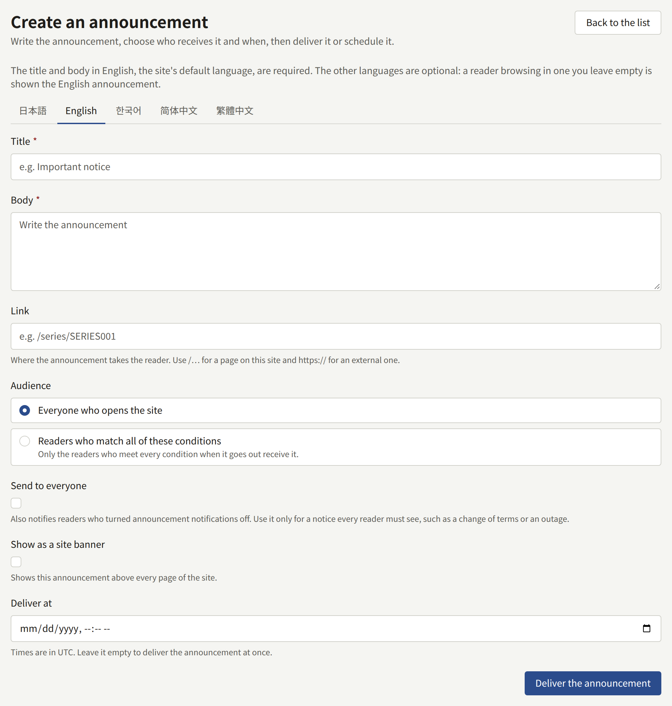

**Announcements**, under **Site**, is how the publisher tells every reader something at once: a new series, a change to the terms, a maintenance window. Each announcement is listed on the site's **Announcements** page and delivered to readers' notifications. An announcement can also be addressed only to the readers a set of conditions selects, such as the followers of one series; see [Choosing who receives it](#choosing-who-receives-it). One of them at a time can also be shown as a banner above every page of the site and the app.

A Tenant admin and an Editor can create announcements, change or delete one that is scheduled, and take banners down. An Auditor sees the list only.

## Creating an announcement

Choose **Create an announcement** and fill in:

- **Title** and **Body**, on a tab for each language the site offers: up to 120 characters of title and 2000 characters of plain text. See [Writing in several languages](#writing-in-several-languages).
- **Link** (optional): where the announcement takes a reader who opens it. Start it with `/` for a page of this site, such as `/series/SERIES001` or `/legal/terms`, or with `https://` or `http://` for another site.
- **Audience**: **Everyone who opens the site** (the default), or **Readers who match all of these conditions**. See [Choosing who receives it](#choosing-who-receives-it).
- **Send to everyone** (off by default): notifies every reader with an account, including readers whose notification settings turn announcements off. See [Sending to everyone](#sending-to-everyone).
- **Show as a site banner**: also shows the announcement above every page. See [The site banner](#the-site-banner).
- **Deliver at** (optional): the time the announcement goes out at. Leave it empty to deliver it at once. See [Scheduling an announcement](#scheduling-an-announcement).

**Deliver the announcement** delivers it at once. With a **Deliver at**, the button reads **Schedule the announcement** instead, and the announcement goes out at that time. Once delivered, an announcement cannot be edited or deleted, so read it over before it goes out.

## Scheduling an announcement

An announcement can be given a time to go out at instead of going out at once: written on a Friday, for instance, to be delivered at nine on Monday. Enter it in **Deliver at** and choose **Schedule the announcement**. The time is in the tenant's time zone and must be in the future. A banner's **Stop showing at** must be after it.

Until that time the announcement is scheduled, and readers do not see it: it is not on the site's **Announcements** page or in the app, no reader is notified of it, and its banner is not shown. The **Status** column of the list reads **Scheduled for** that time. A Tenant admin or an Editor can still choose **Edit** in that column and change anything in it, the time included, then choose **Save**, or choose **Delete** and confirm to delete it. Saving it with **Deliver at** empty delivers it at once.

Within about a minute of its time, the announcement is delivered as one created then would be: readers are notified, it appears on the **Announcements** page and in the app, and its banner is shown. Readers see it among the others by the time it went out, not the time it was written. An announcement with conditions selects its readers at that moment too. From then on it can no longer be edited or deleted.

## Writing in several languages

The form has a tab for each language the site offers, named in that language, and opens on the site's default language. The languages are the ones chosen under [Languages](./1-settings.md#languages) in **Settings**: a language the site does not offer has no tab.

- The default language's **Title** and **Body** are required. A reader browsing in a language you leave empty is shown the default language's announcement.
- Every other tab is optional. Fill in both its **Title** and its **Body**, or leave both empty.

**Deliver the announcement** sends the announcement once, with every language you wrote it in. A language cannot be added to an announcement after it is delivered, so write every translation before you deliver it.

The list shows each announcement's title in the default language, and the **Languages** column names every language it was written in.

## Sending to everyone

An announcement reaches a reader's notifications and their email only while their notification settings take announcements there, so a reader who turned them off does not hear about a campaign. **Send to everyone** notifies every reader with an account, and emails every one whose address is confirmed, whatever those settings say. A push still reaches only a reader who turned the announcement push settings on. Keep it for a notice every reader must see, such as a change to the terms or an outage.

The **Notification** column of the list says how each announcement was sent: **Sent to everyone**, or **As each reader allows** for one sent without the option.

## Choosing who receives it

An announcement can be addressed to the readers who meet a set of conditions instead of to everyone. Under **Audience**, choose **Readers who match all of these conditions**, then pick a condition in **Add a condition**. Each one adds a row with the inputs it takes, and **Remove** takes it off again. The conditions are:

- **Follows series**: the reader follows the **Series** you pick.
- **Bought an episode of series**: the reader holds a purchase of an episode of the **Series** you pick, bought on its own, in a volume, or in a bundle. A purchase that was refunded or revoked does not count.
- **Subscription**: the reader's subscription to the **Plan** you pick, or to **Any plan**, is live (**Holds it**: in its trial, active, or with a renewal payment past due), or the reader has had one that ended and holds no live one (**Had one that ended**).
- **Has never bought anything**: the reader has never bought anything from the site. A purchase made in the payment provider's test mode does not count.
- **Has not read for**: the reader has opened no episode for at least the number of **Days** you enter, or has never opened one.
- **Signed up within**: the reader signed up no more than the number of **Days** you enter ago.
- **Language**: the reader uses the site in the language you pick, out of the ones the site offers: the one they last browsed the site or used the app in, or the site's default language for a reader who has never chosen one.
- **Has the app's push notifications registered**: the reader has registered a phone running the site's app for push notifications.

A number of days is from 1 to 3650. Each condition can be used once, so a condition already added is not offered again, and they combine: a reader receives the announcement only when they meet every condition it names.

Once every row is filled in, the form counts the readers the conditions select and shows the number, such as **Reaches 12 readers**, counting again as the conditions change. It is the count at that moment, and only a guide: the readers are selected again when the announcement goes out, and it can go out whether or not the count could be made.

While the announcement has a condition, **Send to everyone** and **Show as a site banner** are off and cannot be turned on, as the form says above them. Removing every condition makes them available again.

The **Audience** column of the list says who each announcement is for: **Everyone**, or the number of conditions it names, such as **2 conditions**.

The conditions are evaluated once, at the moment the announcement is delivered. A reader who comes to meet them afterwards, by following the series a day later for instance, does not receive it, and a reader who stops meeting them keeps the one they received.

An announcement with conditions reaches each reader it selects as their notification settings allow, and it is never:

- shown as a site banner, which every visitor sees;
- sent with **Send to everyone**, since a notice every reader must see is not one a condition may keep from some of them;
- listed on the **Announcements** page, or in the app, to a visitor who is not signed in or to a signed-in reader it was not delivered to, and its own page shows them **Page not found**.

## What readers see

- **On the site**, the **Announcements** page in the header lists every announcement addressed to everyone, newest first, and anyone can read it. A signed-in reader also sees there, among the others, the announcements with conditions that were delivered to them, and opens them like any other while signed in. Each title opens the announcement on a page of its own. A signed-in reader sees which ones they have not read yet.
- **In their notifications**, every reader with an account whose notification settings take announcements gets "A new announcement", which leads to it, and every reader with an account gets it for an announcement sent with **Send to everyone**. An announcement with conditions reaches only the readers it selects.
- **By email**, every reader with a confirmed address whose notification settings take announcements by email gets a mail with the announcement's title and a link to the **Announcements** page, and every reader with a confirmed address gets it for an announcement sent with **Send to everyone**.
- **As a push notification**, a reader whose notification settings take announcements as browser notifications gets one in their browser, and a reader whose settings take them on the phone gets one from the app. The notification's title is the announcement's title in the reader's language, and opening it shows the announcement. Both settings start off, so a reader who has saved nothing receives none, and **Send to everyone** does not override them.
- **In the app**, the **Announcements** screen lists the same announcements, with the same read marks.

A reader sees each announcement in their language: on the site, the one they browse in, and in the app, the one the app is shown in. Where you did not write it in that language, they see the default language's, with a note naming the language it is shown in.

## The site banner

An announcement created with **Show as a site banner** is shown above the header of every page of the site, to every visitor, signed in or not, and at the top of the app's catalog screen. On the site its link leads to the announcement's **Link**, or to the announcement's own page when it has none. A visitor can close it, and it then stays closed in that browser.

Only one banner is shown at a time: the newest announcement whose banner is still up. Creating a new banner therefore hides the previous one until the new one comes down.

A banner stays up until you take it down, unless you give it an end:

- **Stop showing at**, under the banner checkbox, takes it down at that time, in the tenant's time zone. It must be in the future.
- **Stop showing**, in the **Banner** column of the list, takes it down at once.

Either way the announcement stays on the **Announcements** page and in readers' notifications. Only the banner goes.
