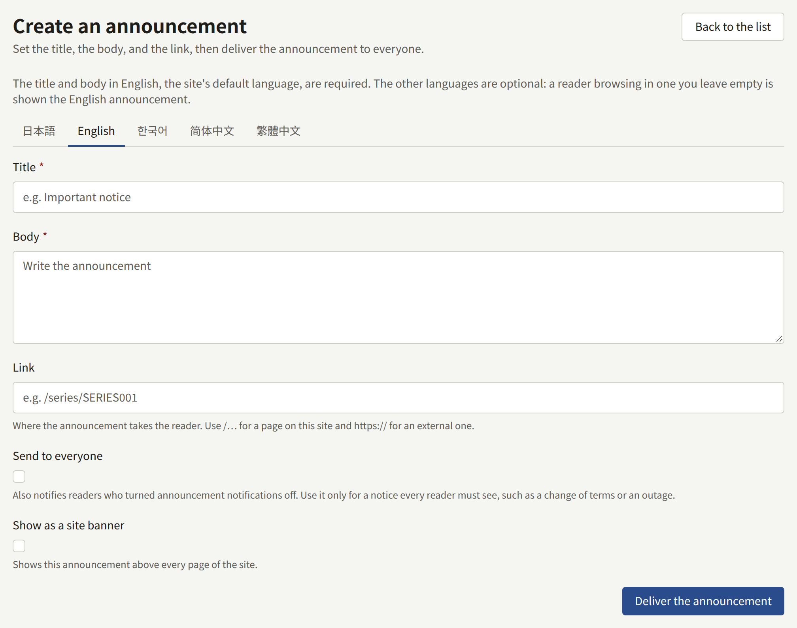

**Announcements**, under **Site**, is how the publisher tells every reader something at once: a new series, a change to the terms, a maintenance window. Each announcement is listed on the site's **Announcements** page and delivered to readers' notifications. One of them at a time can also be shown as a banner above every page of the site and the app.

A Tenant admin and an Editor can create announcements and take banners down. An Auditor sees the list only.

## Creating an announcement

Choose **Create an announcement** and fill in:

- **Title** and **Body**, on a tab for each language the site offers: up to 120 characters of title and 2000 characters of plain text. See [Writing in several languages](#writing-in-several-languages).
- **Link** (optional): where the announcement takes a reader who opens it. Start it with `/` for a page of this site, such as `/series/SERIES001` or `/legal/terms`, or with `https://` or `http://` for another site.
- **Send to everyone** (off by default): notifies every reader with an account, including readers whose notification settings turn announcements off. See [Sending to everyone](#sending-to-everyone).
- **Show as a site banner**: also shows the announcement above every page. See [The site banner](#the-site-banner).

**Deliver the announcement** delivers it at once. An announcement has no draft and cannot be scheduled, edited, or deleted afterwards, so read it over before you deliver it.

## Writing in several languages

The form has a tab for each language the site offers, named in that language, and opens on the site's default language. The languages are the ones chosen under [Languages](./1-settings.md#languages) in **Settings**: a language the site does not offer has no tab.

- The default language's **Title** and **Body** are required. A reader browsing in a language you leave empty is shown the default language's announcement.
- Every other tab is optional. Fill in both its **Title** and its **Body**, or leave both empty.

**Deliver the announcement** sends the announcement once, with every language you wrote it in. A language cannot be added to an announcement after it is delivered, so write every translation before you deliver it.

The list shows each announcement's title in the default language, and the **Languages** column names every language it was written in.

## Sending to everyone

An announcement reaches a reader's notifications and their email only while their notification settings take announcements there, so a reader who turned them off does not hear about a campaign. **Send to everyone** notifies every reader with an account, and emails every one whose address is confirmed, whatever those settings say. Keep it for a notice every reader must see, such as a change to the terms or an outage.

The **Notification** column of the list says how each announcement was sent: **Sent to everyone**, or **As each reader allows** for one sent without the option.

## What readers see

- **On the site**, the **Announcements** page in the header lists every announcement, newest first, and anyone can read it. Each title opens the announcement on a page of its own. A signed-in reader sees which ones they have not read yet.
- **In their notifications**, every reader with an account whose notification settings take announcements gets "A new announcement", which leads to it, and every reader with an account gets it for an announcement sent with **Send to everyone**.
- **By email**, every reader with a confirmed address whose notification settings take announcements by email gets a mail with the announcement's title and a link to the **Announcements** page, and every reader with a confirmed address gets it for an announcement sent with **Send to everyone**. Announcements are not sent as push notifications.
- **In the app**, the **Announcements** screen lists the same announcements, with the same read marks.

A reader sees each announcement in their language: on the site, the one they browse in, and in the app, the one the app is shown in. Where you did not write it in that language, they see the default language's, with a note naming the language it is shown in.

## The site banner

An announcement created with **Show as a site banner** is shown above the header of every page of the site, to every visitor, signed in or not, and at the top of the app's catalog screen. On the site its link leads to the announcement's **Link**, or to the announcement's own page when it has none. A visitor can close it, and it then stays closed in that browser.

Only one banner is shown at a time: the newest announcement whose banner is still up. Creating a new banner therefore hides the previous one until the new one comes down.

A banner stays up until you take it down, unless you give it an end:

- **Stop showing at**, under the banner checkbox, takes it down at that time, in the tenant's time zone. It must be in the future.
- **Stop showing**, in the **Banner** column of the list, takes it down at once.

Either way the announcement stays on the **Announcements** page and in readers' notifications. Only the banner goes.
