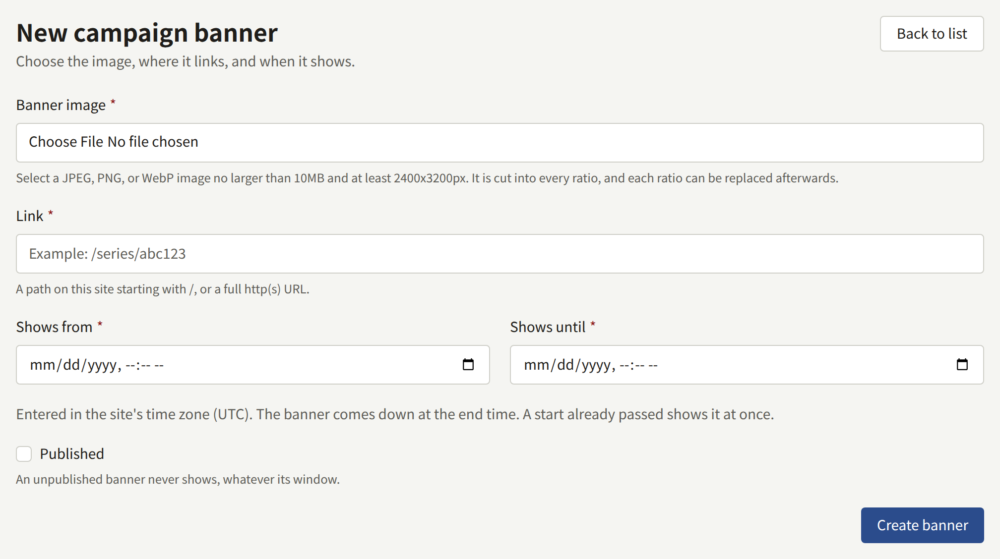

**Campaign banners**, under **Site**, puts a campaign in front of readers who have not gone looking for it: a discount on a series, a new serialization, a fair on another site. A banner is an image that links somewhere, shown for a window you set. The site shows the banners on air at the top of its top page, and the app at the top of its catalog screen.

A banner is not an announcement. It reaches no one's notifications, cannot be closed by a reader, and is shown only on those two screens. To tell every reader something, or to keep a line of text above every page, use [Announcements](./4-announcements.md).

A Tenant admin and an Editor can create, change, reorder, and delete banners. An Auditor sees the list, and opens a banner with **View**, without being able to change it.

## Creating a banner

Choose **New banner** and fill in:

- **Banner image**: a JPEG, PNG, or WebP image of at most 10 MB and at least 2400 × 3200 pixels. See [The image](#the-image).
- **Link**: where the banner takes a reader who opens it, up to 2048 characters. Start it with `/` for a page of this site, such as `/series/SERIES001` or `/labels/LABEL001`, or with `https://` or `http://` for another site.
- **Shows from** and **Shows until**: the window the banner is on air, entered in the tenant's time zone, which the note under the two fields names. See [The window](#the-window).
- **Published**: whether the banner shows at all. A new banner starts unpublished. See [Publishing](#publishing).

Choose **Create banner**. The banner opens on its own screen, with a **Details** tab that changes the link, the window, and **Published**, and an **Image** tab that changes the image.

## The image

The site and the app do not show the image as uploaded. Saving it cuts four images of fixed shapes out of it, as a series' cover image is cut, and the **Image** tab shows them under **Aspect ratio images**. The band on the site and in the app is drawn from **Landscape (16:9)** alone, uncropped, so that is the shape to check. The other three are kept with the banner and not shown anywhere.

Each shape is cropped from the centre of the image. To frame the band differently, choose **Adjust the frame** on the **Landscape (16:9)** slot, or upload artwork made for the band with **Replace**, which takes an image of at least 1600 × 900 pixels for that shape alone. Uploading a new image under **Cover image** and choosing **Update image** replaces all four shapes. A banner always keeps an image, so there is no removing it. [The cover image](../1-catalog/1-series.md#the-cover-image) of a series describes the slots in full.

On a phone the band is as wide as the screen, so lettering in the image has to be readable at that size.

## The window

**Shows from** and **Shows until** are read in the tenant's time zone, chosen under [Settings](./1-settings.md#time-zone), and the list shows every window in it as well. The banner is on air from the first moment to the second, and has come down at the second itself, so one banner can end at the moment the next begins.

- The end has to come after the start.
- A new banner's end has to be ahead. A start already past puts it on air as soon as it is published.
- When you edit a banner, the end has to be ahead too, unless you leave the window as it was. An ended banner can therefore still be unpublished or given another link without being rescheduled.

The site and the app compare the window with the current time on every read, so a banner turns over at the same moment for every reader, wherever they are. The site keeps what it has drawn until the worker's next pass drops it, normally within a minute of the time you set. If a banner is still missing after its window opened, or still up after it closed, the operator of the install can check the job described in [Scheduled jobs](../../3-operations/10-scheduled-jobs.md).

## Publishing

**Published** decides whether the banner shows at all. An unpublished banner never shows, whatever its window, so a banner can be prepared and left unpublished until it is ready. Clearing **Published** on the **Details** tab, and choosing **Update banner**, takes a banner off the air at once.

The list shows where each banner stands now:

| Status          | Meaning                                            |
| --------------- | -------------------------------------------------- |
| **Showing**     | Published, and its window holds the present moment |
| **Scheduled**   | Published, and its window has not opened yet       |
| **Ended**       | Published, and its window has closed               |
| **Unpublished** | Not published, whatever its window                 |

## Ordering

The site and the app show the banners on air in the order of the list. A new banner goes to the end. To move one, drag it by its handle, or focus the handle and use the arrow keys. The order is saved as soon as a banner is dropped.

If someone else reorders the list at the same time, your move is refused with "The banner order changed somewhere else. Reload the page and try again."

## Deleting a banner, and the limit of 50

**Delete**, on the banner's row, asks for confirmation and then removes the banner and its image. The site stops showing it at once.

A tenant holds at most 50 banners, ended ones included. A banner created past that is refused with "This site already holds as many campaign banners as it may. Delete one that has ended, then try again." An ended banner shows nowhere, so deleting it loses nothing a reader sees.

## What readers see

- **On the site**, the banners on air are at the top of the top page, above the work the page opens with. One banner is a single band. Two or more are a strip a reader swipes or scrolls through, with **Previous campaign** and **Next campaign** buttons and a counter such as `1 / 3` under it; the strip runs on from the last banner to the first, and nothing moves it on by itself. On a wide screen the neighbouring banners show at the edges of the strip.
- **In the app**, the same banners are at the top of the catalog screen, under the site banner if there is one and above the shelves. Two or more are pages the reader swipes through, with the edge of the next one showing. The app reads them when the catalog screen is first shown, and again when the reader pulls the screen down to refresh it.
- **When a reader opens a banner**, the site goes to its link, keeping the reader's language for a page of the site. The app opens its own screen for a page of the site it has one for, such as a series or a label, its page screen for one of the tenant's published pages, and the browser for anything else.

A tenant with no banner on air shows neither the band nor any space for it, on the site or in the app.
