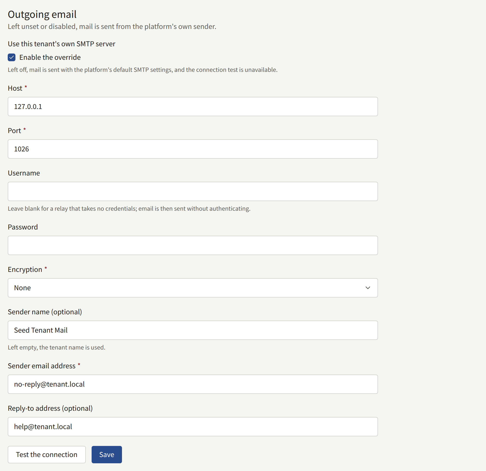
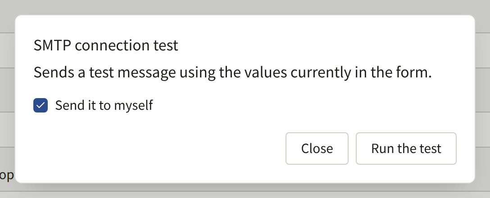
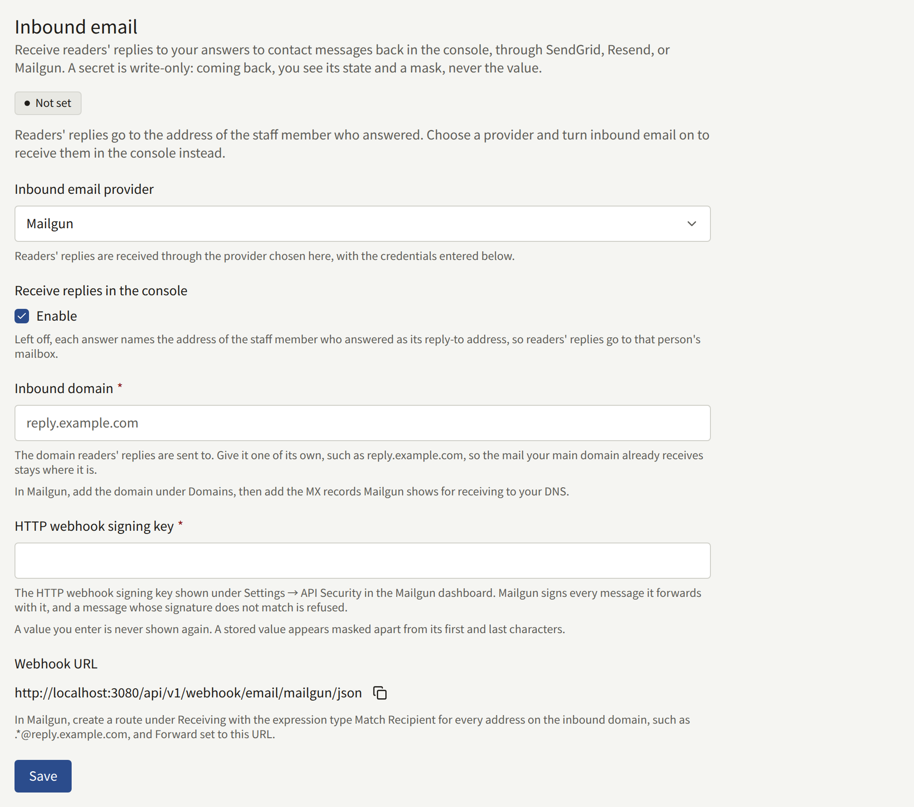

The tenant sends mail to its readers and its staff: address confirmations, password resets, purchase receipts, invitations, replies to contact messages. Until a Tenant admin sets up a server of the tenant's own, all of it goes out through the platform's mail server, from the platform's address, which the operator chooses. **Integrations** › **Email** sends it through the publisher's own SMTP server instead, from an address on the publisher's domain.

Only a Tenant admin sees this screen. There is nothing for the operator to allow first.

## What goes through it

With the tenant's own server turned on, it sends every mail the tenant sends:

- To readers: the sign-up confirmation, password resets and the notice that a password changed, email address change confirmations and the notice that an address changed, and the notice that someone tried to sign up with an address that already has an account.
- To readers who buy an episode on the site: a receipt naming the series and the episode, the price paid, when it was bought and, for an episode with a reading period, until when it can be read, with a link to the reader's purchases.
- Replies to readers' contact messages.
- To staff: invitations to new Tenant admins, the console's password resets and email address changes, and the notice of a new contact message, which goes to the Tenant admins.

Announcements and other notices reach readers on the site and in the app, not by mail.

## Before you start

Have these from whoever runs the publisher's mail:

- The SMTP server's host name and port, and whether it expects TLS from the start of the connection (usually port 465) or STARTTLS (usually port 587).
- A username and password for it, unless it relays mail without credentials.
- The address the mail should come from, which the server is allowed to send as. Have the domain's SPF and DKIM records cover the server, or readers' mail services are likely to file the tenant's mail as spam.

## Setting it up

1. Open **Integrations** › **Email** and, in the **Outgoing email** section, tick **Enable the override** under **Use this tenant's own SMTP server**. The fields below it open.
2. Fill in:
   - **Host** and **Port**.
   - **Username** and **Password**, if the server asks you to sign in. Leave **Username** blank for a relay that takes no credentials, such as one that trusts the platform's address: the mail is then sent without signing in, and no password is kept. A password without a username is refused.
   - **Encryption**: **TLS**, **STARTTLS**, or **None**. **TLS** and **STARTTLS** both require TLS 1.2 or later, and **STARTTLS** fails rather than sending in the clear when the server does not offer it. Choose **None** only for a server that is reached over a private network.
   - **Sender email address**: the address the mail comes from, such as `noreply@comics.example.com`.
   - **Sender name (optional)**: the name readers see beside that address, usually the site's name. Left empty, the tenant's name is used, both for the tenant's mail and for the connection test.
   - **Reply-to address (optional)**: where a reader's reply goes, such as a support address. Left empty, replies go to the sender address. A reply to a contact message keeps its own reply-to address instead.
3. Choose **Test the connection**, then **Run the test**. The test sends a message through the values in the form, without saving them, to your own address, or to another one if you clear **Send it to myself**. A failed test says which step failed where it can tell: connecting, TLS or STARTTLS, signing in, the server refusing the recipient, or the server taking too long to answer.
4. Choose **Save**. The next mail the tenant sends goes through the new server.





A saved password is never shown again. The field shows that one is stored, and **Change** replaces it. Saving after **Change** with the box left empty removes it, which is how the tenant moves to a relay that takes no credentials: clear **Username** as well, since a username without a password is refused.

## When it stops working

Once the tenant's own server is on, its mail does not fall back to the platform's server. If the server refuses a mail or cannot be reached, the platform keeps trying for a while, at growing intervals, and then gives up on that mail. Nothing in the console reports a failure. If readers say their confirmation or password reset mail does not arrive, run **Test the connection** again with the saved settings.

To go back to the platform's mail server, clear **Enable the override** and choose **Save**. The rest of the settings are kept for when you turn it on again.

Every save is recorded in the [audit log](./8-audit-log.md) as **Email settings updated**, and every test, successful or not, as **SMTP connection tested**. The operator's side of the tenant's mail is described in [Email](../../3-operations/6-email.md#a-tenants-own-smtp-account).

## Readers' replies to contact messages

An answer to a contact message reaches the reader by mail. Until the tenant receives mail of its own, the answer's reply-to address is the address of the staff member who answered, so a reader who writes back reaches that person's mailbox and the console never sees the reply. The **Inbound email** section of **Integrations** › **Email** brings those replies back into the console, under the message they answer, through SendGrid, Resend, Mailgun, or Amazon SES, or through any mail service or server that can post a whole mail to an HTTPS URL, such as Cloudflare Email Routing or a Postfix server of the publisher's own.

### Before you start

- An account with SendGrid, Resend, or Mailgun, an AWS account that can use Amazon SES in a region that receives email, or a mail service or server that hands each mail it receives to code of your own: Cloudflare Email Routing, or a Postfix server.
- A domain for replies whose DNS you can change, such as `reply.comics.example.com`. Its MX record will point at the provider, so mail sent to it reaches no other mailbox. A subdomain of its own keeps the mail the publisher's main domain already receives where it is.
- The site reachable from the internet: the provider posts each reply to the site's own domain. An IP allowlist, a sign-in prompt, or a bot challenge in front of the site has to let these requests through, as [Webhooks](../../2-deployments/4-edge.md#webhooks) describes for the operator.

### Setting it up

1. Open **Integrations** › **Email**. In the **Inbound email** section, choose the provider under **Inbound email provider**, tick **Enable** under **Receive replies in the console**, and enter the reply domain as **Inbound domain**.
2. Set up the provider. The section shows a **Webhook URL** on the site's domain, with a button to copy it.
   - **SendGrid**: make up a long random string and enter it as **Webhook token**. In your DNS, point the domain's MX record at `mx.sendgrid.net` with priority 10. In SendGrid, add the domain under **Settings** › **Inbound Parse** with the **Webhook URL** as the destination URL, putting the token in place of `<token>`: SendGrid signs nothing, so the token in the URL is how the site tells its requests from anyone else's.
   - **Resend**: create an API key with **Full access** under **API Keys** and enter it as **API key**; replies are read from Resend with it. Add the domain under **Domains**, turn on receiving for it, and add the MX record Resend shows to your DNS. Under **Webhooks**, add the **Webhook URL** for the `email.received` event, and enter the signing secret Resend shows for it (`whsec_…`) as **Webhook signing secret**.
   - **Amazon SES**: make up a long random string and enter it as **Webhook token**, and enter the ARN of the SNS topic the mail is published to as **SNS topic ARN**. Set up the domain, the topic, and the receipt rule in AWS, then save, and subscribe the topic to the **Webhook URL** as [Receiving through Amazon SES](#receiving-through-amazon-ses) below describes.
   - **Raw MIME over HTTPS**: make up a long random string and enter it as **Webhook token**. Point the domain's MX records at the service or server that receives the mail, and have it post every mail on the domain, whole and unchanged, to the **Webhook URL** with the content type `message/rfc822`, the token in place of `<token>`, and the address the mail was delivered to in an `X-Envelope-To` header. A forward or an alias on the reader's side often leaves the reply without the message's own address in its **To**, and that header is what still matches it. [Cloudflare Email Routing](#posting-raw-mail-from-cloudflare-email-routing) and [Postfix](#posting-raw-mail-from-postfix) below do all of this.
   - **Mailgun**: copy the **HTTP webhook signing key** from **Settings** › **API Security** and enter it under the same name; Mailgun signs every reply it posts with it, and a post whose signature does not match is refused. For a domain on a subaccount, the subaccount's key and the primary account's key both work. Add the domain under **Domains** and add the MX records Mailgun shows for receiving to your DNS. Under **Receiving**, create a route with the expression type **Match Recipient** and a recipient that covers every address on the domain, such as `.*@reply.comics.example.com`, and tick **Forward** with the **Webhook URL** exactly as shown, ending in `/json`: Mailgun signs the whole mail it posts only to a URL that ends that way, and a post to any other URL is refused. The same steps apply to an account in Mailgun's EU region.
3. Choose **Save**. The section turns **Ready** and shows the **Reply address**, `contact+*@` followed by the domain: each answer from then on asks the reader to reply to an address of that form, where `*` is the message's ID, and the reply appears under that message.



Until the section is **Ready**, answers keep the answering staff member's address, and the section says so. **Not set** means nothing is stored; **Disabled** means the settings are stored but **Enable** is cleared; **Incomplete** means it is enabled but the domain or a credential the provider needs is missing.

The tokens and keys are never shown again once saved: each field shows a mask, and **Change** replaces it. Saving with another provider chosen deletes the credentials stored for the previous one.

To stop receiving replies, clear **Enable** and choose **Save**. The next answer names the staff member's address again, and the settings are kept for when you turn it back on. Every save is recorded in the [audit log](./8-audit-log.md) as **Inbound email settings updated**.

### Receiving through Amazon SES

Amazon SES receives the domain's mail and hands each one to a receipt rule. The rule publishes a notification of the mail to an Amazon SNS topic, and the topic delivers it to the **Webhook URL** through an HTTPS subscription. SNS signs every delivery, but any AWS account could subscribe a topic of its own to the URL, so the site also checks the token in the URL and the topic the delivery comes from.

SES receives mail only in some AWS regions, listed under [Email receiving endpoints](https://docs.aws.amazon.com/general/latest/gr/ses.html#ses_inbound_endpoints). Use one of them for the domain, the topic, and the rule below; the bucket can be in another region.

1. In SES, under **Identities**, verify the inbound domain. In your DNS, point its MX record at `inbound-smtp.<region>.amazonaws.com`, such as `inbound-smtp.us-east-1.amazonaws.com`, with priority 10.
2. In SNS, create a standard topic, such as `publira-inbound`. Enter its ARN as **SNS topic ARN** in the console.
3. In SES, under **Email receiving**, create a rule in the active rule set with the inbound domain as its recipient condition, and give it one of these actions:
   - **Deliver to Amazon S3 bucket**, with the SNS topic chosen under **SNS topic**. SES writes each mail to the bucket and tells the topic where it is, and the site reads it from there. This is the action to use: it carries a reply of any size SES receives, up to 40 MB. The bucket's policy has to let SES write to it, as [Giving permissions to Amazon SES for email receiving](https://docs.aws.amazon.com/ses/latest/dg/receiving-email-permissions.html) describes. Leave **Message encryption** cleared: SES then encrypts each mail on the client side, which the site cannot undo. Then, in IAM, create a user with an access key and a policy that allows `s3:GetObject` on the bucket's objects, and enter the key as **AWS access key ID** and **AWS secret access key**. Enter **S3 bucket** to have the site read from that bucket and no other, and **S3 bucket region** when the bucket is in another region than the topic.
   - **Publish to Amazon SNS topic**, with the topic and the encoding **Base64**, which keeps a mail in any character set as it was sent. The mail travels inside the notification, so no bucket or access key is needed, but SES bounces every mail over 150 KB, which a reply with an image or an attachment soon is.
4. Choose **Save** in the console: the subscription is confirmed when SNS posts its confirmation to the site, and the site confirms only for the token and the topic it has stored.
5. In SNS, create a subscription to the topic with the protocol **HTTPS** and the **Webhook URL** as its endpoint, the token in place of `<token>`. Leave **Enable raw message delivery** cleared: a delivery without SNS's signature around it is refused. The subscription turns **Confirmed** within a minute. If it stays **Pending confirmation**, check the token and the topic in the console, save, and choose **Request confirmation** on the subscription.

An IAM policy for the user in step 3, with the bucket's name in place of `publira-inbound-mail`:

```json
{
  "Version": "2012-10-17",
  "Statement": [
    {
      "Effect": "Allow",
      "Action": "s3:GetObject",
      "Resource": "arn:aws:s3:::publira-inbound-mail/*"
    }
  ]
}
```

Add `kms:Decrypt` on the key, too, when the bucket encrypts what is written to it with a KMS key by default.

SNS retries a delivery the site cannot take — a `5xx` while the site is down, or while the mail cannot be read from the bucket — three times, 20 seconds apart, and then drops it. A [delivery policy](https://docs.aws.amazon.com/sns/latest/dg/sns-message-delivery-retries.html) on the subscription can keep it retrying for up to an hour, and a dead-letter queue keeps what it drops. A mail the S3 action wrote stays in the bucket either way.

### Posting raw mail from Cloudflare Email Routing

Cloudflare Email Routing hands each mail to an Email Worker, which posts it to the **Webhook URL**. The inbound domain's DNS has to be on Cloudflare.

1. Under Email Routing, turn on routing for the inbound domain; a subdomain such as `reply.comics.example.com` is added under **Settings** › **Subdomains**. Cloudflare adds its MX records itself. Turn on **Subaddressing** in the same settings, so that mail to `contact+<message ID>@` reaches the rule for `contact@`.
2. Under Email Routing's destination addresses, add a staff mailbox and verify it, for the replies the site cannot take when they arrive.
3. Create a Worker with the code below. Give it the **Webhook URL** without the `inbound:<token>@` part as the variable `WEBHOOK_URL`, the token as the secret `WEBHOOK_TOKEN`, and the staff mailbox as the variable `FALLBACK_ADDRESS`.
4. Under Email Routing's routing rules, create a custom address `contact` on the inbound domain with the action **Send to a Worker** and the Worker you created.

```js
export default {
  async email(message, env) {
    let status;
    try {
      const response = await fetch(env.WEBHOOK_URL, {
        body: await new Response(message.raw).arrayBuffer(),
        headers: {
          Authorization: `Basic ${btoa(`inbound:${env.WEBHOOK_TOKEN}`)}`,
          "Content-Type": "message/rfc822",
          "X-Envelope-To": message.to,
        },
        method: "POST",
      });
      if (response.ok) {
        return;
      }
      status = response.status;
    } catch {
      // The site did not answer.
    }
    if (status === 400) {
      message.setReject("The site could not read this mail");
      return;
    }
    try {
      await message.forward(env.FALLBACK_ADDRESS);
    } catch {
      message.setReject(
        `The reply could not be delivered (${status ?? "no answer"})`
      );
    }
  },
};
```

`message.to` is the address the mail was delivered to, `+<message ID>` included.

Cloudflare gives an Email Worker no way to ask the sender to try again later: rejecting a mail is permanent, and the reader gets a bounce. So the Worker rejects only a mail the site refuses as not being one it can read. When the site does not answer, or cannot take the mail — a `5xx` while it is down, a `401` while the token stored in the console and the Worker's differ — the Worker forwards the mail to the staff mailbox, where the reply is read instead of in the console, and rejects it only if that fails too. A mail the site accepts and then drops, such as one that names no message or arrives while **Enable** is cleared, is answered as accepted and goes nowhere else.

### Posting raw mail from Postfix

A Postfix server that receives the inbound domain's mail can post each mail with `curl` through a `pipe` transport. Point the domain's MX record at the server, and save this script as `/usr/local/bin/publira-inbound`, with the **Webhook URL** split into the token and the URL without it:

```sh
#!/bin/sh
# Posts the mail on standard input for the recipient named as $1, and tells
# Postfix whether a failure is worth retrying.
status=$(curl --silent --output /dev/null --write-out '%{http_code}' \
  --max-time 60 --user 'inbound:<token>' \
  --header 'Content-Type: message/rfc822' \
  --header "X-Envelope-To: $1" \
  --data-binary @- \
  https://comics.example.com/api/v1/webhook/email/mime)
case "$status" in
  2??) exit 0 ;;
  400) exit 65 ;; # EX_DATAERR: not a mail the site can read; bounce it
  *) exit 75 ;;   # EX_TEMPFAIL: keep it queued and try again later
esac
```

Postfix bounces a mail whose command ends with a status it does not know, such as the ones `curl` exits with, so the script answers with the two it does. Only a post the site refuses as not being a mail bounces. Anything else — no answer, a `5xx` while the site is down, a `401` while the token stored in the console and the one in the script differ — leaves the mail queued, and Postfix retries it until its queue lifetime runs out. The script holds the token, so make it readable by the transport's user alone: `chown nobody /usr/local/bin/publira-inbound` and `chmod 700 /usr/local/bin/publira-inbound`.

Add the transport to `/etc/postfix/master.cf`:

```text
publira   unix  -       n       n       -       -       pipe
  user=nobody argv=/usr/local/bin/publira-inbound ${recipient}
```

Then send the domain's mail to it, one recipient per post so that `${recipient}` names one address, in `/etc/postfix/main.cf`:

```text
relay_domains = reply.comics.example.com
transport_maps = hash:/etc/postfix/transport
publira_destination_recipient_limit = 1
```

and in `/etc/postfix/transport`:

```text
reply.comics.example.com  publira:
```

Run `postmap /etc/postfix/transport` and `postfix reload`.
