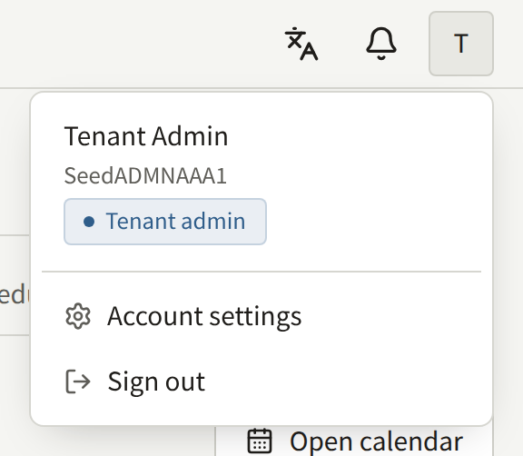
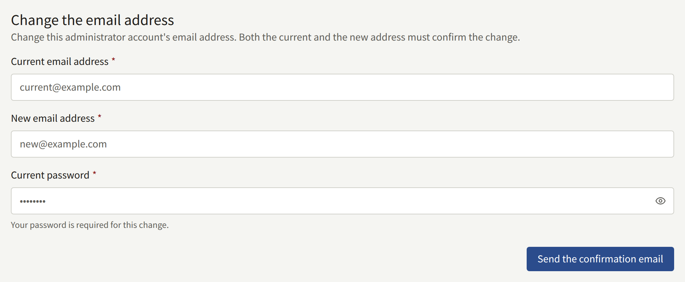
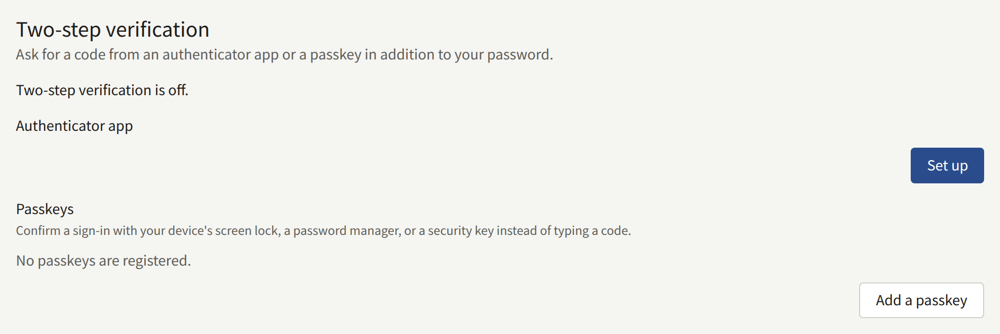
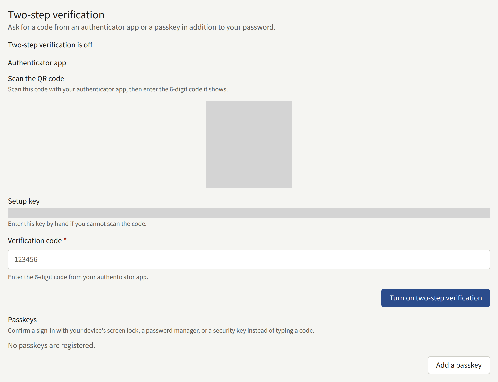
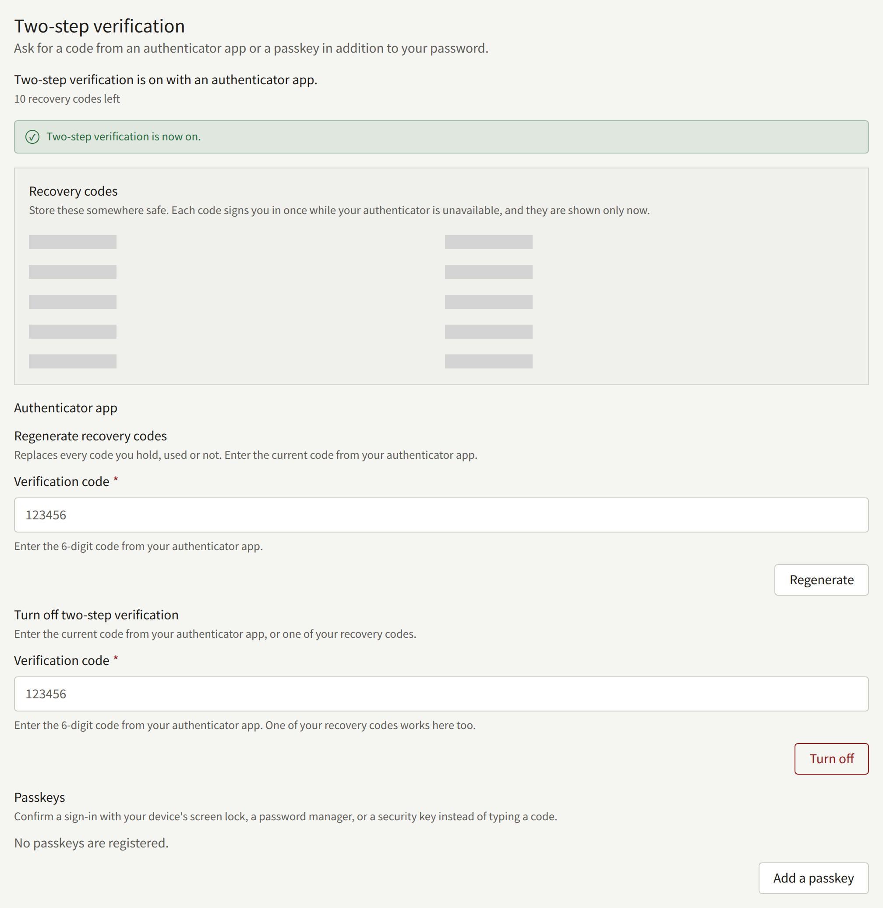

Every member of staff, whatever their role, manages their own console account from **Account settings**, in the account menu at the top of the console. It has two cards: **Change the email address** and **Two-step verification**.

The console has no screen for changing your password. Sign out and use **Forgot your password?** on the sign-in screen, which mails you a link to set a new one.

## Changing your email address

Under **Change the email address**, enter your **Current email address**, the **New email address**, and your **Current password**, and choose **Send the confirmation email**.

A confirmation mail is sent to both addresses, and the change needs both links opened, each within 24 hours. Requiring the current address stops someone who has only your password from moving the account to an address of theirs. Until both are opened, you keep signing in with the current address. Once both are, you sign in with the new one, and the old address is told the address was changed.

The new address must not belong to another account on the tenant, a reader's included. A second request replaces the first, whose links stop working.

Since your console account is also your account on the site, the change applies to both.

## Two-step verification

Two-step verification asks for a second proof after your password, so a stolen password is not enough to sign in. The proof is either a code from an authenticator app on your phone or a passkey. Any authenticator app that reads a QR code works, including the one built into many password managers. A passkey is unlocked with your device's screen lock, a password manager, or a security key, and asks for nothing to be typed.

The **Two-step verification** card has a part for each: **Authenticator app** and **Passkeys**. You can use either, or both, and the line at the top of the card says which of them is on. Two-step verification is on as long as you have at least one of them.

The operator can require it of every Tenant admin on the install. A Tenant admin who has not set it up is then asked to, right after their password, before they can use the console, and **Two-step verification** says "This tenant requires two-step verification for administrators." They can answer with either an authenticator app or a passkey, as [Signing in with a passkey](#signing-in-with-a-passkey) describes. Editors and Auditors are never required to, but can turn it on for themselves.

### Setting up an authenticator app

1. Under **Authenticator app**, choose **Set up**.
2. Scan the QR code with your authenticator app. If you cannot scan it, enter the **Setup key** shown beside it by hand.
3. Enter the six-digit code the app shows under **Verification code**, and choose **Turn on two-step verification**.
4. If the app is your first second factor, the console shows ten **Recovery codes**. Store them somewhere other than your phone, such as a password manager or on paper. They are shown only this once.

From then on, the console asks for a code from the app each time you sign in. You have five minutes to enter it after your password. After five wrong codes, the account is locked for fifteen minutes.

### Adding a passkey

1. Under **Passkeys**, choose **Add a passkey**.
2. The browser asks to create a passkey for the console. Confirm it with your device's screen lock, a password manager, or a security key.
3. If the passkey is your first second factor, the console shows ten **Recovery codes**, as it does for an authenticator app. Store them the same way: they are shown only this once.
4. Under **Name the passkey**, enter a **Name** that tells you where the passkey is kept, such as the device or the password manager, and choose **Save**. **Skip** leaves it unnamed.

Each passkey is listed with its name, when it was added, and when it last signed you in. **Rename** changes the name. You can add several, for example one on your phone and one on a security key, and any of them answers a sign-in. A passkey kept in a password manager that syncs reaches your other devices by itself, so it needs adding only once.

The browser refuses to create a second passkey on an authenticator that already holds one for your account, and the console says so.

### Removing a passkey

Choose **Remove** beside the passkey and confirm. It no longer signs you in to the console. It stays on your device or in your password manager until you delete it there as well.

If it was your last passkey and you have no authenticator app, two-step verification is off, and your recovery codes go with it. When the operator requires two-step verification of Tenant admins, the console refuses to remove a Tenant admin's last second factor: add another passkey or set up an authenticator app first.

### Signing in with a passkey

Once you have added a passkey, from **Account settings** or at sign-in, it answers the screen after your password. When the operator requires two-step verification of Tenant admins and yours is not set up yet, that screen offers **Set up an authenticator app** and **Set up a passkey**. **Set up a passkey** has the browser create a passkey for the console, which you confirm with your device's screen lock, a password manager, or a security key. The console then shows ten **Recovery codes**, as it does for an authenticator app, and goes on to the console once you have stored them.

From then on, the screen after your password offers **Use a passkey** first. Choose it and unlock the passkey when the browser asks: you are signed in, with no code typed. **Enter a code instead** brings up the field for a code from your authenticator app or a recovery code, and **Use a passkey instead** goes back. If a passkey is the only second factor you have, the link reads **Enter a recovery code instead**.

A passkey answers within the same five minutes as a code, and a passkey the console refuses counts toward the same lock as a wrong code. The browser saying it cannot use a passkey, a prompt you closed or that timed out, and a passkey the console does not recognize each leave a message on the screen, and the code field is still one click away.

A passkey belongs to the tenant's domain when the console is served on that domain or under it, as `admin.<domain>` is, and to the console's own host otherwise. If the operator changes the tenant's domain, or moves the console onto or off it, the console stops offering the passkeys created before. If you also have an authenticator app, sign in with it or a recovery code. If a passkey was your only second factor, the console signs you in on your password alone, or, if you are a Tenant admin the operator requires two-step verification of, asks you to set it up again.

### Recovery codes

A recovery code stands in for the app or the passkey once, when you do not have your phone or the device that holds the passkey. Enter it where the console asks for the app's code, or under **Enter a recovery code instead** when you sign in with a passkey. The console then tells you how many codes you have left. The ten codes are shared by the app and every passkey on the account.

**Regenerate recovery codes** issues ten new codes and makes every earlier one useless, used or not. It never accepts a recovery code. Once the app is set up, it is under **Authenticator app** and asks for a code from the app. If passkeys are your only second factor, it is under **Passkeys** instead: choose **Regenerate with a passkey** and unlock one of your passkeys when the browser asks. A passkey the console refuses issues no codes, leaves the ones you hold as they were, and counts toward the same lock as a wrong code. Do it once you have your phone or your passkey back after using a recovery code, or whenever you think the codes may have been seen.

### Turning it off

**Turn off two-step verification**, under **Authenticator app**, removes the authenticator app. It asks for a code from the app or a recovery code. Your passkeys stay, and if you have any, two-step verification stays on with them; to turn it off completely, remove each passkey as well. If the operator requires two-step verification of Tenant admins, a Tenant admin who turns it off with no passkey left is asked to set it up again at their next sign-in.

### A new device, or a lost one

Before you replace the phone with your authenticator app, sign in with a code from the old one, turn two-step verification off, and turn it on again with the new phone. Some authenticator apps can also move their codes to a new phone themselves.

Before you replace a device that holds a passkey, add a passkey on the new device and remove the old one from the list. A passkey in a password manager that syncs moves with the password manager, and needs nothing done.

If you have lost a device, sign in with what you have left: another passkey, the authenticator app, or a recovery code. Then remove the lost device's passkey, or turn off the authenticator app it held, so that it no longer counts as yours, and add the new device. Someone who finds the device still needs your password to sign in, but removing it means they never get as far as the second step.

If you have lost every second factor and every recovery code, you cannot sign in to the console any more, and neither your password nor anyone on the staff can remove two-step verification from your account. Ask the operator of the install: they can remove it, as [A tenant's staff](../../3-operations/3-tenant-staff.md#lost-two-step-verification) describes, and you then sign in with your password and set it up again.

Setting it up, registering, renaming, and removing a passkey, turning it off, regenerating recovery codes, and each sign-in with a code, a passkey, or a recovery code are recorded in the tenant's [audit log](./7-audit-log.md).
