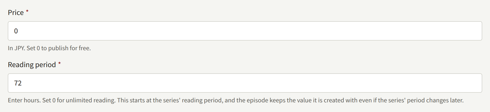
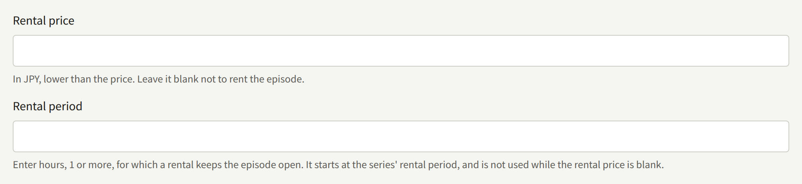
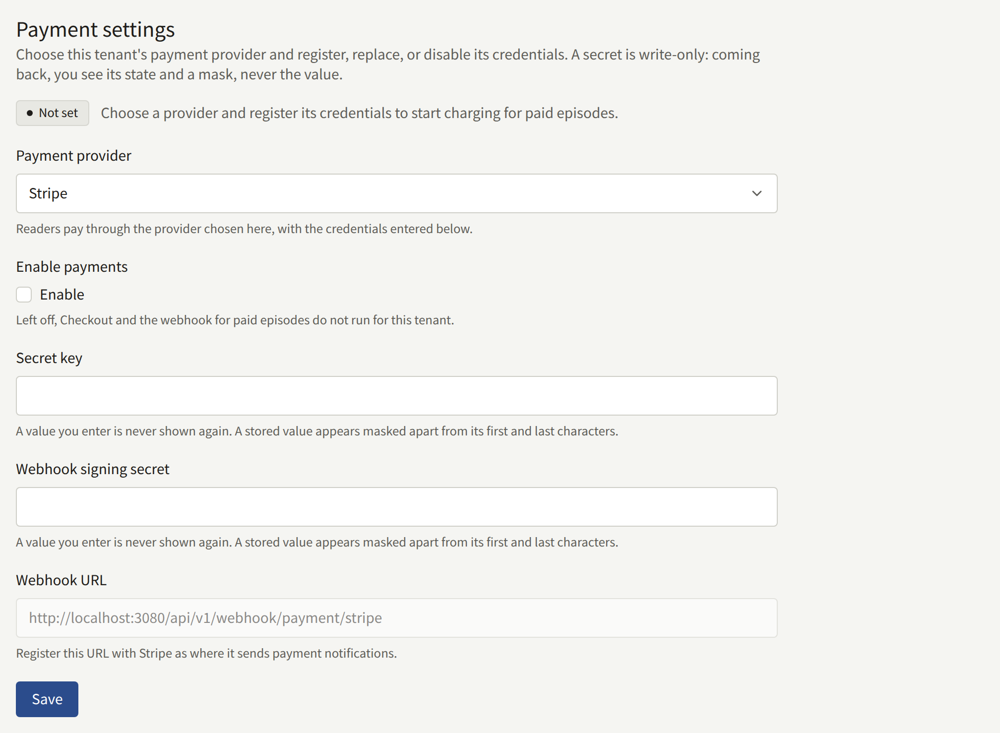
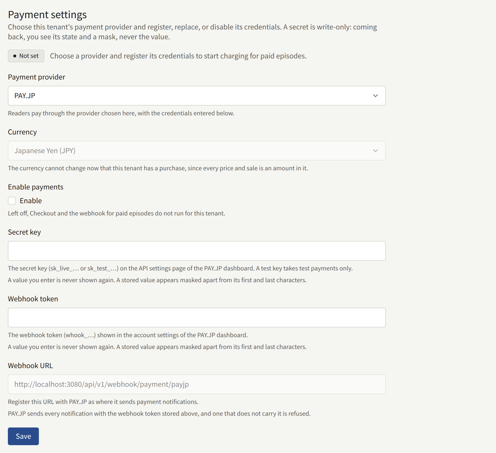
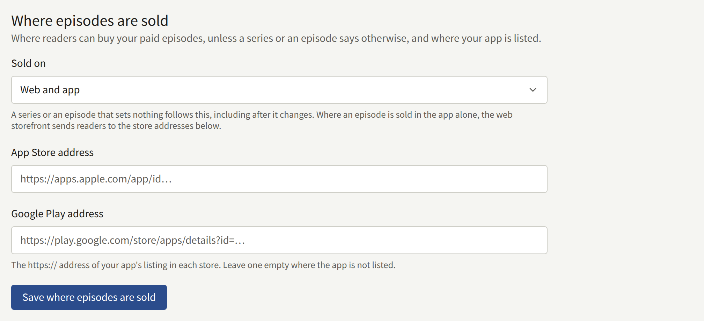
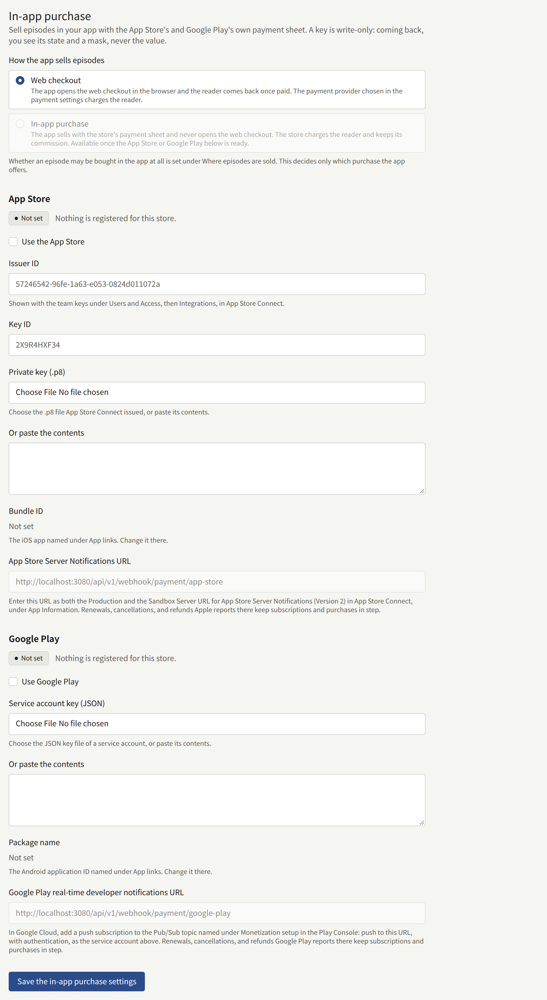
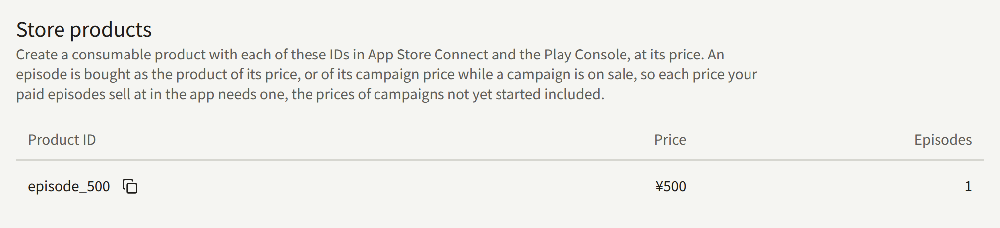

Selling an episode on the site takes three things that have to agree: the episode's price in the tenant console, an account with a payment provider, and a webhook through which the provider tells the install that a reader has paid. The provider charges the reader, but only the webhook opens the episode, so a setup with any of the three wrong takes the reader's money and leaves the episode locked. This page walks through all three, in the order they are set up, and ends with a test purchase that proves they agree.

The tenant's app sells either through the same provider, or through the App Store's and Google Play's own payment, which needs no provider and is verified with the stores instead. [Selling in the app](#selling-in-the-app) covers that choice, and a tenant that sells only in its app through the stores can skip the provider sections.

Everything here under **Payments** › **Payment methods** is for a **Tenant admin**; an Editor or an Auditor does not see that screen. Pricing an episode is done by whoever creates it.

## How a reader buys an episode

### Price and reading period

An episode's **Price** and **Reading period** are first entered on the form that creates it:

- **Price** is entered in the tenant's currency, which the field names, with no more decimal places than the currency has: `500` for 500 yen, `4.99` for 4.99 US dollars. `0` makes the episode free; any other value makes it a paid episode.
- **Reading period** is how many hours a purchase keeps the episode open. `0` keeps it open with no end.

A paid episode can also be rented: sold for less than its **Price**, for a limited time. The two fields below **Reading period** set the rental, and an episode is rented only while **Rental price** holds an amount:

- **Rental price** is entered in the tenant's currency, as **Price** is, and has to be lower than it, so a free episode cannot be rented. Leave it empty not to rent the episode.
- **Rental period** is how many hours a rental keeps the episode open, at least `1`. It is not used while **Rental price** is empty.

The form refuses a rental priced at or above **Price**, and one with a **Rental price** but no **Rental period**, and says which field to correct. A rental does not take the place of the permanent copy: a reader who rented the episode can still buy it.

All four can be changed later under **Price and reading period** on the episode's edit screen, as [Episodes](./1-catalog/2-episodes.md#changing-the-price-and-reading-period) describes. To sell an episode for less for a limited time without changing its price, schedule a [campaign price](./1-catalog/2-episodes.md#campaign-prices) on it. A change applies to purchases made after it is saved; a purchase or a rental already made keeps the price it was paid and the time it expires. A new episode's **Reading period** starts at the series' **Reading period**, and its **Rental period** at the series' **Rental period**, so setting them on the series once gives every episode created afterwards the same periods unless they are changed on the form. Changing the series' periods does not reach the episodes already created.

### Buying and reading

On a paid episode the site shows the price and **Buy this episode**. On a rented one it offers both sales instead, each with what it costs: **Buy for** the price, and **Rent for** the rental period at the rental price. A reader who is signed in and chooses one is sent to the payment provider's checkout page, pays there, and comes back to the episode, which tells them their payment is being confirmed. The episode opens when the provider's notification of the payment reaches the install, usually within seconds. Coming back from the checkout page opens nothing by itself.

Once bought, the episode:

- Stays open for its reading period, or a rental for its rental period, counted from the moment the purchase is recorded.
- Is listed under **Purchases** on the reader's account, marked as a purchase or a rental, with the time a rental has left, and after its period ends, under **Purchase history**.
- Opens on the site and in the tenant's app alike, for the same account, wherever it was bought.
- Cannot be bought again while it is open. Once its reading period has ended, it can. A reader holding a rental can still buy the permanent copy, but not rent it again until the rental ends.

**Download as CSV** on **Purchases** saves every purchase listed there, across all its pages and refunded ones included, as one CSV file. In the tenant's app, **Export as CSV** on **Purchases** writes the same file and hands it to the device's share sheet, from which the reader saves or sends it.

### The rest of a series

A reader can also buy, in one checkout, every paid episode of a series they do not own yet. Above the episode list, the series page offers **Buy remaining episodes** with how many episodes that is and what they cost together, and the series screen of the tenant's app does the same. The purchase opens each of those episodes as buying it alone would, for its own reading period.

What they cost together is the sum of their prices less the series' **Bundle discount**, where an episode under a [campaign price](./1-catalog/2-episodes.md#campaign-prices) counts at that price while its campaign is open, set on the series' form as [Series](./1-catalog/1-series.md#bundle-discount) describes: a whole percent up to `99`, or `0`, where a new series starts, to sell them at that sum. With a discount, the offer says how much it takes off what the episodes cost one by one, and the checkout page lists the discount beside the episodes. The discounted price is rounded down to the currency's smallest unit, and a discount that would leave nothing to pay offers no checkout. A change to the discount applies from the next checkout: a reader who opened the payment provider's checkout page before it pays what that page shows.

### Free reading periods and Free if you wait

A price is what a reader pays when nothing else opens the episode. Two other things can, and while either has the episode open to a reader, the site offers that reader no purchase:

- **Free reading periods**, set on an episode, open it to everyone, signed in or not, between two dates. The price applies again when the period ends. A reader who bought the episode earlier keeps their purchase, and its reading period keeps running through the free period. A series' [Free after publication](./1-catalog/1-series.md#free-after-publication) rule adds such a period to each of its paid episodes a set number of days after the episode is published.
- **Free if you wait**, set on a series, gives each signed-in reader a free ticket that opens one paid episode of the series for **Hours an episode stays open**, and a new ticket **Hours until the next ticket** after they use one. **Newest episodes a ticket cannot open** keeps the latest episodes for buyers. A ticket cannot be used on an episode in a free reading period, or on one the reader already has.

An [access ticket](./2-readers/4-access-tickets.md), issued by staff under **Access tickets**, opens an episode the same way, without payment. An Author credited on an episode reads it free and is not offered a purchase. A member of the tenant's [staff](../3-operations/3-tenant-staff.md#members-and-users), in any of the three roles, reads every published episode free while signed in to the site or the app with the account that holds the role.

## Choosing a payment provider

A tenant takes payment on the site through one provider at a time, chosen under **Payment settings** on **Payments** › **Payment methods**:

| Provider | What a reader can pay with |
| --- | --- |
| Stripe | The payment methods turned on for your account in the Stripe Dashboard, such as cards and konbini. An episode bought with a method that is paid later, such as konbini, opens once the payment arrives. |
| PAY.JP | Cards, with 3-D Secure authentication on every payment. |

Payments are taken in the tenant's currency, chosen under **Currency** in the same form: every price is entered and shown in it, on the site and in the app as in the console. **Currency** offers the currencies the chosen provider charges in — PAY.JP charges in yen only — and starts on the platform's default currency, which the install's operators set, until the settings are saved. Choose it before the first sale: once the tenant has a purchase, every price and every sale is an amount in that currency, so **Currency** can no longer be changed.

The status beside the form says where the setup stands:

- **Not set**: no provider has been chosen.
- **Incomplete**: payments are on, but a credential the provider needs is missing, so nothing is charged.
- **Disabled**: the credentials are stored, but **Enable payments** is off.
- **Ready**: readers can buy.

Until it is **Ready**, a paid episode shows its price with no way to buy it, and tells readers that the site cannot take purchases at the moment. Choosing another provider and saving deletes the credentials stored for the previous one.

Do the setup below with the provider's test keys first, as [Testing before going live](#testing-before-going-live) describes, and replace them with live keys once a test purchase has gone through.

### Stripe

In the Stripe Dashboard:

1. Copy the **secret key** from the API keys page. A test key starts with `sk_test_`, a live key with `sk_live_`.
2. Add a webhook endpoint. Its URL is the **Webhook URL** the console shows under **Payment settings** once Stripe is chosen, `https://<tenant-domain>/api/v1/webhook/payment/stripe` on the tenant's own site domain. Select these seven events, and the three more that [Subscription plans](./5-subscription-plans.md#before-you-start) lists if the tenant sells subscription plans:
   - `checkout.session.completed`
   - `checkout.session.async_payment_succeeded`
   - `checkout.session.expired`
   - `charge.refunded`
   - `refund.updated`
   - `charge.dispute.created`
   - `charge.dispute.closed`
3. Open the endpoint and copy its **signing secret**, which starts with `whsec_`.

Then in the console, under **Payment settings**:

1. Choose Stripe as the **Payment provider**.
2. Enter the **Secret key** and the **Webhook signing secret**.
3. Under **Enable payments**, check **Enable**, and choose **Save**.

Stripe keeps test-mode and live-mode webhook endpoints apart, each with its own signing secret. When you move to live keys, add the endpoint again in live mode, and enter its signing secret together with the live secret key.

#### Promotion codes

A reader can enter a promotion code on Stripe's checkout page. The codes are created in the Stripe Dashboard, under the coupons of the same account and mode as the secret key, and nothing is set in the console: every checkout of an episode or a volume takes them. A checkout of the rest of a series sold at a discount does not, since Stripe applies one discount or the other to a checkout, never both.

The purchase records what the reader paid once the code's discount is taken off, which is the amount shown in their **Purchase history**, the amount a full refund returns, and the sale the episode's Authors are paid royalties on. A code that takes off the whole price opens the episode with no payment, so there is nothing of it to refund. PAY.JP checkouts take no promotion code.

### PAY.JP

In the PAY.JP dashboard:

1. Copy the **secret key** from the API settings page. A test key starts with `sk_test_`, a live key with `sk_live_`, and a test key takes test payments only.
2. Copy the **webhook token**, which starts with `whook_`, from the account settings.
3. Register the **Webhook URL** the console shows under **Payment settings** once PAY.JP is chosen, `https://<tenant-domain>/api/v1/webhook/payment/payjp`, as the URL PAY.JP sends its notifications to. Register it for live mode as well before going live.

Then in the console, under **Payment settings**:

1. Choose PAY.JP as the **Payment provider**.
2. Enter the **Secret key** and the **Webhook token**.
3. Under **Enable payments**, check **Enable**, and choose **Save**.

PAY.JP signs nothing: the install trusts a notification because it carries the webhook token, and refuses one that does not, so keep the token as secret as the secret key.

### When a payment does not open the episode

The provider's dashboard lists each delivery to the webhook with the status the install answered. Each status points to one cause:

| Status | Cause | What to do |
| --- | --- | --- |
| 2xx | Accepted. Not every accepted notification opens an episode: Stripe sends `checkout.session.completed` for a konbini payment before the reader pays, and the episode opens only with the `checkout.session.async_payment_succeeded` that follows the payment | Check the event type and the payment's status in the dashboard. If the payment is complete and the episode is still locked, the reader may have bought it on another account. |
| 400 | The signing secret or webhook token in the console does not match the provider's | Enter the value from the endpoint the provider is sending from. |
| 404 | The path does not name a provider | Register the URL exactly as the console shows it. |
| 503 | Payments are not **Ready**, or the URL names a provider other than the one chosen | Finish the setup above. The provider retries the delivery. |
| No delivery | The webhook is not registered, or is registered for the other mode | Register it in the mode the keys belong to. |

Both providers retry a failed delivery for some time, and their dashboards can resend one. Once the setup is fixed, a payment whose notification arrives opens the episode it paid for.

## Where episodes are sold

**Where episodes are sold**, on the same screen, decides where a reader can buy a paid episode. **Sold on** offers:

- **Web and app**: on the site and in the tenant's app.
- **Web only**: on the site. The app shows the episode as sold on the website, and opens it once it is bought there.
- **App only**: in the app. The site shows the episode as sold in the app, opens it to a reader who bought it there, and links to the app's listing in each store under **App Store address** and **Google Play address**.

A series or an episode can set its own **Sold on**, and one that sets nothing follows the series, or the tenant, including after either changes. An episode is sold only where it is also shown.

The choice exists because of the app stores. Apple and Google each set rules on how an app may sell digital content, decide in review whether an app follows them, and take a commission on what the app sells through them. A tenant whose app sells through the stores' own payment, as the next section describes, pays that commission on every episode bought in the app, and can keep a series on the site alone with **Web only**. A tenant with no app, or one that does not sell in its app, chooses **Web only** for every episode.

## Selling in the app

The **In-app purchase** section decides how the tenant's app sells an episode it may sell, under **How the app sells episodes**:

- **Web checkout** opens the site's checkout in the phone's browser, through the provider above, and brings the reader back to the episode once paid.
- **In-app purchase** sells with the App Store's and Google Play's own payment sheet. The store charges the reader and keeps its commission, and the payment provider above is not involved.

With **In-app purchase**, the app needs no payment provider from [Choosing a payment provider](#choosing-a-payment-provider): it buys through the store and the install verifies the purchase with the store.

On an episode sold **App only**, the site shows the episode as sold in the app and links to the stores only while the app can sell it: with **Web checkout**, while a payment provider is **Ready**; with **In-app purchase**, while a store is **Ready**, and then only to the listing of a store that is. Until then the site quotes the episode's price and tells readers it cannot take purchases. An episode sold **Web and app** is bought on the site while a payment provider is **Ready**; while none is and the app can sell it, the site treats it the same way as one sold **App only**.

**In-app purchase** can be chosen once at least one store is **Ready**: turned on with **Use the App Store** or **Use Google Play**, with its key entered, and with its app named under **Integrations** › **App links**.

The app buys each episode as the store product named after its price, such as `episode_300` for a ¥300 episode, so a store sells only the prices it has a product for. While a [campaign price](./1-catalog/2-episodes.md#campaign-prices) is on sale, the price is the campaign's: an episode on sale from ¥500 to ¥300 is bought as `episode_300` and recorded at ¥300. **Store products**, at the bottom of the screen, lists the product ID every price your app sells at needs, the price of every campaign that is scheduled or on sale included, and counts an episode under each of its prices. Create each one in App Store Connect and in Play Console as a consumable product at that price, and add one whenever a new price appears in the list, which for a campaign is as soon as it is scheduled, so its product is ready before it starts.

What each store needs, from the key the install verifies purchases with to testing with the stores' test buyers, is on [In-app purchase and sign-in](../5-mobile-app/5-purchases-and-sign-in.md#selling-episodes-in-the-app), with the app's own setup. A purchase from the App Store sandbox or a Play license tester opens the episode but is recorded as a test, and left out of royalty statements and the content statistics.

## Refunds

A purchase on the site is refunded from the console, as [Refunding from the console](#refunding-from-the-console) describes, or in the Stripe or PAY.JP dashboard. A purchase in the app is refunded by Apple or Google. Publira does not tell the reader either way.

- **A full refund** closes the episode to the reader. The purchase stays in their **Purchase history**, marked **Refunded**, and they can buy the episode again.
- **A partial refund** leaves the episode open until the refunds on the payment add up to what the reader paid. It still lowers the sales the episode's Authors are paid royalties on.

Each refund reaches the install the way its purchase did:

- **Stripe and PAY.JP** report it through the webhook above, which is why Stripe's endpoint needs `charge.refunded`. A refund the provider accepted can still fail later, for example when the reader's card has been closed; the provider reports that too, through `refund.updated` on Stripe, and the episode opens to the reader again unless what stays refunded still adds up to what the reader paid.
- **The App Store** reports it to the **App Store Server Notifications URL** the console shows in the **App Store** section, which is registered in App Store Connect as both the Production and the Sandbox Server URL.
- **Google Play** does not send refunds. The install reads Google Play's voided purchases once an hour, for the last 30 days, so a refunded purchase can keep its episode open for up to an hour. This runs in `publira worker`, which the operator keeps running, as [Overview](../2-deployments/1-overview.md) describes; without it, Google Play refunds are not applied.

A refund that arrives before the purchase it reverses is kept, and applied when the purchase is recorded.

### Refunding from the console

**Payments** › **Purchases** lists the tenant's purchases, newest first, and narrows them by the reader's email address, the series, the episode, and the days they were made on, in the tenant's time zone. **View** opens a purchase beside the list with what the reader paid, where they paid it, and what has been refunded so far. Only a tenant admin sees the screen.

**Refund** asks the provider the reader paid through to give back what they paid, once you have written a reason; the reason is recorded in the audit log with the refund. The episode closes to the reader at once, and the purchase shows **Refund requested** until the provider reports the refund through the webhook, when it shows **Refunded**. A refund the provider refuses, or one that fails after the provider accepted it, opens the episode to the reader again.

The console offers no refund for a purchase made in the app, one the reader disputed with their bank, or one paid through a provider the tenant no longer takes payments through: refund those where the reader paid.

## Disputes

When a reader disputes a Stripe payment with their bank, Stripe reports it through the same webhook, which is why its endpoint needs `charge.dispute.created`. The episode closes to the reader as soon as the dispute is opened, whichever way the bank later decides it, and the purchase stays in their **Purchase history**, marked **Canceled**. Respond to the dispute in the Stripe Dashboard; nothing is done in the console.

How the bank decides changes only the royalty statement, which learns of the decision through `charge.dispute.closed`:

- A dispute decided for you leaves the payment with you, so the purchase stays a sale. The episode stays closed to the reader.
- A dispute decided against you returns the payment to the reader, so the purchase stops being a sale, as a full refund does. When the month it was bought in is already closed, the next statement takes it back as an adjustment, as [Royalties](./6-reports-and-royalties.md#a-refund-after-the-close) describes for a refund.

## Abandoned checkouts

A reader who leaves the payment page without paying can start the purchase again at any time. Once Stripe reports the abandoned checkout expired, which is why its endpoint needs `checkout.session.expired`, the reader's next attempt opens a new payment page instead of the expired one.

## Testing before going live

Test the whole setup with the provider's test keys before readers can pay: the webhook is the part that most often goes wrong, and only a purchase shows that it works.

A purchase made in the provider's test mode opens the episode but is recorded as a test, and left out of royalty statements and the content statistics. The reader still gets a receipt by mail, which says that the purchase was made in test mode and that no money was charged. The console cannot delete an episode, so keep the test in a series of its own, which you hide afterwards.

1. Set up the provider with its **test** secret key, and register the webhook in test mode, as above. Check that **Payment settings** shows **Ready**.
2. Create a series for the test, shown on **Web and app** or **Web only** and published now. In it, create an episode with a **Price** such as `100` and a **Reading period** such as `1`, published now, and sold on the web.
3. On the site, sign in with a reader account that holds no console role, open the episode, and choose **Buy this episode**.
4. Pay with a test card. `4242 4242 4242 4242`, with any future expiry date and any three-digit security code, works with both providers. PAY.JP then shows its test 3-D Secure screen, where you choose the outcome.
5. Back on the episode, wait for it to open, then check that it is listed under **Purchases**. If it does not open within a minute, read the delivery in the provider's dashboard, as [When a payment does not open the episode](#when-a-payment-does-not-open-the-episode) describes.
6. Refund the purchase from **Payments** › **Purchases**, or the payment in full from the provider's dashboard, which proves that refunds reach the install too. Reload the episode: it is locked again, and **Buy this episode** is back.

When both pass, set the test series' **Shown on** to **Not shown anywhere**. Then replace the test secret key with the live one, register the webhook in live mode, enter its signing secret or token, and save.

To test in-app purchase, use the stores' own test buyers as [Testing a purchase](../5-mobile-app/5-purchases-and-sign-in.md#testing-a-purchase) describes. Those purchases are recorded as tests as well.
