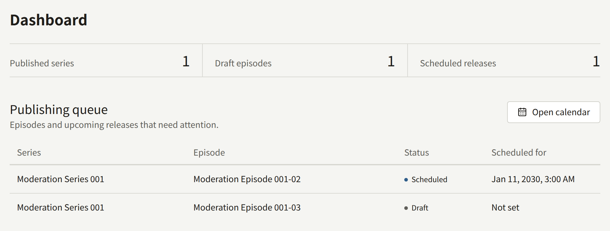
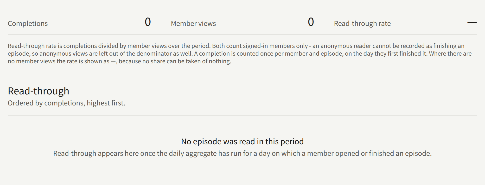
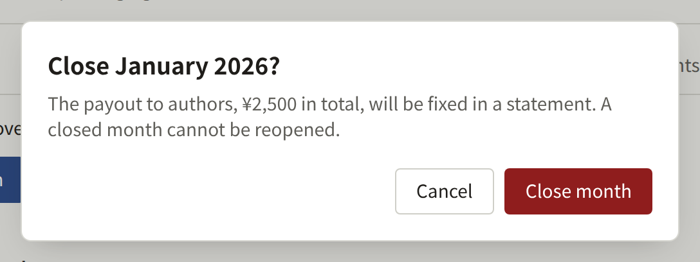
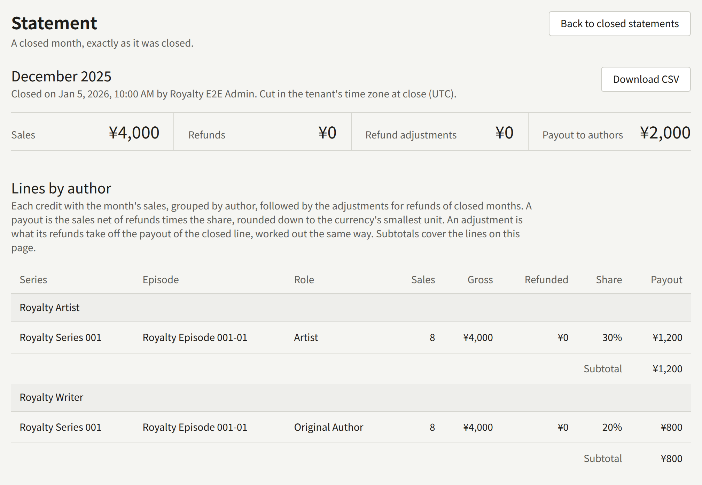
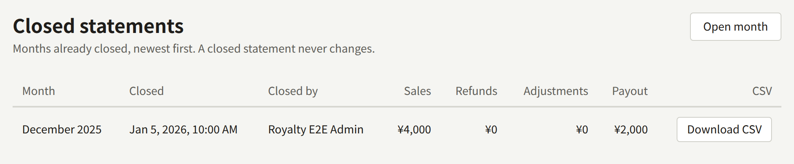
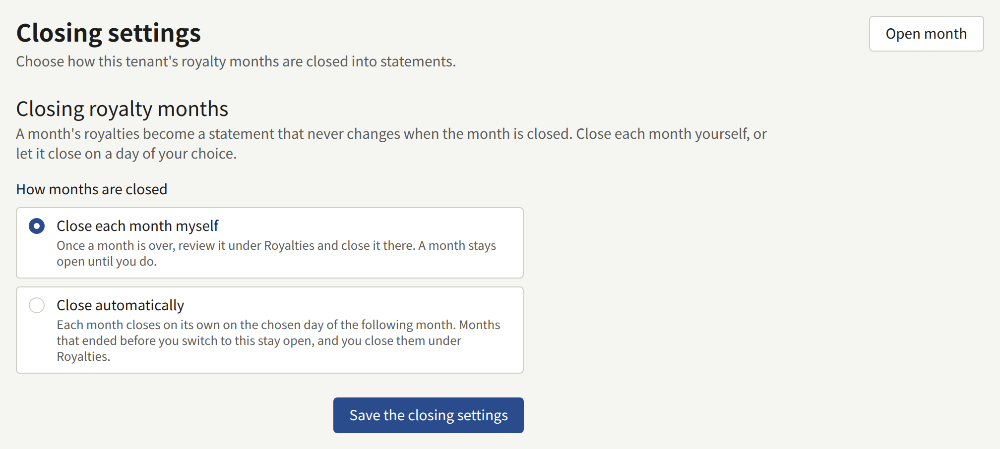

Three screens in the console turn what happens on the site into numbers. **Dashboard** shows where the catalog's publishing stands, **Read-through** under **Reports** shows how far members read, and **Royalties** under **Reports** works out what the tenant owes each Author for a month of sales, then closes that month into a statement that never changes.

Every member of the staff sees **Dashboard** and **Read-through**. Only a **Tenant admin** sees **Royalties**, closes a month, downloads a statement, or changes how months are closed; for anyone else the screens are not there.

## Which day a sale or a read falls on

Every date these screens count by is a calendar day in the tenant's time zone, set under **Settings** › **General** › **Time zone**. A tenant that has never set one uses the install's default, which the operator chooses. A day runs from midnight to midnight in that zone, and a month from 00:00 on its first day to 00:00 on the first day of the next. A sale made at 08:30 on 1 April in Tokyo belongs to April for a tenant on `Asia/Tokyo`, and to March for a tenant on `UTC`, where it is still 23:30 on 31 March.

- A sale falls on the moment the purchase was recorded, which for a payment that settles later, such as konbini, is when the payment arrived.
- A read falls on the day the member opened or finished the episode.
- A statement keeps the zone its month was cut in, and shows it under the month as **Cut in the tenant's time zone at close**.

Changing the time zone after a statement has been closed leaves that statement as it was closed. The month after it starts where the statement ended, at midnight in the old zone, and ends at midnight in the new one, so a sale made in the hours between the two midnights is counted once, in whichever month the old zone put it in. Every month after that runs from midnight to midnight in the new zone. Days that **Read-through** has already counted are not recounted; the change applies from the next day it counts.

## Dashboard

**Dashboard**, the first entry of the console, is an overview of the catalog's publishing, not of sales or reading. Its three figures count the whole tenant, with no date range:

| Figure                 | What it counts                                     |
| ---------------------- | -------------------------------------------------- |
| **Published series**   | Series that are published                          |
| **Draft episodes**     | Episodes saved as a draft                          |
| **Scheduled releases** | Episodes with a release date that has not come yet |

**Publishing queue** lists up to ten of those episodes: the scheduled ones first, soonest release first, then the drafts, newest first. **Scheduled for** is shown in the tenant's time zone, and **Not set** on a draft with no date.

The screen updates as soon as a member of the staff saves a series or an episode, and when a scheduled episode goes live on its own, which then leaves the queue.

## Read-through

**Read-through** shows how many members finish each episode they open. It covers the last 28 days in the tenant's time zone, up to and including yesterday; the line under the title states the dates and the zone.

| Figure | What it counts |
| --- | --- |
| **Completions** | Members finishing an episode. Each member counts once for each episode, on the day they first finished it, however often they read it again |
| **Member views** | Times signed-in members opened an episode. A member's opens of one episode count once in each half hour of the clock, from :00 to :29 and from :30 to :59, so opening it again in the same half hour adds nothing, while opening it at 10:29 and again at 10:30 counts twice |
| **Read-through rate** | **Completions** divided by **Member views**, shown as `—` when there are no views |

Only signed-in members count. A reader who is not signed in cannot be recorded as finishing an episode, so their views are left out as well. How a member came to read the episode makes no difference: an episode bought, opened with a ticket, or free counts the same, and a purchase alone counts nothing.

**Episodes** lists each episode read in the period, the most completions first, twenty to a page. The totals at the top cover the whole period, whichever page is shown.

The figures are counted once a day is over. `publira worker` counts each day after midnight in the tenant's time zone, on its next hourly pass, so a read made today appears tomorrow. While the worker is stopped, no new day is counted: the screen keeps showing the days counted before, and empties as they leave the 28-day window. When the worker starts again, it catches up on the days it missed. [Overview](../2-deployments/1-overview.md) describes keeping `publira worker` running.

## Royalties

**Royalties** works out, month by month, what each Author is owed on the sales of the episodes they are credited on. A month stays open, its figures following every sale, refund, and change of a share, until it is closed. Closing it writes a statement that never changes again. The statement is what the tenant pays its Authors from: Publira pays no one, and the statement is the record of what is owed.

### What an Author is owed

An Author is paid a share of each episode they are credited on. The share is set on the credit, as a percentage of the episode's sales, and whatever the shares on an episode leave is the publisher's:

- **On the series form**, **Authors** sets each credit's share under **Share of author**. These credits are the template a new episode is created with; changing them leaves the existing episodes as they are.
- **On an episode**, **Authors** changes that episode's own credits and shares, and **Save authors** stores them.
- **On the series' episode list**, **Credits** › **Set share** changes one credit's share on many episodes at once.

A share is between 0 and 100 percent, with up to two decimal places, and the shares on an episode add up to no more than 100. A share of 0 credits an Author without paying them. An Editor can set shares too, since they edit the catalog.

For each credit, a month's payout is:

> (the episode's sales in the month − the refunds on those sales) × the share, rounded down to the smallest unit of the tenant's currency, such as a yen or a cent

The sales of a month are:

- Purchases of the episode on the site, through Stripe or PAY.JP, at the price the reader paid.
- Purchases on the site of a volume holding the episode, each a sale of the episode at its part of the price the reader paid. That price is divided among the volume's episodes in proportion to their own prices when the purchase was recorded, or evenly when none of them has a price, so a free episode in a volume with priced ones takes no part and has no sale. The parts are fixed with the purchase: repricing an episode or changing what the volume holds afterwards does not move them. A partial refund of the volume is divided in the same proportion, each episode's part rounded down.
- Purchases in the tenant's app through the App Store or Google Play, at the episode's price. The store's commission is not taken off.

Every amount is in the tenant's currency, and a closed statement keeps the currency it was closed in. A purchase paid in another currency, which happens only when a reader completes a payment started before the tenant changed its currency, opens the episode but is not a sale on the statement.

Nothing else is a sale. Access tickets, **Free if you wait**, free reading periods, and an Author reading their own episode open an episode without one. A purchase from the App Store sandbox or a Play license tester, and one made with Stripe's or PAY.JP's test keys, is a test and is left out.

A purchase that is refunded in full drops out of the month it was bought in. A partial refund leaves the sale in, and its amount is taken off under **Refunded**. Either way, while the month of the purchase is open, the refund counts against that month, not the month of the refund.

A Stripe payment whose [dispute](./4-selling-episodes.md#disputes) the reader's bank decides against you counts as refunded in full from the moment Stripe reports the decision, here and after the close alike. A dispute that is still open, or that is decided for you, leaves the sale in.

### A refund after the close

A refund recorded after the month of the purchase was closed cannot change that statement. It is taken off the next statement closed after it instead, as an adjustment line: a line under the same Author, series, episode, and role as the closed line that counted the sale, naming the closed month it adjusts. An adjustment comes after the month's own lines, and its figures are changes, so they are negative where a line of sales has them positive:

- **Sales** is minus the purchases refunded in full, and **Gross** minus their price.
- **Refunded** is the change in the refunds of the purchases that are still sales. It is negative when a purchase that was partly refunded at the close has since been refunded in full, since that purchase now leaves through **Gross** instead.
- **Payout** is what the refund takes off the closed line's payout: the line's payout worked out again, at the share the closed month applied and rounded down as before, over what is left of its sales, less what it was. A share changed since the close, or an Author credited since, changes nothing about it. The closed line and its adjustments together pay what the line would have paid had the refunds come before the close, so nothing once every sale on it is refunded.

Each part of a refund is taken off once. A purchase refunded in part after one close and in full after the next is taken off in two adjustments, the second for what the first did not cover, and the statements together pay nothing for it.

An adjustment is carried only into a month later than the one it adjusts. A month closed out of order, before an earlier one, carries none of that earlier month's refunds; the next month closed after both carries them. When a month's adjustments outweigh its own sales, its **Payout to authors** is negative, and so is an Author's subtotal when their adjustments outweigh their lines of sales.

### Reading the open month

**Royalties** opens on the month after the newest closed statement, or on last month when nothing has been closed yet. **Month**, with **Show**, opens any other month that is not closed and has started.

**Open month** gives four totals:

| Total | What it is |
| --- | --- |
| **Sales** | Every sale of the month, at its price, including sales of episodes that credit no Author |
| **Refunds** | The refunds on those sales |
| **Refund adjustments** | What the month takes back of the sales of closed months refunded since their close, as [A refund after the close](#a-refund-after-the-close) describes, each sale counted once: zero, or a negative amount |
| **Payout to authors** | What the month owes its Authors, the sum of the lines below, adjustments included. The rest of **Sales** after **Refunds** and **Refund adjustments** is the publisher's |

**Lines by author** groups the month by Author, with a line for each credit on an episode that sold in the month and a **Subtotal** for the Author. Each line gives the **Series**, the **Episode**, the credit's **Role**, the number of **Sales**, the **Gross** amount, the amount **Refunded**, the **Share**, and the **Payout**. An Author credited twice on the same episode, in two roles, has a line for each. An adjustment comes after the month's own lines in its Author's group, says **Refund adjustment for** the closed month under its episode, and counts in the Author's **Subtotal**.

Above the totals the screen says where the month stands:

- **This month is still in progress.** It can be closed once its last day is over in the tenant's time zone.
- **This month is over and ready to close.** **Close month** closes it.
- **This month closes automatically on** a date. The month is closed by `publira worker` on that date, and the console offers no way to close it by hand.

### Before you close a month

Closing a month fixes it as it stands at that moment, and nothing that happens afterwards reaches it. Check, before closing:

- **The credits and shares.** The statement takes each share as it stands when the month is closed, not as it stood when the episode sold. Change a share before the close and the whole month is paid at the new share; change it after, and only the open months are.
- **The refunds you expect.** A refund recorded after the close is taken off the next statement rather than the closed month, as [A refund after the close](#a-refund-after-the-close) describes, so the Author is paid for the sale first and the payout comes back out of a later month. Wait for a refund you know is coming to have it counted in its own month.
- **That the month is over.** A sale made late on its last day counts in the tenant's time zone, which may not be yours.

Close the months in order. The console offers the month after the newest statement for this reason, and a month passed over has to be picked with **Month** to be closed later.

### Closing a month

1. Open **Reports** › **Royalties**. The month shown is the one to close next.
2. Check that it says **This month is over and ready to close**, and read through **Lines by author**.
3. Choose **Close month**. The dialog states the **Payout to authors** that will be fixed. Choose **Close month** again to confirm.

The console then opens the month's **Statement**, which shows **Closed on**, who closed it, and the same totals and lines as the open month had. The close is recorded in **Audit logs** as **Royalty month closed**.

Once closed, a statement keeps each Author's, series', episode's, and role's name as it was at the close: renaming an Author, editing a share, refunding a purchase, or deleting a credit afterwards leaves it as it is. A refund recorded afterwards is taken off the next statement instead. A closed month cannot be reopened, by staff or by the operator. A mistake found afterwards is corrected outside Publira, in what the tenant pays.

**Closed statements** lists every closed month, newest first, with when it was closed, who closed it, and its totals. A month closed automatically shows `—` under **Closed by**.

### Exporting a statement as CSV

**Download CSV** downloads a closed statement: on the **Statement** itself, or on its row in **Closed statements**. An open month cannot be downloaded, since its figures are still changing.

The file is named `royalties-<tenant>-<YYYY-MM>.csv`. It is UTF-8, with a byte order mark so that Excel reads it correctly, one row for each line of the statement under a header row, and no total row. Its columns are:

| Column | Holds |
| --- | --- |
| `period` | The month, `YYYY-MM` |
| `creator_id`, `creator_name` | The Author |
| `role_id`, `role_name` | The credit's role, empty for a credit without one |
| `series_id`, `series_title` | The series |
| `episode_id`, `episode_title` | The episode |
| `sale_count` | The number of sales |
| `gross_amount` | The sales, in the smallest unit of the statement's currency: yen for JPY, cents for USD |
| `refunded_amount` | The refunds on them, in the same unit |
| `share_percent` | The share, with two decimals, such as `12.50` |
| `payout_amount` | The payout, in the same unit |
| `currency` | The statement's currency, such as `USD`: the tenant's when the month was closed, and the only one whose sales it counts |
| `adjusted_period` | Empty for a line of the month's own sales. On an adjustment, the closed month it takes a refund back from, `YYYY-MM`, and its amounts are the negative changes [A refund after the close](#a-refund-after-the-close) describes |

Names are as they were at the close, and the IDs keep a line tied to its Author and episode across renames. A cell that a spreadsheet would read as a formula is written so that it stays text. A statement downloads the same file every time, and each download is recorded in **Audit logs** as **Royalty statement CSV downloaded**.

### Closing months automatically

**Closing settings**, on **Royalties**, chooses how months are closed:

- **Close each month myself**, the default: a month stays open until a Tenant admin closes it as above.
- **Close automatically**: each month is closed on the **Close day** of the following month, a day from 1 to 28 in the tenant's time zone.

Choose **Save the closing settings** to apply the choice; the change is recorded in **Audit logs** as **Royalty closing settings updated**.

An automatic close happens on the first hourly pass of `publira worker` after midnight on the close day, closes the month exactly as **Close month** would, and records no one under **Closed by**. If the worker was stopped on the close day, it closes the months it owes when it starts again, oldest first. Without `publira worker` running, no month is closed automatically.

**Close automatically** applies to the months that end after it is chosen. A month already over when you switch stays a manual close: close it from **Royalties** as above. Choose a **Close day** that leaves time for the checks in [Before you close a month](#before-you-close-a-month), since no one is asked before the close, and fix a share before that day rather than after.
