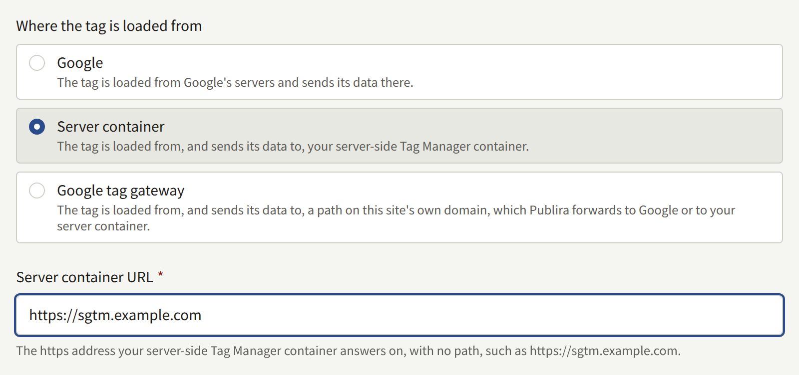
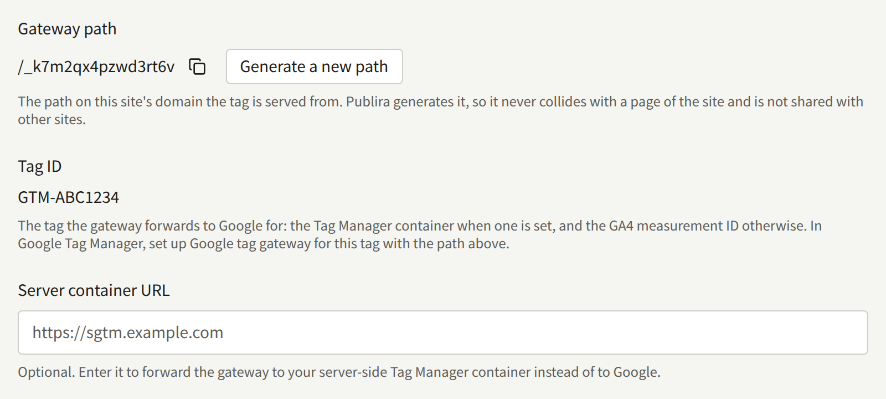
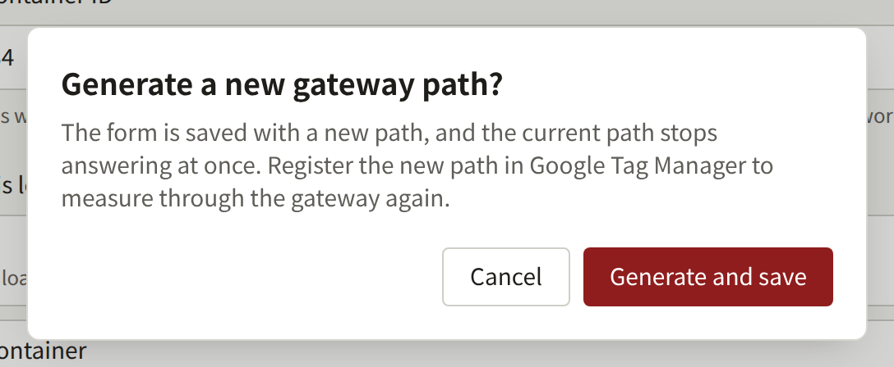
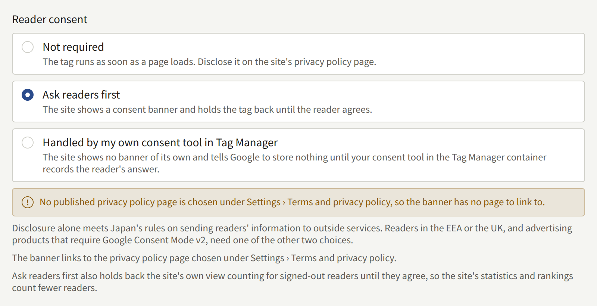

**Integrations** › **Google tag** has the tenant's site load the Google tag: Google Analytics 4 for a measurement ID, Google Tag Manager for a container ID, or both. This page takes a Tenant admin through the IDs, the three places the tag can be loaded from, what each of them needs set up in Google Analytics and Google Tag Manager, and whether readers are asked before the tag runs.

Only a Tenant admin sees **Google tag**, and every saved change is recorded in **Audit logs** as **Google tag updated**. The setting covers the site in the browser. The tenant's app loads no Google tag.

## Before you start

- **A Google Analytics 4 property with a web data stream for the site**, or **a web container in Google Tag Manager**, owned by the publisher. A container is the place for every tag besides Google Analytics, as described below.
- **A privacy policy that covers the tag.** The tag sets cookies of its own and sends what it collects to Google, which Publira's own list of what the site stores does not cover. Write that into the policy before the tag goes live, as [Pages](./3-setup/3-pages.md#what-the-site-stores-in-a-readers-browser) describes.

## The IDs

- **GA4 measurement ID**: the ID of the site's web data stream, starting `G-`. Google Analytics shows it under **Admin** › **Data collection and modification** › **Data streams**, in the details of the stream. A Universal Analytics ID, starting `UA-`, is refused, since Google no longer collects data for one.
- **Tag Manager container ID**: the ID of the site's web container, starting `GTM-`. Google Tag Manager shows it at the top of the container's workspace.

Enter the one the site is measured with:

- **A container alone** when Google Analytics is set up inside it. A container that fires a GA4 tag and a **GA4 measurement ID** beside it count every page view twice, which **Before you save** warns about.
- **A measurement ID alone** when the site has no container.
- **Both** only when the container does not fire GA4 itself, such as a container that holds advertising tags alone.

The console takes no tags of its own beyond these two IDs. An advertising pixel, a conversion tag, or any other tag goes into the Tag Manager container, which the site then loads with everything in it. Leave both IDs empty, and save, to stop loading any tag.

The site moves between its pages without reloading them, so a page view after the first one is counted from the change the browser records in its history. GA4's enhanced measurement counts these by default, whether the GA4 tag is loaded by the site or fired from a container. If page views based on browser history events are turned off for the stream, a visit counts its first page only.

## Where the tag is loaded from

**Where the tag is loaded from** decides where the reader's browser fetches the tag's script, and where the tag sends what it collects:

| Mode | The tag is loaded from | It sends its data to | It needs |
| --- | --- | --- | --- |
| **Google** | Google's servers | Google | Nothing more |
| **Server container** | The tenant's server-side Tag Manager container | The server container | A **Server container URL**, and the server container URL set on the Google tag in the Tag Manager container |
| **Google tag gateway** | A path on the site's own domain | The same path, which Publira forwards to Google or to the server container | Setting up the gateway in Google Tag Manager |

**Google** is the default, and needs nothing set up besides the IDs.

### Server container

**Server container** loads the tag from a server-side Tag Manager container the publisher runs, and the tag sends its data there rather than to Google. Publira does not run the container.

**Server container URL** is the `https` address the container answers on, with no path, such as `https://sgtm.example.com`. It has to be a domain name: an IP address is refused. Serving the container on a subdomain of the site's own domain keeps the tag first-party, which is the arrangement Google recommends in [Map a custom domain](https://developers.google.com/tag-platform/tag-manager/server-side/custom-domain).

The site loads `gtm.js` and `gtag.js` from that address, under the paths Google serves them on. The container therefore has to serve Google's scripts as well as receive the data, as Google's [Load Google scripts first-party](https://developers.google.com/tag-platform/tag-manager/server-side/dependency-serving) describes for a tagging server. A container that does not serve them loads no tag on the site, and the site measures nothing until it does.

Where the data goes depends on which ID loads Google Analytics:

- **A GA4 measurement ID**: the site tells the GA4 tag it loads to send its data to the server container. Nothing more is needed.
- **A Tag Manager container ID**: the site loads the container from the server container, but the tags inside it send their data wherever the container tells them to, which is Google until it is changed. In the web container, set `server_container_url` to the **Server container URL** on the Google tag, and publish the container, as Google's [Send data to server-side Tag Manager](https://developers.google.com/tag-platform/tag-manager/server-side/send-data?option=GTM) describes. Until then the site measures as before, with every hit going to Google directly.

### Google tag gateway

**Google tag gateway** is what Google calls Google tag gateway for advertisers: the tag is loaded from, and sends its data to, a path on the site's own domain, and Publira forwards what arrives there to Google. Ordinarily a site's owner sets this up on their own CDN or load balancer. A Publira site's domain is served by Publira, so Publira does that part, and what is left is to tell Google Tag Manager about the path.

- **Gateway path** is the path the tag is served from, such as `/_k7m2qx4pzwd3rt6v`. Publira generates it the first time the form is saved in this mode, so it never collides with a page of the site and is not shared with any other site. It stays when the tenant switches to another mode, so switching back serves the tag where it was served before.
- **Tag ID** is the tag the gateway forwards to Google for: the **Tag Manager container ID** when one is set, and the **GA4 measurement ID** otherwise. A container covers every tag it fires, so a site with both is set up once, for the container.
- **Server container URL** is optional here. Enter it to have the gateway forward to the publisher's server container instead of to Google; the container then has to answer the gateway path itself, as Google's [Load Google scripts first-party](https://developers.google.com/tag-platform/tag-manager/server-side/dependency-serving) describes. Publira connects to it only where its name resolves to a public address, so a container on a private network is not reached.

Publira forwards a request on the gateway path as it came, path and query included, to `https://<Tag ID>.fps.goog`, or to the server container. Of the reader's cookies, it passes only Google's own measurement cookies, such as `_ga`, `_gcl_au`, and `FPID`, and it lets back only those. The reader's sign-in to the site, and every other cookie of the site, never leave Publira. The reader's IP address is passed on, as Google's gateway expects. Their country and region are passed on when the install's edge looks them up, which Google uses for reporting by region and for region-specific consent defaults; behind an edge that does not, Google reports the site's traffic through the gateway with no region. Ask whoever runs the install which it is.

#### Setting it up in Google Tag Manager

1. Save the form in the **Google tag gateway** mode, and copy the **Gateway path** it shows.
2. For a container, open it in Google Tag Manager and go to **Admin** › **Google tag gateway**. For a measurement ID without a container, open the Google tag's settings instead: in Google Analytics, **Admin** › **Data collection and modification** › **Data streams**, the site's stream, **Configure tag settings**, and then **Admin** › **Google tag gateway**.
3. Select **Continue**, and enter the site's address under **Scan your site**.
4. Publira is none of the CDNs Google connects to on your behalf: under **More ways to set up**, choose **Guided**, and give the **Gateway path** as the measurement path. The routing the guided instructions then describe, from the path to `fps.goog`, is what Publira already does, and needs nothing from you.

Google's [setup guide](https://developers.google.com/tag-platform/tag-manager/gateway/setup-guide) describes that routing for a site that does its own, which shows what Publira does in its place.

#### Checking that it works

- **The path answers.** Open `https://comics.example.com/<gateway path>/healthy` in a browser, with the site's domain and the **Gateway path**. It reads `ok` once the gateway reaches Google. Google's second check, `?validate_geo=healthy`, does not read `ok`, since Publira does not pass the reader's country and region.
- **The hits go through it.** Preview the container in Tag Assistant and browse the site. Under **Summary** › **Output** › **Hits Sent**, the hits are sent to the gateway path.
- **Google sees it.** The **Google tag gateway** screen in Google Tag Manager shows the site's domain as **Pending** until Google has received data through the path, and as **First-party** after that.

#### Generating a new path

**Generate a new path** replaces the **Gateway path**. It saves the form with a new path, and the current path stops answering at once, so the site measures nothing through the gateway until the new path is set up in Google Tag Manager in its place.

## Reader consent

**Reader consent** decides whether the site asks a reader before the tag runs. It applies to every reader of the site, wherever they read from.

| Choice | What the site does | It needs |
| --- | --- | --- |
| **Not required** | Runs the tag as soon as a page loads | The tag disclosed on the privacy policy page |
| **Ask readers first** | Shows a consent banner, and holds the tag back until the reader agrees | A privacy policy page for the banner to link to |
| **Handled by my own consent tool in Tag Manager** | Shows no banner of its own, and tells Google to store nothing until the publisher's consent tool records the reader's answer | A **Tag Manager container ID**, and a consent tool in that container |

**Not required** is the default. Which choice fits depends on who reads the site:

- **Readers in Japan alone**: disclosing the tag on the privacy policy page meets the external transmission rules of Japan's Telecommunications Business Act, so **Not required** is enough.
- **Readers in the EEA or the UK**, or **an advertising product that requires Google Consent Mode v2**: choose one of the other two. Both send Google Consent Mode v2 signals that follow the reader's answer.

### Ask readers first

The banner links to the page chosen as the privacy policy under [Settings › Terms and privacy policy](./3-setup/1-settings.md#terms-and-privacy-policy). While no published page is chosen there, the form warns that the banner has no page to link to when **Ask readers first** is chosen. The warning goes away once a published page is chosen, and the setting can be saved either way.

Until a signed-out reader agrees, the site also does not count their views, which it otherwise does with the identifier [Pages](./3-setup/3-pages.md#what-the-site-stores-in-a-readers-browser) lists for signed-out readers. Statistics and rankings on a site that asks first therefore count fewer readers than the same site would without asking.

### Handled by my own consent tool in Tag Manager

This choice is for a publisher that already runs a consent management platform as a tag inside its Tag Manager container. The site sets every Consent Mode v2 signal to `denied` before the container loads, and the consent tool in the container shows its own banner and updates the signals with the reader's answer.

The choice is offered only while a **Tag Manager container ID** is entered, since there is nowhere else for the tool to run, and the form says so under the choice until one is. Clearing the container ID while this choice is saved is refused in the same way, next to the ID.

## Pages that load no tag

The site loads the tag on every page except the ones where a reader gives it a password, a passkey, or a link from a mail:

- **Sign in** and the sign-up page.
- The steps an account mail leads through: confirming an email address, resetting a password, and resending a confirmation mail.
- **Settings**, and every page under it.

Payment is taken on the payment provider's checkout page, which loads none of the site's tags. The reader comes back from it to a page of the site that loads the tag as usual, so a purchase can be measured on the page they return to.

One of these pages opened directly, or reloaded, loads no tag. A tag already running when a reader moves to one of these pages from another page of the site keeps running, since the site does not reload the page in between.

## What the privacy policy has to say

**Before you save** asks for the site's privacy policy page to say what the site sends to Google, and what for. The tag sets Google's cookies and sends what it collects to Google, or to the server container, and so does every tag the container fires. [Pages](./3-setup/3-pages.md#what-the-site-stores-in-a-readers-browser) lists what Publira itself keeps in a reader's browser, and the policy covers the tag in addition to that list, from Google's documentation and that of each tag in the container.

Whichever choice is made under [Reader consent](#reader-consent), the policy says what the tag sends: asking first decides when the tag runs, not what it sends.

## When a change reaches the site

The site picks up a saved change moments after it is saved, on its next page load. A regenerated gateway path stops answering on the next request.
