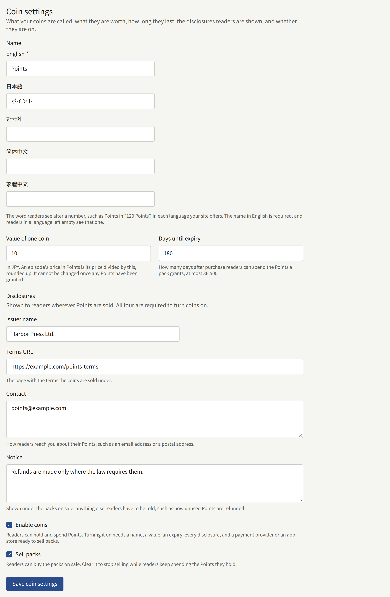
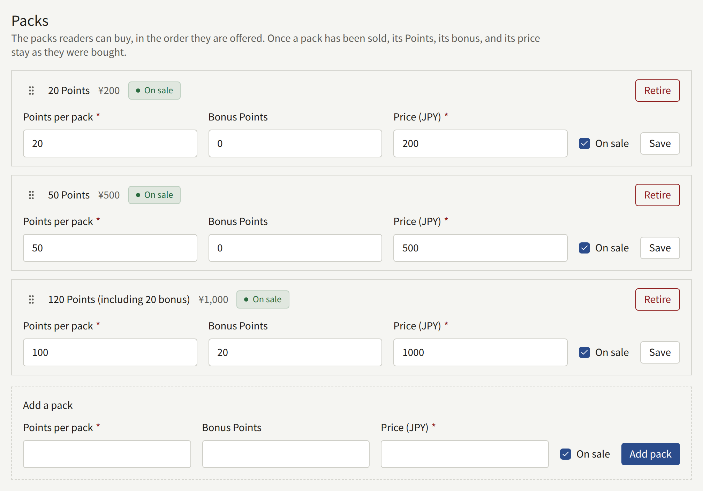
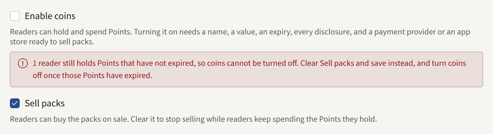

Coins let readers pay for episodes in advance: a reader buys a pack of the tenant's coins once and spends a few on each episode, without a payment page at every episode. The tenant issues them, names them, and decides what one is worth in its currency, how long they last, and which packs are sold. What a reader sees once coins are on, on the site and in the app, is in [Selling episodes](./4-selling-episodes.md#paying-with-coins).

**Payments** › **Coins** is for a **Tenant admin**; an Editor or an Auditor does not see that screen.

## Before you start

Coins are a prepaid payment instrument, and the tenant that sells them is their issuer. Laws on prepaid instruments, electronic money, money transmission, or gift cards may apply to them depending on where the tenant and its readers are, and they can require the tenant to file, to deposit a security, to refund unused balances, or to show certain information where the coins are sold. Whether the tenant may issue coins, and what it has to do, is the tenant's to establish. The screen gives you the switches and the disclosure fields, and says nothing more about the law.

Two things have to be in place first:

- **The platform allows tenants to issue coins.** It is off on a new install. While it is off, **Coins** is missing from the sidebar, and opening the screen by its address says the platform does not let tenants issue coins. The operator turns it on as [Platform policies](../3-operations/9-platform-policies.md#coins-issued-by-tenants) describes.
- **Packs can be sold.** Coins can only be turned on while a payment provider is **Ready** under **Payments** › **Payment methods**, or the App Store or Google Play is, as [Selling episodes](./4-selling-episodes.md) describes. Everything else on the screen can be filled in before that.

## The three states

The top of the screen names the state the tenant's coins are in:

| State | What readers see |
| --- | --- |
| **Off** | Nothing about coins. Every episode is sold as it is without them |
| **On, selling** | Episodes priced in coins, the reader's balance, and the packs on sale |
| **On, not selling** | The same, except that no pack can be bought: readers keep spending the coins they hold |

**Enable coins** and **Sell packs** under **Coin settings** move the tenant between them. A tenant ends its coins by going through **On, not selling**, as [Stopping](#stopping) describes, because turning coins off takes away coins readers have paid for.

## Coin settings

- **Name** is the word readers see after a number, such as `Points` in `120 Points`, entered once for each language the site offers. The name in the site's default language is required, and saving without it is refused under that field. A reader in a language left empty sees the default language's name. Once a name is saved, the screen uses it too, in the language you read the console in: the pack fields read **Points per pack** and **Bonus Points**.
- **Value of one coin** is what one coin is worth in the tenant's currency, such as `10` for ¥10. An episode's price in coins is its price, or its campaign price while one is on sale, divided by this value and rounded up, so an episode of ¥300 costs 30 coins worth ¥10 each. There is no second price list: change an episode's price and its price in coins follows. Once any reader has been granted coins, every balance is counted in this value, and it can no longer be changed.
- **Days until expiry** is how many days after a pack is bought its coins can be spent, at most 36,500. Coins that expire unspent are gone; the reader's history says so.
- **Disclosures** are shown to readers wherever coins are sold, under the packs: **Issuer name**, **Terms URL** (the page with the terms the coins are sold under), **Contact** (how readers reach you about their coins), and **Notice** (anything else readers have to be told, such as how unused coins are refunded).

**Enable coins** turns coins on, and needs a name in the default language, a value, an expiry, all four disclosures, and a way to sell packs. Saving without one of them is refused, naming each field that is missing. **Sell packs** puts the packs on sale, and can be cleared while coins stay on.

## Packs

**Packs** lists the packs readers can buy, in the order the site offers them. Each row shows the pack as readers see it, such as `120 Points (including 20 bonus)`, with its price and whether it is on sale.

- **Add a pack**, under the list, takes the coins the pack grants, the bonus coins it adds on top of them, and its price in the tenant's currency, which has to be above zero. A new pack goes to the end of the list. A tenant offers at most 20 packs.
- A pack's fields are edited in its row and saved with its **Save**. **On sale** takes one pack off sale, or puts it back, without touching the others.
- Once a pack has been sold, its coins, its bonus, and its price stay what the readers who bought it paid for. The row then shows them as text, says why, and leaves only **On sale**. To sell a different pack, add a new one and retire the old one.
- **Retire** takes a pack off sale for good, after you confirm it. It leaves the list, and readers keep the coins they bought in it.
- The order is changed by dragging a row by its handle, or from the keyboard: focus the handle, press Space, move with the arrow keys, and press Space again.

A bonus is a discount the tenant gives, and royalties are paid on what the coins were bought for, as [Reports and royalties](./6-reports-and-royalties.md#what-an-author-is-owed) describes.

### Packs in the app

When the tenant's app sells through the App Store and Google Play, each pack is bought as its own store product, named `coins_` followed by the pack's id. **Store products**, at the bottom of **Payments** › **Payment methods**, lists the product of every pack beside the ones the episodes' prices need. Create each one as a consumable product at the pack's price, as [Selling in the app](./4-selling-episodes.md#selling-in-the-app) describes for the episodes.

## Stopping

Clearing **Sell packs** and saving stops all sales of packs at once, on the site and in the app, and leaves every reader able to spend the coins they hold. The state becomes **On, not selling**.

Clearing **Enable coins** is refused while any reader holds coins that have not expired: the screen says how many readers do, and to stop selling instead. Wait until the last of those coins has expired, at most **Days until expiry** after the last pack was sold, and turn coins off then.

If the operator stops allowing tenant coins, every tenant's coins stop at once, whatever the tenant has saved: nothing is sold or spent, and readers keep their balances. The tenant's settings are kept, and apply again once the operator allows coins.

Every save of the settings, and every pack added, changed, or retired, is recorded in the [audit log](./3-setup/8-audit-log.md) with the Tenant admin who made it.
