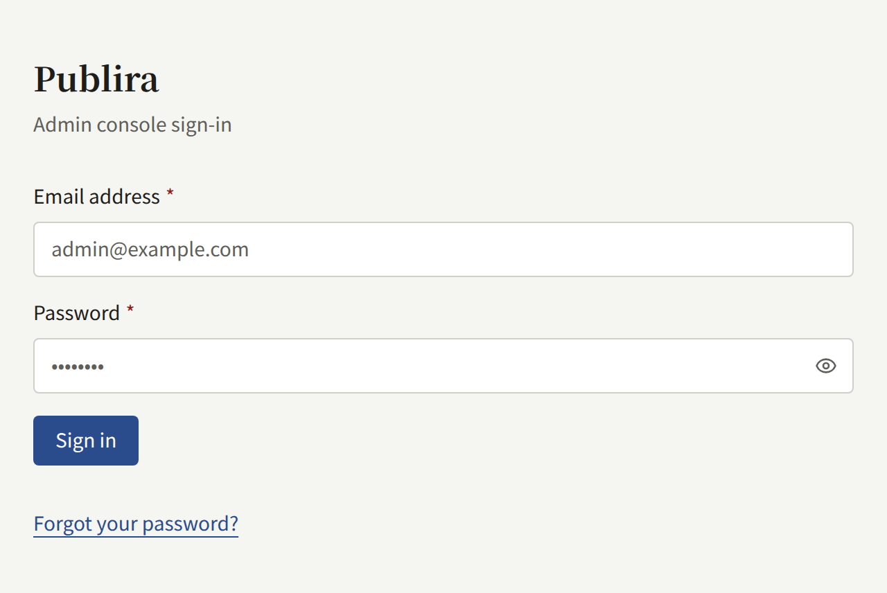
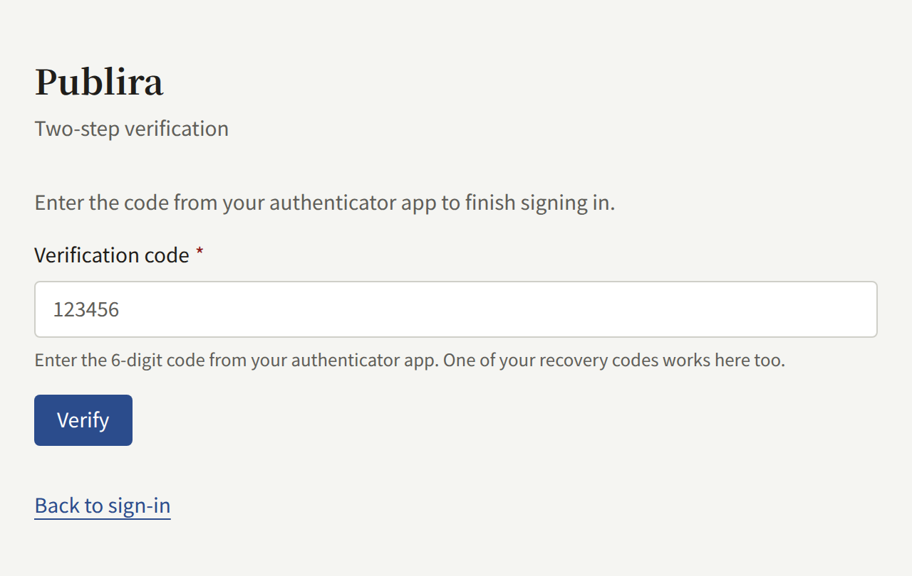
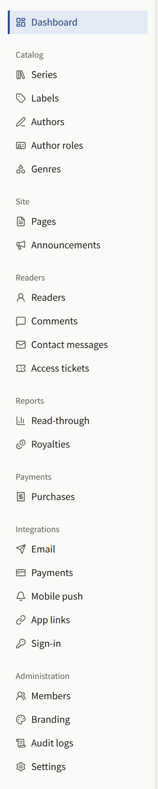

Every tenant has a console of its own, where the publisher's staff manage the works on its site, its readers, and the site's settings. These pages are for those staff. They assume the tenant already exists and that you have been given access to it, as [A tenant's staff](../3-operations/3-tenant-staff.md) describes from the operator's side.

## Signing in

The console is served on the tenant's console host, which is `admin.` followed by the domain of its public site unless the operator gave it another one: for a site on `comics.example.com`, the console is on `admin.comics.example.com`. Sign in there with the email address and password of your account. **Forgot your password?** on the same screen mails a link to set a new one.

If your account has two-step verification turned on, the console then asks for the code from your authenticator app. The operator can require it of every Tenant admin on the install, and a Tenant admin who has not registered an authenticator app yet is then asked to register one before going further. [Your account](./3-setup/9-your-account.md) covers turning it on and what to do when you lose your phone.

Your console account is also an account on the tenant's site: you can read and buy there with the same address and password, and the console is simply what your role adds to it.

## Roles

Every member of the staff holds one of three roles, and the console shows each of them only the parts they may use:

| Role | What it may do |
| --- | --- |
| **Tenant admin** | Everything in the console: the staff, every setting of the tenant, its integrations with mail, payments, push notifications, sign-in, and the Google tag, readers' accounts, purchases and their refunds, subscription plans, royalties, and the audit log |
| **Editor** | Write the catalog and the site's pages, announcements, and campaign banners, and moderate comments |
| **Auditor** | See what an Editor works on, and the tenant's settings, without changing any of it |

A Tenant admin gives the other staff their roles under **Members**. [A tenant's staff](../3-operations/3-tenant-staff.md#the-three-roles) describes the roles in full.

## In this section

- [Publishing works](./1-catalog/index.md): taking an empty catalog to a first episode readers can open, and the series, episodes, labels, Authors, Author roles, and genres it is made of.
- [Readers, comments, and contact messages](./2-readers/index.md): suspending and deleting readers' accounts, working the comment approval and report queues, answering contact messages, and opening a paid episode to a reader with an access ticket.
- [Setting up the tenant](./3-setup/index.md): taking a new tenant to a site with the publisher's look, legal pages, and staff, through its settings, branding, pages, announcements, campaign banners, members, mail server, audit log, and your own account.
- [Selling episodes](./4-selling-episodes.md): pricing an episode, taking payment through Stripe or PAY.JP, where episodes are sold, in-app purchase, refunds, and testing a setup before going live.
- [Subscription plans](./5-subscription-plans.md): selling readers a plan billed every period through Stripe that opens the whole catalog, some labels, or some series, the Price and the webhook events it needs in Stripe, and what a subscriber does on the site.
- [Reports and royalties](./6-reports-and-royalties.md): what the Dashboard and Read-through count, how each Author's royalties are worked out, closing a month into a statement, and exporting it as CSV.
- [Sign-in with Apple and Google](./7-sign-in.md): letting readers sign in to the site and the app with an Apple or Google account, and what to create in Apple's and Google's consoles for it.
- [Google tag](./8-google-tag.md): measuring the site with Google Analytics or Google Tag Manager, the three places the tag can be loaded from, and what to set up in Google Tag Manager for the gateway.

Start from [Getting started](../1-getting-started.md) if you have not read what Publira is.
