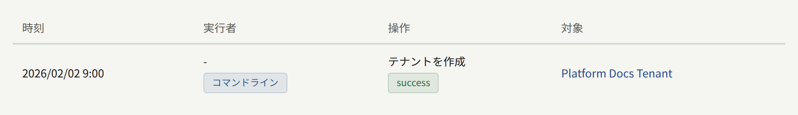
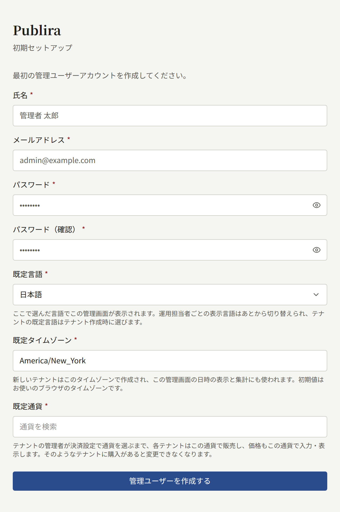
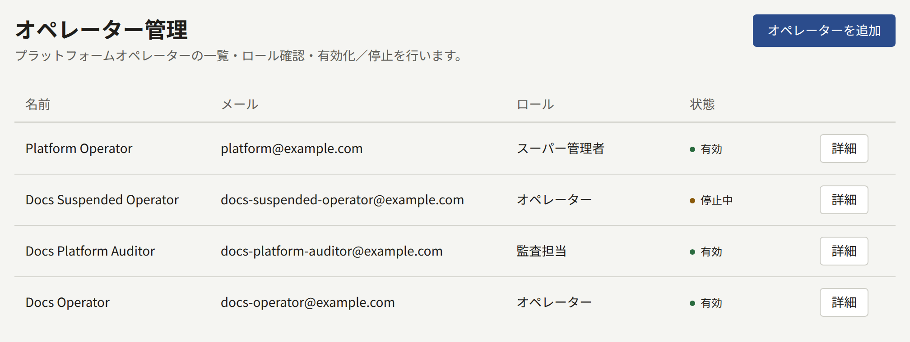
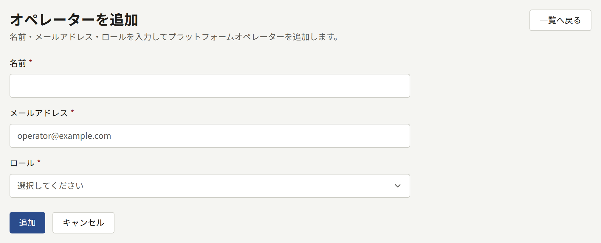
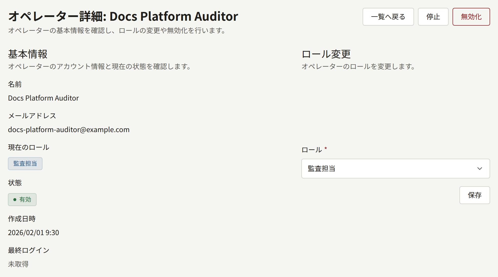
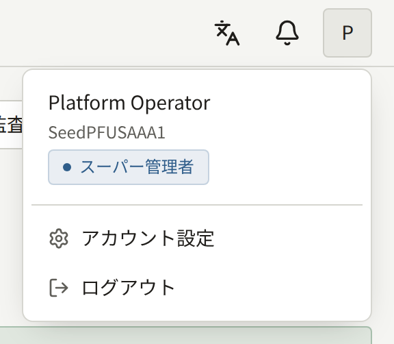
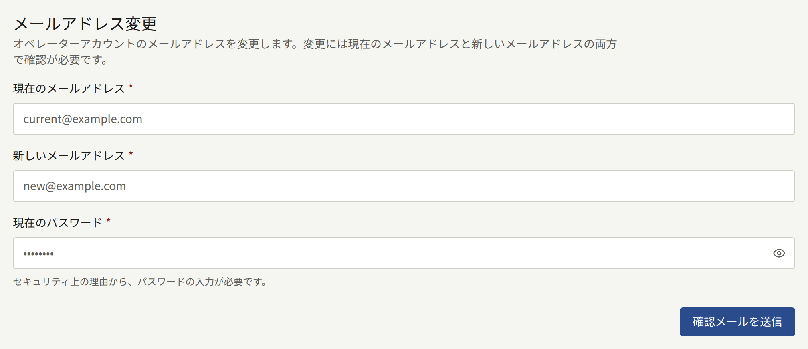
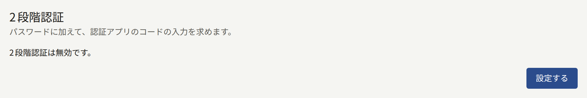
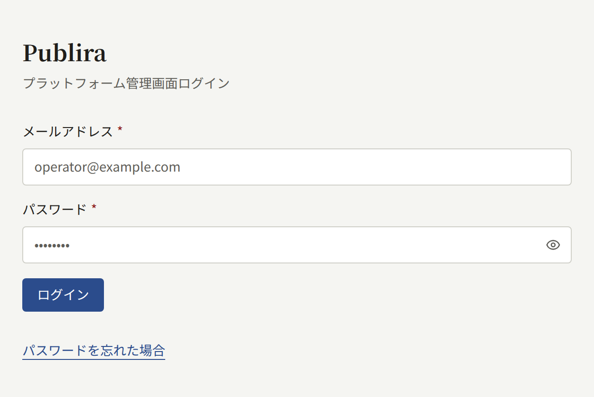

インストール環境は2つの場所のいずれかから管理し、ほとんどの作業はどちらからでも行えます。このページでは、2つの違い、プラットフォーム管理画面が最初のオペレーターを得る方法、その後にオペレーターを追加してロールを与える方法を説明します。

## どちらを使うか

`publiractl`は、[インストール](../2-deployments/2-installing.md)と同じくインストール環境が動かしているリリースのイメージで実行するコマンドで、[Docker Compose](../2-deployments/3-docker-compose.md)のインストール環境では`docker compose run --rm publiractl`で実行します。データベースに`publira_platform`として直接接続するので、プラットフォーム管理画面を動かしていないインストール環境でも使え、その接続以外には何も必要ありません。アカウントも、ブラウザーも、ほかのプロセスの稼働も不要です。

プラットフォーム管理画面は`web-platform`で、オペレーターがログインするWebアプリです。独自のアカウントを持ち、それぞれにロールがあるので、ある人に何も変更させずにすべてのテナントを見せることができ、どのオペレーターがどの変更を行ったかを記録します。

どちらも同じコードを通じて書き込むので、一方から作成したテナントは他方から作成したテナントと同じで、1つのインストール環境で両方を使えます。違うのは、それぞれが提供する作業です。

| 作業 | `publiractl` | プラットフォーム管理画面 |
| --- | --- | --- |
| テナントの作成、変更、停止 | できる | できる |
| テナントのメンバーと管理者の招待 | できる | できる |
| メールを送らずに、パスワード付きの管理画面のアカウントを作成する | できる | できない |
| プラットフォームのオペレーター | できない | できる |
| オペレーターが失った2段階認証の解除 | できる | できない |
| プラットフォームの既定値、ポリシー、保存期間 | できる | できる |
| すべてのテナントの読者 | できない | できる |
| 監査ログの閲覧 | できない | できる |
| メンテナンスジョブの実行 | できる | できない |

どちらかがテナントやそのスタッフに加えた変更はすべて、プラットフォーム管理画面の**監査ログ**に記録されます。`publiractl`から行った変更は、そこでオペレーターを示さず、実行者は**コマンドライン**になります。



プラットフォーム管理画面を動かさない場合も、インストール環境の運用には`publiractl`で十分です。諦めることになるのは、監査ログの閲覧と、テナントをまたいだ読者のアカウントへの操作です。各テナントの管理者は、引き続きテナント管理画面から自分の読者を管理できます。

## 最初のオペレーター

[インストール](../2-deployments/2-installing.md#web-platformによるプラットフォーム管理画面)で説明しているとおりに`web-platform`を動かし、開きます。オペレーターがいないあいだは、どのアドレスを開いても**初期セットアップ**画面に移り、次の項目を求められます。

- **氏名**、**メールアドレス**、**パスワード**と**パスワード（確認）**：最初のオペレーターのアカウントです。
- **既定言語**：プラットフォーム管理画面が最初に表示される言語です。これはプラットフォームの既定言語にもなり、`publiractl setup`が保存した言語を置き換えます。各オペレーターは後で自分に表示される言語を切り替えられ、各テナントは作成時に独自の言語を選びます。
- **既定タイムゾーン**：タイムゾーンを指定せずに作成したテナントが最初に使うタイムゾーンで、プラットフォーム管理画面が日時を表示し、日付を数えるときのタイムゾーンでもあります。最初はブラウザーのタイムゾーンになっており、そのままにするとそのタイムゾーンが保存され、`publiractl setup`が保存したものを置き換えます。別のものを選ぶには、地域や都市を検索します。既存のテナントは自分のタイムゾーンを維持します。
- **既定通貨**：テナントの管理者が独自の**決済設定**を保存するまで、すべてのテナントが販売に使う通貨です。最初は`publiractl setup`が保存した通貨になっているので、そのままにするとその通貨が維持されます。別の通貨を探すには、名前か`EUR`のようなISO 4217のコードを入力します。その通貨で販売しているテナントに購入が1件でもあると、そのテナントの価格はその通貨での金額なので、この項目は読み取り専用になり、その旨が表示されます。保存されている通貨を読み取れない場合も、項目は読み取り専用になってその旨が表示され、セットアップは通貨をそのまま維持します。その場合は後で**一般設定**から変更します。通貨が及ぶ範囲は[プラットフォームの既定値](./9-platform-policies.md#プラットフォームの既定値)にあります。



**管理ユーザーを作成する**を選ぶと、**スーパー管理者**のロールでアカウントが作成され、ログイン画面に移ります。それ以降、セットアップ画面はなくなります。2人目の最初のオペレーターというものはなく、`publiractl`にもオペレーターを作成する機能はありません。その後のオペレーターはすべて、スーパー管理者が**オペレーター管理**から追加します。

プラットフォーム管理画面のアカウントは、プラットフォーム管理画面専用です。`publiractl setup`が作成したテナントの管理者はプラットフォーム管理画面にログインできず、オペレーターも自分のオペレーターのアカウントでテナントの管理画面にはログインできません。

## オペレーターのロール

各オペレーターは、3つのロールのいずれかを持ちます。

| ロール | できること |
| --- | --- |
| **監査担当** | すべてを閲覧できます。ダッシュボード、テナントとそのメンバー、ユーザー、監査ログ、プラットフォームの設定です。変更できるのは自分のアカウントだけです |
| **オペレーター** | 監査担当ができることすべてに加えて、テナント、そのメンバーと招待、読者のアカウント、プラットフォームの設定とサービスを変更できます |
| **スーパー管理者** | オペレーターができることすべてに加えて、オペレーターの追加、そのロールの変更、停止と無効化ができます |

プラットフォーム管理画面は、監査担当にもオペレーターと同じ画面とフォームを表示し、変更を送信した時点で拒否します。完全な表は[`publira server`のリファレンス](https://github.com/publira/publira/blob/main/server/cmd/publira/README.md#platform-console-role-permissions)にあります。

## オペレーターの管理

サイドバーの**ガバナンス**の下にある**オペレーター管理**には、すべてのオペレーターがロールと状態とともに一覧表示されます。そこで何かを変更できるのはスーパー管理者だけです。



### オペレーターを追加する

**オペレーターを追加**では、オペレーターの**名前**、**メールアドレス**、**ロール**を入力すると、すぐにアカウントが作成されます。新しいオペレーターには、アカウントの最初のパスワードを設定するリンクがメールで送られ、パスワードを設定したらそのパスワードでログインします。リンクの有効期限は24時間です。期限が過ぎたら、ログイン画面で**パスワードを忘れた場合**を選ぶと新しいリンクを受け取れます。このメールは、プラットフォーム管理画面が送るほかのすべてのメールと同じく、プラットフォームが保存したSMTPの設定を使って、プラットフォームの既定言語で`publira worker`が送ります。

そのアドレスに、ロールを持たないプラットフォーム管理画面のアカウントがすでにある場合は、新しいアカウントを作成する代わりに、そのアカウントにロールが与えられます。そのアカウントは既存のパスワードを維持するので、メールにパスワードのリンクは含まれず、ログインできるようになったことだけが伝えられます。



すでにオペレーターのものになっているアドレスは、無効化されたものも含めて、もう一度追加することはできません。

### オペレーターのロールを変更する

**オペレーター管理**からオペレーターを開き、**ロール変更**で新しいロールを選びます。誰も自分のロールは変更できないので、スーパー管理者が自分を降格させることはなく、インストール環境には操作しているスーパー管理者が常に残ります。



### 停止と無効化

同じ画面で、次の操作ができます。

- **停止**は、オペレーターのログインを止め、開いているセッションを終了させます。**再有効化**すると、再びログインできるようになります。
- **無効化**は、アカウントを永久に終わらせます。無効化したアカウントは二度と使えず、そのアドレスを新しいオペレーターとして追加することもできません。そのアカウントが行った変更は、その名前で監査ログに残ります。

どちらも自分のアカウントには行えません。

## オペレーター自身のアカウント

管理画面のヘッダーのアカウントメニューにある**アカウント設定**では、自分のメールアドレスを変更できます。確認のリンクが現在のアドレスと新しいアドレスの両方にメールで送られ、両方のリンクを開いた時点で変更が有効になります。





### 2段階認証

同じページの**2段階認証**を有効にすると、ログインのたびに、パスワードの後で認証アプリのコードを求められます。**設定する**を選ぶと、アプリで読み取るQRコードと、読み取りができないアプリのための同じキーのテキストが表示されます。アプリに表示される6桁のコードを入力し、**2段階認証を有効にする**を選びます。続いてページに10個のリカバリーコードが一度だけ表示されます。スマートフォンとは別の安全な場所に保管してください。各コードは、認証アプリが手元にないときに、ログインでコードを求められるどの場面でも1回だけ使えます。



それ以降、ログインはパスワードの後で**2段階認証**に進み、コードを求めます。リカバリーコードでログインすると、残りの数が表示されます。有効にしているあいだ、同じカードには2つのフォームがあります。

- **リカバリーコードを再発行する**は、使用済みかどうかにかかわらず手元のすべてのコードを、新しい10個のコードに置き換えます。リカバリーコードではなく、認証アプリのコードが必要です。
- **2段階認証を無効にする**には、認証アプリのコードかリカバリーコードが必要です。いつでも、新しい認証アプリがあればそれで、もう一度設定できます。

プラットフォームは、[セキュリティ](./12-security/2-two-step-verification.md#プラットフォームのオペレーター)で説明しているとおり、すべてのオペレーターに2段階認証を要求できます。その場合、次にログインしたときに設定を求められ、設定するとログインが完了します。

ログインしたままパスワードを変更するフォームはありません。ログアウトし、ログイン画面で**パスワードを忘れた場合**を選び、メールで届くリンクから新しいパスワードを設定します。リンクの有効期限は24時間です。



### 2段階認証を失ったとき

2段階認証を有効にしたオペレーターが、認証アプリとすべてのリカバリーコードの両方を失うと、プラットフォーム管理画面にログインできなくなり、ほかのオペレーターもそこでそのアカウントから2段階認証を解除することはできません。`publiractl`で解除します。

```bash
publiractl operator reset-mfa --email operator@example.com
```

`--email`の代わりに`--user <public ID>`でアカウントを指定することもできます。このコマンドはアカウントの認証アプリとすべてのリカバリーコードを削除し、それ以外には何もしません。パスワード、ロール、状態はそのままです。オペレーターはその後パスワードだけでログインし、**アカウント設定**から2段階認証をもう一度設定します。プラットフォームがすべてのオペレーターに2段階認証を要求している場合は、ログインが完了する前に設定を求められます。

`publiractl`の実行にはアカウントが必要ないので、2段階認証を失ったオペレーターがインストール環境で唯一の**スーパー管理者**である場合も、これがログインし直す方法になります。

解除すると、アカウントを守るものはパスワードだけになります。これは盗んだパスワードを持つ人が求めることでもあります。コマンドを実行する前に、依頼が届いた経路ではなく、そのオペレーターのものだとすでにわかっている経路で、依頼がそのオペレーター本人からのものであることを確認してください。

解除は、プラットフォーム管理画面の**監査ログ**に、実行者を**コマンドライン**として記録されます。
