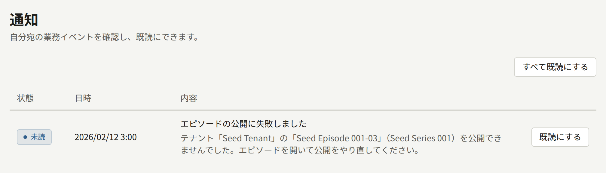

リクエストを受けずにPubliraが行う処理は、すべて`publira worker`が担います。予約時刻を迎えたエピソードの公開、変更によって古くなったキャッシュのWebアプリへの通知、メールとプッシュ通知の送信、統計とランキングの再構築、保持期間を過ぎたデータの削除です。ほかにタイマーで動かすものはなく、ホストのcronもKubernetesのCronJobも要りません。このページでは、どの処理がいつ動くか、症状からどのジョブを調べればよいか、`publiractl job`でジョブを手動で実行する方法を説明します。

各ジョブの実行間隔、調整に使う変数、ジョブの一覧は、[`publira worker`のリファレンス](https://github.com/publira/publira/blob/main/server/cmd/publira/README.md#publira-worker)と[`publiractl job`のリファレンス](https://github.com/publira/publira/blob/main/server/cmd/publiractl/README.md#job)にあります。このページでは繰り返しません。

## 症状から調べるジョブ

起きている症状から、それを受け持つジョブを確認してください。

| 症状 | ジョブ | 説明の場所 |
| --- | --- | --- |
| エピソードが予約時刻を過ぎても**予約済み**のまま | 予約公開 | [予約公開](#予約公開) |
| 無料公開期間中なのにサイトのエピソードのページに価格が表示される、または期間が終わったのに無料と表示される | 無料公開期間 | [無料公開期間とキャッシュ](#無料公開期間とキャッシュ) |
| 公開サイトの曜日別の更新作品一覧で、昨日の分が今日として表示されたまま | テナントの日付の切り替え | [無料公開期間とキャッシュ](#無料公開期間とキャッシュ) |
| サイトのバナーが**掲出を終える日時**を過ぎても表示されている | バナーに掲出するお知らせ | [無料公開期間とキャッシュ](#無料公開期間とキャッシュ) |
| シリーズが**公開日時**を過ぎてもサイトの一覧に表示されない | 公開予約されたシリーズ | [無料公開期間とキャッシュ](#無料公開期間とキャッシュ) |
| 掲載期間が始まってもキャンペーンバナーがサイトに表示されない、または期間が終わっても表示されている | キャンペーンバナー | [無料公開期間とキャッシュ](#無料公開期間とキャッシュ) |
| キャンペーン価格が始まってもサイトのエピソードのページに通常価格が表示される、または終わってもキャンペーン価格が表示される | キャンペーン価格 | [無料公開期間とキャッシュ](#無料公開期間とキャッシュ) |
| 使われないまま失効したコインが読者のコイン履歴に表示されない | コインの失効 | [その他の定期ジョブ](#その他の定期ジョブ) |
| シリーズの「公開後に無料」の設定で無料になる日を過ぎても、エピソードが有料のまま | 公開後に無料 | [その他の定期ジョブ](#その他の定期ジョブ) |
| 変更前の内容がページに表示され続ける | アウトボックスによるキャッシュの再検証 | [アウトボックス](#アウトボックスメールプッシュ通知キャッシュの再検証) |
| メールやプッシュ通知が届かない | アウトボックス | [アウトボックス](#アウトボックスメールプッシュ通知キャッシュの再検証) |
| ランキング、シリーズの評価、おすすめが更新されなくなる | 統計とランキングの一連のジョブ | [統計とランキング](#統計とランキング) |
| テナントの締め日になっても月が締められない | 印税の締め | [その他の定期ジョブ](#その他の定期ジョブ) |
| Google Playで購入されたエピソードが返金後も読めるまま | Google Playの返金の同期 | [その他の定期ジョブ](#その他の定期ジョブ) |
| 新しく保存した検索エンジンに検索が切り替わらない | 検索インデックスの構築 | [検索](./7-search.md#インデックスの作成に失敗したとき) |
| 古いレコードが削除されない | パージ | [その他の定期ジョブ](#その他の定期ジョブ) |

どのジョブも、`publira worker`が起動していて準備ができていることが前提です。ワーカーが止まっていてもページはすべて表示されますが、公開も送信も再構築も一切行われません。ワーカーの`GET /readyz`には、ワーカーが使うデータベースログインごとにチェックが1つずつ表示されるので、応答しなくなったログインはそこで特定できます。ワーカーをキューごとに分けている場合は、各ジョブのキューを受け持つワーカーも動いている必要があります。詳しくは[一部のジョブだけを受け持つワーカー](#一部のジョブだけを受け持つワーカー)を参照してください。

### ジョブの失敗の記録先

ワーカーは失敗をすべてログに出力し、ログ行にはジョブ名が入ります。また、定期ジョブは実行のたびに、データベースの`river_job`テーブルに行を残します。`river_job`はワーカーが自分の処理を登録しておくテーブルで、ジョブがそもそも実行されたのか、いつ実行されたのかがわかります。

失敗が行にどう残るかは、ジョブによって異なります。予約公開、無料公開期間、日付の切り替え、バナーに掲出するお知らせ、公開予約されたシリーズ、キャンペーンバナー、キャンペーン価格、コインの失効、公開後に無料の各ジョブは、途中で一部が失敗しても実行を最後まで終えます。処理できなかったものはログに書き、1分後の次の実行に回します。そのため行は完了として残り、失敗はログにしか現れません。それ以外のジョブは、失敗した実行を行に記録し、試行ごとのエラーを`errors`カラムに残します。エラーには、処理が止まったテナントと日付が含まれます。データベースの[管理用ログイン](../2-deployments/2-installing.md#サービスを用意する)で`psql`から接続し、次のクエリーで確認してください。

```sql
SELECT kind, state, attempt, finalized_at, errors
FROM river_job
WHERE state IN ('retryable', 'discarded')
ORDER BY id DESC
LIMIT 20;
```

`retryable`は再試行を待っている実行、`discarded`は試行回数を使い切った実行です。完了した行とキャンセルされた行は1日後に、`discarded`の行は1週間後に削除されるので、症状に気づいたら早めに確認してください。アウトボックスの記録はこれとは別にあり、[後半](#断念されたエントリーの確認)で説明します。

## 予約公開

スタッフが予約したエピソードは、予約時刻を過ぎるとワーカーが公開します。同時に、シリーズのフォロワーへの通知と、そのエピソードを公開予定として載せていたページのキャッシュの破棄も行います。ワーカーは公開時刻を迎えたエピソードを1分ごとに探すので、エピソードは予約時刻からおよそ1分以内に公開されます。

公開に失敗すると、同じ実行の中で何回か再試行します。すべての試行が失敗した場合、エピソードは**予約済み**のまま残り、ワーカーは「エピソードの公開に失敗しました」という通知を作成します。テナントの管理者にはテナント管理画面に、すべてのオペレーターにはプラットフォーム管理画面の**通知**に表示されます。この通知は1つのエピソードにつき1回だけ作成されます。

ワーカーはその後も実行のたびにそのエピソードの公開を試みるので、データベースの障害や未実行のマイグレーションといった原因を取り除けば、エピソードは自動的に公開されます。スタッフはそれを待たずに公開することもできます。テナント管理画面のエピソードのページで、**公開設定**に現在時刻を入力すると、ワーカーを介さずにそのリクエストの中でエピソードが公開されます。この場合も、フォロワーへの通知は[アウトボックス](#アウトボックスメールプッシュ通知キャッシュの再検証)を通じてワーカーが送ります。



## 無料公開期間とキャッシュ

次の6つのジョブは、ある時刻を過ぎたときに、Webアプリがキャッシュしているページを新しい状態に切り替えます。

- **無料公開期間**のジョブは、各期間の開始時と終了時に、それより前にサイトがキャッシュしたページを破棄します。エピソードの**無料公開期間**に登録した期間に入ると、そのエピソードは開始の瞬間から無料で読めるようになり、期間が終わると再び有料に戻ります。この切り替え自体にジョブは関わらず、閲覧のたびに期間と現在時刻を比べています。
- **テナントの日付の切り替え**のジョブは、テナントのタイムゾーンで午前0時になるたびに、公開サイトの曜日別の更新作品一覧のキャッシュを破棄します。テナントの暦の日付によって内容が変わるページは、この一覧だけです。
- **バナーに掲出するお知らせ**のジョブは、お知らせの**掲出を終える日時**を過ぎると、そのお知らせをバナーから外し、バナーのキャッシュを破棄します。
- **公開予約されたシリーズ**のジョブは、シリーズの公開日時を過ぎると、シリーズが非公開だった間にサイトがキャッシュしたシリーズ一覧、著者ページ、そのシリーズのページを破棄します。**公開日時**に未来の日時を設定して保存したシリーズはその日時から公開されますが、この切り替え自体にジョブは関わらず、閲覧のたびに設定した日時と現在時刻を比べています。同じ実行の中で、シリーズが非公開の間に公開されたエピソードの公開日時をシリーズの公開日時に合わせ、それらのエピソードの公開通知を[アウトボックス](#アウトボックスメールプッシュ通知キャッシュの再検証)に渡します。
- **キャンペーンバナー**のジョブは、公開済みの各バナーの掲載期間の開始時と終了時に、それより前にサイトがキャッシュしたバナーを破棄します。公開済みのキャンペーンバナーは掲載期間の開始から終了まで表示されますが、この切り替え自体にジョブは関わらず、閲覧のたびに掲載期間と現在時刻を比べています。
- **キャンペーン価格**のジョブは、各キャンペーンの開始時と終了時に、それより前にサイトがキャッシュしたエピソードのページとシリーズのページを破棄します。キャンペーン価格を設定したエピソードは、キャンペーンの開始から終了までその価格で表示され、その価格で購入されます。この切り替え自体にジョブは関わらず、閲覧や購入手続きのたびにキャンペーンの期間と現在時刻を比べています。

どのジョブも1分ごとに実行されます。ただし、ジョブ自身がキャッシュを破棄するわけではありません。破棄の指示をアウトボックスにエントリーとして記録し、それをワーカーがWebアプリに送ります。ワーカーに`PUBLIRA_REVALIDATE_TOKEN`を設定しているのにページが古いままなら、原因はアウトボックスにあります。[アウトボックスの説明](#アウトボックスメールプッシュ通知キャッシュの再検証)を参照してください。

`PUBLIRA_REVALIDATE_TOKEN`を設定せずにワーカーを起動すると、キャッシュの再検証は無効になります。このとき、これらのジョブは破棄を一切記録しません。それでも期間の境目やシリーズの公開日時は過ぎたものとして処理を済ませ、バナーも取り下げます。アウトボックスには再試行するものが残らないので、あとからトークンを設定してワーカーを再起動しても、その分の破棄は行われません。破棄されるはずだったページは、同じ対象に次の変更があって破棄されるか、キャッシュの期限が切れるまで、古い内容のままです。時刻どおりに切り替えたい最初の境目が来る前に、[インストール](../2-deployments/2-installing.md#シークレットを生成する)の説明に従って`publira server`と`publira worker`にトークンを設定してください。

これらのジョブには`publiractl job`のコマンドがありませんが、必要もありません。どのジョブも、実行のたびに過ぎた時刻をすべて処理するからです。ワーカーを起動した直後の最初の実行でも同じです。

## 統計とランキング

統計、ランキング、シリーズの評価、おすすめは、テナントのタイムゾーンで1日が終わるたびに、閲覧の記録から作り直されます。この処理は、次の4つのジョブが順番につながって行います。

1. **閲覧の取り込み**(`project-episode-reads`)は、終了した閲覧をすべて分析イベントとして記録します。
2. **日次統計**(`aggregate-content-stats`)は、終わった日ごとに、シリーズとエピソード単位の閲覧数、読了数、購入数、評価、お気に入り、コメントを作り直し、読者が各エピソードをどこまで読んだかも集計します。公開サイトに表示するシリーズの評価は、この結果から計算します。また、ログインしている読者のうち誰がその日にどのシリーズのエピソードを閲覧、読了、購入したかも記録します。管理画面では、ある週に会員登録した読者のその後をこの記録でたどります。この記録を導入したリリースへのアップグレード時には、その時点で分析イベントが残っていたすべての日について記録を作成しました。それより前にパージされていた日には記録がなく、あとから作ることもできません。
3. **ランキング**(`aggregate-rankings`)は、公開サイトの**ランキング**ページに表示する日間と週間のランキングを作り直します。
4. **おすすめ**(`build-recommend-features`)は、読者ごとのおすすめの元になるスナップショットを作り直します。

この一連のジョブは1時間ごとに始まり、各ジョブは終わると次のジョブを開始します。午前0時になる時刻はテナントによって異なるので、テナントの1日分は、その日が終わってからおよそ1時間に処理時間を足したくらいで作り直されます。テナントの午前0時から数時間たってもランキングが変わらないのは正常ですが、1日たっても変わらない場合は異常です。

ワーカーは、各ジョブが最後に処理を終えた日をテナントごとに覚えていて、その翌日から処理します。ある日の処理が失敗すると、そのテナントはその日で止まりますが、ほかのテナントの処理は続きます。エラーは失敗したジョブの`river_job`の行に残ります。実行は最大3回試行され、次の1時間ごとの実行は失敗した日からやり直します。原因を取り除けば、そのテナントは遅れた日を古い順にすべて処理して、自動的に追いつきます。

## その他の定期ジョブ

| ジョブ | 頻度 | 処理内容 |
| --- | --- | --- |
| 公開後に無料 | 1分ごと | シリーズの「公開後に無料」の設定の対象になった、公開済みで有料のエピソードに無料公開期間を追加します。対象になるのは、エピソードの公開から設定した日数が過ぎていて、設定で有料のまま残す最新のエピソードに含まれない場合です。期間はその日から始まります。その時点で手動で設定した期間がまだ続いていれば、その期間が終わったところから始まり、その手動の期間を削除すると開始はその日に戻ります。期間は、エピソードが設定の対象から外れるまで続きます。設定を無効にして保存した場合や、そのエピソードが外れる数値で保存した場合は、期間はすぐに取り除かれます。最新のエピソードの範囲に入った、公開を取り下げたなど、それ以外の理由で対象から外れたエピソードからは、次の実行で取り除かれます。期間が始まるときや終わるときと同じく、エピソードのページのキャッシュは同じ実行で破棄されます。時刻でキャッシュを切り替えるジョブと同じく、`publiractl job`のコマンドはありません |
| コインの失効 | 1分ごと | 付与したコインが未使用分を残して失効するたびに、読者のコイン履歴にエントリーを書き込み、そのコインがどうなったかを履歴でわかるようにします。コインは失効した時点で残高に数えられなくなり、二度と戻りません。これはジョブとは関係なく起こります。時刻でキャッシュを切り替えるジョブと同じく、`publiractl job`のコマンドはありません |
| 印税の締め(`close-royalty-statements`) | 1時間ごと | **自動で締める**に設定したテナントについて、締め日が来たら、締めるべき月をすべて締めます。手動で、または以前の実行ですでに締めた月はそのままにします |
| Google Playの返金の同期(`sync-google-play-voided-purchases`) | 1時間ごと | Google Playストアを有効にしているすべてのテナントについて、Google Playが過去30日間に返金した購入を読み込み、[エピソードの販売](../4-console/4-selling-episodes.md#返金)で説明しているとおりに購入を取り消します |
| 検索インデックスの構築(`build-search-index`) | 30秒ごと | 新しく保存した検索エンジンにインデックスを作成し、検索をそのエンジンに切り替えます。[検索](./7-search.md#別のエンジンに切り替える)で説明しています |
| パージ(`purge-*`) | 1時間ごとまたは24時間ごと | 取り下げられたコメント、分析イベント、ランキングのスナップショットのうち、保持期間を過ぎたものを削除します。保持期間は[プラットフォーム全体の既定値とポリシー](./9-platform-policies.md#保持期間)で説明しています。ほかに、2段階認証によるログインで使い終わったチャレンジと、どのテナントでも使われなくなった画像のうちアップロードから1日以上たったものも削除します |

## 一部のジョブだけを受け持つワーカー

`--queue`を付けて起動したワーカーは、指定したキューのジョブだけを実行し、ほかのキューはそれを指定したワーカーに任せます。詳しくは[キューごとにワーカーを分ける方法](../2-deployments/7-scaling-out.md#ワーカーをキューごとに分ける)を参照してください。このページのジョブは次の4つのキューに分かれています。`river_job`でのキュー名も同じですが、`outbox`だけは`default`と表示されます。

| キュー | ジョブ |
| --- | --- |
| `outbox` | [アウトボックス](#アウトボックスメールプッシュ通知キャッシュの再検証)を通じて送るメール、プッシュ通知、キャッシュの再検証、検索エンジンのインデックスの更新 |
| `ticker` | 予約公開、無料公開期間、テナントの日付の切り替え、バナーに掲出するお知らせ、公開予約されたシリーズ、キャンペーンバナー、キャンペーン価格、コインの失効、公開後に無料 |
| `maintenance` | 統計とランキングの一連のジョブ、印税の締め、Google Playの返金の同期、パージ |
| `search_index` | 検索インデックスの構築 |

どのキューにも、それを受け持つワーカーが少なくとも1つ動いている必要があります。ジョブを登録するワーカーは、自分がどのキューを受け持っているかに関係なく、すべてのジョブを登録します。そのため、受け持つワーカーが動いていないキューのジョブも失われはしませんが、誰にも実行されません。そのジョブはキューを受け持つワーカーが起動するまで`river_job`で待ち、起動すると[ワーカーの停止後](#ワーカーの停止後)と同じように実行されます。各ワーカーは起動時に、ほかのワーカーに任せるキューを`worker leaves queues to other replicas`というログで出力し、そのキュー名を`not_hosted`に示します。ジョブが滞っているキューは`river_job`で確認できます。

```sql
SELECT queue, kind, count(*), min(scheduled_at)
FROM river_job
WHERE state = 'available' AND scheduled_at < now() - interval '5 minutes'
GROUP BY queue, kind;
```

ここに出る行は、実行予定時刻を5分過ぎてもどのワーカーにも取り出されていないジョブです。その`queue`を受け持つワーカーを起動するか、動いているワーカーの`--queue`にそのキューを追加してください。

## ワーカーの停止後

停止していたワーカーや、データベースが正常に動かない状態で動いていたワーカーは、その間何も処理しません。処理は失われず、データベースで待っています。ワーカーが再び起動すると、各ジョブは次のように動きます。

| ジョブ | 起動時の動作 |
| --- | --- |
| アウトボックス | 待っていたエントリーをすべて送ります。停止したワーカーが処理中だったエントリーは、15分後に改めて処理されます |
| 予約公開 | 予約時刻を過ぎたエピソードをすべて公開し、フォロワーに通知します |
| 無料公開期間、テナントの日付の切り替え、バナーに掲出するお知らせ、公開予約されたシリーズ | 停止中に境目を過ぎたページのキャッシュをすべて破棄し、掲出を終える日時を過ぎたバナーをすべて取り下げます |
| 公開後に無料 | 停止中に無料になる日を迎えたエピソードを、すべてその日から無料にします |
| 統計とランキングの一連のジョブ | 各テナントが処理できなかった日を古い順にすべて作り直します。ただし、分析イベントがすでに保持期間を過ぎた日と、以前に保存した短い保持期間でパージされた日は除きます。それらの日は欠けているとログに記録されて飛ばされ、作り直すことはできません |
| 印税の締め | 締めるべき時期を迎えた月をすべて締めます |
| 検索インデックスの構築 | 保留中のインデックスを作成します |
| パージ | 現在の1時間、または当日のうちにまだ1回も完了していない場合だけ実行します。この区切りはワーカーの起動時刻からではなく、時計の時刻で数えます。最初の実行で、停止中に期限が切れたものをまとめて削除します |
| Google Playの返金の同期 | パージと同じく、現在の1時間のうちにまだ1回も完了していない場合だけ実行します。30日を超えて停止していたワーカーは、Google Playの一覧から消えた返金を取りこぼします |

この実行間隔があるので、再起動やデプロイのたびにすべてのテーブルとバケット全体を走査することにはなりません。

## アウトボックス(メール、プッシュ通知、キャッシュの再検証)

リクエストの処理であとに回す副作用は、すべてアウトボックスに書き込まれます。メール、プッシュ通知、キャッシュの破棄、検索エンジンのインデックスの更新がこれにあたり、原因になった変更と同じトランザクションで書き込まれます。そのため、変更だけが保存されて副作用が失われることはありません。ワーカーはエントリーを数秒以内に送ります。

失敗したエントリーは再試行されます。待ち時間は失敗のたびに1秒、2秒、4秒と2倍に延びます。10回目の試行にも失敗すると(最初の試行からおよそ9分後)、エントリーは完全に断念されて**dead**になり、二度と送られません。削除されたアカウント宛てのメールのように成功する見込みのないエントリーは、すぐに断念されます。ワーカーが知らない種類のエントリーは、失敗とはみなしません。アップグレード中であれば、新しいリリースだけが書き込む種類のエントリーだからです。ワーカーはそのエントリーを新しいリリースのワーカーに任せて1分ごとに確認し、書き込まれてから1日たった時点で初めて断念します。何が失敗にあたるかは、エントリーの種類によって異なります。

- **メール**は、SMTPサーバーが拒否するか、SMTPサーバーに到達できない間は失敗します。`email-renderer`を有効にしている場合は、`email-renderer`についても同じです。詳しくは[メール](./6-email.md#publiraが送るメール)を参照してください。
- スマートフォンへの**プッシュ通知**は、テナントがFirebaseの認証情報を保存していない間は、失敗ではなくスキップとして扱われます。そのため、あとで認証情報を保存しても再試行されません。ブラウザーへの通知は、Web Pushを有効にして初めて送られます。[Web Push](./8-web-push.md)を参照してください。
- **キャッシュの再検証**は、Webアプリが停止している間は失敗します。`PUBLIRA_REVALIDATE_TOKEN`を設定していないワーカーでは、`publira server`や`publiractl`が記録した破棄がすべての試行で失敗します。ワーカー自身のジョブによる破棄は、[無料公開期間とキャッシュ](#無料公開期間とキャッシュ)で説明したとおり、そもそも記録されません。

試行回数は`publira worker`の`PUBLIRA_OUTBOX_MAX_ATTEMPTS`で変更できます。試行の間隔は最大1時間まで2倍ずつ延びていくので、試行回数を少し増やすだけで、エントリーはずっと長い障害にも耐えられるようになります。

### 断念されたエントリーの確認

ワーカーは断念したエントリーを`outbox event dead`としてログに出力します。メトリクスを有効にしていれば、`publira.outbox.events.dead`メトリクスでも数えます。メトリクスについては[監視](./11-monitoring.md#アウトボックス)を参照してください。このログかメトリクスのどちらかにアラートを設定してください。エントリー自体は、最後のエラーとともに`outbox_events`テーブルに残ります。

```sql
SELECT event_type, tenant_id, attempts, last_error, updated_at
FROM outbox_events
WHERE status = 'dead'
ORDER BY updated_at DESC
LIMIT 20;
```

deadになったエントリーは再送できません。影響は`event_type`によって異なります。

- **メール**は届きません。読者にはパスワードの再設定メールや確認メールを改めて依頼してもらい、管理者の招待は再送します。[テナントのスタッフ](./3-tenant-staff.md)を参照してください。
- **プッシュ通知**は届きません。通知自体は、サイトとアプリにある読者の通知一覧に残ります。
- **キャッシュの再検証**が失われると、対象のページは古い内容のままになります。同じ対象に次の変更があって再び破棄されるか、キャッシュの期限が切れるまでこの状態が続きます。

## ジョブを手動で実行する

`publiractl job <job>`は、メンテナンスジョブを1回だけ実行して終了します。実行するのはワーカーの定期実行と同じコードで、別に用意した複製ではないので、動作も定期実行と変わりません。定期実行では行わない次のような作業に使います。

- **バックフィル**。一連のジョブがすでに処理を終えた日を指定して、その日の統計を作り直します。
- **ドライラン**。パージが実際に削除する前に、削除対象の件数を数えます。
- **変更の即時反映**。保存したばかりの短い保持期間でのパージを、次の日次の実行を待たずにすぐ行います。
- **デバッグ**。失敗する実行を、ログを見ながら調べます。

動かしているPubliraと同じリリースのイメージを使い、`PUBLIRA_CONTENT_STATS_DB_URL`に`publira_content_stats`の接続URLを設定して実行します。

```bash
docker run --rm -e PUBLIRA_CONTENT_STATS_DB_URL \
  publira/publiractl:<tag> job purge-content-events
```

[Docker Compose](../2-deployments/3-docker-compose.md)で動かしている場合は、`docker compose run --rm publiractl job purge-content-events`だけで接続が設定された状態で実行できます。画像のパージ、Google Playの返金の同期、検索インデックスの構築では、使う認証情報がPubliraに保存されている場合、`PUBLIRA_SECRET_ENCRYPTION_KEYS`と`PUBLIRA_SECRET_ENCRYPTION_PRIMARY_KEY_ID`も必要です。バケットのアクセスキー、テナントのGoogle Playのサービスアカウントキー、検索エンジンのパスワードがこうした認証情報にあたります。

ジョブはログを標準出力に書き、実行に失敗すると`1`で終了します。テナントを1つずつ処理するジョブは、失敗したテナントがあってもほかのテナントの処理を終えてから終了し、失敗したテナントをログに示します。

### ドライラン

どのパージにも、削除せずに件数を数えるだけにする変数があります。たとえば`purge-content-events`では`PUBLIRA_CONTENT_EVENTS_PURGE_DRY_RUN=true`です。各パージの変数名はリファレンスを参照してください。件数はログに出力されます。

```bash
docker run --rm -e PUBLIRA_CONTENT_STATS_DB_URL \
  -e PUBLIRA_CONTENT_EVENTS_PURGE_DRY_RUN=true \
  publira/publiractl:<tag> job purge-content-events
```

パージは開始時に保持期間を読み込むので、ドライランでは、現在保存されている保持期間で削除される件数がわかります。保持期間を大幅に短くしたときは、本番の実行の前にドライランをして、どれだけ削除されるかを確認してください。`purge-orphan-images`のドライランは、バケット内のオブジェクトのうち、どの画像の行からも参照されておらず、1日以上たったものを報告します。[復元](../2-deployments/9-backup-and-restore.md#ワーカーが取り戻す処理)したあとは、バックアップを取ったあとにアップロードされた画像もここに含まれます。

### 特定の日の統計を作り直す

一連のジョブは処理を終えた日をもう一度処理することはないので、元のデータをあとで修正しても、その日の統計は作り直されません。データを修正したときや、リリースノートで指示されたときに作り直すには、4つのジョブを順番に実行します。日付はテナントの暦で指定します。

```bash
docker run --rm -e PUBLIRA_CONTENT_STATS_DB_URL \
  publira/publiractl:<tag> job project-episode-reads
docker run --rm -e PUBLIRA_CONTENT_STATS_DB_URL \
  -e PUBLIRA_CONTENT_STATS_DATE=2026-10-01 \
  publira/publiractl:<tag> job aggregate-content-stats
docker run --rm -e PUBLIRA_CONTENT_STATS_DB_URL \
  publira/publiractl:<tag> job aggregate-rankings
docker run --rm -e PUBLIRA_CONTENT_STATS_DB_URL \
  publira/publiractl:<tag> job build-recommend-features
```

1回の実行で、すべてのテナントについてその日が作り直されます。ランキングとおすすめは、ここでは各テナントの昨日の分が作り直されます。公開サイトに表示されるのは最新のランキングだけで、昨日までの週間ランキングが直近7日間をカバーしているからです。それより古いランキングを作り直す場合に限り、`PUBLIRA_CONTENT_RANKING_DATE`と`PUBLIRA_RECOMMEND_FEATURES_DATE`で日付を指定してください。

コンテンツイベントの保持期間がその日をもう含まないテナントは、ワーカーがそうした日を飛ばすのと同じく、この実行の対象から外れます。その日の分析イベントはすでに削除されているので、残ったデータから作り直すのではなく、統計をそのまま残します。パージでその日が削除されたあとで保持期間を延ばしたテナントも同様です。保持期間を延ばしても、削除されたイベントは戻りません。実行はそうしたテナントをスキップしたとログに記録し、ほかのすべてのテナントについてはその日を作り直します。

手動での実行は、各テナントの処理がどこまで進んだかというワーカーの記録を変えません。そのため、手動で実行したことが原因で、ワーカーが日を飛ばしたり同じ日を繰り返したりすることはありません。

### 繰り返し実行しても安全なジョブ

どのジョブも、繰り返し実行しても、ワーカーの定期実行と同時に実行しても問題ありません。

| ジョブ | 再実行したときの動作 |
| --- | --- |
| `project-episode-reads` | すべての閲覧を記録し終えていれば、何も書き込みません |
| `aggregate-content-stats`、`aggregate-rankings`、`build-recommend-features` | 作ったものを同じ結果で置き換えます。同じテナントと日付について同じジョブを2つ同時に実行すると、一方が他方を待ちます。両方が書き込むことはなく、あとの実行が30秒後に失敗します |
| すべての`purge-*` | 削除するものが残っていないので、何も削除しません |
| `close-royalty-statements` | 締めるべき月はすべて締め済みになっています。初回の実行で実際に締めるのは、次の定期実行が締めるはずの月だけです。つまり、**自動で締める**に設定していて締め日を迎えたテナントの月です |
| `sync-google-play-voided-purchases` | 同じ購入を二度取り消すことはありません |
| `build-search-index` | 構築する予定がないとき、またはワーカーがすでに構築中のときは何もしません |

唯一の例外は実行のタイミングです。[バックアップと復元](../2-deployments/9-backup-and-restore.md#1-ワーカーを停止する)で説明しているとおり、バケットのバックアップをコピーしている間は`purge-orphan-images`を実行しないでください。

予約公開、無料公開期間、日付の切り替え、バナーに掲出するお知らせのジョブには、専用のコマンドがありません。これらを動かすには、ワーカーを起動してください。
