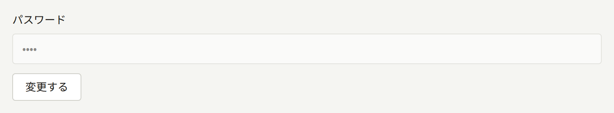
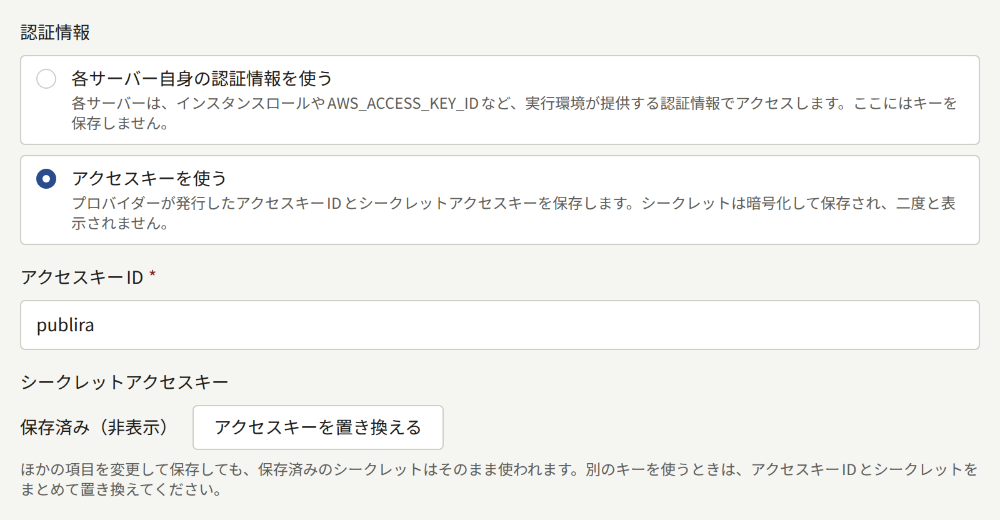

このページでは、[各シークレットの置き場所](./index.md#各シークレットの置き場所)に挙げたシークレットを入れ替える手順を説明します。必要になる前に目を通しておいてください。どの手順も、インシデントの最中より、落ち着いているときに行うほうが簡単です。

シークレットを最初に生成する手順は[インストール](../../2-deployments/2-installing.md#シークレットを生成する)に、シークレットの保管については[バックアップと復元](../../2-deployments/9-backup-and-restore.md#シークレットの暗号化キー)にあります。

## シークレットの暗号化キーのローテーション

Publiraが保存する認証情報は、すべて暗号化キーで暗号化されています。暗号化された値には、暗号化に使ったキーのIDが記録されています。`PUBLIRA_SECRET_ENCRYPTION_KEYS`はプロセスが値の復号に使えるキーの一覧で、`PUBLIRA_SECRET_ENCRYPTION_PRIMARY_KEY_ID`は新しい値の暗号化に使うキーを指定します。ローテーションは、キーを追加し、そのキーで暗号化するように切り替え、保存済みの値をそのキーで暗号化し直す作業です。一覧にないキーで暗号化された値は、まったく復号できません。

### 1. 新しいキーを追加する

キーを生成し、`k2`のように一覧にまだないIDを付けます。古いキーと並べて追加し、プライマリーキーはそのままにします。

```text
PUBLIRA_SECRET_ENCRYPTION_KEYS=k1:<old key>,k2:<new key>
PUBLIRA_SECRET_ENCRYPTION_PRIMARY_KEY_ID=k1
```

この設定で`publira server`と`publira worker`を再起動し、以降の`publiractl`コマンドもすべてこの設定で実行します。新しいキーは、すぐにシークレットの保管場所とバックアップに保存してください。次の手順からは、値がこのキーで暗号化されるようになります。

### 2. プライマリーキーにする

すべてのプロセスが両方のキーを持って動くようになったら、プライマリーキーを`k2`に変えて、もう一度再起動します。それ以降に保存される値はすべて`k2`で暗号化され、`k1`で暗号化された値も引き続き復号できます。

再起動を2回に分けているのには理由があります。`k2`をまだ持たないプロセスは、ほかのプロセスが`k2`で暗号化した値を復号できません。そのため、`publira server`や`publira worker`を複数のインスタンスで動かしている場合や、1つずつ順に再起動する場合に、キーの追加と同じ手順でプライマリーキーを切り替えると、メールの送信が失敗したりログインが拒否されたりする時間が生まれます。

[Docker Compose](../../2-deployments/3-docker-compose.md)の構成では、どちらの手順も`.env`の2つの変数を編集して`docker compose up -d`を実行するだけです。これで`server`とその中で動くワーカーが再起動し、ほかのサービスは動いたままです。

### 3. 保存済みの値を暗号化し直す

プロセスと同じ2つの変数を設定し、管理用ログインの接続で`publiractl db reseal`を実行します。

```bash
publiractl db reseal
```

このコマンドは、データベースにある暗号化された値をすべて一覧のキーで復号し、プライマリー以外のキーで暗号化された値をプライマリーキーで暗号化し直します。対象は、プラットフォームとすべてのテナントの認証情報、すべてのスタッフとオペレーターの2段階認証のシークレット、Appleでサインインによる各アカウント連携が保持するトークン、Web Pushの秘密鍵、アウトボックスのエントリーがワーカーに渡す値です。値そのものは変わらないので、誰もログアウトせず、何かを入力し直す必要もありません。実行中もPubliraは動き続けます。実行中に保存が行われても、保存とコマンドのどちらかがもう一方を待つので、どちらも失われません。

出力は、保存済みの値に記録されたキーIDごとに1行です。

```text
KEY ID        RESEALED  ON PRIMARY  UNREADABLE
k1            42        0           0
k2 (primary)  0         3           0
```

`RESEALED`はそのキーで暗号化されていて今回プライマリーキーで暗号化し直した値の数、`ON PRIMARY`はもともとプライマリーキーで暗号化されていた値の数、`UNREADABLE`は一覧のどのキーでも復号できない値の数です。何も書き込まずに同じ表を確認するには、`publiractl db reseal --dry-run`を実行します。

[Docker Compose](../../2-deployments/3-docker-compose.md)の構成では、`publiractl`サービスに管理用の接続と`.env`のキーがすでに設定されています。

```bash
docker compose run --rm publiractl db reseal
```

### 4. 古いキーは使われなくなってから削除する

`k1`を一覧から削除するのは、`db reseal`が`0`で終了し、`UNREADABLE`の列に値が1つも残っていないときだけにしてください。このとき、もう一度実行するとプライマリーキーの1行だけが出力され、そこで数えられた値はすべて`k1`なしで復号できます。

一覧のどのキーでも復号できない値があると、`db reseal`はその値をそのままにして、ほかの値をすべて暗号化し直し、`1`で終了します。復号できない値は、カラム、行、記録されたキーIDとともにログに出力され、表ではそのキーIDの行で数えられます。こうした値は、一覧から外れたキーか、同じIDを付けた別のキーで暗号化されたものです。そのキーを一覧に戻して、コマンドをもう一度実行してください。キーを誰も持っていない値は、キーを失ったときと同じく、保存した場所で入力し直す必要があります。

キーがなくなった値は復号できません。たとえば、テナント管理者の認証アプリのシークレットがまだ`k1`で暗号化されているのに`k1`を削除すると、その管理者のログインは2段階認証の段階でエラーページになって失敗します。サーバーのログには`secretcrypto: unknown key id: k1`が出力され、テナントの監査ログには、理由が`secret_undecryptable`の失敗した**ログイン時の2段階認証**が記録されます。なくなったキーで暗号化されたパスワードを使うメールも送信されません。キーを一覧に戻して再起動すれば、すべて元に戻ります。

キーが漏えいした場合は、暗号化し直すだけでは足りません。古いキーと、ローテーションより前に取ったデータベースのバックアップを持っている者は、そのバックアップ内の値をすべて復号できるからです。SMTPの新しいパスワード、バケットの新しいアクセスキー、決済プロバイダの新しいキーなど、認証情報そのものを発行元で作り直し、新しい認証情報を保存してください。プラットフォーム管理画面では、[メール](../6-email.md#設定を変更する)と[オブジェクトストレージ](../5-object-storage.md#アクセスキーをローテーションする)で説明しているとおり、SMTPの新しいパスワードは**メール**の**パスワード**の横にある**変更する**から、新しいアクセスキーは**ストレージ**の**アクセスキーを置き換える**から入力します。





## データベースのロールのパスワードのローテーション

ロールが持てるパスワードは一度に1つだけです。そのため、PostgreSQLでパスワードを変更したら、そのロールで接続するすべてのプロセスをすぐに再起動します。

| ロール | 接続するプロセス |
| --- | --- |
| `publira_public`、`publira_admin` | `publira server` |
| `publira_platform` | `publira server`と、プラットフォームの設定を変更する`publiractl`コマンド |
| `publira_outbox`、`publira_ticker` | `publira worker` |
| `publira_content_stats` | `publira worker`と`publiractl job` |

1. `openssl rand -hex 32`で新しいパスワードを生成します。接続URLにはパスワードをエスケープせずに入れるので、16進数の文字列にしています。
2. 管理用ログインの接続で、そのロールのフラグだけを付けて`publiractl db roles`を実行します。ほかのロールのパスワードは変わりません。

   ```bash
   publiractl db roles --admin-password-file /run/secrets/publira-admin-db-password
   ```

   ロールごとに1行が出力され、指定したロールには`set its password`、ほかのロールには`kept its password`と表示されます。

3. 上の表に挙げたプロセスの接続URLを新しいパスワードに変更し、再起動します。

プロセスがすでに開いている接続はログインしたままなので、パスワードを変えた瞬間に何かが失敗することはありません。ただし、その後にプロセスが開く接続は拒否されるので、2つの手順の間を空けないでください。古いパスワードのまま再起動したプロセスは起動できず、ログに`password authentication failed for user "publira_admin"`が繰り返し出力されます。プロセスが再び動き出したあとは、`GET /readyz`にロールごとのチェックが表示されるので、パスワードの不一致はそこで特定できます。プロセスが持っているパスワードで`db roles`をもう一度実行すれば、元に戻ります。

すべてのロールを一度にローテーションするには、`db roles`に6つのフラグをすべて付けて実行し、`publira server`と`publira worker`を再起動します。

Docker Composeの構成では、パスワードは`.env`の`PUBLIRA_*_DB_PASSWORD`変数で、Composeファイルがそこからすべての接続URLを組み立てます。変数を変更してから、次を実行します。

```bash
docker compose run --rm publiractl db roles --admin-password-file /run/secrets/admin-db-password
docker compose up -d
```

`docker compose up -d`は、接続URLが変わったプロセスだけを再起動します。

### 管理用ログインのパスワード

`publiractl`は管理用ログインを管理しません。パスワードはPostgreSQL側で変更します。`psql`で`ALTER ROLE postgres PASSWORD '<new password>'`を実行するか、データベースのプロバイダーの機能を使ってください。そのあと、`db`コマンドの実行に使う`PUBLIRA_DB_URL`を変更します。管理用ログインを使う常駐プロセスはないので、再起動するものはありません。

Docker Composeの構成では、PostgreSQLが`PUBLIRA_POSTGRES_PASSWORD`を読むのはボリュームを作成するときだけなので、`.env`を変更するだけでは何も変わりません。`docker compose exec postgres psql -U postgres -d publira`で`ALTER ROLE`を実行してから、`.env`に同じ値を設定してください。次に`docker compose up -d`を実行すると、変数が変わった`postgres`コンテナが再起動するので、すべてのプロセスが数秒間中断されます。

## 署名キーとトークンのローテーション

これらの値は、プロセスの起動時に読み込まれます。ローテーションは、値を持つすべてのプロセスに新しい値を設定して、まとめて再起動するだけです。どの値もデータベースには保存されず、入れ替えたあとに古い値を残しておく必要もありません。

| 値 | 変更する場所 | 変更による影響 |
| --- | --- | --- |
| `PUBLIRA_AUTH_JWT_SECRET` | `publira server` | 全員がログアウトします。すべてのテナントのサイトとモバイルアプリの読者、すべてのテナント管理画面のスタッフ、プラットフォーム管理画面のオペレーターが対象です |
| 1つのWebアプリの`PUBLIRA_AUTH_SECRET` | そのWebアプリ | そのアプリのユーザーだけがログアウトします |
| キャッシュ再検証トークン | `publira server`、`publira worker`、すべてのWebアプリ | 誰もログアウトしません |
| Webサービストークン | `publira server`、`web-admin`、`web-platform` | 誰もログアウトしません |

Docker Composeの構成では、`.env`の`PUBLIRA_AUTH_JWT_SECRET`、`PUBLIRA_WEB_STOREFRONT_AUTH_SECRET`、`PUBLIRA_WEB_ADMIN_AUTH_SECRET`、`PUBLIRA_WEB_PLATFORM_AUTH_SECRET`、`PUBLIRA_REVALIDATE_TOKEN`、`PUBLIRA_WEB_SERVICE_TOKEN`がこれらの値です。1つを変更して`docker compose up -d`を実行すると、その変数を読むプロセスだけが再起動します。

### アクセストークンの署名キー

セッションはすべて、このキーで署名したアクセストークンです。そのため、キーを新しくするとすべてのセッションが一度に終了します。読者やスタッフがページを開くと、「セッションの有効期限が切れました。もう一度ログインしてください。」というメッセージとともにログイン画面に移ります。テナントのモバイルアプリのセッションも同じ種類のトークンなので、同じく終了します。2段階認証のログインの途中だったスタッフは、パスワードの入力からやり直します。

エピソードの画像へのリンクにも、同じキーで署名した有効期間の短いトークンが付いています。テナントのサイトは無料エピソードのページをリンクごと最大1時間キャッシュするので、そのページが作り直されるまで、無料エピソードの画像が読み込めないことがあります。

このキーは、漏えいしたおそれがあるときと、セッションキーが漏えいしたおそれがあるときには必ずローテーションしてください。セッションCookieには1日有効なアクセストークンが入っていて、それより早く無効にできるのは署名キーの変更だけです。

### Webアプリのセッションキー

各Webアプリは、自分の`PUBLIRA_AUTH_SECRET`でセッションCookieを暗号化します。キーを新しくすると、そのアプリが暗号化したCookieはすべて読めなくなり、ユーザーはメッセージなしでログイン画面に移ります。ほかのアプリのセッションはそのままです。`web-storefront`のキーをローテーションすると、読者はサイトからはログアウトしますが、モバイルアプリからはログアウトしません。また、進行中だったAppleやGoogleでのログインは取り消されます。`web-admin`のキーをローテーションすると、進行中だった2段階認証のログインも取り消されます。

値は32バイト以上必要で、使われるのは先頭の32バイトだけです。古い値の末尾だけを書き換えるのではなく、`openssl rand -base64 32`でまったく新しい値を生成してください。

### キャッシュ再検証トークン

`publira server`と`publira worker`は、Webアプリのキャッシュ済みページを破棄するリクエストに必ずこのトークンを付けて送り、各Webアプリは自分のトークンと一致しないリクエストを拒否します。双方のトークンが一致しない間は、破棄のリクエストがすべて`401`で拒否され、ワーカーは試行のたびに`revalidate endpoint returned status=401`を含む`outbox event retry scheduled`をログに出力します。ワーカーは1つの破棄をおよそ9分間再試行し続けるので、その間にすべてのプロセスを新しいトークンで再起動すれば何も失われません。試行回数を使い切った破棄では、[定期ジョブとメンテナンスジョブ](../10-scheduled-jobs.md#断念されたエントリーの確認)で説明しているとおり、対象のページは古いままになります。

### Webサービストークン

`web-admin`と`web-platform`は、どのユーザーにも共通して表示する情報を読み込むためにこのトークンを送ります。`publira server`のトークンと一致しない間はこの読み込みが拒否され、どちらの管理画面もダッシュボードに「セッションが無効です。再ログインしてください。」と表示します。ログインし直しても解決しないので、3つのプロセスを同じトークンで再起動してください。
