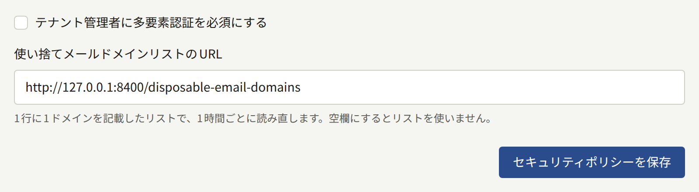

このページはオペレーターに向けたものです。テナントのスタッフとプラットフォーム管理画面のオペレーターが2つ目の要素でアカウントを守る方法、それを必須にする方法、そしてそれを失ったときの対処を説明します。

## テナントのスタッフ

テナントのスタッフは誰でも、管理画面の**アカウント設定**から、認証アプリと10個のリカバリーコードで管理画面のアカウントを守ることができます。スタッフ向けの説明は[アカウント](../../4-console/3-setup/9-your-account.md)にあります。

スタッフは、[パスキーでのログイン](../../4-console/3-setup/9-your-account.md#パスキーでのログイン)で説明しているとおり、パスキーやセキュリティキーで2段階認証に答えることもできます。パスキーは、認証アプリと同じく、下で説明する必須の要件を満たします。ログイン時に2段階認証の設定を求められたテナント管理者は、代わりにパスキーを登録できます。アカウントのパスキーと認証アプリは同じ10個のリカバリーコードを共有し、拒否されたパスキーは、誤ったコードと同じロックに数えられます。

パスキーは、そのホストがどこで提供されていても管理画面のホストに結び付けられ、テナントのドメインには決して結び付けられません。`admin.<domain>`のように管理画面がテナントのドメインの下にある場合も同じです。そのため、[管理画面を別のホストに移す](../2-tenants.md#テナントを別のホスト名に移す)（新しい管理ドメインを与える、または管理画面が`admin.<domain>`にあるテナントのドメインを変更する）と、そのスタッフが登録したすべてのパスキーが使えなくなります。認証アプリやリカバリーコードを持っているスタッフは、それでログインします。2つ目の要素がパスキーだけだったスタッフは、要件がそのロールを対象にしていれば2段階認証の設定をやり直すよう求められ、対象にしていなければパスワードだけでログインします。管理画面を元のホストに戻せば、古いパスキーは再び使えるようになります。

インストール環境のすべてのテナント管理者に2段階認証を必須にできます。プラットフォーム管理画面の**ポリシー**の下にある**セキュリティ**で**テナント管理者に多要素認証を必須にする**にチェックを入れて**セキュリティポリシーを保存**を選ぶか、次を実行してください。

```bash
publiractl policy set --mfa-required-for-tenant-admin
```



`--mfa-required-for-tenant-admin=false`で必須をやめます。この要件はテナント管理者のログイン時にチェックされるので、すでに開いているセッションではなく、それぞれの次のログインから適用されます。これが何をし、誰を対象にするかは、[プラットフォームの既定値とポリシー](../9-platform-policies.md#テナント管理者の2段階認証)にあります。

2つ目の要素（認証アプリとパスキー）をすべて失い、リカバリーコードもすべて失ったスタッフは、もうログインできず、テナントのほかの管理者もそのアカウントから2段階認証を外すことはできません。それができるのはあなたで、[テナントのスタッフ](../3-tenant-staff.md#2段階認証を失った場合)で説明しているとおり、`publiractl tenant member reset-mfa`を使います。

各認証アプリのシークレットは暗号化キーで封じられており、そのため[古いキーを削除する](./1-rotating-secrets.md#4-古いキーは何も使わなくなってから削除する)とスタッフが締め出されることがあります。パスキーはそうではありません。インストール環境が保持するのは各パスキーの公開鍵だけで、それを読んだ誰に対しても何も証明しないので、キーを入れ替えたり削除したりしてもパスキーは動き続けます。

## プラットフォームのオペレーター

オペレーターは誰でも、同じように、**アカウント設定**の**2段階認証**から、認証アプリと10個のリカバリーコードでプラットフォーム管理画面のアカウントを守ることができます。[オペレーター自身のアカウント](../1-platform-console.md#オペレーター自身のアカウント)で説明しています。

ロールにかかわらず、すべてのオペレーターに2段階認証を必須にできます。**ポリシー**の下にある**セキュリティ**で**Platform Consoleのすべてのオペレーターに2段階認証を必須にする**にチェックを入れて**セキュリティポリシーを保存**を選ぶか、次を実行してください。

```bash
publiractl policy set --mfa-required-for-platform-operator
```

`--mfa-required-for-platform-operator=false`で必須をやめます。これはオペレーターのログイン時にチェックされるので、あなた自身のものを含め、すでに開いているセッションではなく、それぞれの次のログインから適用されます。まだ設定していないオペレーターに何が表示されるかは、[プラットフォームの既定値とポリシー](../9-platform-policies.md#プラットフォームのオペレーターの2段階認証)にあります。必須にする前に自分の認証アプリを設定しておいてください。そうすれば、ログインで何を求められるかを最初に知るのがあなたになることはありません。

認証アプリとすべてのリカバリーコードを失ったオペレーターは、もうログインできず、ほかのオペレーターもプラットフォーム管理画面でそのアカウントから2段階認証を外すことはできません。それができるのはあなたで、[2段階認証を失った場合](../1-platform-console.md#2段階認証を失ったとき)で説明しているとおり、`publiractl operator reset-mfa`を使います。これはアカウントを必要としないので、2段階認証を失ったオペレーターがインストール環境で唯一の**スーパー管理者**であっても使えます。

各認証アプリのシークレットは、テナントのスタッフのものと同じく暗号化キーで封じられているので、[古いキーを削除する](./1-rotating-secrets.md#4-古いキーは何も使わなくなってから削除する)とオペレーターも締め出されることがあります。

2段階認証を必須にするかどうかにかかわらず、次のようにしてください。

- 各オペレーターに、パスワードマネージャーで管理する、本人だけの長いパスワードを持たせます。
- **スーパー管理者**のロールはできるだけ少ないオペレーターに与え、見るだけでよい人には**監査担当**を与えます。
- アカウントがもう必要なくなったオペレーターは、[停止と無効化](../1-platform-console.md#停止と無効化)で説明しているとおり、停止または無効化します。
- プラットフォーム管理画面のホスト名を、VPNやTLS終端でのアドレスの許可リストなどを使って、オペレーターが到達するネットワークにだけ提供することを検討してください。読者とテナントのスタッフがそれを必要とすることはありません。
