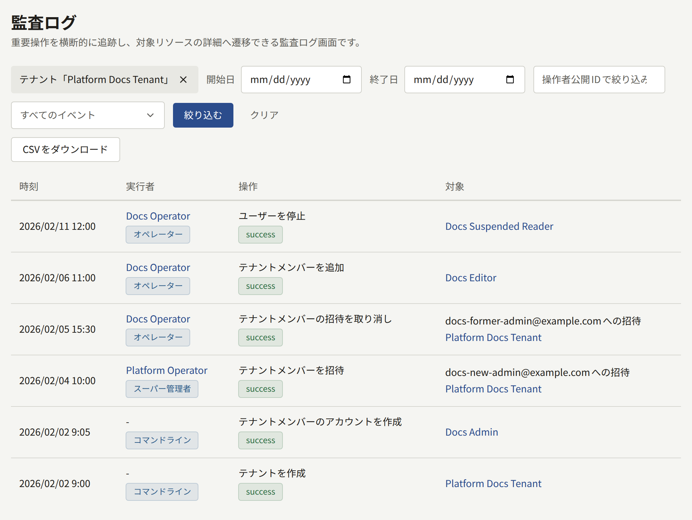

Publiraには2つの監査ログがあり、両者がエントリーを共有することはありません。1つはオペレーターと`publiractl`による変更を記録するプラットフォーム管理画面のログ、もう1つはスタッフがテナント管理画面で行った変更を記録する各テナントのログです。エントリーは削除されません。データベースは、Publiraのプロセスが接続するどのロールにもエントリーの変更を許しません。唯一の例外はデータベース自身が行う変更で、操作したアカウントが削除されると、エントリーにはそのアカウントの代わりに、アカウントの名前と公開IDが残ります。どちらのログも、期間を区切って[CSVでエクスポート](#ログのエクスポート)できます。

## プラットフォーム管理画面のログ

プラットフォーム管理画面の**ガバナンス**にある**監査ログ**には、エントリーが新しい順に1ページ20件で表示されます。**監査担当**を含め、すべてのオペレーターが閲覧できます。各エントリーには、**時刻**、ロール付きの**実行者**、操作とその結果、**対象**が表示されます。`publiractl`から行った変更にはオペレーターが表示されず、実行者は**コマンドライン**になります。一覧は、**開始日**と**終了日**による期間、公開IDで指定した1人の実行者、1種類の操作で絞り込めます。期間はプラットフォームの**既定タイムゾーン**での日単位です。テナントのページで**監査ログを確認**を選ぶと、そのテナントでも絞り込んだ状態で一覧が開きます。対象になるのは、そのテナント、テナントへの招待、テナントのスタッフと読者のアカウントを変更したエントリーです。一覧の上にテナント名が表示され、その閉じるボタンではテナントの絞り込みだけが外れます。**クリア**を選ぶと、すべての絞り込みが外れます。

記録される内容は次のとおりです。

- **オペレーター**の追加、変更、停止、再有効化、無効化と、各オペレーター自身の2段階認証の操作。2段階認証では、設定、ログイン時に求められたコードの入力(正誤を問わず)、リカバリーコードによるログイン、リカバリーコードの再発行、無効化を記録します。
- **プラットフォームの設定とサービス**の変更。一般設定、セキュリティとコミュニティのポリシー、保持期間の既定値、メール、ストレージ、検索の設定、Web Pushの連絡先を保存するたびに記録します。メール、ストレージ、検索の接続テストも、その結果とともに記録します。
- **テナントとそのスタッフ**の変更。テナントの作成、変更、停止、再開、管理者の招待、招待の再送とキャンセル、メンバーの追加、パスワードを指定したメンバーの作成、ロールの変更、メンバーの削除を記録します。
- **読者**のアカウントに対する、オペレーターによる停止、復元、削除。
- **ログ自体**のエクスポート。エクスポートの対象期間と、絞り込んだテナントも記録します。

## テナントのログ

各テナントの管理画面の**管理**にある**監査ログ**には、スタッフが管理画面で行った操作が2段階認証も含めて記録されます。閲覧できるのは、そのテナントのテナント管理者だけです。記録される内容は[監査ログ](../../4-console/3-setup/8-audit-log.md)を参照してください。テナントのログはプラットフォーム管理画面からは閲覧できません。また、オペレーターがプラットフォーム管理画面や`publiractl`からテナントに対して行った変更は、テナントのログではなくプラットフォーム管理画面のログに記録されます。

## ログのエクスポート

どちらのログも、閲覧できる人が、最長366日分を1つのCSVファイルとしてエクスポートできます。テナントのログはそのテナントのテナント管理者が、プラットフォーム管理画面のログは**監査担当**を含むすべてのオペレーターがエクスポートできます。期間は日単位で、テナントのログではテナントのタイムゾーン、プラットフォーム管理画面のログではプラットフォームの**既定タイムゾーン**で区切ります。実行者と操作による絞り込みは、一覧と同じようにファイルにも適用されます。プラットフォーム管理画面のログでは、テナントによる絞り込みも同様です。

ファイルには、期間内のすべてのエントリーが古い順に1行ずつ入ります。各行の内容は、記録された時刻(期間のタイムゾーンのオフセット付き)、実行者の公開ID、名前、ロール、操作とその結果と理由、操作の対象の種類とID、クライアントのアドレスです。プラットフォーム管理画面のログのファイルには、各エントリーのテナントの公開IDと名前、操作の対象の公開IDと名前も入ります。ファイルはバイトオーダーマーク付きのUTF-8です。バイトオーダーマークがあることで、表計算ソフトがファイルをUTF-8として読み込みます。また、表計算ソフトが数式として解釈する値は、テキストのまま扱われるよう先頭にアポストロフィを付けて書き出します。

エクスポートそのものも、エクスポートしたログにエントリーとして記録されます。そのため、誰がどの期間のコピーをいつ取ったかがログでわかります。

プラットフォーム管理画面では、**監査ログ**の絞り込みの横にある**CSVをダウンロード**を選ぶと、表示中の期間、テナント、実行者、操作に一致するエントリーが、`platform-audit-log-2026-04-01--2026-04-30.csv`のように期間を表す名前のファイルとして保存されます。**終了日**を指定しない場合、期間は今日までです。**開始日**を指定しない場合は、**終了日**(指定がなければ今日)までの366日間になります。それより長い期間や、**開始日**が**終了日**より後の期間は、期間を絞り込むまでダウンロードできません。ダウンロードのたびに、ログには**監査ログをCSVでダウンロード**と記録されます。

## どちらのログにも記録されないもの

- **パスワードによるログイン**。ログインの成功もパスワードの誤りも、エントリーには残りません。テナントのログに記録されるのは、そのあとの2段階認証の段階だけです。`publira server`は、サイト、テナント管理画面、プラットフォーム管理画面へのすべてのログインの試行を、`audit auth`で始まる行としてログに出力します。行には操作、結果、理由、クライアントのアドレスが含まれ、たとえば`audit auth action=admin_login outcome=failure ... reason=invalid_credentials`のようになります。この記録が必要な場合は、サーバーのログを保管してください。
- **Publiraのシークレットと環境変数**。キー、パスワード、トークンのローテーションはPubliraの外で行うので、どこにもエントリーは残りません。いつ何をローテーションしたかは、別途記録しておいてください。

すべてのエントリーは、保存される前に、`msg=audit`を含む行として`publira server`のログにも出力されます。ほとんどのエントリーは、サーバーのメモリー上のキューを経由して、変更の少しあとに保存されます。何回か試みても保存できなかったエントリーや、サーバーが停止したときにまだキューに残っていたエントリーは、管理画面の一覧からは失われますが、このログの行には残ります。こうした欠落に対してアラートを設定すべきログとメトリクスは、[監視](../11-monitoring.md#監査ログ)を参照してください。
