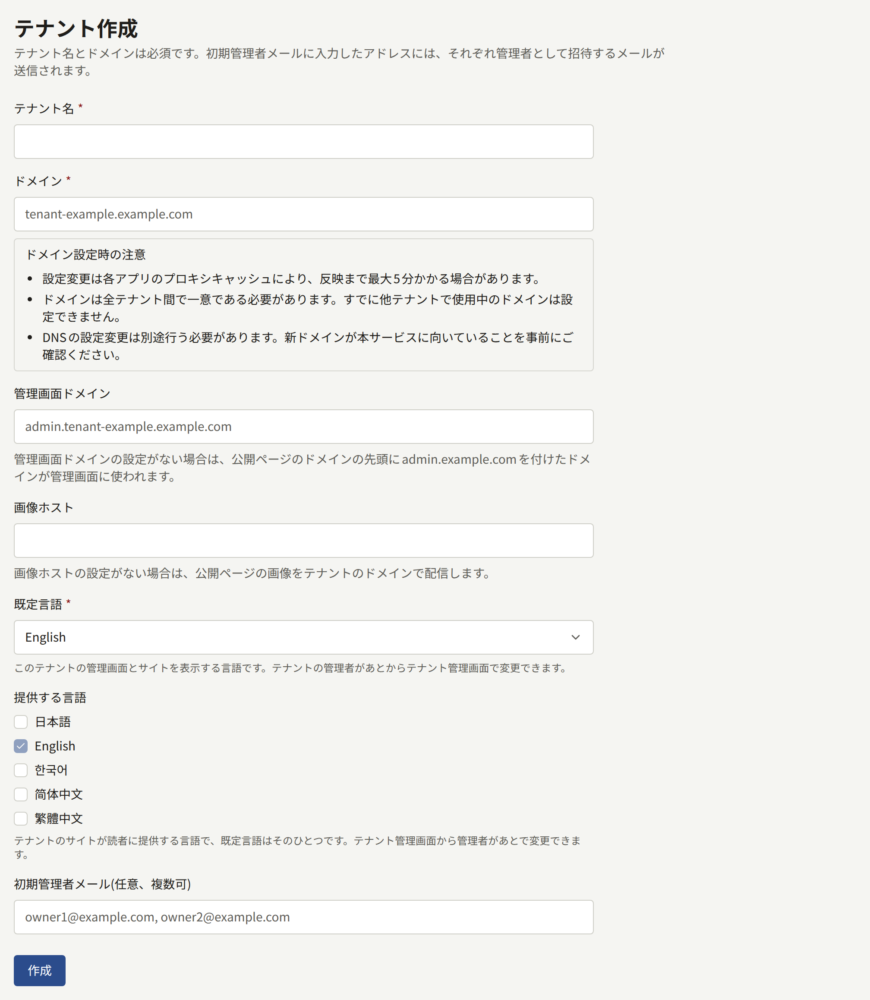
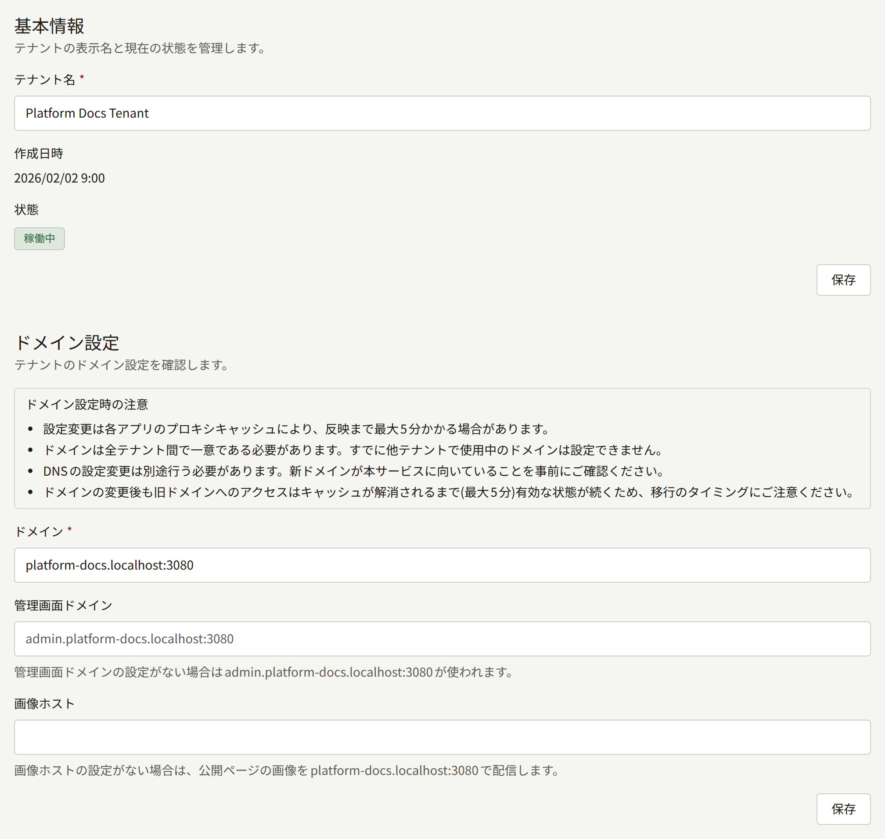
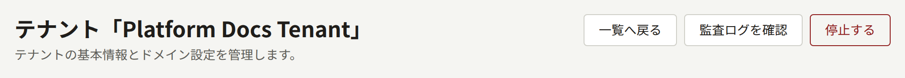
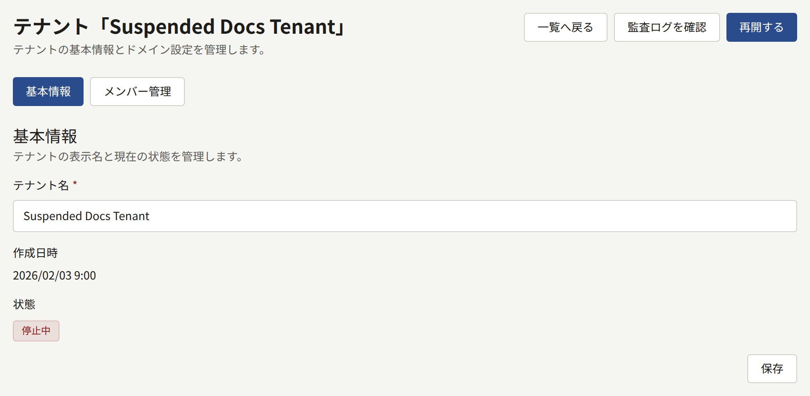
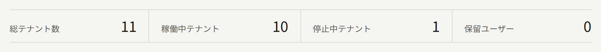

Publiraが受け持つ出版社は、1社ごとに1つのテナントになります。テナントは、独自のドメインで公開する公開サイトと、別のホスト名で開く管理画面を持ちます。最初のテナントは`publiractl setup`で作成済みです。このページでは2つ目以降のテナントを追加する方法と、作成後に変更できる項目を説明します。

このページの`publiractl`コマンドは、コマンド部分だけを示しています。実行するときは[プラットフォーム管理画面とpubliractl](./1-platform-console.md#どちらを使うか)の説明に従い、`PUBLIRA_PLATFORM_DB_URL`に`publira_platform`への接続先を設定してください。すべてのフラグは[`publiractl`のリファレンス](https://github.com/publira/publira/blob/main/server/cmd/publiractl/README.md#tenant)に載っています。

## テナントを作成する前に

テナントは、作成したその時点からそのホスト名で公開されます。そのため、次の項目を先に決めておきます。

- **ドメイン**は公開サイトのホスト名で、たとえば`comics.example.com`です。
- **管理画面のホスト名**は、スタッフがログインするホスト名です。別の名前を指定しなければ、ドメインの前に`admin.`を付けた`admin.comics.example.com`のような名前になります。
- **画像ホスト**は、サイトの画像を`images.comics.example.com`のような専用のホスト名で配信する場合にだけ決めます。詳しくは[画像ホスト](#画像ホスト)で説明します。画像ホストがなければ、画像はドメインで配信されます。
- **既定言語**は、サイトと管理画面が最初に使う言語です。自動では決まりません。あとからテナントの管理者がテナント管理画面で変更できます。
- **サイトで提供する言語**は読者が選べる言語で、既定言語もその1つです。何も指定しなければ、サイトは既定言語だけを提供します。これもあとからテナントの管理者が変更できます。
- **最初の管理者**と、その管理者にアクセスを渡す方法を決めます。招待メールを送る方法と、パスワード付きのアカウントを作成する方法があり、[テナントのスタッフ](./3-tenant-staff.md)で両者を比べています。

ホスト名は1つずつ小文字で書き、`https://`やパス、末尾の`/`は付けません。1つのホスト名は1つのテナントだけのもので、そのテナントのドメイン、管理画面のホスト名、画像ホストのどれか1つとして使います。2つを兼ねることはできません。リバースプロキシはホスト名ごとに転送先を1つしか持てないので、同じ名前を2か所で使うと片方には届かなくなるからです。そのため、Publiraは次のホスト名を受け付けません。

- ほかのテナントがドメイン、管理画面のホスト名、画像ホストのいずれかとしてすでに使っているホスト名。管理画面に既定で割り当てられる`admin.<domain>`も含みます。
- テナント自身のドメインと同じ管理画面のホスト名
- テナント自身のドメインや管理画面のホスト名と同じ画像ホスト

テナントに割り当てられるはずの`admin.<domain>`がすでに使われている場合は、そのテナントに専用の管理画面ドメインを指定してください。

次に、テナントのホスト名でPubliraにアクセスできるようにします。[テナントの追加](../2-deployments/4-edge/index.md#テナントを追加するとき)の手順に従い、DNS、証明書、リバースプロキシのルーティングの順に設定してください。この作業はテナントの作成の前後どちらに行ってもかまいませんが、終わるまでスタッフは管理画面を開けません。

### 管理画面を別のドメインに置く

管理画面のホスト名は、テナントのドメインの下になくてもかまいません。たとえば`example.com`のサイトの管理画面を`admin.example.net`に置くこともできます。指定には後述の**管理画面ドメイン**か`--admin-domain`を使います。管理画面用に2つ目のドメインを取得できるなら、そのほうが安全です。

公的な認証局が発行した証明書はすべてCertificate Transparencyログに公開され、crt.shなどのサービスで誰でもドメイン名から検索できます。そのため、サイトのドメインの下にある管理画面のホスト名は、どんな名前にしても、証明書が発行された時点からサイトのホスト名と並んで検索結果に出ます。ワイルドカード証明書を使えばホスト名はログに載りませんが、`admin.<domain>`は誰もが真っ先に試す名前です。登録可能ドメインがサイトと異なるホスト名に管理画面を置き、サイトのホスト名を1つも含まない証明書を使えば、こうした形でサイトと結び付けられることはありません。それでも管理画面はスタッフにログインを求めるので、この方法で人目から隠せるのはログインページです。既定は引き続き`admin.<domain>`で、そのままでも問題なく使えます。

管理画面のホスト名は、スタッフがパスキーを登録する前に決めてください。パスキーは管理画面のホスト名に結び付けられるので、あとから管理画面を別のホスト名に移すと、登録済みのパスキーは使えなくなります。詳しくは[2段階認証](./12-security/2-two-step-verification.md#テナントのスタッフ)を参照してください。

さらに、リバースプロキシで管理画面のホスト名へのアクセスをスタッフのIPアドレスだけに限ることもできます。[リバースプロキシの設定例](../2-deployments/4-edge/1-sample-configurations.md)にはこの設定は含まれていません。この制限で守れるのは管理画面のページです。管理画面のAPIにはこうした制限は要りません。管理画面はAPIをプライベートネットワーク経由で呼び出し、[公開APIだけをリバースプロキシに通す構成](../2-deployments/4-edge/index.md#リバースプロキシを通すのは公開apiだけ)にしたリバースプロキシは、どのホスト名でもこのAPIを転送しないからです。

### 画像ホスト

テナントのサイトの画像は、ページと同じリバースプロキシを通り、テナントのドメインで配信されます。画像ホストを設定すると、画像は`images.comics.example.com`のような専用のホスト名で配信されるようになります。こうすると、[画像と公開APIを分けて配信する方法](../2-deployments/7-scaling-out.md#画像と公開apiを別々に提供する)のとおり、画像だけをページや公開APIとは別のロードバランサーやCDNを通してPubliraに届けられます。その必要がないテナントには画像ホストは要りません。

テナントに画像ホストを設定すると、公開APIはサイトの画像のアドレスをそのホスト名で返します。Publiraはそのホスト名ではテナントのサイトの画像だけを返し、ページやAPI、管理画面は配信しません。テナントのサイトとモバイルアプリは画像を画像ホストから読み込みます。テナント管理画面は、これまでどおり管理画面のホスト名から画像を読み込みます。

画像ホストも、テナントのほかのホスト名と同じようにPubliraに届くようにします。DNSに登録し、証明書を用意し、そのホスト名の`/images`を`publira server`に転送してください。詳しくは[テナントの画像ホスト](../2-deployments/4-edge/index.md#テナントの画像ホスト)を参照してください。リバースプロキシの設定例は、ホスト名を`PUBLIRA_EDGE_IMAGE_HOSTS`に加えればルーティングします。画像ホストを設定するとサイトはその時点から画像をそこから読み込むので、設定する前に準備を済ませておいてください。

あとから画像ホストを設定、変更、解除するのは、[テナントを別のホスト名に移す](#テナントを別のホスト名に移す)で説明するほかのホスト名の変更と同じ扱いです。変更前にサイトが生成したページは、`publira worker`が変更をWebアプリに伝えるまで、以前のホスト名の画像を参照し続けます。それまでは以前のホスト名でも画像を配信し続けてください。

## テナントを作成する

### プラットフォーム管理画面から

サイドバーの**テナント**にある**テナント作成**を選び、次の項目を入力します。

- **テナント名**には出版社の名前を入力します。招待メールをはじめ、テナントから送るメールではこの名前が使われます。
- **ドメイン**には、先に決めたドメインを入力します。
- **管理画面ドメイン**には、管理画面のホスト名が`admin.<domain>`でない場合にだけ、そのホスト名を入力します。空欄のままにすると、入力欄の下に表示されるとおり、管理画面は`admin.<domain>`で開きます。
- **画像ホスト**には、テナントのサイトの画像をドメイン以外で配信する場合にだけ、そのホスト名を入力します。空欄のままにすると、入力欄の下に表示されるとおり、画像はドメインで配信されます。
- **既定言語**を選びます。
- **提供する言語**では、テナントのサイトで提供する言語のチェックボックスにチェックを入れます。既定言語のチェックボックスは常にチェックが入っていて外せません。ほかの言語は最初はチェックが外れています。
- 「**初期管理者メール(任意、複数可)**」には、テナントの管理者として招待するメールアドレスを、カンマか改行で区切って入力します。テナントを作成するとすぐに、各アドレスに招待メールが送られます。



**作成**を選ぶとテナントが作成され、そのテナントのページが開きます。タイムゾーンはプラットフォームの既定値になります。タイムゾーンはテナントの管理者がテナント管理画面から変更できます。

### publiractlから

```bash
publiractl tenant create \
  --name "Example Comics" \
  --domain comics.example.com \
  --default-locale en \
  --supported-locale en \
  --supported-locale ja \
  --initial-admin-email owner@comics.example.com
```

`--supported-locale`には、テナントのサイトで提供する言語を指定します。繰り返し指定でき、既定言語はその中に含める必要があります。省略すると、サイトは既定言語だけを提供します。`--admin-domain`で管理画面専用のホスト名を、`--image-domain`でサイトの画像専用のホスト名を指定します。`--timezone`には、プラットフォームの既定と異なるIANAタイムゾーンを指定します。`--initial-admin-email`は繰り返し指定でき、各アドレスにはプラットフォーム管理画面から作成したときと同じように招待が送られます。

### 作成したあと

招待メールは`publira worker`が送ります。ワーカーが動いていて、プラットフォームのSMTP設定が保存されている必要があります。メールを送らない構成では、代わりに`publiractl tenant admin create`でテナントの最初の管理者を作成します。詳しくは[テナントのスタッフ](./3-tenant-staff.md#メールを使わずにアカウントを作成する)を参照してください。

管理者がログインしたら、サイト、ブランディング、決済、ほかのスタッフなど、残りの設定はテナントの管理画面から行います。

## テナントを変更する

テナント名、ドメイン、管理画面のホスト名、画像ホストは作成後も変更できます。言語とタイムゾーンはテナントの管理者が決めるもので、テナント管理画面から変更します。テナントは削除できません。

### プラットフォーム管理画面から

**テナント一覧**からテナントを開きます。**基本情報**では**テナント名**を、**ドメイン設定**では**ドメイン**、**管理画面ドメイン**、**画像ホスト**を変更できます。**管理画面ドメイン**を空にすると管理画面は`admin.<domain>`に戻り、**画像ホスト**を空にするとサイトの画像は再びドメインで配信されます。



### publiractlから

```bash
publiractl tenant update --tenant comics.example.com --name "Example Comics Ltd."
```

`--tenant`には、テナントのドメインか公開IDを指定します。`--name`、`--domain`、`--admin-domain`、`--image-domain`は、それぞれ指定した値だけを置き換え、ほかの値は変えません。`--admin-domain ""`とすると管理画面は`admin.<domain>`に戻り、`--image-domain ""`とするとサイトの画像は再びドメインで配信されます。テナントの現在の設定は`publiractl tenant show --tenant comics.example.com`で確認できます。

### テナントを別のホスト名に移す

`publira worker`が変更をWebアプリに伝えると、サイトはすぐに古いドメインで応答しなくなり、ページのリンクも新しいドメインに変わります。ただし、`PUBLIRA_REVALIDATE_TOKEN`が設定されていないワーカーは変更を伝えられず、古いドメインがその後も最大5分間応答します。この仕組みは[アウトボックス](./10-scheduled-jobs.md#アウトボックスメールプッシュ通知キャッシュの再検証)で説明しています。新しいドメインはすぐに応答します。ただし、変更前に誰かが新しいドメインを開いていた場合は別です。サイトは、どのテナントのものでもなかったホスト名を最大5分間覚えているからです。管理画面は、一度調べたホスト名をすべて最大5分間保持します。そのため新しい管理画面のホスト名は応答するまでに最大5分かかり、それまでは古いホスト名が応答し続けます。

作業は[テナントの追加](../2-deployments/4-edge/index.md#テナントを追加するとき)と同じ順序で進めてください。変更する前に新しいホスト名をDNS、証明書、ルーティングに追加し、変更が反映されてから古いホスト名を取り除きます。専用の管理画面ドメインを持たないテナントの管理画面は`admin.<domain>`にあるので、ドメインを移すと管理画面も移ります。この場合は新しいホスト名を両方とも準備しておく必要があります。

ドメインを移すと、ドメインを前提にしているものもすべて移ります。

- 読者とスタッフのログインはホスト名ごとなので、新しいホスト名でログインし直すことになります。
- スタッフのパスキーは管理画面のホスト名に結び付いているので、管理画面のホスト名が変わる移動をすると使えなくなります。新しい管理画面ドメインを指定する場合と、管理画面が`admin.<domain>`にあるテナントのドメインを変える場合がこれに当たります。詳しくは[2段階認証](./12-security/2-two-step-verification.md#テナントのスタッフ)を参照してください。
- テナントのモバイルアプリは1つのホスト名に向けてビルドされ、そのホスト名のリンクしか開きません。[アプリマニフェスト](../5-mobile-app/1-app-manifest.md)に新しいホスト名を指定し、ビルドと申請をやり直してください。
- テナント管理画面に表示される決済用の**Webhook URL**と、AppleとGoogleでのログイン用に表示されるコールバックURLは、ドメイン上のURLです。新しいURLをそれぞれのプロバイダーに登録してください。
- 変更前に送ったメールのリンクは、古いホスト名を指したままです。

## テナントを停止する

プラットフォーム管理画面のテナントのページで**停止する**を選ぶか、`publiractl tenant suspend --tenant comics.example.com`を実行すると、テナントは**停止中**になります。**再開する**を選ぶか`publiractl tenant resume`を実行すると、テナントは再び稼働中になります。プラットフォーム管理画面のボタンは確認なしで、押した時点で反映されます。どちらの方法でも変更は**監査ログ**に記録され、そのテナントはダッシュボードの**停止中テナント**に数えられます。







停止すると、そのテナントのサービスの提供が止まります。それ以外は何も変わりません。

- サイト、アプリ、管理画面が使えなくなります。APIはこのテナントへのリクエストをログインも含めてすべて拒否し、画像も配信しなくなります。ただし、読者のブラウザーやPubliraの前段のキャッシュにすでに保存されている画像は、最大1時間は表示されます。Publiraが画像の保存を認めている期間が1時間だからです。
- 読者には、サイトが利用できないことだけが伝わります。サイトのどのページを開いても、その旨を伝えるページがステータス`503`で返ります。`503`は、サイトがなくなったのではなく一時的に利用できない状態であることを検索エンジンに伝えるステータスです。アプリでは、すべての画面の代わりに同じ内容が**再試行**ボタンとともに表示されます。テナントが再開されたあと、読者がこのボタンをタップするかアプリに戻ると、アプリは再び使えるようになります。
- スタッフには、サイトが停止中のため管理画面を利用できないことが、ログインページを含む管理画面のすべてのページに表示されます。内部の詳細は何も表示されません。
- Webアプリは一度調べたホスト名を最大5分間保持します。そのため停止から最大5分間は、すでに用意されていたページが表示されることがあります。それ以外のページでは、上で説明した案内の代わりにWebアプリのエラーページが表示されます。
- 決済プロバイダーと受信メールのプロバイダーからテナントに届く通知も拒否されます。拒否された通知は、各プロバイダーが独自のスケジュールで再送します。テナントを再開した時点でまだ再送が続いている通知は再開後に処理され、プロバイダーがすでに再送をあきらめた通知は処理されません。
- 読者とスタッフはログアウトされません。停止中はセッションが受け付けられませんが、再開すると再び使えます。
- 読者とスタッフへのメールとプッシュ通知は送られず、あとで送るために保存されることもありません。リンク先が利用できないうえ、再開するころには内容が古くなっているからです。例外はテナントの管理者への招待で、プラットフォーム管理画面や`publiractl`から送れば停止中でも送信されます。招待のリンクはテナントを再開すると使えるようになり、それまでに期限が切れていれば**再送**で新しいリンクを発行できます。
- 予約公開、無料公開期間、印税の締め処理など、テナントの予定された処理はすべて続きます。そのため、再開したテナントは本来のスケジュールどおりの状態になっています。
- テナントの情報、メンバー、招待は、停止中もプラットフォーム管理画面と`publiractl`から変更できます。詳しくは[テナントのスタッフ](./3-tenant-staff.md)を参照してください。

停止しても再開しても、テナントについて削除されるものや変わるものはありません。再開すれば、ほかに何もしなくてもすぐに再びサービスが提供されます。
