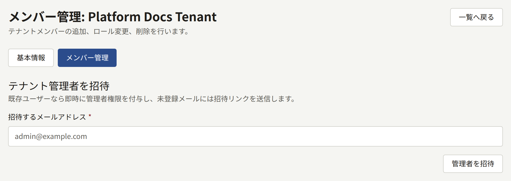
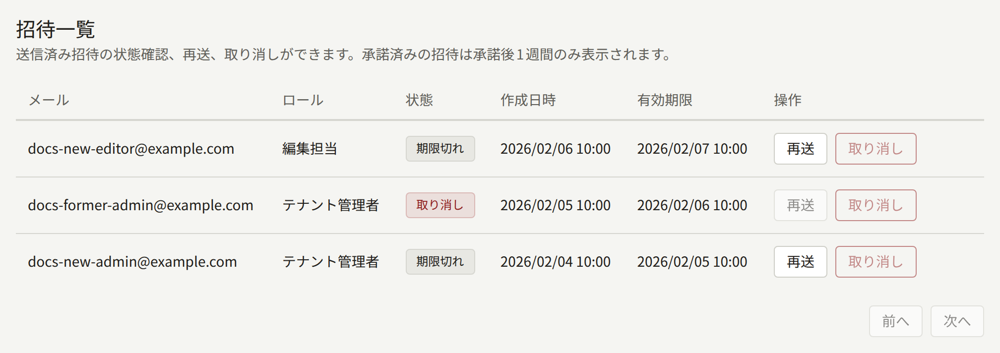
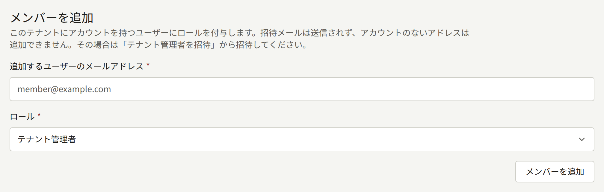
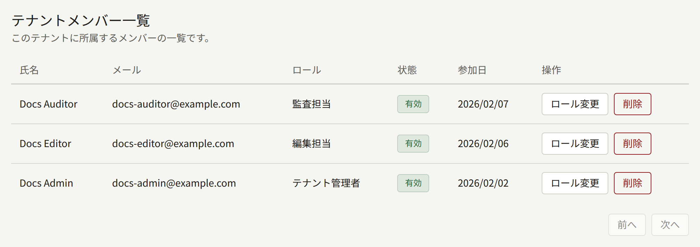

テナントのスタッフとは、そのテナントの管理画面にログインする人たちです。このページでは、スタッフが管理画面にたどり着くまでをオペレーターの側から説明します。最初の管理者の招待、スタッフが持つロール、管理者が1人もいなくなったテナントへの対処です。テナントに管理者ができたら、残りのスタッフはその管理者がテナント管理画面の**メンバー**から管理します。詳しくは[メンバー](../4-console/3-setup/6-members.md)を参照してください。オペレーターが再び必要になるのは、何か問題が起きたときだけです。

このページの`publiractl`コマンドは[プラットフォーム管理画面とpubliractl](./1-platform-console.md#どちらを使うか)の説明どおりに実行します。どのコマンドも`--tenant`でテナントをドメインか公開IDで指定します。フラグの一覧は[`publiractl`リファレンス](https://github.com/publira/publira/blob/main/server/cmd/publiractl/README.md#tenant)にあります。

## メンバーとユーザー

すべてのアカウントは1つのテナントに属します。2つのテナントのサイトで会員登録した読者は、それぞれに1つずつ、合わせて2つのアカウントを持ちます。アカウントはそのテナントの**ユーザー**です。管理画面のロールも持つユーザーはテナントのスタッフの**メンバー**であり、そのテナントの管理画面にログインできます。

ここから次のことが言えます。

- 誰かをスタッフにしても、その人のアカウントが移動することはありません。ロールを与えられたテナントの読者は、読者として使っていたのと同じメールアドレスとパスワードで管理画面にログインします。
- ロールを外しても、その人のアカウントは残ります。その人はテナントの読者のままで、あとから再びロールを与えることもできます。
- アカウントがロールを持っている間は、テナントの公開済みのエピソードをすべて、購入しなくてもサイトとアプリで読めます。これにより、スタッフは読者が目にするとおりにカタログを確認できます。サイトでこの方法で有料のエピソードを開くと、価格の横に、ロールによって開けていること、購入していない読者にはページの代わりに購入の案内が表示されることが示されます。テナントの年齢確認は引き続き適用され、エピソードを評価することはできないので、スタッフ自身の閲覧がサイトに表示される評価に加算されることはありません。ロールを外すと、これもあわせてなくなります。

## 3つのロール

| ロール | できること |
| --- | --- |
| **テナント管理者** | 管理画面のすべての操作。スタッフとその招待、テナントのすべての設定、サイトとブランディング、メール、決済、プッシュ通知、ログイン、Googleタグの各連携、読者のアカウントと問い合わせ、アクセスチケット、購入とその返金、印税、監査ログ |
| **編集担当** | カタログ（シリーズ、エピソード、著者、レーベル、ジャンル）と、テナントのページ、お知らせ、キャンペーンバナーの作成・編集、コメントのモデレーション |
| **監査担当** | 編集担当が扱うものと、テナントの設定の閲覧。変更はできません |

各ロールは、その下にあるロールができることをすべて含みます。管理画面は、ロールが使えないものを表示しません。編集担当のサイドバーには**メンバー**、**読者**、**印税**、**購入**が表示されず、監査担当には何かを変更するボタンが表示されません。

ほかの人にロールを与えられるのはテナント管理者だけなので、テナントには少なくとも1人のテナント管理者が必要です。

## スタッフにアクセス権を与える

方法は3つあり、どれが適しているかは、その人がすでにテナントにアカウントを持っているかどうかと、インストール環境がメールを送るかどうかで決まります。

### テナント管理者を招待する

招待はメールアドレスに送られ、承諾されるとそのアドレスをテナント管理者にします。新しいテナントは通常、作成時に指定したアドレスへの招待によって最初の管理者を得ます。あとから管理者を追加するのもこの方法です。

- **プラットフォーム管理画面**：**テナント一覧**からテナントを開き、**メンバー管理**を選び、**テナント管理者を招待**の下にアドレスを入力して、**管理者を招待**を選びます。
- **publiractl**：`publiractl tenant invite create --tenant comics.example.com --email editor-in-chief@comics.example.com`



招待された人には、テナントの管理画面へのリンクが、テナントの既定言語で送られます。そのリンク先で**お名前**と**パスワード**を入力し、**招待を承諾する**を選んでログインします。リンクの有効期限は24時間です。

すでにテナントのユーザーのものであるアドレスには、招待は送られません。そのアドレスはすぐにテナント管理者になり、メールは送られません。これは以前に持っていたロールを置き換えるので、この方法で招待された編集担当はテナント管理者になります。

招待メールは`publira worker`が送ります。テナントが独自のSMTP設定を保存していればそれを使い、そうでなければプラットフォームのものを使います。ワーカーが動いていないインストール環境では、招待は作成されますが、何も送られません。

プラットフォーム管理画面や`publiractl`から送る招待でできるのは、テナント管理者にすることだけです。編集担当と監査担当には、[既存のユーザーを追加する](#既存のユーザーを追加する)の説明どおりにロールを与えるか、テナント自身の管理者が招待します。テナントの管理画面からの招待では、3つのロールのどれでも与えられます。

### 招待のその後を確認する

同じ**メンバー管理**画面の**招待一覧**には、テナント自身の管理者がテナント管理画面から送ったものも含め、テナントのすべての招待が、承諾したときに与えられる**ロール**と状態（**招待中**、**承諾済み**、**取り消し**、**期限切れ**）とともに一覧表示されます。

- 招待中または期限切れの招待で**再送**を選ぶと、新しいリンクで招待が再び送られ、そこからさらに24時間有効になります。以前のリンクは使えなくなります。
- 招待中の招待で**取り消し**を選ぶと、招待が取り下げられ、そのリンクは使えなくなります。



コマンドラインでは、`publiractl tenant invite list --tenant comics.example.com`が各招待をそのIDとともに表示し、`tenant invite resend --id <ID>`と`tenant invite cancel --id <ID>`が、期限切れのものも含めて1件の招待を操作します。

テナント自身の管理者はテナント管理画面で同じ招待を確認でき、そこで送信、再送、取り消しができます。

### 既存のユーザーを追加する

テナントの読者には、メールを使わずに、3つのロールのどれでも直接与えられます。

- **プラットフォーム管理画面**：テナントの**メンバー管理**画面で、**メンバーを追加**の下にアドレスを入力し、**ロール**を選んで、**メンバーを追加**を選びます。
- **publiractl**：`publiractl tenant member add --tenant comics.example.com --email reader@example.com --role tenant_editor`。`--role`は`tenant_admin`、`tenant_editor`、`tenant_auditor`のいずれかです。



これは、すでにテナントにアカウントがあるアドレスにだけ使えます。それ以外のアドレスは拒否されます。アカウントのない人は、先にテナントのサイトで会員登録するか、テナント管理者として招待されます。すでにロールを持っているアカウントは、代わりに**ロール変更**で変更します。

### メールを使わずにアカウントを作成する

`publiractl tenant admin create`は管理画面のアカウントを直接作成します。アカウントにはパスワードが設定され、メールアドレスは確認済みとして扱われ、すぐにログインできます。メールを送らないので、メールを送らないインストール環境ではこの方法で最初の管理者を用意し、その後のスタッフも同じように追加します。

```bash
publiractl tenant admin create \
  --tenant comics.example.com \
  --email owner@comics.example.com \
  --name Owner \
  --generate-password
```

`--generate-password`はパスワードを一度だけ、ターミナルにだけ表示するので、ターミナルを閉じる前に持ち主に伝えてください。パスワードを設定するほかの方法は[リファレンス](https://github.com/publira/publira/blob/main/server/cmd/publiractl/README.md#tenant)にあります。`--role`を指定すると、テナント管理者の代わりに編集担当か監査担当を作成します。プラットフォーム管理画面には同等の機能はありません。

そのアドレスがまだテナントにアカウントを持っていないことが条件です。アカウントを持っているアドレスには、代わりに`tenant member add`を使います。

## ロールの変更とメンバーの削除

プラットフォーム管理画面のテナントの**メンバー管理**画面では、**ロール変更**でメンバーに別のロールを与え、**削除**でメンバーのロールをすべて外します。



コマンドラインでは次のようにします。

```bash
publiractl tenant member list --tenant comics.example.com
publiractl tenant member update-role --tenant comics.example.com --user <public ID> --role tenant_auditor
publiractl tenant member remove --tenant comics.example.com --user <public ID>
```

`tenant member list`は各メンバーの公開IDを表示し、それを`--user`に渡します。

管理画面はリクエストのたびにメンバーのロールを読み込むので、変更はすぐに、すでに開いている管理画面にも適用されます。削除されたメンバーはテナントの読者としてアカウントを持ち続けるので、購入や履歴もその人のものとして残ります。

## 2段階認証を失った場合

2段階認証を有効にしたスタッフが、2つ目の要素（認証アプリとパスキー）とリカバリーコードをすべて失うと、管理画面にログインできなくなり、テナントのスタッフの誰もその人のアカウントから2段階認証を解除できません。オペレーターは次のように解除できます。

```bash
publiractl tenant member reset-mfa --tenant comics.example.com --email editor@comics.example.com
```

`--email`の代わりに`--user <public ID>`でアカウントを指定することもできます。このコマンドは、アカウントの認証アプリ、どの管理画面のアドレスで登録されたかにかかわらず登録済みのすべてのパスキー、すべてのリカバリーコードを削除し、それ以外には何もしません。パスワードとロールはそのまま残ります。メンバーはその後パスワードだけでログインし、[アカウント](../4-console/3-setup/9-your-account.md)の説明どおりに**アカウント設定**から2段階認証を設定し直します。プラットフォームがそのロールに2段階認証を必須にしている場合は、ログイン時に管理画面が設定を求めます。

2段階認証を解除すると、アカウントはパスワードだけで守られる状態になります。これはまさに、盗んだパスワードを持つ人が求めることです。コマンドを実行する前に、依頼が本当にそのメンバーからのものであることを、依頼が届いた経路ではなく、その人のものだとすでにわかっている経路で確認してください。

解除はプラットフォーム管理画面の**監査ログ**に、実行者を**コマンドライン**として記録されます。プラットフォーム管理画面自体には同等の機能はありません。

## 管理者がいなくなったテナントを復旧する

テナント管理画面は最後のテナント管理者の降格や削除を拒否するので、通常、テナントには常に管理者がいます。それでも実際には、最後の管理者を失うことがあります。管理者が出版社を辞めた、メールボックスにアクセスできなくなった、アカウントを乗っ取られた、といった場合です。

プラットフォーム管理画面と`publiractl`は、まさにオペレーターが介入できるように、最後のテナント管理者を守る制限を設けていません。

- **スタッフの誰かが引き継ぐ場合**：その人のアカウントに、**ロール変更**か`tenant member update-role --role tenant_admin`でテナント管理者のロールを与えます。
- **新しい管理者がテナントにアカウントを持っていない場合**：その人を招待するか、メールを受け取れない場合は`publiractl tenant admin create`でアカウントを作成します。
- **最後の管理者が2段階認証を失った場合**：[2段階認証を失った場合](#2段階認証を失った場合)の説明どおりに`tenant member reset-mfa`で解除すれば、その人はパスワードで再びログインできます。
- **最後の管理者のアカウントが侵害された場合**：先に別の人にロールを与え、そのあと侵害されたアカウントから**削除**でロールを外します。これでそのアカウントはすぐに管理画面から締め出されます。そのアカウントは読者としてテナントのサイトには引き続きログインできるので、新しい管理者がテナント管理画面の**読者**から停止できます。

これらの変更はどれも、プラットフォーム管理画面の**監査ログ**に、変更したオペレーター、または`publiractl`からの変更であれば**コマンドライン**とともに記録されます。テナント自身のスタッフがテナント管理画面から行った変更は、代わりにテナントの監査ログに記録されます。
