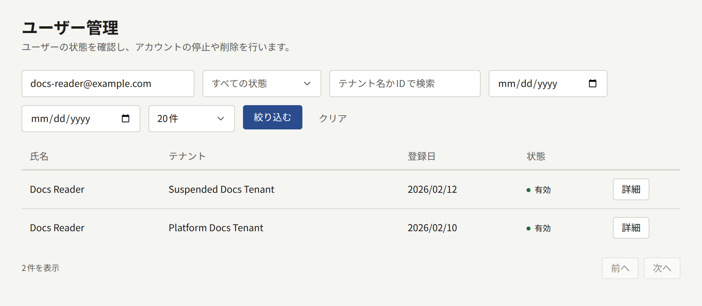
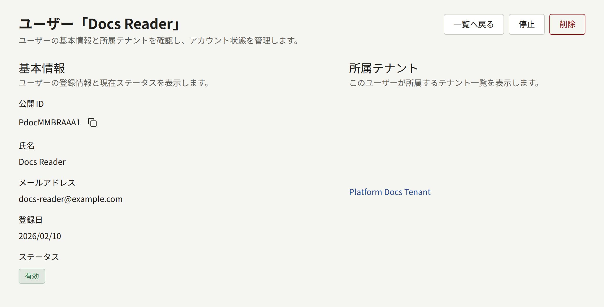
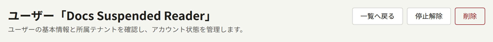

プラットフォーム管理画面のサイドバーで**ガバナンス**の**ユーザー管理**を開くと、すべてのテナントの読者が1つの一覧にまとまって表示されます。この画面は、1つのテナントだけでは対処できないときのためのものです。たとえば、出版社ではなくオペレーターに届いた苦情や法的な要請に対応するときや、テナントの管理者が手を出せないアカウントを扱うときに使います。ふだんの読者の管理は、各テナントの管理者がテナント管理画面の**読者**で行います。`publiractl`には同じことをするコマンドはありません。

## 一覧の内容

アカウントはどれも1つのテナントに属します。2つのテナントのサイトで読んでいる人は、テナントごとに1件ずつ、合わせて2件表示されます。一覧には各アカウントの**氏名**、**テナント**、**登録日**、**状態**が並び、メールアドレス、状態、テナント、登録日で絞り込めます。

**メールアドレス**欄にアドレスを入れると、そのアドレスを持つアカウントがすべて見つかります。その人が会員登録したテナントごとに1行ずつ表示されます。大文字と小文字の違いや、アドレスの名前の部分の後ろに付いた`+tag`は区別しないので、`John+news@Example.com`で探すと`john@example.com`で登録したアカウントが見つかります。入れるのはアドレス全体で、一部だけでは見つかりません。名前での検索もありません。そのアドレスのアカウントがどのテナントにもなければ、一覧にそう表示されます。ほかの絞り込み条件と組み合わせると、アドレスで見つかったアカウントをさらに絞り込めます。たとえば状態も選ぶと、そのうち停止中のアカウントだけが表示されます。

この一覧に表示されるのは読者だけです。テナントの管理画面でロールを持つアカウントはスタッフなので、[テナントのスタッフ](./3-tenant-staff.md)で説明するとおり、そのテナントの**メンバー管理**で管理します。

**詳細**を選ぶとアカウントのページが開き、**公開ID**、名前、**メールアドレス**、登録日、状態、所属するテナントが表示されます。

## アカウントを停止または削除する

アカウントのページで操作できるのは、オペレーターとスーパー管理者です。監査担当にはボタンのないページが表示されます。

- **停止**すると、読者はサイトでもアプリでもログインできなくなり、ログイン中のセッションも終了します。アカウントの内容は何も削除されません。**停止解除**すると、再びログインできるようになります。
- **削除**するとアカウントは完全に削除され、元に戻せません。自分のアカウントを消したい読者はテナントのサイトから自分で削除でき、たいていはそのほうが適切です。

管理画面のロールを持つアカウントは、停止も削除もできません。先にそのテナントの**メンバー管理**でロールを外してください。

どちらの操作も、操作したオペレーターとともに**監査ログ**に記録されます。
