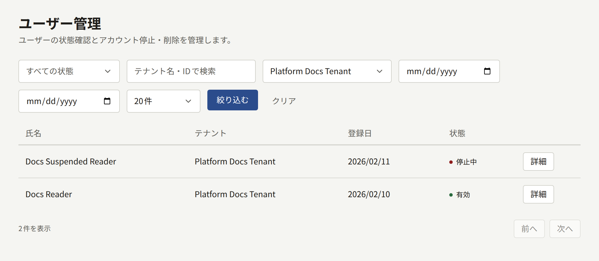
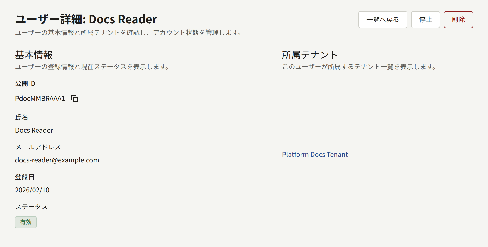
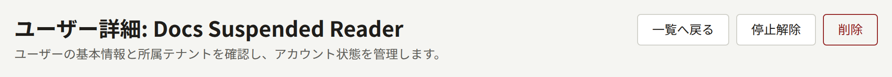

プラットフォーム管理画面のサイドバーで**ガバナンス**にある**ユーザー管理**を開くと、すべてのテナントの読者を1つの一覧で確認できます。この画面は、1つのテナントだけでは対処しきれない場合に使います。たとえば、出版社ではなくオペレーターに届いた苦情や法的な要請への対応や、テナントの管理者では手の届かないアカウントの処理です。ふだんの読者の管理は、各テナントの管理者がテナント管理画面の**読者**で行います。`publiractl`には、この画面に当たる機能はありません。

## 一覧の内容

アカウントはどれも1つのテナントに属します。そのため、2つのテナントのサイトで読んでいる人は、テナントごとに1件ずつ、合わせて2件表示されます。一覧にはアカウントごとに**氏名**、**テナント**、**登録日**、**状態**が表示され、状態、テナント、登録日で絞り込めます。名前やメールアドレスでは検索できないので、アカウントはテナントと会員登録した日で絞り込んで探します。

この一覧に表示されるのは読者だけです。テナントの管理画面のロールを持つアカウントはスタッフとして扱われ、そのテナントの**メンバー管理**で管理します。詳しくは[テナントのスタッフ](./3-tenant-staff.md)を参照してください。

**詳細**を選ぶとアカウントのページが開き、**公開ID**、名前、**メールアドレス**、登録日、状態、所属するテナントが表示されます。

## アカウントを停止または削除する

アカウントのページで操作できるのは、オペレーターとスーパー管理者です。監査担当にはボタンのないページが表示されます。

- **停止**を選ぶと、その読者はサイトでもアプリでもログインできなくなり、ログイン中のセッションも終了します。アカウントから削除されるものはありません。**停止解除**を選ぶと、またログインできるようになります。
- **削除**を選ぶとアカウントは完全に削除され、元に戻せません。自分のアカウントを削除したい読者は、テナントのサイトから自分で削除できます。たいていはそちらのほうが適切です。

管理画面のロールを持つアカウントは、停止も削除もできません。先にテナントの**メンバー管理**でロールを外してください。

どちらの操作も、操作したオペレーターとともに**監査ログ**に記録されます。
