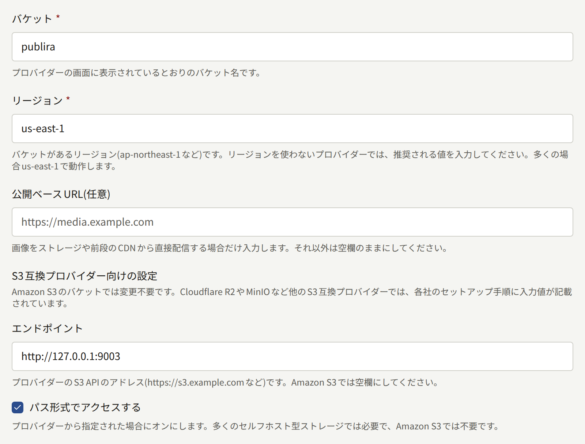
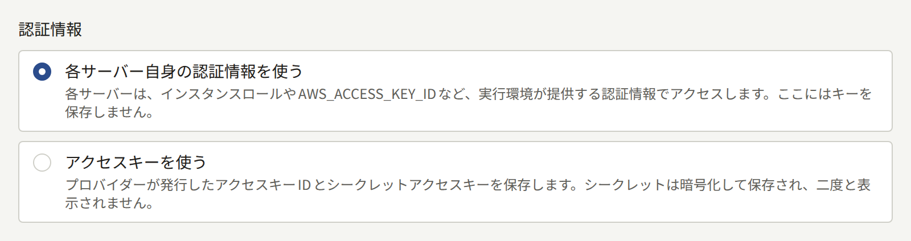
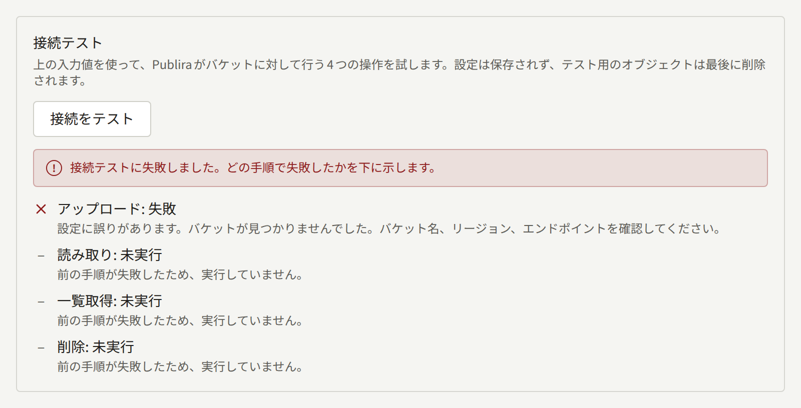
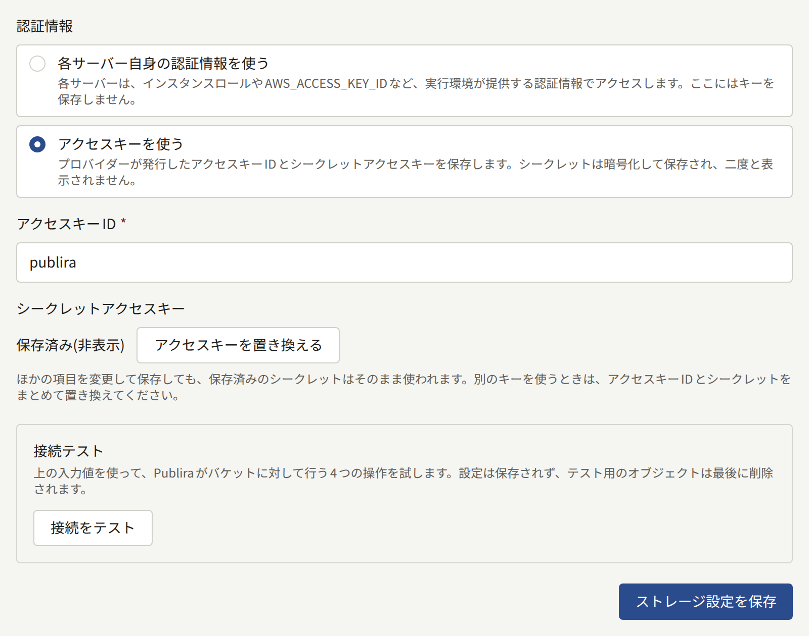

Publiraが保存する画像は、表紙、エピソードのページ、著者の写真、各テナントのロゴのどれも、すべてのテナントで共有する1つのS3互換バケットに置かれます。このバケットの設定は`publiractl setup`で保存済みです。このページでは、各設定の意味、テストの方法、あとから変更する方法と、保存した画像が読者に届く仕組みを説明します。

このページの`publiractl`コマンドは、コマンド部分だけを示しています。実行するときは[プラットフォーム管理画面とpubliractl](./1-platform-console.md#どちらを使うか)の説明に従い、`PUBLIRA_PLATFORM_DB_URL`に`publira_platform`への接続先を設定してください。`PUBLIRA_SECRET_ENCRYPTION_KEYS`と`PUBLIRA_SECRET_ENCRYPTION_PRIMARY_KEY_ID`にも、各プロセスと同じ値を設定します。すべてのフラグは[`publiractl`のリファレンス](https://github.com/publira/publira/blob/main/server/cmd/publiractl/README.md#storage)に載っています。

## バケット

Publiraはバケットを作成しません。あらかじめプロバイダーで空のバケットを作成し、Publiraが使う認証情報に、バケット内のオブジェクトのアップロード、読み取り、一覧取得、削除の権限を与えてください。読者がバケットから直接画像を取得することはないので、バケットを公開する必要はありません。

設定では、使うバケットとそこへの接続方法を指定します。

| 設定 | `publiractl storage set` | プラットフォーム管理画面 |
| --- | --- | --- |
| バケットの名前 | `--bucket` | **バケット** |
| バケットのリージョン | `--region` | **リージョン** |
| Amazon S3以外のストレージのアドレス | `--endpoint` | **エンドポイント** |
| バケットをホスト名ではなくURLのパスで指定するかどうか | `--force-path-style` | **パス形式でアクセスする** |
| 保存したオブジェクトを読み取れるURL | `--public-base-url` | **公開ベースURL(任意)** |



Amazon S3のバケットを使う場合は、バケットとリージョンだけを指定し、ほかは空のままにします。

Cloudflare R2やMinIO、RustFS、各社のオブジェクトストレージなど、ほかのS3互換ストレージを使う場合は、そのS3 APIのアドレスをエンドポイントに指定します。プロバイダーがパス形式を求める場合は、パス形式でのアクセスを有効にします。セルフホストのストレージの多くはパス形式を求めます。リージョンのないストレージでも、リージョンには何か値が必要です。そのストレージのドキュメントが推奨する値を入力し、推奨がなければ`us-east-1`を入力してください。

公開ベースURLは空のままにしてください。何を入力しても、画像は必ず`publira server`を通して配信されます。この仕組みは[画像が読者に届くまで](#画像が読者に届くまで)で説明します。

## 認証情報

Publiraはバケットへのリクエストすべてに署名します。署名の方法は次の2つのどちらかです。

1つ目は、設定と一緒に**アクセスキーを保存する**方法です。プロバイダーが発行したアクセスキーIDとシークレットアクセスキーを保存します。シークレットはPubliraの暗号鍵で暗号化して保存されるので、バケットにアクセスするプロセスはすべて同じ暗号鍵を設定して動かす必要があります。保存したシークレットは二度と表示されません。Amazon S3以外のストレージではふつうこちらを使います。また、プロセスが自前の認証情報を持たない環境では、こちらしか使えません。

2つ目は、キーを保存せず、**各プロセスが自分で見つけた認証情報**を使う方法です。各プロセスは、AWS SDKが単独で動くときと同じように認証情報を探して署名します。使われるのは、環境変数の`AWS_ACCESS_KEY_ID`と`AWS_SECRET_ACCESS_KEY`、Web IDトークン、プロセスが動いているマシンのインスタンスロールのいずれかです。AWS上では、この方法なら長期間有効なシークレットを一切データベースに置かずに済みます。ただし、`publira server`、`publira worker`、手元で実行する`publiractl`のすべてにその認証情報が必要です。サーバーは画像をアップロードして読み取り、ワーカーは使われなくなった画像を削除し、`publiractl storage test`も署名するからです。

プラットフォーム管理画面では、**認証情報**で**アクセスキーを使う**か**各サーバー自身の認証情報を使う**かを選びます。`publiractl storage set`では、`--access-key-id`を指定するとキーを保存します。シークレットは、`--secret-access-key-file`ならファイルから、`--secret-access-key-stdin`なら標準入力から読み込みます。どちらも指定しなければ、入力を伏せたプロンプトで尋ねられます。プラットフォームがシークレットを環境変数でしか渡せない場合は、`--secret-access-key-env`で環境変数から読み込みます。`--access-key-id`を省略すると、各プロセス自身の認証情報で署名するようになり、保存済みのキーは削除されます。



## 接続をテストする

テストでは、小さなオブジェクトをアップロードし、読み取り、一覧で確認し、削除します。これはPubliraがバケットに対して行う操作のすべてです。結果は4つの手順ごとに表示されます。

- プラットフォーム管理画面では、**ストレージ**の**接続をテスト**で、保存する前のフォームの値をテストします。テストは`publira server`から実行されます。
- `publiractl storage test`は、保存済みの設定を`publiractl`を実行したマシンからテストします。失敗した手順があると終了コード`1`で終了します。

失敗した場合は、失敗した手順とその理由が表示されます。たとえば、ストレージが認証情報を拒否した、キーにある操作の権限がない、指定した名前、リージョン、エンドポイントでバケットが見つからなかった、エンドポイントに接続できなかった、といった理由です。管理画面のテストとコマンドは別々のマシンで動きます。そのため、片方のマシンからだけストレージに接続できるようなファイアウォールがあると、テストは一方で成功し、もう一方で失敗します。ストレージに接続できなければならないのは`publira server`と`publira worker`です。



## 設定を変更する

### プラットフォーム管理画面から

サイドバーの**外部サービス**にある**ストレージ**を選びます。画面には保存済みの設定が表示され、保存済みのシークレットは「**保存済み(非表示)**」と表示されます。値を変更して**接続をテスト**を選び、**ストレージ設定を保存**で保存します。別のアクセスキーに替えるには、**アクセスキーを置き換える**を選び、アクセスキーIDとシークレットを両方入力します。保存済みのシークレットは、一緒に保存したアクセスキーIDとの組み合わせでしか使えないからです。



保存できるのはオペレーターとスーパー管理者です。監査担当は画面を閲覧できますが、保存はできません。

### publiractlから

```bash
publiractl storage set \
  --bucket publira-images \
  --region ap-northeast-1 \
  --access-key-id AKIA... \
  --secret-access-key-file /run/secrets/aws-secret-access-key
publiractl storage test
publiractl storage show
```

`storage set`は、保存済みの設定を指定したフラグの値ですべて置き換えます。指定しなかったフラグの設定は消えるので、毎回すべてのフラグを指定してください。保存済みと同じ`--access-key-id`を指定してシークレットを指定しなければ、保存済みのシークレットはそのまま残ります。

### 変更が反映されるまで

どのプロセスも30秒ごとに設定を読み直すので、保存した設定は再起動しなくても1分以内にすべてのプロセスに反映されます。保存もテストも、そのたびに**監査ログ**に記録されます。

### 別のバケットに移す

新しいバケットを保存しても、画像は何もコピーされません。それまでにアップロードされた画像は古いバケットに残ったままで、Publiraは新しいバケットからその画像を探しますが、見つかりません。保存する前に、オブジェクトをキーを変えずに新しいバケットにコピーしてください。保存したら、最初のコピーの最中にアップロードされた画像を拾うため、もう一度コピーします。AWS CLIを使う場合は次のとおりです。ほかのプロバイダーでは、それに当たるツールを使ってください。

```bash
aws s3 sync s3://publira-images s3://publira-images-new
publiractl storage set --bucket publira-images-new --region ap-northeast-1 ...
aws s3 sync s3://publira-images s3://publira-images-new
```

保存したあとは、Publiraが古いバケットにアクセスすることはありません。古いバケットは、新しいバケットからの配信がしばらく問題なく続くまで残しておき、その後は自分で削除してください。

### アクセスキーをローテーションする

プロバイダーで新しいキーを発行し、`storage set`か**アクセスキーを置き換える**で保存してテストします。古いキーを無効にするのはそのあとです。プロセスが新しいキーに切り替わるまでには最大1分かかるので、それより早く古いキーを無効にすると、アップロードや画像の読み取りが失敗する時間ができてしまいます。

## 画像が読者に届くまで

読者のブラウザーとアプリは、テナントのホスト名の`/images`から画像を取得します。このリクエストは、[ルーティング](../2-deployments/4-edge/index.md#ルーティング)で定めているとおり、リバースプロキシが`publira server`に転送します。サーバーはリクエストごとに次の処理をします。

1. 読者がその画像を見てよいかを確認します。エピソードのページを見られるのは、そのエピソードが無料の読者か、エピソードを解放した読者だけです。未公開のエピソードのページを見られるのは、管理画面を使っているテナントのスタッフだけです。
2. バケットから元の画像を読み取り、ブラウザーが対応しているWebPかAVIFに変換して、ページが求めるサイズに縮小します。
3. 変換した画像を変換キャッシュに保存します。同じ画像を同じサイズで求める次のリクエストでは、バケットの読み取りも変換も行いません。
4. エピソードのページは、暗号化してから読者に送ります。ブラウザーが受け取るのは、保存してほかの場所で開けるような画像ファイルではありません。表紙やロゴなど、ほかの画像はそのまま送ります。

そのため、バケットを公開する必要も、前段にCDNを置く必要も、縮小したコピーを前もって用意しておく必要もありません。バケットに置くのは、画像1つにつき元の画像1つだけです。

### 変換キャッシュ

変換キャッシュは、`publira server`に`PUBLIRA_REDIS_URL`で指定したValkeyかRedisのサーバーに保存され、サーバーのすべてのインスタンスで共有されます。指定がなければ、各インスタンスのメモリーに保存されます。インスタンスが1つならこれで問題ありませんが、インスタンスを増やすと、増やしたインスタンスがすべての画像をもう一度変換することになります。

変換した画像を保存しておく期間は1時間です。`publira server`の`PUBLIRA_IMAGE_CACHE_TTL`を設定すると変更でき、`6h`のような期間か秒数で指定します。長くすればバケットの読み取りと変換は減りますが、Valkeyのメモリーを多く使います。短くすればその逆です。画像のレスポンスにはそれぞれ`X-Publira-Image-Cache: hit`か`miss`が付くので、キャッシュが効いているかどうかを確認できます。

画像に関するほかの環境変数と、変換に必要なlibvipsライブラリを組み込んだサーバーのビルド方法は、[`publira server`のリファレンス](https://github.com/publira/publira/blob/main/server/cmd/publira/README.md#image-delivery)に載っています。
