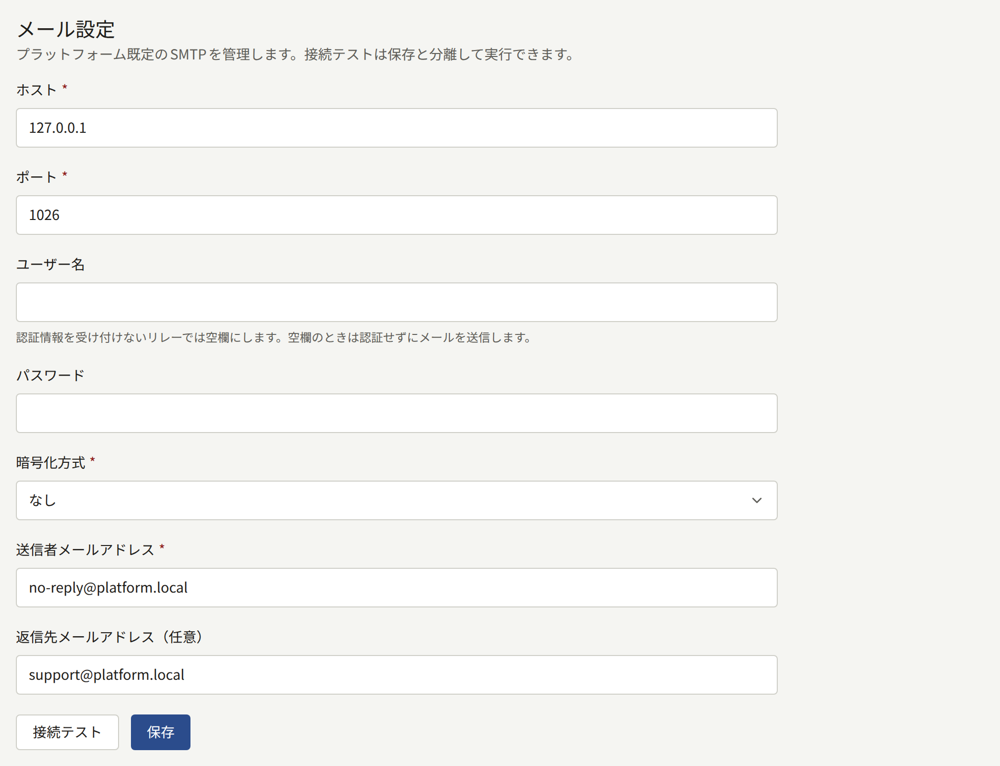
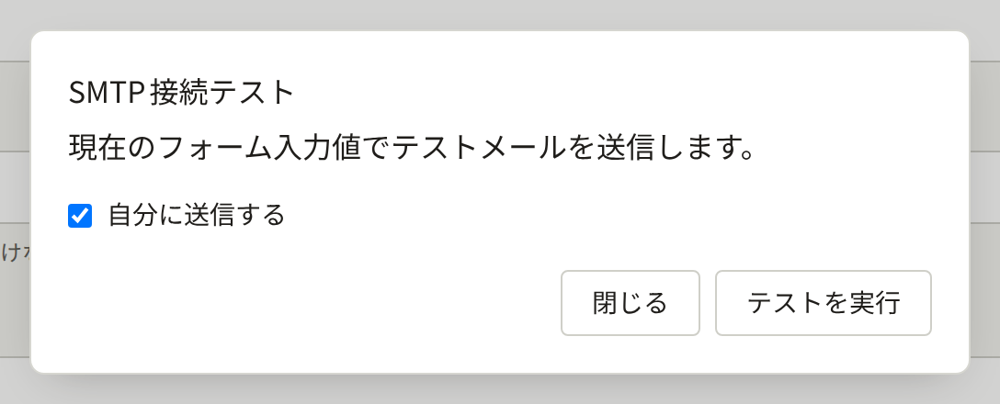
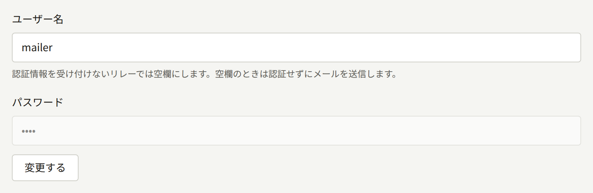

インストール環境は、読者、各テナントのスタッフ、プラットフォーム管理画面のオペレーターに向けてメールを送ります。そのすべてを、用意したSMTPサーバーを通して`publira worker`が送ります。プラットフォームのSMTPアカウントは`publiractl setup`が保存しており、テナントは独自のアカウントを保存することもできます。このページでは、その両方と、そのテスト方法、そしてメールの見た目とリンク先を決める設定を説明します。

このページの`publiractl`コマンドは、コマンド単体で示しています。[プラットフォーム管理画面とpubliractl](./1-platform-console.md#どちらを使うか)の説明どおりに、`PUBLIRA_PLATFORM_DB_URL`に`publira_platform`の接続先を設定し、各プロセスと同じ`PUBLIRA_SECRET_ENCRYPTION_KEYS`と`PUBLIRA_SECRET_ENCRYPTION_PRIMARY_KEY_ID`を指定して実行してください。すべてのフラグは[`publiractl`リファレンス](https://github.com/publira/publira/blob/main/server/cmd/publiractl/README.md#smtp)にあります。

## インストール環境が送るメール

| 宛先 | メール |
| --- | --- |
| テナントの読者 | 新しいアカウントのメールアドレスを確認するリンク。パスワードの再設定と、パスワードが変更されたことの通知。新しいメールアドレスの確認と、変更されたことの古いアドレスへの通知。すでにアカウントがあるアドレスで誰かが会員登録しようとしたことの通知。問い合わせに対するスタッフの回答。フォローしているシリーズや著者の新しいエピソード、テナントが投稿したお知らせ、コメントの承認 |
| テナントのスタッフ | テナントの管理者への招待。パスワードの再設定。新しいメールアドレスの確認と、古いアドレスへの通知。読者からの新しい問い合わせ |
| プラットフォームのオペレーター | パスワードの再設定。新しいメールアドレスの確認と、古いアドレスへの通知 |

各メールはテナントの既定言語で、オペレーター宛てのものはプラットフォームの既定言語で書かれます。

読者宛ての最後の3つ（新しいエピソード、お知らせ、コメントの承認）は、読者の通知設定に従って届きます。通知の種類ごとにメールの設定があり、読者がオフにしない限りオンです。また、届くのは確認済みのアドレスだけです。テナントが全員に送るお知らせは、設定にかかわらず、確認済みのアドレスを持つすべての読者にメールで送られます。そのため、読者の多いテナントは、その人数分のメールを一度にSMTPアカウントから送ることになります。

ワーカーはすべてのメールをキューに入れ、送れなかったメールは、失敗するたびに待ち時間を2倍にしながら再試行します。1秒、2秒、4秒と続きます。10回目の試行に失敗すると、最初の試行から約9分後に、そのメールの送信を完全にあきらめ、その後送られることはありません。そのため、SMTPサーバーの障害、または`email-renderer`を有効にしている場合はその障害がこれより長く続くと、その間にキューに入ったメールは遅れるのではなく失われます。試行回数は`publira worker`の`PUBLIRA_OUTBOX_MAX_ATTEMPTS`で設定します。待ち時間は試行の間隔が最大1時間になるまで倍になり続けるので、試行回数を少し増やすだけで、ずっと長い障害に耐えられます。

送信をあきらめたメールは、ワーカーのログに`outbox event dead`として記録され、ワーカーがOpenTelemetryのメトリクスを出力している場合は`publira.outbox.events.dead`メトリクスに数えられます。どちらかでアラートを設定してください。インストール環境がこうしたメールを送り直すことはできません。読者はパスワード再設定や確認のメールをもう一度依頼し、管理者への招待は再送します。詳しくは[テナントのスタッフ](./3-tenant-staff.md)を参照してください。

ワーカーが動いていないインストール環境では、メールは一切送られません。

## メールを送るSMTPアカウント

| メール | 送信に使うアカウント |
| --- | --- |
| テナントのメール（読者とスタッフ宛て） | テナントが独自のSMTPアカウントを保存して有効にしていればそれ、そうでなければプラットフォームのもの |
| プラットフォーム管理画面のメール | 常にプラットフォームのSMTPアカウント |

プラットフォームのアカウントは必須です。これがないと、オペレーターは誰もパスワードを再設定できず、独自のアカウントを持たないテナントはすべて何も送れません。テナント独自のアカウントは任意で、自社のドメインと自社のプロバイダーからメールを送りたい出版社のためのものです。

## プラットフォームのSMTPアカウント

| 設定 | `publiractl smtp set` | プラットフォーム管理画面 |
| --- | --- | --- |
| SMTPサーバー | `--host`、`--port` | **ホスト**、**ポート** |
| 接続の暗号化方式 | `--encryption`：`tls`、`starttls`、`none` | **暗号化方式**：**TLS**、**STARTTLS**、**なし** |
| ログインに使うユーザー | `--username` | **ユーザー名** |
| そのパスワード | `--password-file`、`--password-stdin`、マスクされたプロンプト、またはプラットフォームがシークレットを環境変数としてしか設定できない場合は`--password-env` | **パスワード** |
| メールの送信元アドレス | `--from-address` | **送信者メールアドレス** |
| 返信先のアドレス（送信者と異なる場合） | `--reply-to` | **返信先メールアドレス（任意）** |



メールプロバイダーがSMTPでのメール送信用に示す値を使ってください。ポート587はほぼ必ずSTARTTLS、ポート465は最初からTLSです。**なし**を選ぶのは、自前のプライベートネットワーク上のリレーの場合だけにしてください。

ログインせずにメールを受け付けるリレーの場合は、ユーザー名を空にします。この場合、ワーカーは認証せずに送信し、パスワードは保存されません。パスワードはインストール環境の暗号鍵で暗号化して保存されるので、`publira worker`は保存したときと同じ鍵を指定して実行する必要があります。

送信元アドレスは、プロバイダーがそのアカウントに送信を許可しているアドレスである必要があります。また、ドメインにはプロバイダーが求めるSPFとDKIMのレコードを公開してください。そうしないと、メールの多くが迷惑メールに振り分けられたり、読者のメールサーバーに拒否されたりします。

### アカウントをテストする

テストでは、アカウントを通して短いメッセージを1通送り、サーバーが受け付けたかどうかを報告します。

- プラットフォーム管理画面では、**メール**の**接続テスト**で**SMTP接続テスト**が開きます。保存前のフォームの値を使って、**自分に送信する**で自分宛てに、またはほかの**送信先メールアドレス**宛てに送ります。送信は`publira server`から行われます。
- `publiractl smtp test --to operator@example.com`は保存済みの設定を使って、`publiractl`を実行している場所から送り、サーバーが拒否すると`1`で終了します。



サーバーがテストメッセージを受け付けても、迷惑メールに振り分けられることがあります。届いた受信トレイを確認してください。また、テストは`publira server`か`publiractl`が送りますが、実際のメールは`publira worker`が送るので、ワーカーからもSMTPサーバーに到達できることを確認してください。

### 変更する

プラットフォーム管理画面で、サイドバーの**外部サービス**の下にある**メール**を選び、値を変更して**保存**を選びます。保存済みのパスワードは、横にある**変更する**を選ばない限り保持されます。それを選んだあとに欄を空のまま保存すると、パスワードは削除されます。保存できるのはオペレーターまたはスーパー管理者で、監査担当は画面を閲覧することしかできません。



`publiractl`では次のようにします。

```bash
publiractl smtp set \
  --host smtp.example.com --port 587 --encryption starttls \
  --username mailer --password-file /run/secrets/smtp-password \
  --from-address no-reply@example.com
publiractl smtp test --to operator@example.com
publiractl smtp show
```

`smtp set`は保存済みの設定をすべて、指定したフラグで置き換えるので、毎回すべてのフラグを指定してください。`--reply-to`を省略すると、保存済みの値は消去されます。同じ`--username`を指定してパスワードを指定しなければ、保存済みのパスワードが保持されます。

ワーカーはメールを送るたびに設定を読み込むので、保存した内容は再起動なしで次のメールから適用されます。保存とテストはそれぞれ**監査ログ**に記録されます。

## テナント独自のSMTPアカウント

テナント独自のアカウントは、テナントの管理者がテナント管理画面の**外部連携** › **メール情報**で設定します。**上書きを有効化**で**テナントSMTP上書きを有効にする**をオンにし、プラットフォームのものと同じ値に加えて「**送信者名（任意）**」を入力します。**接続テスト**はフォームの値でテストメッセージを送り、**保存**で保存します。変更できるのはテナント管理者だけで、手順は[メール](../4-console/3-setup/7-email.md)で案内しています。

次のメールから、そのテナントのメールは新しい管理者への招待も含めてすべて、テナントのアカウントを通して送られます。上書きをオフにすると、再びプラットフォームのアカウントから送られます。

オペレーターがこのために設定することは何もなく、プラットフォーム管理画面も`publiractl`もテナントのアカウントを変更しません。プラットフォームのテストは成功するのにテナントのメールが届かなくなった場合は、まずテナント独自のアカウントを確認してください。

## プレーンテキストとHTML

`email-renderer`がなければ、メールはすべてプレーンテキストです。これがあれば、すべてのメールに同じテキストと並んでHTML版が付き、読者のメールアプリが好みのほうを表示します。有効にするには、これを実行し、`PUBLIRA_EMAIL_RENDERER_URL`で`publira worker`にその場所を指定します。詳しくは[email-rendererでのHTMLメール](../2-deployments/2-installing.md#email-rendererによるhtmlメール)を参照してください。

有効にしたあとは、レンダラーはメール送信の一部になります。レンダラーが停止している間、ワーカーはメールをテキストだけで送るのではなく、SMTPの障害と同じ試行回数の範囲で再試行します。そのため、それより長くレンダラーが停止するとメールが失われます。プレーンテキストに戻すには、変数を削除してワーカーを再起動します。

## メールのリンク先

ほとんどのメールには、アドレスの確認、パスワードの再設定、招待の承諾などのためのリンクが含まれます。ワーカーは、リクエストがどのホストに届いたかを知らないままリンクを組み立てるので、ホストとスキームは、`publira worker`が読み込むインストール環境の設定から決まります。

| メール | リンク先 |
| --- | --- |
| 読者宛て | テナントのドメイン。たとえば`https://comics.example.com` |
| テナントのスタッフ宛て | テナントの管理画面のホスト。別のホストを指定していない限り`admin.<domain>` |
| プラットフォームのオペレーター宛て | `PUBLIRA_PLATFORM_APP_URL`のアドレス。たとえば`https://platform.example.com` |

テナントのリンクのスキームは`PUBLIRA_TENANT_URL_SCHEME`で、設定しなければ`https`です。`http`に設定するのは、ブラウザーが実際にHTTPでテナントを開く場合だけにしてください。プラットフォーム管理画面を運用するインストール環境では、`publira worker`に`PUBLIRA_PLATFORM_APP_URL`を必ず設定してください。設定しないと、オペレーター宛てのリンクがローカルの開発マシンのアドレスになります。

テナントのリンクはそのドメインに従うので、テナントを別のホスト名に移すと、それ以降に送られるメールは新しいホスト名にリンクし、それ以前に送られたメールは古いホスト名にリンクしたままです。詳しくは[テナントを別のホスト名に移す](./2-tenants.md#テナントを別のホスト名に移す)を参照してください。
