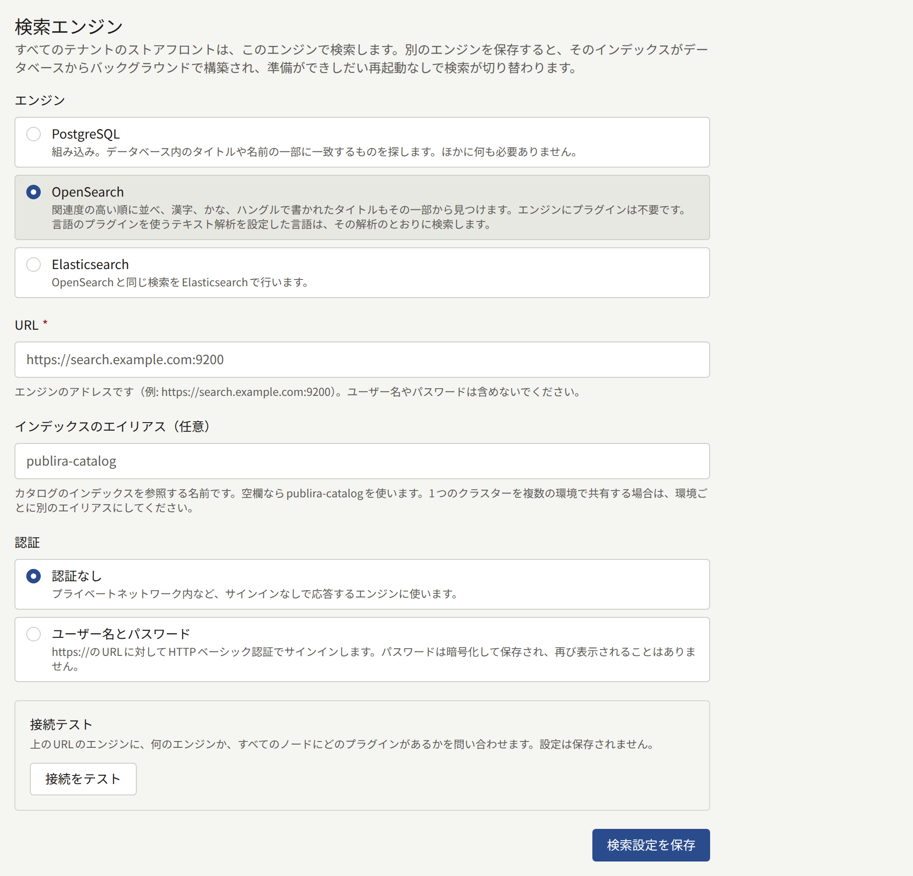
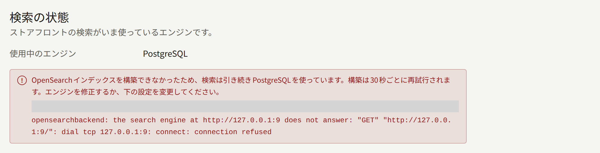
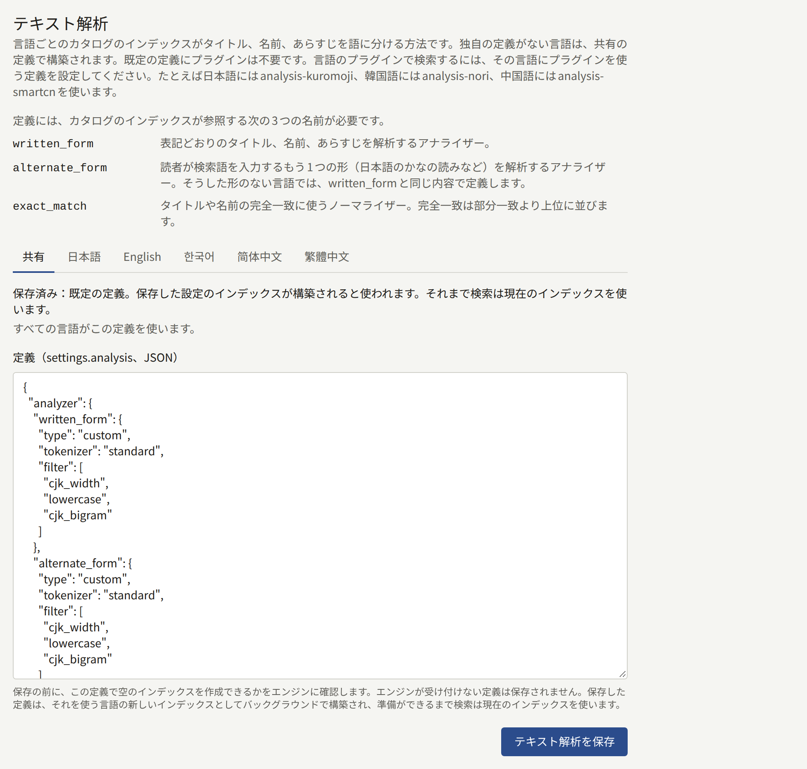

各テナントのサイトの検索は、すべてのテナントで共有する1つのエンジンでシリーズ、著者、レーベルを探します。Publiraは最初はデータベースそのものを検索に使うので、ほかに用意するものはありません。検索結果を関連度順に並べたい場合は、OpenSearchかElasticsearchを使うこともできます。このページでは、エンジンの違い、エンジンの切り替え方、エンジンが持つインデックスについて説明します。

このページの`publiractl`コマンドは、コマンド部分だけを示しています。実行するときは[プラットフォーム管理画面とpubliractl](./1-platform-console.md#どちらを使うか)の説明に従い、`PUBLIRA_PLATFORM_DB_URL`に`publira_platform`への接続先を設定してください。`PUBLIRA_SECRET_ENCRYPTION_KEYS`と`PUBLIRA_SECRET_ENCRYPTION_PRIMARY_KEY_ID`にも、各プロセスと同じ値を設定します。すべてのフラグは[`publiractl`のリファレンス](https://github.com/publira/publira/blob/main/server/cmd/publiractl/README.md#search)に載っています。

## エンジンを選ぶ

| エンジン | `--engine` | 検索のしかた | 必要なもの |
| --- | --- | --- | --- |
| **PostgreSQL** | `sql` | 入力した文字列を含むタイトルや名前を見つけ、タイトル順か名前順に並べます | なし。Publiraがすでに使っているデータベースで検索します |
| **OpenSearch** | `opensearch` | 結果を関連度順に並べます。ラテン文字で書かれた単語なら1文字の打ち間違いがあっても見つけ、漢字、かな、ハングルで書かれたタイトルはその一部から見つけます。[独自のテキスト解析](#言語ごとにプラグインを使う)を設定した言語は、その解析に従って検索します。たとえば、漢字で書かれた日本語のタイトルを、かなで入力した読みから見つけられます | OpenSearchのクラスター |
| **Elasticsearch** | `elasticsearch` | OpenSearchと同じように検索します | Elasticsearchのクラスター |

どのエンジンで結果を見つけても、ストアフロントに表示する各結果の内容はデータベースから読み込みます。そのため、エンジンへの反映が遅れていても、シリーズのタイトル、価格、表紙が古いまま表示されることはありません。検索結果の絞り込みと並べ替えは、どのエンジンでも同じようにできます。

どのエンジンも、シリーズは読者の言語で表示されるタイトルとあらすじで探します。たとえば英語で閲覧している読者は、シリーズを英語のタイトルで見つけられますが、日本語のタイトルにしかない単語では見つけられません。英語のタイトルがないシリーズは、代わりに表示されるサイトの既定言語のタイトルで見つかります。著者とレーベルの名前はどの言語でも1つなので、読者の言語にかかわらずその名前で見つかります。

読者が検索より一覧から作品を探すことが多い場合や、タイトルを正確に入力して検索する場合は、PostgreSQLで十分です。読者が読みでタイトルを探したり、綴りを間違えたりして、何も見つけられずにいるようなら、OpenSearchかElasticsearchに切り替えてください。

## OpenSearchやElasticsearchを用意する

Publiraはエンジンを用意しません。自分で運用するクラスターか、マネージドサービスのクラスターを使い、次のものを用意してください。

- **プラグイン**は、必要な場合にだけ入れます。既定のテキスト解析はOpenSearchとElasticsearchに標準で入っている機能だけで作られているので、公式イメージのエンジンはそのままで使えます。プラグインが必要になるのは、プラグインを使った[独自のテキスト解析を設定する](#言語ごとにプラグインを使う)言語がある場合だけです。
- **URL**は、エンジンが応答する`http://`か`https://`のURLです。`publira server`、`publira worker`、`publiractl`のどれからも接続できる必要があります。
- **ユーザー**は、エンジンが認証を求める場合に用意します。PubliraはHTTPベーシック認証でログインし、認証情報は`https://`のURLにだけ送ります。APIキーにも独自の認証局にも対応していないので、セキュリティを有効にしたエンジンには、サーバーがすでに信頼している証明書が必要です。ユーザーには、後述のインデックスのエイリアスで始まる名前のインデックスを作成、書き込み、削除する権限と、そうしたエイリアスを付け替える権限が必要です。
- **インデックスのエイリアス**は、Publiraのインデックスの名前のもとになる名前で、指定しなければ`publira-catalog`です。Publiraは、読者が選べる言語ごとに1つずつインデックスを持ちます。各インデックスには、このエイリアスの末尾に言語を付けた`publira-catalog-en`、`publira-catalog-ja`、`publira-catalog-zh-hans`のようなエイリアスが付きます。インデックスとエイリアスはPubliraが自分で作成します。1つのクラスターを複数のPubliraで共有する場合は、それぞれに別のエイリアスを指定してください。同じエイリアスを使うと、互いの作品データを上書きしてしまいます。

## エンジンをテストする

テストでは、エンジンにその種類と、すべてのノードに入っているプラグインを問い合わせ、製品名、バージョン、プラグインを表示します。エンジンが応答しない場合、認証情報が拒否された場合、選んだものとは別の製品だった場合は失敗します。プラグインの有無で結果は変わりません。既定のテキスト解析にはプラグインが要らず、独自の定義は保存するときにエンジンで確かめるからです。プラグインの一覧を取得するには、ほかには必要のないクラスター権限がユーザーに要ります。その権限がないユーザーでは、プラグインが一覧に出ないままテストは成功します。

- プラットフォーム管理画面では、**検索**の**接続をテスト**で、保存する前のフォームの値をテストします。テストは`publira server`から実行されます。
- `publiractl search test`は、保存済みのエンジンを`publiractl`を実行したマシンからテストします。テストに失敗すると終了コード`1`で終了します。PostgreSQLの場合はテストするものがないので、やはり`1`で終了します。

## 別のエンジンに切り替える

エンジンを保存しても、検索はすぐには新しいエンジンに切り替わりません。新しいエンジンのインデックスは空なので、まず`publira worker`がデータベースからインデックスを作ります。すべてのテナントの作品データがインデックスに入ったところで、検索が切り替わります。それまでストアフロントは切り替え前のエンジンで検索を続けるので、読者が空のインデックスを検索することはありません。

### プラットフォーム管理画面から

1. サイドバーの**外部サービス**にある**検索**を選びます。
2. **エンジン**で**OpenSearch**か**Elasticsearch**を選び、**URL**を入力します。エイリアスを指定する場合は「**インデックスのエイリアス（任意）**」も入力します。
3. **認証**で**認証なし**を選ぶか、**ユーザー名とパスワード**を選んで両方を入力します。
4. **接続をテスト**を選び、成功したら**検索設定を保存**で保存します。



画面上部の**検索の状態**には、ストアフロントが今使っているエンジンが表示されます。インデックスを作っている間は、切り替え先のエンジンも表示されます。画面は数秒ごとに状態を確認し直すので、切り替わるとその場で表示が変わります。保存できるのはオペレーターとスーパー管理者で、監査担当は画面を閲覧できるだけです。

### publiractlから

```bash
publiractl search set \
  --engine opensearch \
  --url https://search.example.com:9200 \
  --username publira --password-file /run/secrets/search-password
publiractl search test
publiractl search show
```

`search set`は、保存済みの設定を指定したフラグの値ですべて置き換えるので、毎回すべてのフラグを指定してください。`--username`を省略すると、保存済みのパスワードは削除されます。保存済みと同じ`--username`を指定してパスワードを指定しなければ、保存済みのパスワードはそのまま残ります。`search show`は、検索が今使っているエンジンと、進行中または失敗したインデックスの作成を表示します。

### かかる時間

ワーカーは30秒ごとに、作るべきインデックスがないかを確認します。インデックスへのデータの投入には、すべてのテナントの公開済みのシリーズ、著者、レーベルをエンジンが取り込み終えるまでの時間がかかります。その間に行われた変更も新しいインデックスに書き込まれるので、待っている間に失われるものはありません。

### インデックスの作成に失敗したとき

インデックスの作成に失敗しても、検索は切り替え前のエンジンのままです。失敗の原因には、エンジンが止まった、保存済みの定義が使うプラグインがノードからなくなった、ユーザーにインデックスを作成する権限がない、などがあります。エラーは**検索の状態**と`publiractl search show`に表示されます。ワーカーは30秒ごとに作り直しを試みるので、エンジンを直せば、設定を保存し直さなくてもインデックスの作成は完了します。切り替えをやめる場合は、検索が今使っているエンジンを保存し直してください。



### PostgreSQLに戻す

**PostgreSQL**を保存するか`publiractl search set --engine sql`を実行すると、検索はすぐにPostgreSQLに戻ります。データベースにはインデックスが要らないからです。エンジン上のインデックスは残ったままなので、もう使わない場合は自分で削除してください。

### 変更がすべてのプロセスに反映されるまで

`publira server`と`publira worker`は30秒ごとに設定を読み直すので、エンジンの切り替えは再起動しなくても1分以内にすべてのインスタンスに反映されます。保存もテストも、そのたびに**監査ログ**に記録されます。

## テキスト解析

エンジンがタイトル、名前、あらすじを単語に分ける方法をテキスト解析と呼びます。テナントはインデックスを共有しているので、定義はすべてのテナントで1つです。各言語のインデックスは、その言語に独自の定義がなければこの定義から作られます。

既定の定義はプラグインを必要とせず、どの言語にもある程度対応します。ラテン文字のタイトルは単語で見つけ、1文字の打ち間違いは許容します。漢字、かな、ハングルのタイトルは、その中の連続する2文字以上のどの部分からでも見つけます。大文字と小文字の違いや、英数字とかなの全角と半角の違いは区別しません。それ以上の言語の知識はないので、たとえば漢字で書かれたタイトルを読みから見つけることはできません。それ以上が必要な言語には、その言語のプラグインを使った[独自の定義を設定](#言語ごとにプラグインを使う)できます。

定義はインデックスの`settings.analysis`オブジェクトで、64KiB以内のJSONで書きます。定義には、インデックスが参照する3つの名前を必ず含めます。アナライザーの`written_form`と`alternate_form`、ノーマライザーの`exact_match`です。それぞれの役割は[テキスト解析のリファレンス](https://github.com/publira/publira/blob/main/server/README.md#text-analysis)に載っています。

- プラットフォーム管理画面では、**検索**の**テキスト解析**にある**共有**タブで、「**定義（settings.analysis、JSON）**」に定義を入力し、**テキスト解析を保存**で保存します。**既定に戻す**を選ぶと既定の定義に戻ります。PostgreSQLにはインデックスがないので、テキスト解析も保存できません。
- `publiractl`では、`search set --analysis-file korean-analysis.json`でエンジンの設定と一緒に定義を保存し、`--default-analysis`で既定の定義に戻します。どちらも指定しなければ、`search set`は保存済みの定義をそのまま残します。

ある言語をその言語向けのプラグインで検索するには、その言語に独自の定義を設定します。その言語のインデックスは独自の定義から作られ、ほかの言語のインデックスは共有の定義から作られます。

- プラットフォーム管理画面の**テキスト解析**には、共有の定義の**共有**タブと、言語ごとのタブがあります。**共有**タブには、共有の定義を使っている言語が表示されます。独自の定義がない言語のタブには、書き始めのもとになるように共有の定義が表示されます。そのタブで**テキスト解析を保存**を選ぶと、エディターの内容がその言語独自の定義として保存されます。**共有の定義を使う**を選ぶと独自の定義は破棄され、その言語のインデックスはまた共有の定義から作られます。
- `publiractl`では、`search set`で言語独自の定義を指定します。

```bash
publiractl search set --engine opensearch --url https://search.example.com --locale-analysis-file ja=japanese-analysis.json
```

`--locale-analysis-file`には、言語とファイルを`LOCALE=FILE`の形で指定します。`--shared-analysis-for ja`を指定すると、その言語のインデックスはまた共有の定義から作られます。どちらのフラグも、言語ごとに繰り返し指定できます。どちらのフラグにも指定しなかった言語は今の設定のままです。どちらのフラグも付けずに`search set`を実行した場合は、すべての言語が今の設定のままです。指定できる言語は`ja`、`en`、`ko`、`zh-Hans`、`zh-Hant`です。独自の定義を持つ言語は、`publiractl search show`の**Own analysis**に表示されます。



定義を保存する前に、Publiraはその定義で空のインデックスを作るようエンジンに依頼します。エンジンが受け付けなかった定義は保存されず、エンジンが返した理由が表示されます。言語独自の定義なら、どの言語に指定した定義かも表示されます。定義を保存すると、その定義で変わる言語について、エンジンを切り替えたときと同じように新しいインデックスが作られ、作り終えたところで検索がそのインデックスに切り替わります。ほかの言語のインデックスはそのままです。

### 言語ごとにプラグインを使う

どの言語も、独自の定義を設定するまでは共有の定義で検索されます。独自の定義の設定は必須ではありません。OpenSearchとElasticsearchは、どちらも多くの言語向けに解析プラグインを公開しています。たとえば日本語向けの`analysis-kuromoji`と`analysis-icu`は、漢字で書かれたタイトルを、かなで入力した読みと結び付けられます。ほかにも韓国語向けの`analysis-nori`や中国語向けの`analysis-smartcn`などがあります。こうしたプラグインを使った定義を設定すると、その言語はプラグインの解析に従って検索されます。手順は次のとおりです。

1. ノードを停止した状態で、`bin/opensearch-plugin install`か`bin/elasticsearch-plugin install`にプラグインの名前を付けて実行し、すべてのノードにプラグインを入れます。リポジトリの[開発用OpenSearchイメージ](https://github.com/publira/publira/blob/main/infra/docker/opensearch/Dockerfile)には、この手順をDockerfileで書いた例があります。入れたプラグインは、**接続をテスト**で表示される、すべてのノードにあるプラグインの一覧に出てきます。
2. エンジンのプラグインのドキュメントに従い、プラグインのトークナイザーとフィルターを使って、上に挙げた3つの名前を含む定義を書きます。
3. 書いた定義を、**テキスト解析**のその言語のタブで保存するか、`publiractl search set --locale-analysis-file`で保存します。

すると、その言語のインデックスが新しい定義で作り直され、準備ができたところで、その言語の検索は新しいインデックスに切り替わります。その言語のタイトルがないシリーズは、代わりに表示されるタイトルでその言語のインデックスに入ります。そのため、そうしたタイトルにもその言語の解析が使われます。

## インデックスを再構築する

テナントが作品を公開したり、編集したり、既定言語を変えたりするたびに、ワーカーがインデックスを最新の状態にします。エンジンやテキスト解析が変わったときや、リリースで読者が選べる言語や既定のテキスト解析が変わったときも、ワーカーが新しいインデックスを作ります。そのため、インデックスを手で再構築する必要はほとんどありません。ワーカーがインデックスを作っている間は、**検索の状態**と`publiractl search show`にその旨が表示され、ストアフロントは今あるインデックスで検索を続けます。`publiractl search reindex`は、それ以外の次の2つの場合に使います。

- **リリースでインデックスが変わった場合**。[リリースノート](../2-deployments/8-upgrading.md#リリースノートを読む)に作品のインデックスが変わったと書かれていたら、アップグレードが終わってから実行します。
- **インデックスが失われた場合**。クラスターを置き換えた場合や、インデックスを削除してしまった場合です。

```bash
publiractl search reindex
```

このコマンドは、言語ごとに今のインデックスとは別に新しいインデックスを作り、すべてのテナントの作品データを入れます。そのうえで、すべてのエイリアスを一度に新しいインデックスに付け替え、古いインデックスを削除します。そのため、実行中もストアフロントの検索は止まりません。作品データは`publira_content_stats`ロールで読み込むので、このロールの接続先を`PUBLIRA_CONTENT_STATS_DB_URL`に設定してください。エンジンのパスワードを保存している場合は、暗号鍵も設定します。ワーカーがインデックスを作っている間は実行できず、作成中なら終了コード`1`で終了します。作成が終わってからもう一度実行してください。PostgreSQLの場合は再構築するインデックスがないので、やはり`1`で終了します。

`publiractl search reindex --tenant comics.example.com`は、新しいインデックスを作らずに、検索が今使っているインデックスに1つのテナントの作品データを書き込み直します。特定のテナントの検索結果がおかしいときに使うもので、インデックスそのものの変更を反映することはできません。
