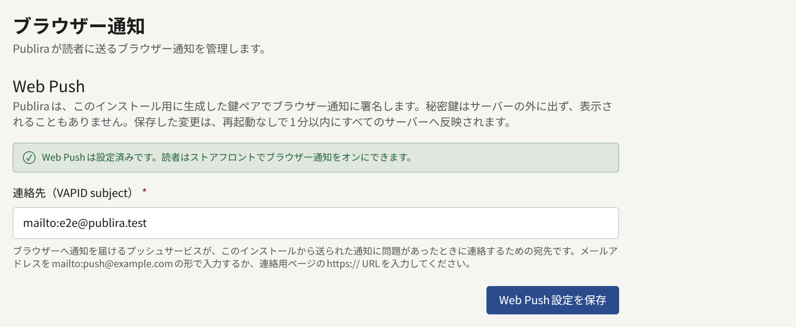

読者は、テナントのサイトから自分のブラウザーに通知を送ることを許可できます。許可しておけば、サイトを開かなくても新しいエピソードの公開を知ることができます。Publiraは各読者のブラウザーのプッシュサービスを通して通知を送り、通知の1件1件にPublira自身のVAPIDの鍵ペアで署名します。Web Pushは使っても使わなくてもよく、有効にするまではオフです。一度も有効にしなければブラウザー通知は送られませんが、それで何かが失敗することはありません。

このページの`publiractl`コマンドは、コマンド部分だけを示しています。実行するときは[プラットフォーム管理画面とpubliractl](./1-platform-console.md#どちらを使うか)の説明に従い、`PUBLIRA_PLATFORM_DB_URL`に`publira_platform`への接続先を設定してください。`PUBLIRA_SECRET_ENCRYPTION_KEYS`と`PUBLIRA_SECRET_ENCRYPTION_PRIMARY_KEY_ID`にも、各プロセスと同じ値を設定します。すべてのフラグは[`publiractl`のリファレンス](https://github.com/publira/publira/blob/main/server/cmd/publiractl/README.md#webpush)に載っています。

## 有効にするのに必要なもの

必要なものは次の2つです。どちらも、プロセスの環境変数ではなくPubliraの設定に保存されます。

- **VAPIDの鍵ペア**は、ブラウザーのプッシュサービスが通知を1件ずつ検証するのに使います。鍵ペアはPubliraが生成するので、どちらの鍵も自分で扱う必要はありません。秘密鍵はPubliraの暗号鍵で暗号化して保存され、表示されることはありません。公開鍵は、読者のブラウザーが通知を購読するときにそのブラウザーに渡されます。
- **サブジェクト**は、Publiraが送る通知に問題があったときに、プッシュサービスが運用者に連絡するための連絡先です。`mailto:push@example.com`の形のメールアドレスか、問い合わせページの`https://`のURLを指定します。

サブジェクトを保存するまで、Web Pushはオフのままです。オフの間、ストアフロントはブラウザー通知を案内せず、ワーカーも通知を送りません。

## 有効にする

### publiractlから

```bash
publiractl webpush init --subject mailto:push@example.com
publiractl webpush show
```

`webpush init`は、鍵ペアがまだ保存されていなければ生成し、サブジェクトを保存します。`webpush show`は、サブジェクトと公開鍵を表示します。

`publiractl setup`でもこの手順を尋ねられます。そこで答えていれば、Web Pushはすでに有効です。

### プラットフォーム管理画面から

サイドバーの**外部サービス**にある**Web Push**を選びます。鍵ペアがまだ保存されていなければ、画面を開いたときに生成されます。「**連絡先（VAPID subject）**」を入力して**Web Push設定を保存**を選ぶと、Web Pushが設定済みであることが画面に表示されます。保存できるのはオペレーターとスーパー管理者で、監査担当は画面を閲覧できるだけです。



APIサーバーにシークレットの暗号鍵がないのでWeb Pushを設定できない、と画面に表示された場合は、`publira server`が`PUBLIRA_SECRET_ENCRYPTION_KEYS`を設定せずに起動されています。ほかのプロセスと同じ暗号鍵を設定して`publira server`を再起動し、画面を開き直してください。

### 動作を確認する

APIとワーカーは10秒ごとに設定を読み直すので、保存したサブジェクトは再起動しなくても反映されます。最初に保存したときは、約20秒後、APIがサブジェクトを返すようになった時点で、ワーカーが全テナントのサイト情報のキャッシュを破棄します。そのため各サイトは、次のリクエストからブラウザー通知を案内するようになります。このキャッシュの破棄は、アウトボックスから送るキャッシュの再検証の1つで、ほかの再検証と同じように送られます。そのため、`PUBLIRA_REVALIDATE_TOKEN`が設定されていないワーカーは送れません。詳しくは[アウトボックス](./10-scheduled-jobs.md#アウトボックスメールプッシュ通知キャッシュの再検証)を参照してください。

実際に試すには、テナントのサイトに読者としてログインし、読者の通知設定の**ブラウザ通知**で**このブラウザでプッシュ通知を受け取る**をオンにします。通知設定の**ブラウザ**の列はオンのままにして、シリーズを1つフォローしてください。そのシリーズで次にエピソードが公開されてサイトに表示されると、ブラウザー通知が届きます。

保存はそのたびに**監査ログ**に記録されます。

## あとから変更する

サブジェクトは、`webpush init`に新しい`--subject`を指定するか、同じ画面から、いつでも変更できます。ただし削除はできません。一度サブジェクトを保存すると、Web Pushは有効なままです。

鍵ペアを置き換えることはありません。ブラウザーの購読はどれもこの公開鍵をもとに登録されているので、鍵ペアを新しくすると、通知を有効にしたすべての読者への通知が、何の知らせもなく止まってしまいます。そのため、`publiractl`にもプラットフォーム管理画面にも、2つ目の鍵ペアを生成する機能はありません。つまり、鍵ペアはバックアップで必ず残さなければならないものの1つです。鍵ペアは暗号鍵で暗号化されてデータベースに入っているので、データベースと暗号鍵のどちらかを失えば鍵ペアも失われます。暗号鍵をローテーションしても鍵ペアはそのまま使えます。`publiractl db reseal`が、ほかの暗号化されたデータと一緒に秘密鍵を新しい暗号鍵で暗号化し直すからです。詳しくは[シークレットの暗号鍵のローテーション](./12-security/1-rotating-secrets.md#シークレットの暗号化キーのローテーション)を参照してください。

読者が通知の許可を取り消したり、サイトのデータを消去したりすると、ブラウザーはその購読を手放します。手放された購読は、次にその購読への通知が拒否されたときに削除されます。

## モバイルアプリの通知

Web Pushの対象はブラウザーだけです。テナントのモバイルアプリに届く通知は、テナント独自のFirebaseプロジェクトを通して送られます。Firebaseはテナントの管理者がテナント管理画面で設定するもので、Publira全体の設定には含まれません。設定方法は[プッシュ通知](../5-mobile-app/3-push-notifications.md)で説明しています。
