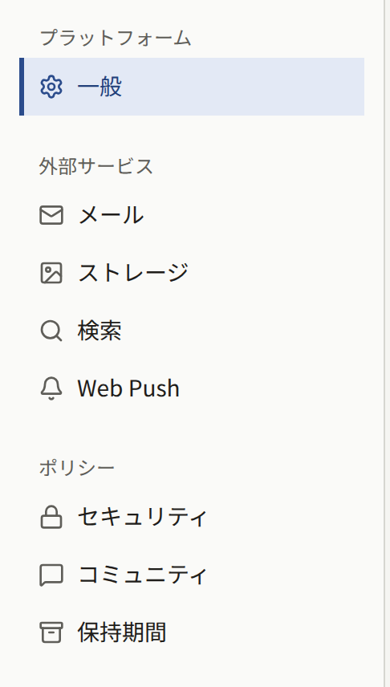
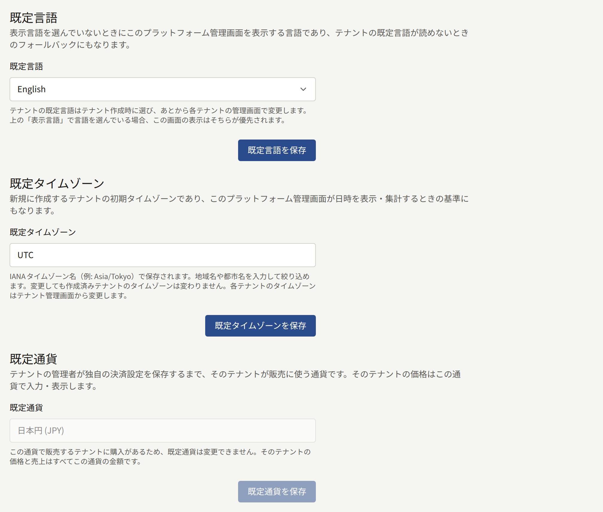
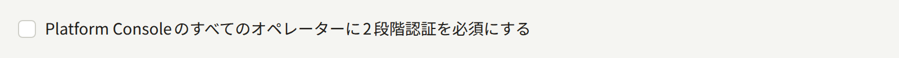
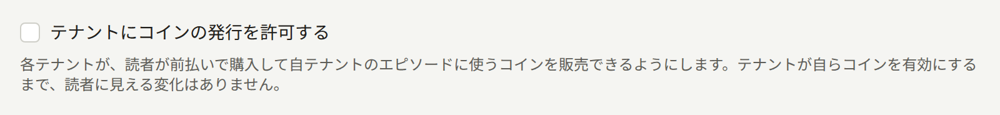
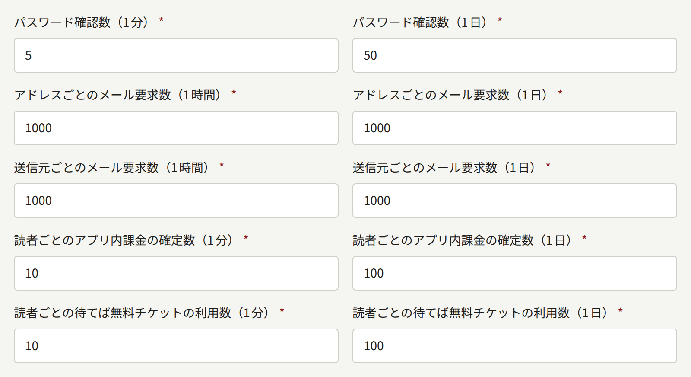
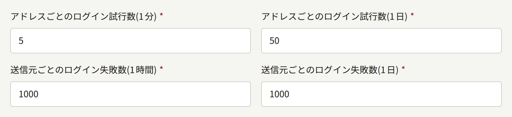
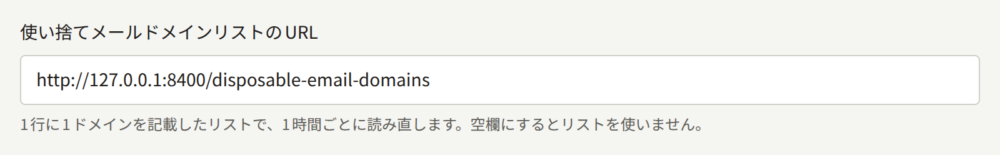
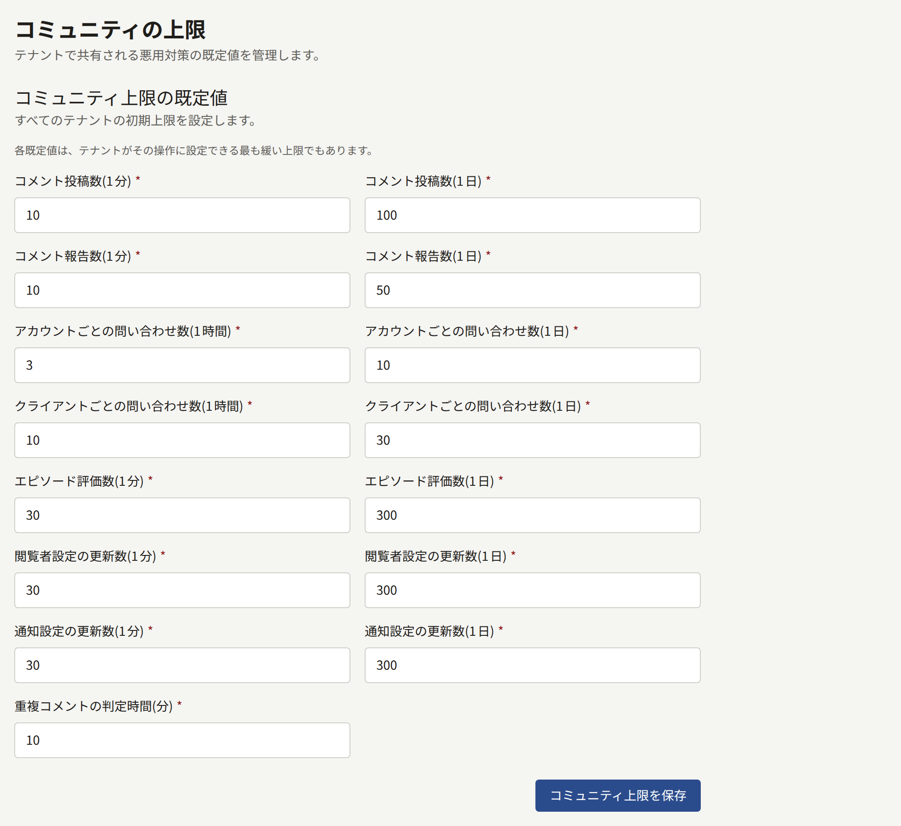
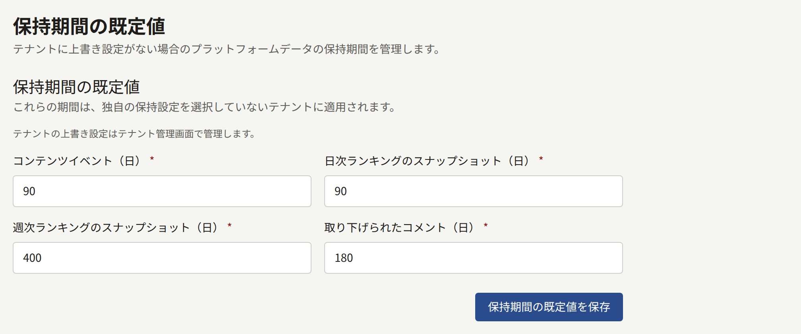

Publiraには、どのテナントにも属さない設定がいくつかあります。新しいテナントが最初に使う言語、タイムゾーン、通貨と、1人の読者や1つのアドレスにプラットフォームを圧迫させないための上限、期限のある記録を残しておく期間です。このページでは、設定のグループごとに、何を防ぐためのものか、どう変更するか、テナントの管理者が自分のテナントについてどこまで変えられるかを説明します。

ポリシーと保持期間の値にはそれぞれ組み込みの既定値があり、何も保存していなければPubliraはその値で動きます。既定のタイムゾーンと既定の通貨も同じです。既定のタイムゾーンは、保存するまでは`UTC`です。既定の通貨は`publiractl setup`で指定した通貨で、指定しなかった場合は`USD`、このリリースより前から動いているPubliraでは`JPY`です。既定の言語には組み込みの既定値がありません。`publiractl setup`が保存した言語を、プラットフォーム管理画面のセットアップ画面で最初のオペレーターが選んだ言語で置き換えています。各値の範囲と組み込みの既定値は、`publiractl`のリファレンスの[`policy`](https://github.com/publira/publira/blob/main/server/cmd/publiractl/README.md#policy)と[保持期間](https://github.com/publira/publira/blob/main/server/cmd/publiractl/README.md#retention-periods)に載っているので、このページでは繰り返しません。

## 設定の場所

どのグループも、プラットフォーム管理画面からでも`publiractl`からでも設定できます。`publiractl`は[プラットフォーム管理画面とpubliractl](./1-platform-console.md#どちらを使うか)の説明どおりに実行してください。

| グループ | プラットフォーム管理画面 | `publiractl` |
| --- | --- | --- |
| 既定の言語、タイムゾーン、通貨 | **プラットフォーム**にある**一般** | `platform set`、`platform show` |
| 2段階認証、テナントによるコインの発行の可否、ログイン、パスワード、購入、チケット、メールの上限、使い捨てメールのドメインのリスト | **ポリシー**にある**セキュリティ** | `policy set`、`policy show` |
| コメント、報告、評価、お問い合わせ、ビューアー、通知設定の上限 | **ポリシー**にある**コミュニティ** | `policy set`、`policy show` |
| 期限のある記録を残しておく期間 | **ポリシー**にある**保持期間** | `retention set`、`retention show` |



プラットフォーム管理画面と`publiractl`は、同じ処理を通して設定を書き込みます。`set`コマンドはフラグで指定した値だけを変え、ほかの値はそのまま残します。プラットフォーム管理画面のページは、そのページにある値をすべてまとめて保存します。何も変わらない保存は記録されません。それ以外の保存は、**監査ログ**に**プラットフォーム設定を更新**、**プラットフォームのポリシーを更新**、**保持期間の既定値を更新**のいずれかとして記録されます。

**セキュリティ**、**コミュニティ**、**保持期間**のページは、ページを開いたあとに行われた保存を上書きしません。ページを開いてから誰かがそのページを保存していると、プラットフォーム管理画面は「別のオペレーターが設定を変更したため保存されませんでした。再読み込みしてもう一度お試しください。」と表示して保存を拒否します。**セキュリティ**と**コミュニティ**は1つのポリシーとして保存されるので、**セキュリティ**のページを開いたあとに**コミュニティ**が保存された場合も、その逆の場合も、保存は拒否されます。**一般設定**の3つのフォームはこの確認をしません。各フォームは保存されている値にかかわらず自分の値を上書きし、ほかの値は保存されているとおりに残します。`publiractl`は、書き込む直前に保存済みの値を読み込みます。読み込んでから書き込むまでの間に別の保存が入ると、終了コード`1`で終了します。同じコマンドをもう一度実行すると、その保存の内容にフラグの値を上書きします。

これらのページを保存できるのはオペレーターとスーパー管理者です。監査担当にも同じフォームが表示されますが、保存しようとすると拒否されます。

ポリシーを保存するまで、プラットフォーム管理画面のダッシュボードにある**設定の状況**カードには「サインイン、不正利用対策、データ保持期間には組み込みの既定値が適用されています。」と表示されます。これはPubliraが正常に動いている状態で、設定が終わっていないわけではありません。値を変えるのは、組み込みの値がプラットフォームに合わない場合だけにしてください。

## プラットフォームの既定値

**一般設定**には3つの値があり、それぞれに保存ボタンがあります。



**既定言語**は、言語を選んでいないオペレーターに対してプラットフォーム管理画面を表示する言語です。ログイン画面もこの言語で表示されます。パスワードの再設定など、プラットフォーム管理画面がオペレーターに送るメールもこの言語で書かれます。テナントの言語はこの値では決まりません。[テナント](./2-tenants.md#テナントを作成する前に)で説明するとおり、各テナントの既定言語はテナントの作成時に決めます。この値は、最初のオペレーターがセットアップ画面で選んだものです。

**既定タイムゾーン**は、タイムゾーンを指定せずに作成したテナントが最初に使うタイムゾーンです。プラットフォーム管理画面も、このタイムゾーンで日時を表示し、日付を区切ります。テナントは作成時のタイムゾーンを持ち続けるので、既定を変えても、変わるのはその後に作成するテナントだけです。テナントのタイムゾーンは、テナントの管理者がテナント管理画面で変更します。この値は、最初のオペレーターがセットアップ画面で選んだものです。セットアップ画面では、そのオペレーターのブラウザーのタイムゾーンが初期値になっていました。

**既定通貨**は、管理者が**決済設定**を保存していないテナントが販売に使う通貨です。そうしたテナントでは、価格もこの通貨で入力し、表示します。決済設定を保存したテナントはそこで保存した通貨を使い続け、既定通貨の影響を受けなくなります。通貨は、一覧から名前か`EUR`のようなISO 4217のコードで探します。既定通貨で販売しているテナントで一度でも購入があると、既定通貨は変更できなくなります。その場合、欄は読み取り専用になって理由が表示され、`publiractl`でも変更は拒否されます。この状態は、そうしたテナントがすべて独自の通貨で決済設定を保存するまで続きます。`publiractl setup`とプラットフォーム管理画面のセットアップ画面は、Publiraのセットアップ時に既定通貨を尋ねます。通貨はそのときに決めておいてください。

コマンドラインでは次のように設定します。

```bash
publiractl platform set --default-locale en --default-timezone America/New_York --default-currency USD
```

## セキュリティ

**セキュリティポリシー**の値は、すべてのテナントに同じように適用され、どのテナントも変更できません。どの値も、アカウントか、メールを送る操作か、お金に関わる操作を守るためのものです。

### テナント管理者の2段階認証

**テナント管理者に多要素認証を必須にする**(`--mfa-required-for-tenant-admin`)をオンにすると、テナント管理者はパスワードだけではテナント管理画面にログインできなくなります。認証アプリを設定していない管理者も締め出されるわけではありません。パスワードを入力すると管理画面に**2段階認証を設定する**が表示され、認証アプリを登録した時点でログインが完了します。画面にはテナントが2段階認証を求めていると表示されますが、実際にはプラットフォームの要件なので、テナントがオフにすることはできません。


この設定はすべてのテナントに一度に適用され、対象は**テナント管理者**のロールだけです。編集担当と監査担当には求められません。各管理者が次にログインしたときから適用され、ログイン中のセッションには適用されません。管理者はアカウント設定で自分の認証アプリをオフにすることもできますが、その場合は次のログインで改めて設定を求められます。

プラットフォーム管理画面のオペレーターはこの設定の対象外です。オペレーター向けには次の設定があります。

### プラットフォームのオペレーターの2段階認証

**Platform Consoleのすべてのオペレーターに2段階認証を必須にする**(`--mfa-required-for-platform-operator`)をオンにすると、オペレーターはパスワードだけではプラットフォーム管理画面にログインできなくなります。認証アプリを設定していないオペレーターも締め出されるわけではありません。パスワードを入力すると**2段階認証を設定する**が表示され、認証アプリを登録してリカバリーコードが表示された時点でログインが完了します。



どのオペレーターもすべてのテナントのデータを読めるので、この設定は**監査担当**を含むすべてのロールが対象です。各オペレーターが次にログインしたときから適用され、ログイン中のセッションには適用されません。オペレーターは**アカウント設定**で自分の認証アプリをオフにすることもできますが、その場合は次のログインで改めて設定を求められます。この設定は、誰かがオンにするまではオフです。`publira server`に`PUBLIRA_SECRET_ENCRYPTION_KEYS`が設定されていない場合は、オンにできません。その状態ではどのオペレーターも認証アプリを設定できず、ログインしてこの設定をオフに戻せる人がいなくなるからです。

### テナントによるコインの発行

**テナントにコインの発行を許可する**(`--tenant-coins-allowed`)をオンにすると、テナントがコインを発行できるようになります。コインは、テナントの読者が前もって購入し、そのテナントのエピソードに使う残高です。新しくインストールした場合も、この設定がなかったリリースからアップグレードした場合も、誰かがオンにするまではオフです。



コインは前払いで価値を預かる仕組みです。そのため、プラットフォームの運営者と各テナントの所在地によっては、前払式支払手段、電子マネー、資金移動、ギフトカードに関する法律の対象になることがあります。法域によっては、コインを販売するテナントではなく、Publiraを運営するプラットフォームがそうした法律の対象とみなされます。テナントにコインの発行を許可しても運営者が発行者にならないことを確かめるか、発行者として必要な対応を済ませるまでは、オフのままにしてください。

オンにしても、読者から見えるものは何も変わりません。[コイン](../4-console/9-coins.md)で説明するとおり、テナントが自分の管理画面の**決済** › **コイン**でコインを有効にする必要があります。チェックボックスを外すか`--tenant-coins-allowed=false`でオフにすると、テナントごとの設定にかかわらず、すべてのテナントで一度にコインが止まります。コインを販売するテナントも、コインを使う読者もいなくなりますが、読者の残高はそのまま残ります。もう一度オンにすると、各テナントは保存していた設定に戻ります。

### レート制限

上限はどれも、1分あたりか1時間あたりの回数と、1日あたりの回数の組で決めます。1日あたりの回数は、短いほうの単位の回数より小さくできません。上限を超えたリクエストは、その時間枠が終わるまで拒否されます。時間枠は読者の最初のリクエストから始まるのではなく、時計で区切られています。回数は毎分0秒または毎時0分に、1日あたりの回数はUTCの午前0時に0へ戻ります。

| セキュリティのページの項目 | 守るもの |
| --- | --- |
| 「**パスワード確認数(1分)**」と「**パスワード確認数(1日)**」 | 読者が、パスワードやメールアドレスの変更、アカウントの削除のために今のパスワードを入力する操作。どちらもアカウントごとに数え、正しいパスワードを入力すると回数はリセットされます。そのため、1回打ち間違えた読者ではなく、手に入れたセッションでパスワードを推測しようとする人を遅らせます |
| 「**アドレスごとのメール要求数(1時間)**」と「**アドレスごとのメール要求数(1日)**」 | メールを送るフォームから1つのアドレスに送られるメール。対象は、読者の会員登録とメールアドレスの確認、3つのアプリすべてのパスワードの再設定とメールアドレスの変更、スタッフの招待、プラットフォーム管理画面からの管理者の招待とオペレーターの追加、お問い合わせへの返信です。アドレスは、そのテナントの中か、プラットフォーム管理画面の中で数えます。`+tag`付きのアドレスは、`+tag`を除いたアドレスとして数えます |
| 「**送信元ごとのメール要求数(1時間)**」と「**送信元ごとのメール要求数(1日)**」 | 上と同じメールを、送信を要求したクライアントのアドレスごとに、すべての宛先とすべてのテナントをまたいで数えたもの。1つのクライアントが、見知らぬ人の長いアドレスのリストにメールを送れないようにします |
| 「**読者ごとのアプリ内課金の確定数(1分)**」と「**読者ごとのアプリ内課金の確定数(1日)**」 | 1人の読者が、AppleかGoogleで検証してもらうためにサーバーに渡すストアの取引 |
| 「**読者ごとの待てば無料チケットの利用数(1分)**」と「**読者ごとの待てば無料チケットの利用数(1日)**」 | 1人の読者が待てば無料チケットを使うリクエスト。実際に使えるチケットはシリーズの回復時間ですでに制限されているので、この上限は拒否される試行の回数を抑えるものです |



このほかに同じ種類の上限が8つありますが、セキュリティのページにはまだ入力欄がありません。

- 1人の読者が、改訂されたテナントの利用規約とプライバシーポリシーへの同意を求められて同意を送る回数。既定は1分あたり10回、1日あたり50回で、`publiractl policy set --legal-page-agreement-per-minute`と`--legal-page-agreement-per-day`で変更できます。
- 1人の読者が自分のアカウントにAppleやGoogleのアカウントを連携しようとする回数。既定は1分あたり5回、1日あたり20回で、`--identity-link-per-minute`と`--identity-link-per-day`で変更できます。
- 1人の読者が自分のアイコンをアップロード、選択、削除する回数。既定は1分あたり5回、1日あたり20回で、`--icon-change-per-minute`と`--icon-change-per-day`で変更できます。
- 1人の読者がパスキーの登録やパスキーでの確認を始める回数と、パスキーの名前を変えたり削除したりする回数。既定は1分あたり10回、1日あたり50回で、`--passkey-per-minute`と`--passkey-per-day`で変更できます。
- 1人の読者が、シリーズの残りをまとめて購入する手続きを始める回数。既定は1分あたり10回、1日あたり50回で、`--series-remainder-checkout-per-minute`と`--series-remainder-checkout-per-day`で変更できます。
- 1人の読者が、サブスクリプションの購入手続きを始める回数。既定は1分あたり10回、1日あたり50回で、`--subscription-checkout-per-minute`と`--subscription-checkout-per-day`で変更できます。
- 1人の読者が、エピソードの代金をコインで支払う回数。既定は1分あたり20回、1日あたり500回で、`--coin-payment-per-minute`と`--coin-payment-per-day`で変更できます。
- 1人の読者が、エピソード、巻、コインパックの購入を始める回数。ウェブでの購入手続きとアプリのストアでの購入を合わせて数えます。既定は1分あたり10回、1日あたり100回で、`--purchase-checkout-per-minute`と`--purchase-checkout-per-day`で変更できます。

セキュリティのページを保存しても、これらの値は今の設定のまま残ります。

招待は1件を1回のリクエストとして数えます。**テナント作成**の**初期管理者メール**に入力したアドレスも1件ずつ数え、テナントを作成する前にすべて数えます。1件でも上限を超えると、テナントは作成されず、メールも送られません。`publiractl`はフォームを通さずに送るので、どの上限にも数えられません。

クライアントのアドレスとは、`publira server`が`Forwarded`か`X-Forwarded-For`の中で、信頼するプロキシを読み飛ばして見つけたアドレスです。詳しくは[Publiraが信頼するプロキシ](../2-deployments/4-edge/index.md#publiraが信頼するプロキシ)を参照してください。オフィスや携帯電話会社のゲートウェイのように1つのアドレスを共有している読者同士は、送信元ごとやクライアントごとの回数も共有します。

### ログインの試行

テナントのサイト、テナント管理画面、プラットフォーム管理画面へのパスワードでのログインそのものは、さらに2つの上限で守ります。この2つは**セキュリティ**のページでレート制限の下にあり、数え方も同じです。

| セキュリティのページの項目 | フラグ | 守るもの |
| --- | --- | --- |
| 「**アドレスごとのログイン試行数(1分)**」と「**アドレスごとのログイン試行数(1日)**」 | `--login-attempts-per-account-per-minute`と`--login-attempts-per-account-per-day` | 1つのアドレスに対して試されたパスワード。アドレスは、そのテナントの中か、プラットフォーム管理画面の中で数えます。テナントの中では、テナントのサイトとテナント管理画面で1つの回数を共有します。正しいパスワードでログインすると回数はリセットされるので、打ち間違えた人ではなく、1つのアカウントのパスワードを推測しようとする人を遅らせます |
| 「**送信元ごとのログイン失敗数(1時間)**」と「**送信元ごとのログイン失敗数(1日)**」 | `--login-attempts-per-source-per-hour`と`--login-attempts-per-source-per-day` | 1つのクライアントのアドレスからのログインの失敗。すべてのアドレス、すべてのテナント、プラットフォーム管理画面をまたいで数えるので、1つのクライアントが長いアドレスのリストにパスワードを試せないようにします。正しいパスワードでのログインは数えません |



どちらかの上限を超えた試行は、パスワードを確認する前に拒否されます。拒否のしかたはそのアドレスのアカウントがあってもなくても同じなので、推測しようとする人には、どのアドレスが登録されているかがわかりません。パスワードが正しかった可能性もあるため、ログイン画面にはメールアドレスかパスワードが正しくないという表示ではなく、「短時間に操作が集中しています。少し時間をおいて再試行してください。」と表示されます。2段階認証はパスワードのあとに行う別の確認で、そのコードはこれらの上限には数えません。

アカウントごとの上限は悪用もできます。アドレスを知っている人なら誰でも、間違ったパスワードでその回数を使い切り、時間枠が終わるまで持ち主がパスワードでログインできないようにできます。AppleやGoogleでのログインと、パスワードの再設定には影響しません。他人のスクリプトのせいで丸1日パスワードでログインできなくなることがないよう、1日あたりの値は十分に大きくしておいてください。

### 回数を数える場所

上限の回数は`publira server`が、`PUBLIRA_REDIS_URL`で指定したValkeyかRedisのサーバーで数えます。このサーバーは[インストール](../2-deployments/2-installing.md#サービスを用意する)の手順で用意したものです。`publira server`のすべてのインスタンスが同じ回数を共有するので、インスタンスをいくつ動かしても、上限はPublira全体で守られます。

この環境変数がないと、各インスタンスは自分のメモリーで回数を数え、そのことはログにも出ません。リクエストが3つのインスタンスに分かれた読者は上限の3倍まで操作でき、再起動するとすべての回数が0に戻ります。インスタンスがRedisに接続できない間も同じです。起動時に接続できなかったサーバーは、エラーをログに出して単独で数えます。途中で接続が切れたサーバーは警告をログに出し、接続が戻るまで単独で数え、戻ったときにもログを出します。`publira server`を複数動かす場合は、すべてのインスタンスに`PUBLIRA_REDIS_URL`を設定してください。

保存した変更は、再起動しなくても10秒以内に、動いているすべてのインスタンスに反映されます。

### 使い捨てメールのドメインのリスト

**使い捨てメールドメインリストのURL**(`--disposable-email-domains-url`)には、使い捨てメール用のドメインのリストの場所を指定します。`publira server`はこのURLからリストを読み込みます。Publiraにはリストが付属していないので、URLを指定するまではリストはありません。



リストは1行に1つのドメインを書いたプレーンテキストのファイルです。空行と`#`で始まる行は無視されます。これは[disposable-email-domains](https://github.com/disposable-email-domains/disposable-email-domains)プロジェクトのブロックリストと同じ形式です。リストにあるドメインは、そのサブドメインも対象になります。各インスタンスは、リストが初めて必要になったときに読み込み、その1時間後に読み込み直します。読み込みに失敗したり、ファイルにドメインではない行があったりすると、インスタンスは前に読み込んだリストを使い続け、警告をログに出します。前に読み込んだリストがなければ何も拒否せず、1時間後にもう一度読み込みます。新しいURLを保存すると、次にリストを照会するときにそのURLから読み込みます。

リストを保存するだけでは、何も拒否されません。使い捨てのアドレスを拒否したいテナントは、管理画面の**設定**の**受け付けないメールアドレス**で**使い捨てメールのドメインを受け付けない**をオンにします。オンにすると、読者はリストにあるドメインのアドレスで会員登録できなくなり、そうしたアドレスへの変更もできなくなります。AppleやGoogleでのログインには影響しません。プラットフォームにリストがない場合、このスイッチには効果がないことが表示されます。

## コミュニティ

**コミュニティの上限**は、テナントのコミュニティでの読者の操作に対する上限です。ここでの値は、すべてのテナントにとっての初期値であり、テナントが選べる最も緩い値でもあります。テナントは自分の上限を厳しくすることはできますが、緩くすることはできません。



| コミュニティのページの項目 | 制限するもの |
| --- | --- |
| 「**コメント投稿数(1分)**」と「**コメント投稿数(1日)**」 | 1人の読者が投稿するコメント |
| 「**コメント報告数(1分)**」と「**コメント報告数(1日)**」 | 1人の読者が報告するコメント |
| 「**アカウントごとの問い合わせ数(1時間)**」と「**アカウントごとの問い合わせ数(1日)**」 | ログインしている1人の読者が、テナントのお問い合わせフォームから送るメッセージ |
| 「**クライアントごとの問い合わせ数(1時間)**」と「**クライアントごとの問い合わせ数(1日)**」 | 1つのクライアントのアドレスから、ログインの有無にかかわらずお問い合わせフォームで送られるメッセージ。すべてのテナントをまたいで数えます |
| 「**エピソード評価数(1分)**」と「**エピソード評価数(1日)**」 | 1人の読者がエピソードの評価を押す回数 |
| 「**閲覧者設定の更新数(1分)**」と「**閲覧者設定の更新数(1日)**」 | 1人の読者がビューアーのレイアウトを保存する回数 |
| 「**通知設定の更新数(1分)**」と「**通知設定の更新数(1日)**」 | 1人の読者が通知設定を保存する回数 |
| **重複コメントの判定時間(分)** | 読者が同じエピソードに同じコメントをもう一度投稿しようとしたときに拒否する期間。1分から1週間までの範囲で指定します。前後の空白を取り除いたうえで、完全に一致するかどうかで比べます |

これらもセキュリティの上限と同じ場所で数えるので、[回数を数える場所](#回数を数える場所)の説明はこちらにも当てはまります。

## 保持期間

**保持期間の既定値**では、独自の期間を設定していないすべてのテナントについて、4種類の記録を残しておく期間を決めます。期間は整数の日数で指定します。期間を過ぎた記録は`publira worker`が自分のスケジュールで削除するので、そのための設定は要りません。同じ削除は`publiractl job`で手動でも実行できます。



| 記録 | 内容 | 削除するジョブ | 頻度 |
| --- | --- | --- | --- |
| **取り下げられたコメント** | 投稿者が削除したコメント。コメントについての報告や異議申し立てが解決していない間もスタッフが読めるように残しておきます。コメントへの報告も、コメントと一緒に削除されます | `purge-withdrawn-comments` | 1時間ごと |
| **コンテンツイベント** | 閲覧、読了、購入、お気に入り、評価、コメントが発生するたびの記録 | `purge-content-events` | 24時間ごと |
| **日次ランキングのスナップショット** | 日ごとのランキング | `purge-ranking-snapshots` | 24時間ごと |
| **週次ランキングのスナップショット** | 週ごとのランキング | `purge-ranking-snapshots` | 24時間ごと |

各削除ジョブは開始時に期間を読み込むので、保存した変更は次の実行から使われます。各ジョブは、現在の実行間隔の中でまだ実行されていなければ、`publira worker`の起動時にも実行されます。止まっていた期間のあとの最初の実行では、その間に期限が切れた記録をすべて削除します。

次の記録は、仕様として期間を過ぎても残ります。

- スタッフが非表示にしたコメントや、報告の数がしきい値に達して非表示になったコメントは、どれだけ古くなっても削除されません。モデレーションの判断の記録だからです。削除されるのは、投稿者が取り下げたコメントだけです。
- テナントごとに、種類ごとの最新のランキングは必ず残すので、ランキングが空になることはありません。

期間を決めるときは、次の点を考えてください。

- **コンテンツイベント**は、記録されたあと2つのものに使われます。1日が終わってから作られるその日の統計と、テナントのタイムゾーンで終わった直近28日分から作られるおすすめです。統計はイベントより長く残るので、期間を短くしてもテナントのレポートが減ることはありません。ログインしている読者がどの日に利用したかの記録も、イベントより長く残ります。管理画面はこの記録を使い、ある週に会員登録した読者をその後12週間追うので、期間をそれより短くしても、その12週間の集計はできます。期間が30日未満だと、おすすめが少ない日数から作られることになり、統計を作る前にその日のイベントが削除されてしまうおそれもあります。そのため、30日未満の期間は、プラットフォームの既定値でもテナント独自の期間でも受け付けません。30日は、28日に、おすすめを作る当日の1日と、夏時間の切り替えで長くなる日のための1日を足した日数です。Publiraが30日未満を拒否するようになる前に保存された短い期間は、30日として扱われます。
- **ランキングのスナップショット**は、時間を追って比べるために残します。読者に表示されるのは常に最新のものだけです。期間を短くしても、さかのぼって比べられる範囲が短くなるだけです。
- **取り下げられたコメント**の期間は、テナントがコメントへの報告や異議申し立てを解決するまでにかかる時間をまかなえる長さにしてください。テナント管理画面には、取り下げられたコメントがそれぞれいつ削除されるかがスタッフ向けに表示されます。

コマンドラインでは次のように設定します。

```bash
publiractl retention set --content-event-days 120
```

## テナントが変更できる設定

テナントの管理者は、これらの一部を自分のテナントについて、テナント管理画面の**設定** → **制限と保持**で変更できます。管理者向けの説明は[設定](../4-console/3-setup/1-settings.md#制限と保持)にあります。編集担当と監査担当にもこのページは表示されますが、保存はできません。

| グループ | テナントができること |
| --- | --- |
| **一般**の既定の言語とタイムゾーン | ここでは何もできません。テナントは作成したときから独自の言語とタイムゾーンを持ち、管理画面の**設定**で変更します |
| **一般**の既定通貨 | **決済設定**で独自の通貨を選べます。選ぶと、既定通貨の影響を受けなくなります |
| **セキュリティ**のすべての値 | 何もできません。関連してテナントが選べるのは使い捨てメールのドメインを拒否するかどうかだけで、拒否に使うリストはプラットフォームのものです |
| **コミュニティ**のすべての値 | どの値も厳しくできます。上限を下げることも、重複コメントの判定時間を長くすることもできます。プラットフォームの値より緩い値は受け付けられません |
| **保持期間**のすべての期間 | どの期間も、プラットフォームの既定値より長くも短くもできます。範囲は1日から36500日で、**コンテンツイベント**だけは30日からです |

このページでは、グループごとに**プラットフォームの既定値を使う**に最初からチェックが入っていて、横にプラットフォームの値が表示されます。チェックを外すとテナント独自の値を入力でき、**コミュニティの上限を保存**か**保持期間を保存**で保存します。もう一度チェックを入れて保存すると、そのグループはプラットフォームの値に戻ります。プラットフォームの既定値を使っているテナントには、その後に既定値を変えるたびに、変更がそのまま反映されます。

テナント独自の値は、プラットフォームの値が変わってもそのまま残ります。例外は1つだけです。テナントのコミュニティの上限は、リクエストのたびにプラットフォームの値と比べられ、厳しいほうが使われます。そのため、プラットフォームの上限をテナント独自の値より低くすると、そのテナントの上限も厳しくなります。プラットフォームの上限をまた上げても、厳しい値を選んだテナントの上限が緩むことはありません。保持期間にはこのような比較はなく、テナント独自の期間がそのまま使われます。

テナントによる変更は、そのテナントの管理画面の監査ログに**コミュニティの上限更新**と**保持期間更新**として記録されます。
