シリーズは、読者が続きを追いかける作品の単位です。タイトル、概要、アイキャッチ、レーベル、著者を持ち、その中に読者が開くエピソードが入ります。サイドバーの**作品**グループにある**シリーズ**を開くと、テナントのシリーズが新しい順に1ページ20件ずつ表示されます。一覧の上の**連載状況**と**年齢制限**で絞り込めます。

各行の**編集**でシリーズを開き、**エピソード**でそのシリーズのエピソードを開きます。監査担当には**編集**の代わりに**表示**が出ます。行の**状態**は、シリーズの**公開日時**を過ぎていれば**公開中**、公開日時がまだ先なら**予約済み**、公開日時が設定されていなければ**下書き**です。サイトとアプリのどちらか一方にしか表示しないシリーズには、タイトルの横に**Webのみ**か**アプリのみ**が表示されます。

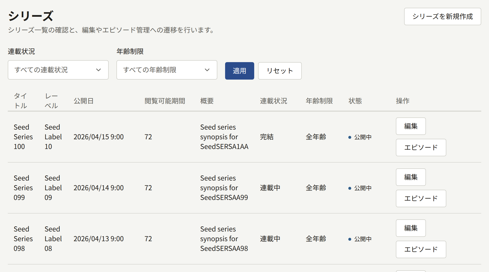

## シリーズの作成

**シリーズを新規作成**を選びます。作成時のフォームはあとで編集するときと同じもので、どの項目もあとから変更できます。フォーム下部の**シリーズを作成**を選ぶと保存され、そのシリーズの編集ページが開きます。

タイトルと概要は、サイトのデフォルトの言語で入力します。ほかの言語のタイトルと概要は、シリーズを作成したあとで追加します。手順は[ほかの言語のタイトル](#ほかの言語のタイトル)で説明しています。

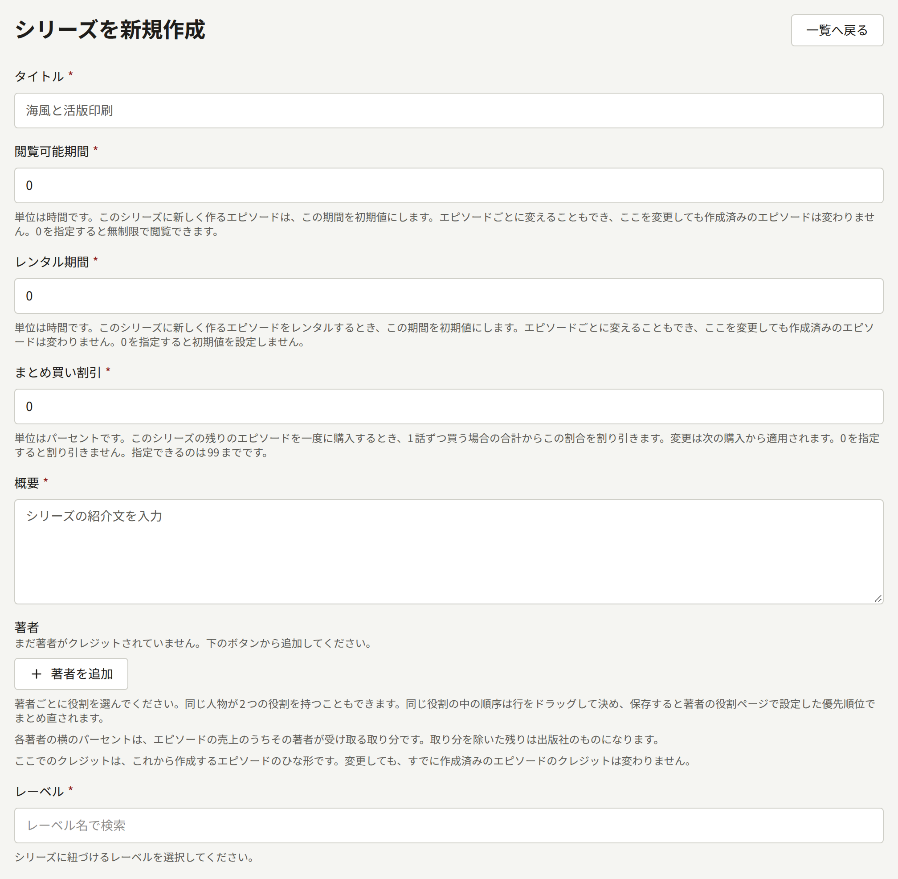

### 読者の目に最初に触れる項目

- **タイトル**は255文字までです。
- **概要**はシリーズのページに表示される紹介文で、10,000文字までです。
- **著者**には、シリーズにクレジットする人を役割と一緒に指定します。詳しくは[著者と役割](./4-authors.md#著者のクレジット)を参照してください。著者の横の割合は、シリーズのエピソードの売上のうちその著者が受け取る分です。計算方法は[レポートと印税](../6-reports-and-royalties.md#著者に支払う額)で説明しています。ここで設定したクレジットは、エピソードを作成するときにそのエピソードへコピーされます。あとでシリーズのクレジットを変更しても、作成済みのエピソードのクレジットは変わりません。
- **レーベル**は、シリーズを刊行するレーベルです。シリーズにはレーベルが必須なので、[レーベル](./3-labels.md)の手順で先に作成しておきます。
- **ジャンル**には、テナントのジャンルをいくつでも指定できます。表示順は**ジャンル**で設定した順です。
- **タグ**は、読者が作品を探すときに使う自由入力の語です。20個まで付けられ、1つあたり50文字までです。すでに使われているタグと大文字と小文字の違いを除いて一致するタグは、既存のタグにまとめられます。
- **アイキャッチ画像**には、10MB以下で2400 × 3200ピクセル以上のJPEG、PNG、WebP画像を指定します。このフォームで画像を指定できるのはシリーズを作成するときだけです。作成後は**アイキャッチ**タブで変更します。詳しくは[アイキャッチ画像](#アイキャッチ画像)を参照してください。

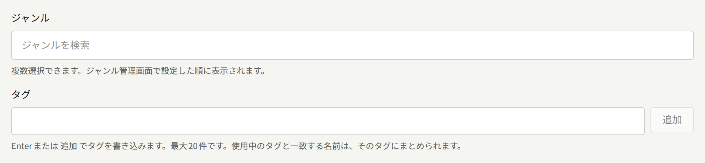

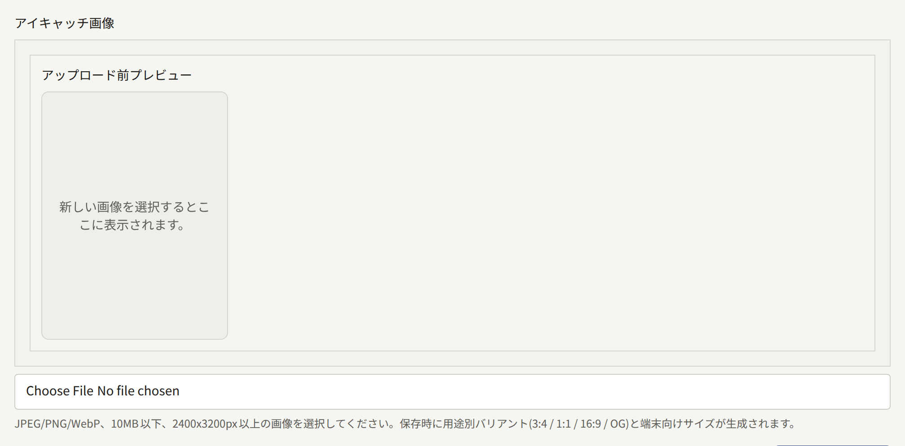

### 公開日時

シリーズを公開するかどうかは**公開日時**で決まります。日時はテナントのタイムゾーンで解釈され、どのタイムゾーンかは欄に表示されます。

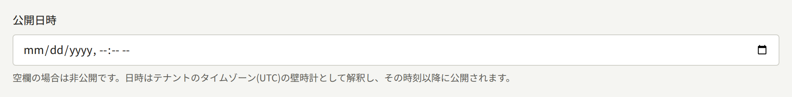

- **空欄**の場合、シリーズは非公開です。シリーズのページは存在しないものとして扱われ、各エピソードの状態にかかわらず、どのエピソードも読めません。
- **過去の日時**か現在の日時の場合、保存した時点でシリーズが公開されます。
- **未来の日時**の場合、その日時まではシリーズは非公開のままです。`publira worker`が公開日時を過ぎたシリーズを1分ごとに探し、サイトのキャッシュされたページを更新します。そのため、指定した日時からおよそ1分以内に、サイトの一覧やトップページにシリーズが表示されます。

公開中のシリーズでこの欄を空にすると、シリーズはエピソードごとサイトから取り下げられます。シリーズは削除できないので、公開をやめるにはこの方法しかありません。

非公開のシリーズが公開されると、それが初めての公開でも再公開でも、非公開の間に公開されたエピソードが読者に通知されます。通知されるのは、そのエピソードかシリーズ、またはクレジットされた著者をフォローしている読者です。これらのエピソードの日付は、シリーズが公開された時点になります。以前シリーズが公開されていた間にすでに通知されたエピソードは、日付が変わらず、再び通知されることもありません。通知を受け取る読者については[エピソード](./2-episodes.md#予約したエピソードが公開されるタイミング)で説明しています。

### 表示先と販売先

**表示先**では、読者がシリーズを見つけられる場所を**Webとアプリ**、**Webのみ**、**アプリのみ**から選びます。新しく作成したシリーズは**Webとアプリ**になっています。表示先に含まれない場所では、シリーズもそのエピソードも読者からは存在しないものとして扱われます。エピソードごとにこの設定より狭くすることはできますが、広げることはできません。

**販売先**では、有料エピソードを購入できる場所を決めます。初期値は**テナントの設定に従う**で、**決済** › **決済方法**の**販売先**の設定に従います。テナントの設定をあとで変えた場合も、その変更に従います。どちらの設定についても、またアプリのあるテナントがシリーズをサイトだけで販売する理由についても、[エピソードの販売](../4-selling-episodes.md#エピソードの販売先)で説明しています。

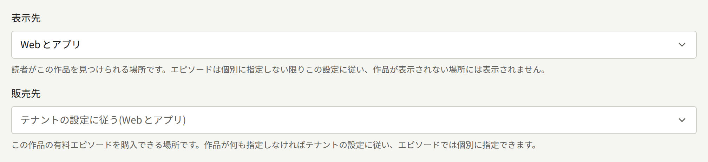

### 連載状況と更新スケジュール

**連載状況**は**連載中**、**完結**、**休載中**のいずれかです。連載状況はシリーズのページで読者に表示され、読者はシリーズの一覧を連載状況で絞り込めます。それ以外には影響しないので、**完結**にしたシリーズにもエピソードを追加できます。

**更新スケジュール**では、新しいエピソードを公開する予定の曜日にチェックを入れます。チェックを入れると、シリーズのページに、チェックした曜日に更新することが表示されます。また、サイトのトップページの**曜日から探す**ではそれぞれの曜日の下にシリーズが並びます。どの曜日にもチェックを入れなければ、シリーズのページに更新スケジュールは表示されず、どの曜日の下にも並びません。チェックを入れた曜日にエピソードが自動で公開されるわけではありません。エピソードが公開される日時は、引き続き各エピソードの**公開日時**で決まります。

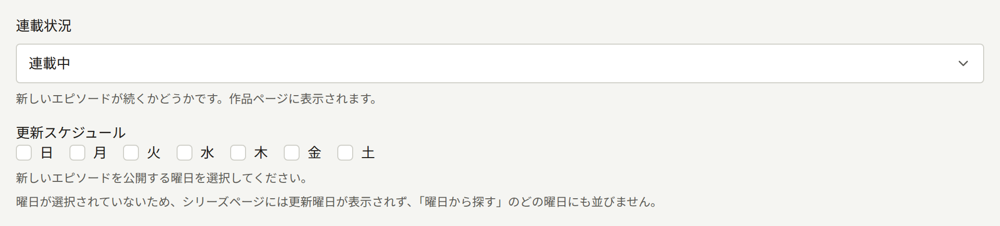

### 年齢制限

**年齢制限**は**全年齢**、**R15**、**R18**のいずれかです。**R15**か**R18**のシリーズはサイトで年齢制限が表示され、ページを開く前に読者に年齢の確認を求めます。読者が年齢を確認するまでは、年齢制限のあるシリーズはトップページにも検索結果にも表示されません。

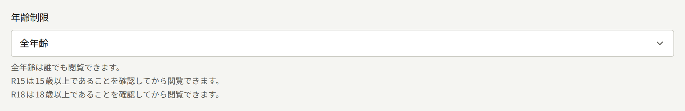

読者が確認するだけでよいか、年齢を証明できる生年月日を登録したアカウントでのログインまで求めるかは、テナント全体の設定である**年齢の証明を求める年齢制限**で決まります。詳しくは[設定](../3-setup/1-settings.md#年齢確認)を参照してください。この設定をシリーズごとに変えることはできません。

### コメント

**コメント**では、シリーズのエピソードに読者が書いたコメントの公開方法を**受け付けない**、**すぐに公開する**、**承認してから公開する**から選びます。初期値は**テナントの設定に従う**で、**設定**の**コメントの公開方法**に従います。テナントの設定をあとで変えた場合も、その変更に従います。詳しくは[設定](../3-setup/1-settings.md#読者のコメント)を参照してください。コメントの承認とモデレーションは[コメント](../2-readers/2-comments.md)で説明しています。

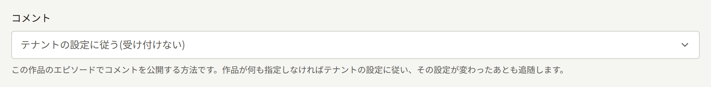

ここで選んだ公開方法は、テナントの設定にかかわらずそのシリーズに適用されます。たとえば**すぐに公開する**にしたシリーズは、テナントがコメントを受け付けない設定になっていてもコメントを受け付けます。

### 読む方向と見開き

**読む方向**は、シリーズのページをめくる方向です。日本のマンガと同じ**右から左**が初期値で、ほかに**左から右**を選べます。この設定で、ページをめくる方向、見開きでの2ページの並び、進行状況バーの向き、前後のエピソードが左右どちらにあるかが決まります。

**見開きを始めるページ**は、2ページを並べられる幅のある画面で、どのページから2ページずつ表示するかを決めます。そのページより前は1ページずつ表示されます。初期値の`2`では、最初のページ(たいていは表紙)が単独で表示されます。`1`にすると最初のページから見開きで表示されます。この値よりページ数の少ないエピソードは、1ページずつ表示されます。

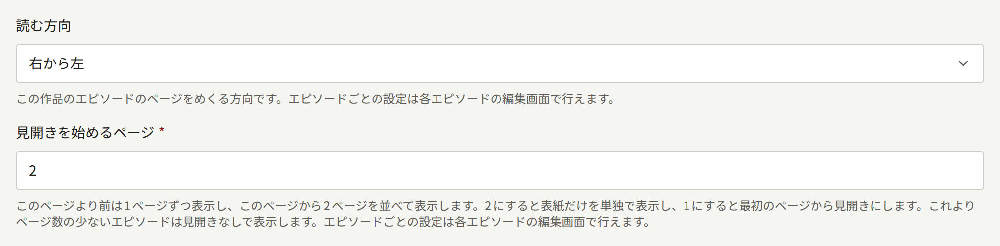

どちらの設定もエピソードごとに変えられます。詳しくは[ページレイアウト](./2-episodes.md#ページレイアウト)を参照してください。エピソードで設定していない場合はシリーズの設定に従い、シリーズの設定を変えたときもそれに従います。

### 閲覧可能期間

**閲覧可能期間**(時間単位)は、シリーズに新しく作成するエピソードの**閲覧可能期間**の初期値です。購入したエピソードを読める期間は、シリーズではなくエピソードに設定された期間で決まります。エピソードの期間は作成時にも、[あとから](./2-episodes.md#価格と閲覧可能期間の変更)でも変えられます。シリーズの期間をあとで変えても、作成済みのエピソードの期間は変わりません。新しいシリーズの初期値は`0`で、この場合は購入したエピソードを無期限に読めます。期間がどう使われるかは[エピソードの販売](../4-selling-episodes.md#価格と閲覧可能期間)で説明しています。

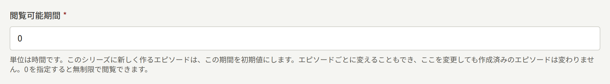

### レンタル期間

**レンタル期間**(時間単位)は、シリーズに新しく作成するエピソードの**レンタル期間**の初期値です。この設定だけではエピソードはレンタルの対象になりません。エピソードに**レンタル価格**を設定して初めてレンタルできるようになり、レンタル期間はレンタルしたエピソードを読める長さとして使われます。**閲覧可能期間**と同じく、シリーズの値を変えてもエピソードは作成時の値のままです。新しいシリーズの初期値は`0`で、期間を設定しないことを意味します。この場合、新しいエピソードの**レンタル期間**は空欄になります。レンタルについては[エピソードの販売](../4-selling-episodes.md#価格と閲覧可能期間)で説明しています。

### まとめ買い割引

**まとめ買い割引**(整数のパーセント)は、読者がシリーズの残りを1回の決済でまとめて購入したときの割引率です。まとめ買いの対象は、そのシリーズの有料エピソードのうち読者がまだ持っていないものすべてで、価格の合計からこの割合が割り引かれます。新しいシリーズの初期値は`0`で割引はなく、最大は`99`です。変更は次の決済から適用され、読者がすでに購入したものには影響しません。この販売方法は[エピソードの販売](../4-selling-episodes.md#シリーズの残りのエピソード)で説明しています。

## ほかの言語のタイトル

シリーズは、サイトで提供する言語ごとにタイトルと概要を持ちます。提供する言語はテナント管理者が[**設定**](../3-setup/1-settings.md#言語)で選びます。**基本情報**タブのフォームの上には、言語ごとのタブが並んだ**言語**があり、下のフォームでは選択中の言語のタイトルと概要を編集します。どの言語を編集しているかは、**タイトル**の下の注記に表示されます。まだタイトルがない言語のタブには「**(未追加)**」と表示されます。そのタブを開くと**タイトル**と**概要**が空のフォームが表示され、入力して**シリーズを更新**を選ぶと追加されます。タイトルが追加されるまでは、その言語の読者にはサイトでもアプリでもシリーズが別の言語で表示され、そのことを知らせる注記が付きます。また、その言語のページがあることは検索エンジンに伝えられません。

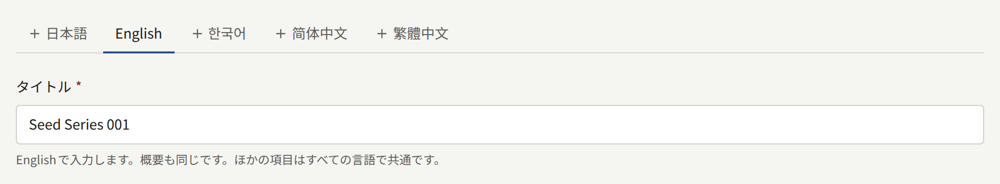

フォームのほかの項目は、言語ごとではなくシリーズ全体の設定です。どの言語のタブで変更しても、すべての言語に反映されます。タブの横の**この翻訳を削除**を選ぶと、選択中の言語のタイトルと概要が削除されます。ただし、シリーズに残っている最後の言語のタイトルと概要は削除できません。

**シリーズ**の一覧など、管理画面でシリーズ名を表示する画面では、サイトのデフォルトの言語のタイトルが表示されます。デフォルトの言語のタイトルがないシリーズは、最初に入力した言語のタイトルで表示されます。

## アイキャッチ画像

シリーズの**アイキャッチ**タブでは、作成時に選んだ画像を差し替えたり削除したりできます。**アイキャッチ画像**で新しい画像を選んで**アイキャッチを更新**を選ぶか、**現在のアイキャッチ画像を削除する**を選んで画像をなくします。新しい画像は、10MB以下で2400 × 3200ピクセル以上のJPEG、PNG、WebP画像にしてください。

サイトには、アップロードした画像がそのまま表示されるわけではありません。保存すると、決まった縦横比の4つの画像が切り出され、下の**比率別画像**に表示されます。各枠には比率の名前が見出しとして付き、その下にその画像が使われる場所が1行で書かれています。

| 枠 | 最小サイズ | 使われる場所 |
| --- | --- | --- |
| **縦長(3:4)** | 1200 × 1600 | サイトとアプリの棚に並ぶ表紙と、サイトのシリーズのページ |
| **正方形(1:1)** | 1200 × 1200 | サイトの一覧でシリーズとそのエピソードの横に表示する小さな画像と、サイトが検索エンジンに渡す画像の1つ |
| **横長(16:9)** | 1600 × 900 | サイトとアプリの横長のバナーと、サイトのシリーズのページやエピソードを読み終えたところで各エピソードの横に表示する小さな画像 |
| **リンクプレビュー(1200:630)** | 1200 × 630 | シリーズやそのエピソードへのリンクを共有したときに表示されるプレビュー。この画像がないシリーズを共有すると、サイトがタイトルとロゴ、テーマの色から作ったカードが表示されます。詳しくは[リンクのプレビュー](../3-setup/2-branding.md#リンクのプレビュー)を参照してください |

どの比率も、元の画像の中央から切り出されます。ある比率だけ切り出す範囲を変えたい場合や別の画像を使いたい場合は、**比率別画像**でその比率の画像をクリックし、枠に書かれたサイズ以上のJPEG、PNG、WebP画像を選びます。元と同じ画像を選んでもかまいません。続いて**枠を調整する**で表示する範囲を決め、**差し替える**で保存します。ほかの3つの画像はそのまま残ります。比率ごとの差し替えはシリーズにアイキャッチ画像がある場合にだけできるので、先に**アイキャッチ画像**で画像をアップロードしてください。**アイキャッチ画像**で新しい画像をアップロードすると、4つの画像がすべて差し替わります。

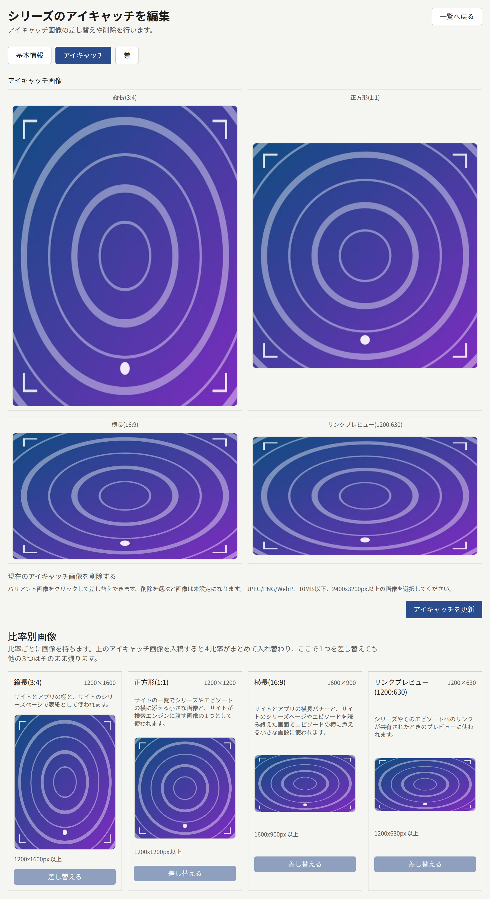

レーベルとジャンルにも同じタブがあり、サイズも同じです。ただし各比率の画像が使われる場所はシリーズとは異なり、各枠の下の1行には、編集しているレーベルやジャンルでの使われ方が書かれています。たとえばレーベルの正方形の画像は、アプリのタイルと、サイトの一覧でレーベルの横に表示する小さな画像に使われます。レーベルの縦長の画像は、まだどこにも表示されません。

## 待てば無料

**基本情報**タブのシリーズのフォームの下にある**待てば無料**を使うと、ログインしている読者がシリーズの有料エピソードを1話ずつ無料で読めるようになります。読むにはチケットを使い、使ったチケットは一定時間待つと戻ってきます。

- **このシリーズで無料チケットを配る**で有効にします。無効にしても、下の数値は次に有効にするときのために残ります。読者がすでにチケットで開いたエピソードは、期限が来るまで読めます。
- **次のチケットまでの時間**は、チケットを使ってから次のチケットを受け取れるまでの時間です。1から8760までで、初期値は`23`です。変更は、各読者が次にチケットを使ったときから適用されます。
- **エピソードを読める時間**は、チケットで開いたエピソードを読める時間です。1から8760までで、初期値は`72`です。
- **チケットで読めない最新話の数**は、公開済みのエピソードのうち、購入する読者のためにチケットの対象から外す最新話の数です。シリーズの並び順で最後のエピソードからさかのぼって数えます。`0`にすると、どの有料エピソードもチケットで開けます。

**待てば無料の設定を保存**を選んで保存します。チケットは読者1人につきシリーズごとに1枚で、使わずにおいても増えません。すでに全員に無料で公開されているエピソード、読者がすでに開けるエピソード、読者の年齢では読めないエピソードは、チケットでは開けません。シリーズのページにはチケットの仕組みが読者向けに説明され、チケットで開けないエピソードには**無料チケット対象外**と表示されます。

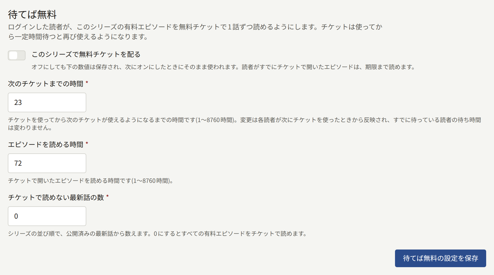

チケットと価格や無料公開期間との関係は、[エピソードの販売](../4-selling-episodes.md#無料公開期間と待てば無料)で説明しています。

## 公開後に無料

**基本情報**タブの**待てば無料**の下にある**公開後に無料**を使うと、シリーズの有料エピソードが、公開から決まった日数が過ぎたあとに全員に無料で公開されます。

- **公開後にエピソードを無料にする**で有効にします。無効にしても、下の数値は次に有効にするときのために残ります。
- **公開からの日数**は、エピソードの公開から無料になるまでの日数です。1から3650までで、初期値は`30`です。
- **有料のまま残す最新話の数**は、公開済みのエピソードのうち、公開からどれだけ日数が経っても有料のままにする最新話の数です。シリーズの並び順で最後のエピソードからさかのぼって数えます。`0`にすると、すべての有料エピソードが日数を過ぎた時点で無料になります。

**公開後に無料の設定を保存**を選んで保存します。ワーカーは、エピソードが無料になる日にそのエピソードへ無料公開期間を追加して無料にします。この期間はエピソードの[無料公開期間](./2-episodes.md#無料公開期間)に**シリーズのルールによる**として表示され、そこからは削除できません。この期間は、ルールの対象になっている間だけ続きます。ルールを無効にして保存した場合や、対象から外れる数値で保存した場合は、外れたエピソードがすぐに有料に戻ります。あとから最新話の範囲に入ったエピソードは、ワーカーの次回の処理で有料に戻ります。手動で設定した無料公開期間はそのまま残り、ルールによる期間はその終わりから始まります。

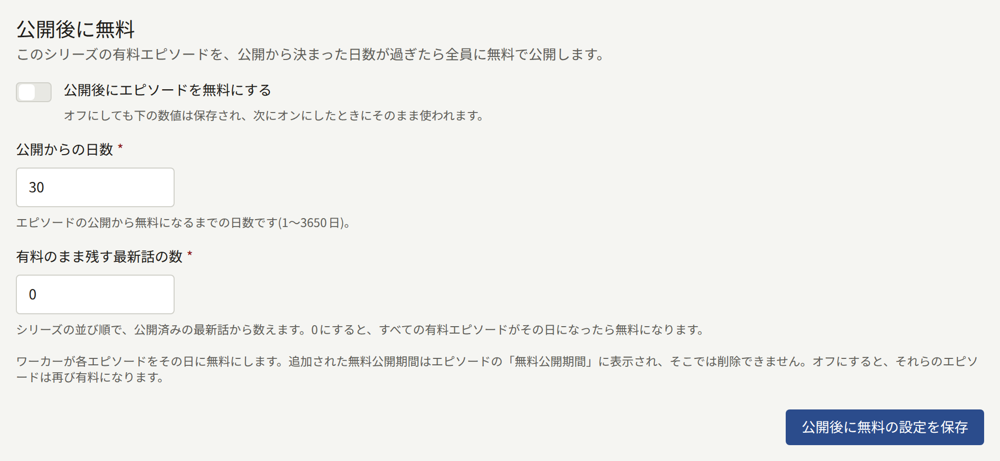

## 巻

巻は、シリーズの連続したエピソードをまとめて、独自の価格で1回の決済で販売するものです。巻を購入すると、収録されたすべてのエピソードを期限なく読めます。巻はレンタルできず、閲覧可能期間もありません。1つのエピソードを収録できる巻は1つまでで、巻に収録したエピソードも引き続き1話ずつ販売されます。

シリーズの**巻**タブには、シリーズの巻が並び順に表示されます。各巻には、アイキャッチ、価格、収録しているエピソードの数、**販売中**かどうかが表示されます。並び順を変えるには巻のハンドルをドラッグします。ドロップした時点で並び順が保存されます。監査担当にはハンドルのない一覧が表示され、各巻は**表示**で開きます。

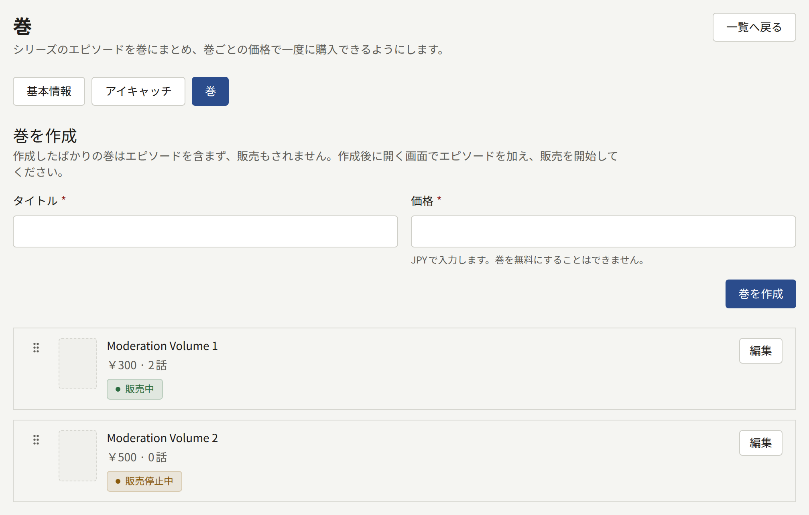

### 巻の作成

**巻を作成**で、**タイトル**(255文字まで)と、テナントの通貨での**価格**を入力します。価格は`0`より大きい値にしてください。**巻を作成**を選ぶと、新しい巻の画面が開きます。作成した直後の巻には、エピソードは収録されておらず、販売もされていません。1つのシリーズに作成できる巻は100までです。

巻の画面は次の4つに分かれています。

- **基本情報**では、タイトルと価格をまとめて変更し、**巻を更新**で保存します。新しい価格は、保存後の購入から適用されます。
- **エピソード**は、巻に収録するエピソードの一覧です。操作は次の節で説明します。
- **アイキャッチ**には、10MB以下で2400 × 3200ピクセル以上のJPEG、PNG、WebP画像を指定します。画像は[シリーズのアイキャッチ画像](#アイキャッチ画像)と同じ4つの比率に切り出されます。アイキャッチのない巻には、シリーズのアイキャッチ画像が表示されます。
- **販売**では、巻の販売を開始したり停止したりします。

### 収録するエピソードの選択

**エピソード**の**エピソードを追加**でシリーズのエピソードを検索し、**追加**を選ぶと一覧の最後に加わります。巻の中での順番を変えるにはエピソードのハンドルをドラッグし、巻から外すには行の右端のボタンを使います。**エピソードを保存**を選ぶまで、変更は保存されません。公開済みのエピソードだけでなく、下書きや予約済みのエピソードも追加できます。

ほかの巻に収録されているエピソードは候補に表示されません。先にその巻から外してください。

一度でも販売した巻からは、収録していたエピソードを外せなくなります。販売を停止したあとも同じです。販売中に決済を始めた読者はその決済を完了でき、購入すると巻に収録されているエピソードを読めます。エピソードの追加と並べ替えは、販売後も引き続きできます。

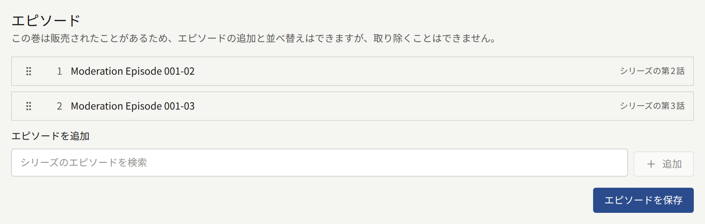

### 巻の販売

**販売**で**販売を開始**を選ぶと、巻が読者向けに販売されます。**販売を停止**を選ぶと販売をやめます。エピソードを収録していない巻は販売を開始できません。巻の販売を停止しても、読者がすでに購入したものは取り消されません。

巻を購入すると、収録されたエピソードをそれぞれ購入したことになります。そのため巻は、収録されたすべてのエピソードを購入できる場所でしか販売されません。たとえば収録されたエピソードの1つが**販売先**でサイトのみの販売になっていれば、巻もサイトだけで販売されます。エピソードを販売する場所については[エピソードの販売](../4-selling-episodes.md#エピソードの販売先)で説明しています。

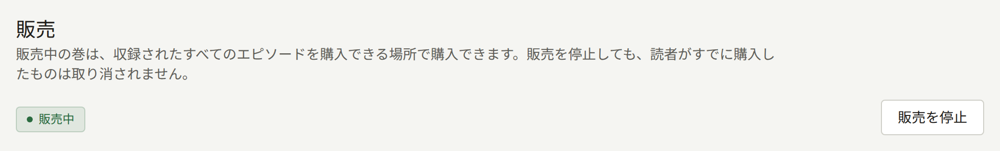

サイトとアプリでは、まだ巻を読者向けに提供していません。また、巻の売上は、印税の明細で収録エピソードの著者にまだ計上されません。
