エピソードは、読者が開き、代金を支払う対象です。タイトル、価格、公開される時刻を持つ、ひと続きのページ画像です。エピソードはシリーズの中にあります。**シリーズ**の一覧で、シリーズの行の**エピソード**を選ぶと開きます。

一覧では、各エピソードが位置とタイトルで表示され、状態（**下書き**、**予約済み**、**公開中**）、価格、予約済みのものは公開予定の時刻が示されます。サイトとアプリの両方には表示されないエピソードには、**Webのみ**、**アプリのみ**、**表示先なし**のいずれかが付きます。**編集**（監査担当には**表示**）でエピソードを開きます。編集画面には2つのタブがあります。[アイキャッチ画像](#アイキャッチ画像)で説明する**アイキャッチ**と、画面のほかのすべてのセクションを含む**基本情報**です。

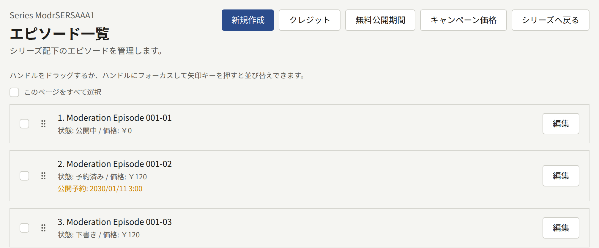

エピソードは、作品がマンガであってもなくても、ページ画像で構成されます。テキストで書かれた小説にはまだ対応していません（[#505](https://github.com/publira/publira/issues/505)）。

## エピソードの並び順

エピソードは、シリーズの並び順で一覧に表示され、サイトでもその順に番号が付きます。新しいエピソードは最後に加わります。移動するには、ハンドルでドラッグするか、ハンドルにフォーカスして矢印キーを使います。一覧は1ページに20件ずつ表示され、エピソードは同じページの中でだけ移動できます。

サイトでは、各エピソードにその位置に応じた番号を付け、**第1話**のように表示します。この番号は、読者にまだ見えないエピソードも数えます。公開済みのエピソードが欠番なく番号付けされるように、下書きと予約済みのエピソードは並び順の最後に置いてください。

新しい並び順は、保存した時点でサイトに反映されます。

## エピソードの作成

エピソード一覧で**新規作成**を選び、次の項目を入力します。

- **タイトル**：サイトのデフォルトの言語でのエピソードのタイトル。たとえば`Episode 1 — A beginning morning`です。[あとから変更](#タイトルの変更)でき、そこでサイトのほかの言語でのタイトルも付けられます。
- **価格**：テナントの通貨での価格で、通貨は欄に表示されます。小数点以下の桁数は、その通貨の桁数までです。500円なら`500`、4.99米ドルなら`4.99`です。`0`にするとエピソードは無料になります。
- **閲覧可能期間**：購入したエピソードを読める時間。`0`にすると期限なく読めます。初期値はシリーズの[閲覧可能期間](./1-series.md#閲覧可能期間)です。
- **レンタル価格**と**レンタル期間**：エピソードのレンタル料金（**価格**より低い額）と、レンタルしたエピソードを読める時間。エピソードをレンタルしない場合は、**レンタル価格**を空欄にします。**レンタル期間**の初期値はシリーズの[レンタル期間](./1-series.md#レンタル期間)です。
- **公開日時**：エピソードを公開する時刻で、テナントのタイムゾーンで解釈されます。空欄にすると下書きとして作成されます。すでに過ぎた時刻にすると、エピソードは作成と同時に公開されます。
- **表示先**と**販売先**：[表示先と販売先](#表示先と販売先)で説明する、エピソードを見つけられる場所と購入できる場所。どちらも最初はシリーズに従います。

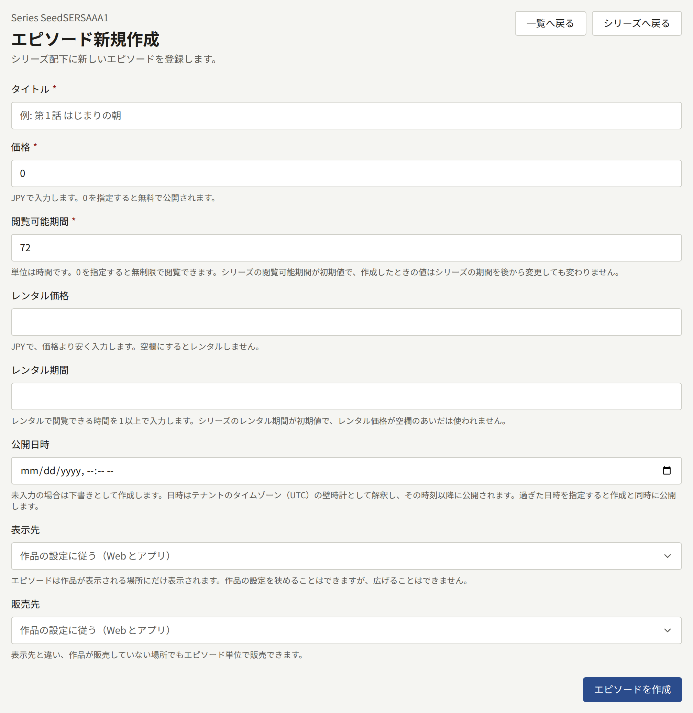

**価格**、**閲覧可能期間**、レンタルは[あとから変更](#価格と閲覧可能期間の変更)できます。これらの説明は[エピソードの販売](../4-selling-episodes.md#価格と閲覧可能期間)にあります。

**エピソードを作成**を選びます。エピソードは、シリーズにクレジットされている著者をクレジットした状態で作成され、ページを追加するための編集画面が開きます。

## タイトルの変更

エピソードの編集画面の上部にある**タイトル**には、サイトが提供する各言語でのエピソードのタイトルがあります。**言語**には言語ごとのタブがあり、その下の欄には選択している言語でのタイトルが入っています。変更して**タイトルを更新**を選びます。サイトとアプリには、保存した時点で新しいタイトルが表示されます。タイトルを空にすることはできません。

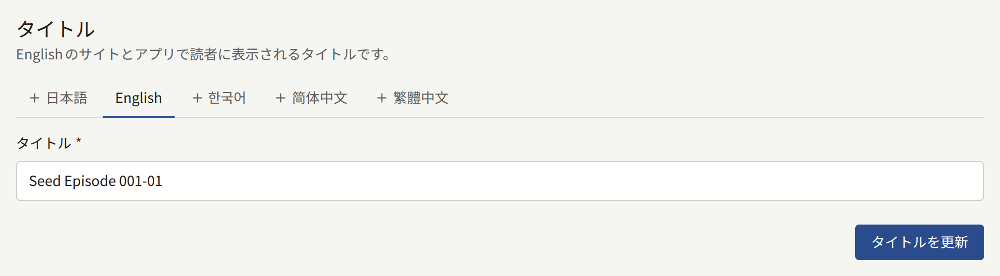

エピソードにまだタイトルがない言語には「**（未追加）**」と表示されます。そのタブを開くと欄は空なので、タイトルを入力して**翻訳を追加**を選びます。追加するまで、その言語のサイトとアプリの読者には、エピソードのタイトルが別の言語で表示されます。タブの横にある**この翻訳を削除**は、選択している言語のタイトルを削除します。ただし、エピソードに残っている最後のものは削除できません。

エピソード一覧や、エピソード名を表示する管理画面のほかの画面では、サイトのデフォルトの言語でのタイトルが表示されます。

## 価格と閲覧可能期間の変更

エピソードの編集画面にある**価格と閲覧可能期間**には、エピソードの販売に使われる値があり、作成時と同じ規則が適用されます。**価格**はテナントの通貨で、`0`にするとエピソードは無料になります。**閲覧可能期間**は時間数で、`0`にすると購入したエピソードは期限なく読めます。**レンタル価格**と**レンタル期間**はレンタルの値です。**レンタル価格**を空にするとエピソードのレンタルをやめます。レンタルしていないエピソードでは、**レンタル期間**にシリーズの[レンタル期間](./1-series.md#レンタル期間)が入っているので、価格を入力するだけでレンタルできます。いずれかを変更して**価格と閲覧可能期間を更新**を選びます。サイトとアプリでは、保存した時点で新しい値でエピソードが販売されます。

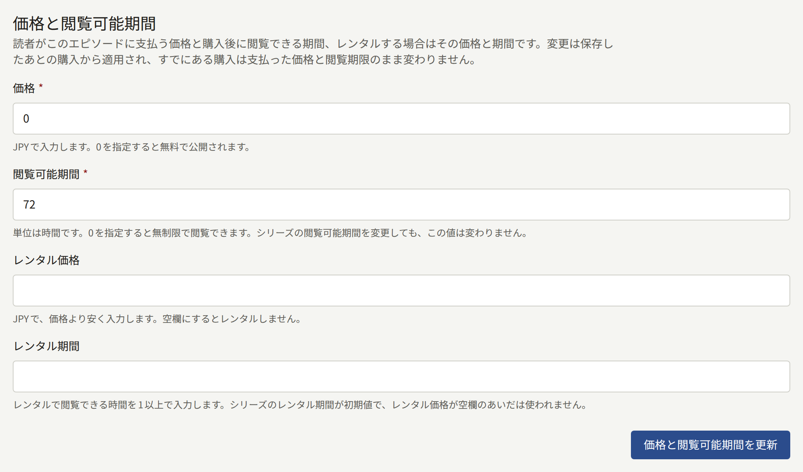

変更は、保存したあとの購入に適用されます。すでに行われた購入は、支払った価格と有効期限をそのまま保ちます。また、変更前に決済プロバイダの決済ページを開いた読者は、そのページに表示された額を支払います。シリーズの**閲覧可能期間**や**レンタル期間**を変更しても、これらは変わりません。

ストアを通じて販売するアプリでは、エピソードはその価格に対応するストアの商品として購入されます。そのため、新しい価格や新しい[キャンペーン価格](#キャンペーン価格)には新しい商品が必要になる場合があります。[ストアの商品](../4-selling-episodes.md#アプリでの販売)を参照してください。

## ページの追加

エピソードの編集画面にある**漫画ページ追加**では、**アップロード方法**で選んだ3つの方法のいずれかでページを追加します。

- **ページ画像を複数選択**では、複数のJPEG、PNG、GIF、WebPファイルを一度に受け付けます。ファイルを選ぶか、**ページ画像**にドロップします。ファイルはブラウザーが渡した順（通常はファイル名順）に追加されるので、あとで順序を確認してください。
- **ZIPを使う**では、ZIPファイルを受け付け、中にある`.png`、`.jpg`、`.jpeg`、`.gif`画像をパスの順に追加します。そのため`page2.png`は`page10.png`より前になります。ほかのファイルは無視され、WebP画像もそこに含まれます。画像は1000枚まで入れられます。
- **ePubを使う**では、ePubファイルを受け付け、そのページに表示されるJPEG、PNG、GIF、WebP画像を、読む順に1000枚まで追加します。

アップロードするには、**ページ画像を追加**、**ZIPを追加**、**ePubを追加**のいずれかを選びます。3つのどの方法でも、画像は1枚20MBまで、1回のアップロードは256MBまでです。そのため、エピソード全体を1つのZIPやePubとして追加できます。それより大きい場合は、複数回に分けてアップロードします。各回のページは、それまでの最後のページのあとに追加されます。カードのファイル選択の下に、これらの形式と上限が書かれています。

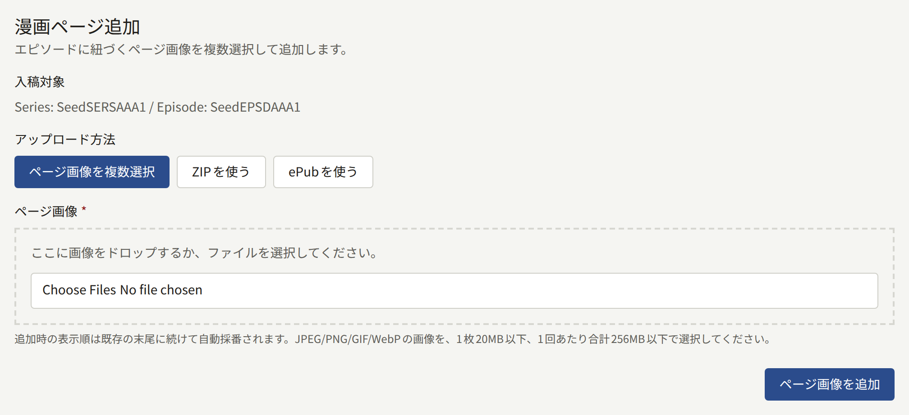

**登録済みページ画像**には、ページが順に表示されます。ページを移動するには、ハンドルでドラッグするか、ハンドルにフォーカスして矢印キーを使います。各ページの下には次のものがあります。

- **差し替え**は、そのページの位置に新しい画像を入れます。**新しいページ画像**で20MBまでのJPEG、PNG、GIF、WebP画像を1枚選び、**ページを差し替え**を選びます。ほかのページはすべてそのままの位置です。
- **削除**は、**ページを削除**で確認したあと、そのページをエピソードから取り除きます。それより後ろのページは1つずつ前に詰まります。削除したページは元に戻せません。戻すには、その画像をもう一度追加します。

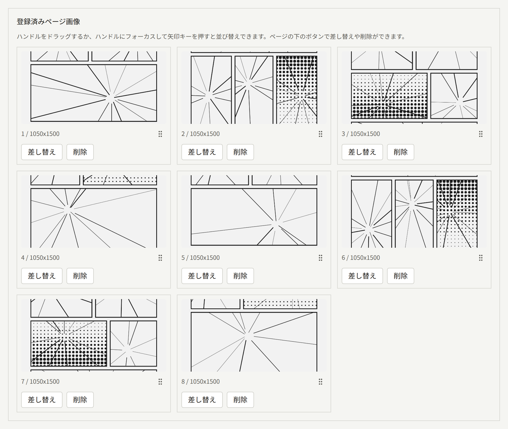

すでに公開されているエピソードへのページの追加、ページの差し替えや削除、ページの新しい並び順は、保存した時点で読者に反映されます。ページのない公開済みエピソードでは、ページがまだ公開されていないことが読者に表示されます。

ページを削除しても、[ページレイアウト](#ページレイアウト)にあるエピソード独自の**見開きの開始**はそのままです。そのページが最後のページより後ろになった場合、エピソードは再びそのページ数になるまで見開きなしで表示されます。

## ページレイアウト

**ページレイアウト**では、シリーズがエピソードに対して決める2つのことを、このエピソードだけに設定します。

- **読む方向**：**作品の設定に従う**、**右から左**、**左から右**のいずれか。
- **見開きの開始**：**作品の設定に従う**、または**このエピソードで指定する**。後者では、見開きを始めるページを1からエピソードの最後のページまでで指定します。先にページを追加してください。ページのないエピソードはシリーズに従うことしかできません。

**ページレイアウトを更新**を選んで保存します。シリーズに従う値は、シリーズの設定が変わるたびに変わります。それぞれがビューアーで何をするかは[読む方向と見開き](./1-series.md#読む方向と見開き)で説明しています。

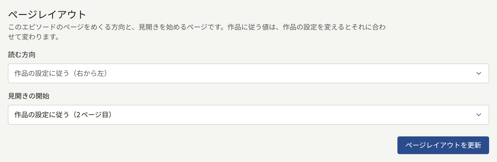

サイトで2ページが並んで表示されるのは、幅が768ピクセル以上で、高さが幅を超えないビューアーだけです。アプリでは、タブレットか横向きにしたスマートフォンだけです。それ以外では、ページは1ページずつ表示されます。

## ページのプレビュー

エピソードの編集画面の下部にある**プレビュー**では、サイトと同じビューアーでエピソードのページを表示します。ページは保存された順に並び、エピソードの読む方向にめくられ、レイアウトが指定するページから見開きになります。下書きや予約済みのエピソードも公開済みのものと同じようにプレビューできるので、読者が目にする前にページを確認できます。

ページはサイトで読者がするのと同じようにめくります。矢印キーを使うか、ビューアーの左右の端の近くをクリックします。ビューアーの中央をクリックすると、**前のページ**、**次のページ**と、ページの下の読書の進行状況スライダーが表示されます。プレビューの見開きの規則はサイトと同じなので、ウィンドウの幅が十分あれば2ページが並んで表示されます。

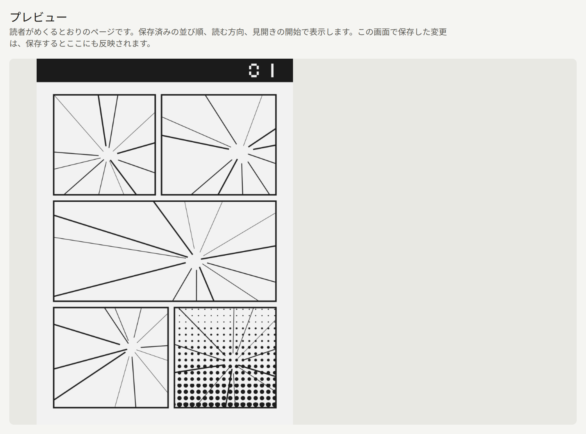

編集画面で保存した変更（ページの追加、差し替え、削除、移動や、**ページレイアウト**の更新）は、保存した時点でプレビューに反映され、プレビューは最初のページから表示し直されます。**ページレイアウト**で選んでもまだ保存していない値は反映されません。ページのないエピソードでは、プレビューにその旨が表示されます。

エピソードを開ける人は、エピソードを変更できない人も含めて、だれでもプレビューでページをめくれます。

## アイキャッチ画像

独自のアイキャッチ画像がないエピソードは、サイトとアプリで画像を表示するすべての場所で、シリーズの[アイキャッチ画像](./1-series.md#アイキャッチ画像)を表示します。そのため、新しいエピソードではここで何もする必要はありません。シリーズとは違う見た目にしたいエピソードに、独自のアイキャッチ画像を付けてください。エピソードにもシリーズにも「**リンクプレビュー (1200:630)**」の画像がない場合、エピソードへのリンクは、[リンクのプレビュー](../3-setup/2-branding.md#リンクのプレビュー)で説明するとおり、エピソードのタイトルからサイトが描いたカードで共有されます。

エピソードの編集画面の**アイキャッチ**タブで設定します。**アイキャッチ画像**で、10MB以下、2400 × 3200ピクセル以上のJPEG、PNG、WebP画像を選び、**アイキャッチを更新**を選びます。保存すると、シリーズのアイキャッチと同じ4つの形に同じサイズで切り出され、**比率別画像**に**縦長 (3:4)**、**正方形 (1:1)**、**横長 (16:9)**、「**リンクプレビュー (1200:630)**」として表示されます。各枠の下の1行に、エピソードのアイキャッチのその形がどこで使われるかが書かれています。

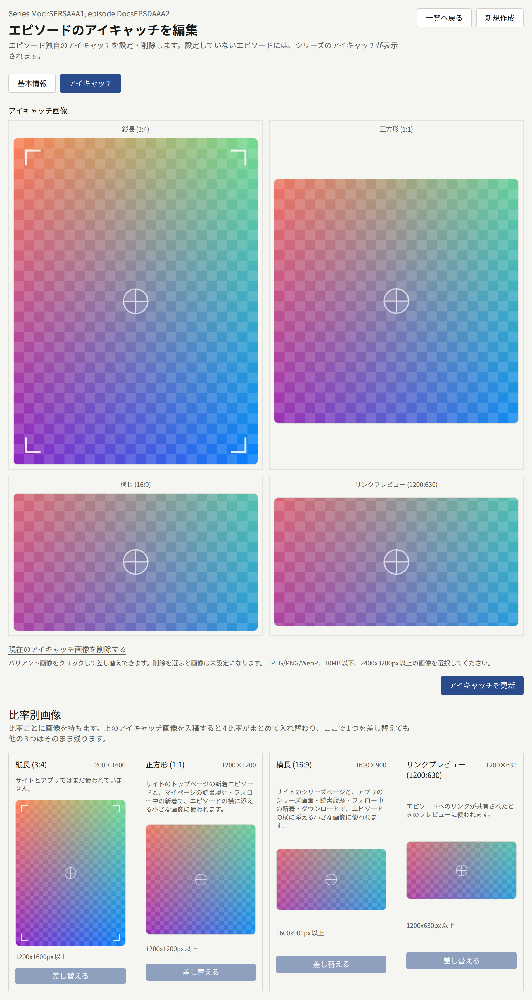

それぞれの形は、画像の中央から切り出されます。ある形だけ切り出し方を変えたり別の画像にしたりするには、**比率別画像**でその形の画像をクリックし、枠が求める大きさ以上のJPEG、PNG、WebP画像を選びます。前と同じ画像でもかまいません。続けて**枠を調整する**で、その形に表示する部分を決め、**差し替える**で保存します。ほかの3つはそのままです。形を差し替えられるのはエピソードにアイキャッチ画像がある場合だけなので、先に**アイキャッチ画像**でアップロードしてください。そこで新しいアイキャッチ画像をアップロードすると、4つすべてが差し替わります。

シリーズのアイキャッチに戻すには、**現在のアイキャッチ画像を削除する**を選んでから**アイキャッチを更新**を選びます。

## クレジット

エピソードの編集画面にある**著者**には、このエピソードにクレジットされている著者が、それぞれの役割と売上の取り分とともに表示されます。新しいエピソードはシリーズのクレジットから始まり、ここでエピソードごとに変更します。あとでシリーズのクレジットを変更しても、エピソードには反映されません。ここで追加したクレジットには**このエピソードのみ**と表示されます。このエピソードだけに参加したゲストのためのものです。**著者を保存**を選んで保存します。

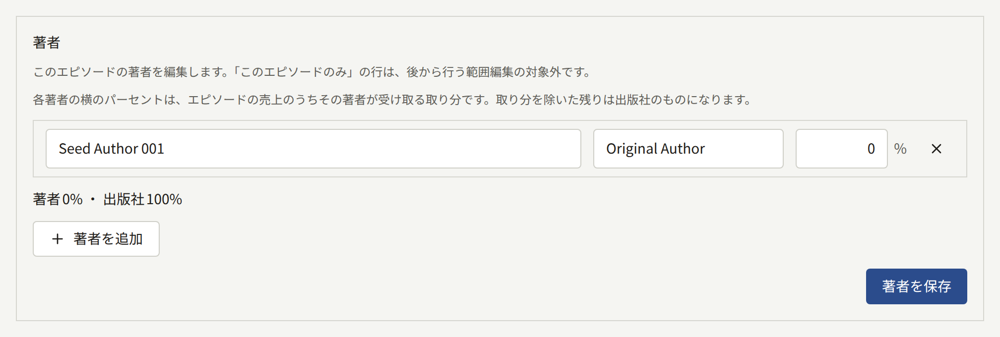

サイトのエピソードのページにはこれらのクレジットが表示され、シリーズのページにはシリーズ自身のクレジットが表示されます。[レポートと印税](../6-reports-and-royalties.md#著者に支払うべき金額)で説明するとおり、印税もエピソードのクレジットに基づいて支払われます。また、[著者と著者の役割](./4-authors.md#著者と読者アカウントの紐付け)で説明するとおり、読者アカウントに紐付けられた著者は、自分がクレジットされたエピソードを読めます。

12話から作画担当が加わる場合のように、多くのエピソードのクレジットをまとめて変更するには、一覧でエピソードを選び、**クレジット**を選びます。**操作**には次のものがあります。

- **追加**は、選んだエピソードのうち、その著者がその役割でまだクレジットされていないすべてのエピソードに、その著者をその役割で取り分なしでクレジットします。
- **置き換え**は、あるクレジットを別のクレジットに変えます。
- **削除**は、クレジットを外します。
- **取り分を設定**は、クレジットの取り分を変更します。

操作の対象となる**著者**と**役割**を選び、**エピソード**でエピソードにチェックを入れて、**適用**を選びます。**エピソード**にはシリーズのすべてのエピソードが表示され、一度に1000件まで扱えます。**置き換え**、**削除**、**取り分を設定**は、**このエピソードのみ**のクレジットには影響しません。結果には、変更されたエピソードの数と、ほかのエピソードがそれぞれ変更されなかった理由が表示されます。

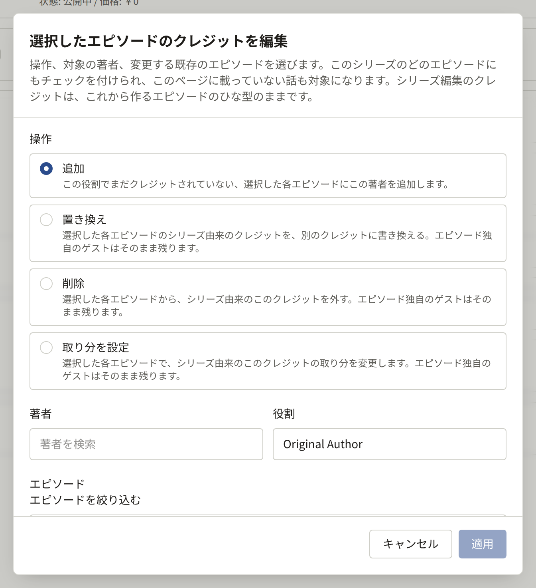

## 表示先と販売先

各エピソードには独自の**表示先**と**販売先**があり、最初はシリーズに従います。

- **表示先**は、シリーズが表示される場所を狭めることはできますが、広げることはできません。**アプリのみ**に表示されるシリーズで**Webのみ**に設定したエピソードは、どこにも表示されず、画面に警告が表示されます。**表示先を更新**を選んで保存します。
- **販売先**には、シリーズ自身の**販売先**に含まれない場所も指定できますが、エピソードが販売されるのは、必ずそのエピソードが表示される場所だけです。**販売先を更新**を選んで保存します。

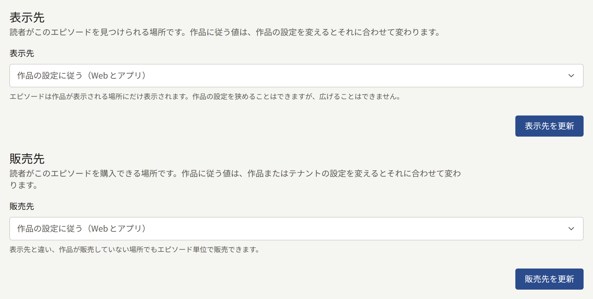

**表示先**をどこにも表示されないように設定すると、公開済みのエピソードを、公開を取り消さずにサイトから取り下げられます。エピソードが販売されていない場所で読者に何が表示されるかは、[エピソードの販売](../4-selling-episodes.md#エピソードの販売先)で説明しています。

## 無料公開期間

無料公開期間は、有料エピソードを2つの時刻の間、ログインしているかどうかにかかわらず全員に公開するものです。エピソードは価格を保ち、期間が終わると再びその価格が適用されます。無料のエピソードに設けた期間は何の効果もありません。

エピソードの編集画面にある**無料公開期間**には、エピソードの期間が**無料公開中**、**予定**、**終了**として表示されます。追加するには、どちらもテナントのタイムゾーンで**開始日時**と**終了日時**を入力し、**無料公開期間を追加**を選びます。**終了日時**は**開始日時**より後で、かつ未来でなければなりません。**開始日時**は過去でもかまわず、その場合はエピソードが今から無料になります。1つのエピソードの2つの期間は重ねられませんが、ある期間が終わるちょうどその時刻に別の期間を始めることはできます。

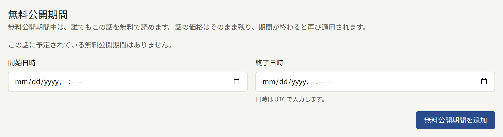

期間は編集できません。**削除**して、別の期間を追加します。始まっている期間を削除すると、エピソードはすぐに再び有料になります。

終了日時がなく**シリーズのルールによる**と表示された期間は、シリーズの[公開後に無料](./1-series.md#公開後に無料)のルールによって追加されたものです。このルールは、各有料エピソードを公開から決まった日数が過ぎたあとで無料にします。この期間には**削除**がありません。[定期ジョブとメンテナンスジョブ](../../3-operations/10-scheduled-jobs.md#その他の定期ジョブ)で説明するとおり、ルールが無効になるか、ルールがそのエピソードを対象にしなくなると消えます。

多くのエピソードに同じ期間を設けるには、エピソード一覧で**無料公開期間**を選びます。**対象の話**で、**選択した話**（一覧でチェックを入れたエピソード）、**最初の話から**（シリーズの並び順で最初の指定した数のエピソード）、**すべての話**のいずれかを選びます。続けて**開始日時**と**終了日時**を入力し、**追加する**を選びます。いずれかのエピソードにすでにある期間と重なる場合は、何も追加されません。

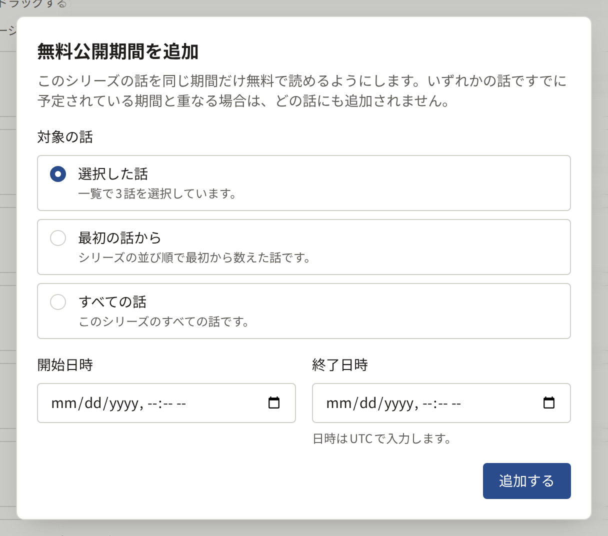

サイトでは、期間が始まった瞬間からその期間が表示され、終わった瞬間に表示されなくなります。[定期ジョブとメンテナンスジョブ](../../3-operations/10-scheduled-jobs.md#無料公開期間とその他のキャッシュ済みページ)で説明するとおり、`publira worker`が期間の始まりと終わりにキャッシュされたページを更新するためです。

## キャンペーン価格

キャンペーン価格は、有料エピソードを2つの時刻の間、安く販売するものです。キャンペーン中にエピソードを購入すると、サイトでも**アプリ内課金**で販売するアプリでも、キャンペーン価格が請求されます。[シリーズの残り](../4-selling-episodes.md#シリーズの残りのエピソード)とまとめて購入する場合も、シリーズの**まとめ買い割引**が差し引かれる前の額にキャンペーン価格が使われます。エピソードは自身の**価格**を保ち、キャンペーンが終わると再びその価格が適用されます。レンタルは**レンタル価格**のままで、キャンペーン価格で行われた購入は支払った価格をそのまま保ちます。

エピソードの編集画面にある**キャンペーン価格**には、エピソードのキャンペーンが価格とともに**セール中**、**予定**、**終了**として表示されます。追加するには、テナントの通貨で、エピソードの**価格**より低い**キャンペーン価格**を入力し、続けてどちらもテナントのタイムゾーンで**開始日時**と**終了日時**を入力して、**キャンペーン価格を追加**を選びます。**終了日時**は**開始日時**より後で、かつ未来でなければなりません。**開始日時**は過去でもかまわず、その場合はエピソードが今からセールになります。1つのエピソードの2つのキャンペーンは重ねられませんが、あるキャンペーンが終わるちょうどその時刻に別のキャンペーンを始めることはできます。無料のエピソードには値下げする価格がないので、このセクションにフォームは表示されません。

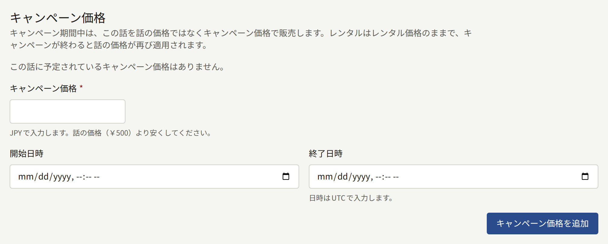

キャンペーンは編集できません。**削除**して、別のキャンペーンを追加します。始まっているキャンペーンを削除すると、エピソードはすぐに再び自身の価格で販売されます。エピソードの**価格**をキャンペーンの価格以下に下げると、そのキャンペーンの効果はなくなります。エピソードは自身の価格で販売されるようになるためです。

多くのエピソードを同じ価格と期間でセールにするには、エピソード一覧でエピソードにチェックを入れ、**キャンペーン価格**を選びます。**キャンペーン価格**、**開始日時**、**終了日時**を入力し、**追加する**を選びます。価格がチェックを入れたすべてのエピソードの**価格**より低くない場合や、期間がいずれかのエピソードにすでにあるキャンペーンと重なる場合は、何も追加されません。

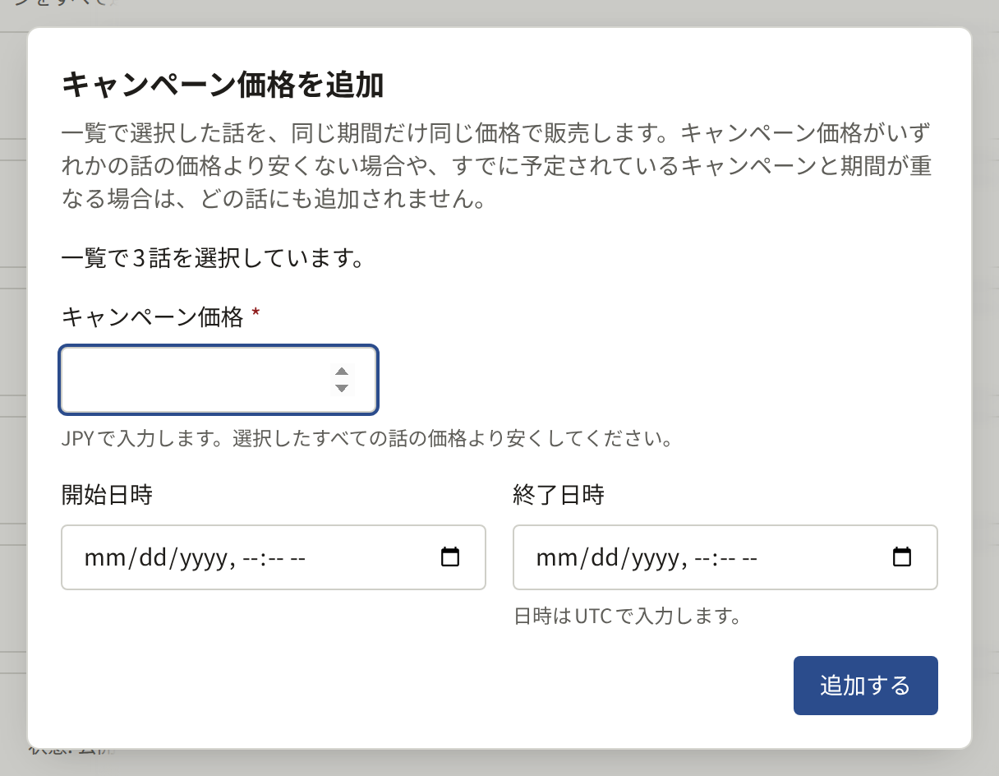

サイトでエピソードの価格を示すすべての場所で、キャンペーン中のエピソードには、キャンペーン価格と、その横に取り消し線の付いた自身の**価格**、テナントのタイムゾーンでのキャンペーンの終了時刻が表示されます。価格は読者が購入を始めた時点で確定します。そのため、キャンペーンが終わったあとで購入を始めた読者は、始めたページにまだキャンペーン価格が表示されていても、エピソード自身の**価格**を支払い、決済ページにもその価格が表示されます。

サイトでは、キャンペーンが始まった瞬間からキャンペーン価格が表示され、終わった瞬間に表示されなくなります。[定期ジョブとメンテナンスジョブ](../../3-operations/10-scheduled-jobs.md#無料公開期間とその他のキャッシュ済みページ)で説明するとおり、`publira worker`がキャンペーンの始まりと終わりにキャッシュされたページを更新するためです。

アプリでは、シリーズのエピソード一覧、ロックされたエピソード、前のエピソードの最後に表示される次のエピソードの案内で、キャンペーンが示されます。表示されるのは、キャンペーン価格、その横に取り消し線の付いたエピソード自身の**価格**、キャンペーンの終了時刻です。終了時刻は、アプリのすべての時刻と同じく、読者の端末のタイムゾーンで表示されます。これは、アプリがWebの決済で販売する場合でも、[**アプリ内課金**](../4-selling-episodes.md#アプリでの販売)で販売する場合でも同じです。アプリ内課金では、エピソードはキャンペーン価格に対応するストアの商品として購入されるので、ストアの支払い画面ではアプリが示す価格が請求されます。

## エピソードの公開

エピソードは次の3つの状態のいずれかにあります。

| 状態 | 意味 |
| --- | --- |
| **下書き** | 公開日時がありません。読者には見えません |
| **予約済み** | 公開日時がまだ先です。その時刻までは読者には見えません |
| **公開中** | 公開日時を過ぎています。シリーズが公開されていて、読者が使っている場所に表示される設定であれば、読者はエピソードを開けます |

エピソードが公開されるまでは、そのページは存在しないものとして応答し、どの一覧にも表示されず、前後のエピソードにある前のエピソード・次のエピソードへのリンクでも飛ばされます。

### 公開日時の設定

エピソードの編集画面にある**公開設定**では、すでに存在するエピソードの公開日時を設定・変更します。テナントのタイムゾーンで時刻を入力するか欄を空にして、**公開日時を更新**を選びます。

- **過去の時刻**（現在時刻など）にすると、下書きや予約済みのエピソードがすぐに公開されます。予約済みのエピソードが公開時刻になったときと同じように、フォロワーに告知され、検索インデックスに送られます。公開済みのエピソードはそのままなので、表示されている時刻のままセクションを保存しても何も変わりません。
- **未来の時刻**にすると、エピソードはその時刻に予約されます。
- **空欄**にすると、エピソードは下書きになります。

公開済みのエピソードは、後の2つによってサイトから取り下げられます。[エピソードをサイトから取り下げる](#エピソードをサイトから取り下げる)で説明しています。

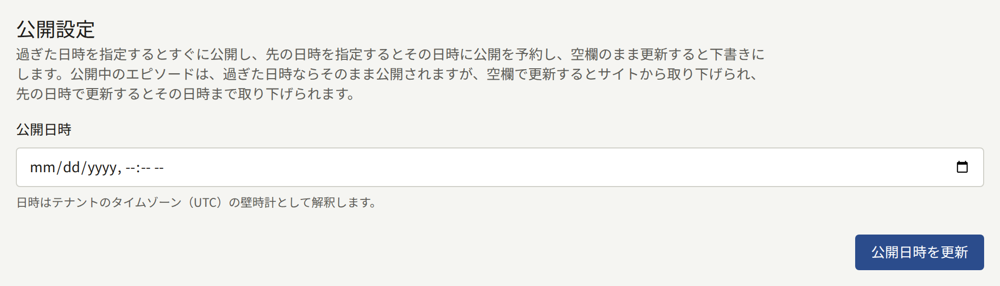

したがって、公開中のシリーズに新しいエピソードを公開する通常の手順は次のとおりです。

1. **公開日時**を空にして、下書きとしてエピソードを作成します。
2. ページを追加し、レイアウトを設定し、その両方を[プレビュー](#ページのプレビュー)で確認します。
3. **公開設定**で、今すぐ公開するなら現在時刻を、そうでなければ公開する時刻を入力して保存します。

### 予約したエピソードが公開されるとき

エピソードを公開するのは`publira worker`で、1分ごとに公開時刻を過ぎたエピソードを探します。その処理で、エピソードは次のようになります。

- サイトのエピソード自身のページとシリーズのエピソード一覧、そしてアプリで開けるようになります。
- エピソード、シリーズ、またはクレジットされた著者をフォローしているすべての読者に告知されます。告知は、エピソードが表示されるサイトとアプリのそれぞれで、通知とプッシュ通知によって行われ、サイトに表示される場合はメールでも行われます。このうちどれが届くかは、各読者の通知設定で決まります。
- 検索インデックスに送られます。

そのため、12:00に予約したエピソードは12:01ごろには読めるようになり、**更新順**に並べたシリーズ一覧など、サイトの一覧にも同じ時点から表示されます。

公開時刻を大きく過ぎても**予約済み**のままのエピソードがある場合、ワーカーが動いていないか、公開に失敗しています。その場合、テナント管理者に「エピソードの公開に失敗しました」という通知が届きます。これはオペレーターが直すべきもので、[定期ジョブとメンテナンスジョブ](../../3-operations/10-scheduled-jobs.md#予約公開)で説明しています。直れば、エピソードは自動的に公開されます。待たずに公開するには、**公開設定**で現在時刻を入力して保存します。

シリーズが公開されていない間に公開されたエピソードは、通知から見つからないページへ案内することがないよう、シリーズの公開を待ちます。シリーズが公開されたとき（**シリーズを更新**からでも、シリーズ自身の**公開日時**が来たことによってでも）に告知され、それ以降は、シリーズが公開された時点を公開日として表示します。それより前には読者がだれも開けなかったためです。シリーズが以前に公開されていた間にフォロワーに告知済みのエピソードは、日付をそのまま保ち、再び告知されることはありません。

**表示先なし**の状態で公開されたエピソードは、だれにも告知されず、あとで表示されるようになっても告知されません。サイトとアプリの一方にだけ表示されるエピソードは、そちらでだけ告知されます。読者はその一方の通知でだけ通知を見ることになり、プッシュ通知もブラウザーだけ、またはスマートフォンだけに届きます。エピソードをどこで告知するかは`publira worker`が通知を送る時点で決まり、そのあとで**表示先**を変更しても、送信済みの通知は移りません。エピソードの表示先は公開時刻より前に設定してください。

### 何がいつ公開されるか

サイドバーの**作品**グループにある**カレンダー**には、すべてのシリーズにわたるテナントの1か月分の公開予定が表示されます。各日には、その日に公開される、または公開されたエピソードが、シリーズのタイトル、エピソードのタイトル、状態（**予約済み**または**公開中**）とともに表示され、選ぶとその編集画面が開きます。1日はテナントのタイムゾーンでの1日で、そのタイムゾーンは画面に表示されます。そのため、テナントのタイムゾーンで23:30に予約したエピソードは、見ている人がどこにいても、その日に表示されます。下書きには公開日時がないので、カレンダーには表示されません。

カレンダーは当月を表示した状態で開き、今日に印が付きます。**前の月**と**次の月**で1か月ずつ移動し、**今月**で戻ります。ダッシュボードの**公開キュー**の横にある**カレンダーを開く**からも開けます。スタッフはだれでも開けますが、カレンダーからは何も変更できません。エピソードの予定を変更するには、そのエピソードの**公開設定**を使います。

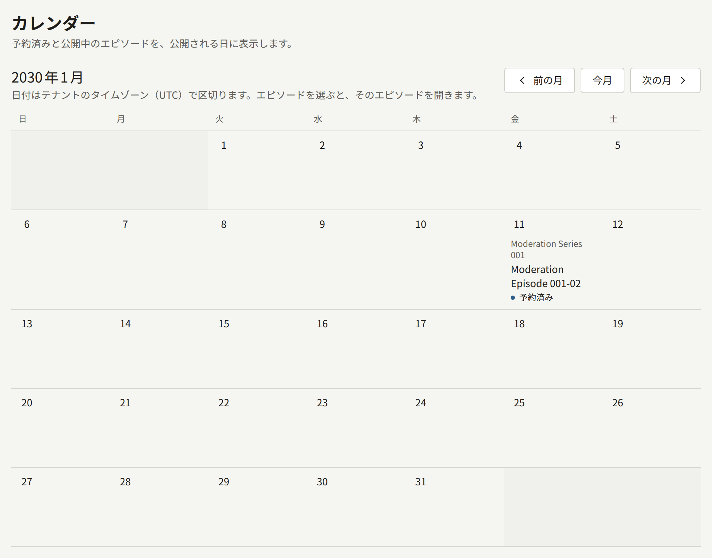

### エピソードをサイトから取り下げる

公開済みのエピソードは削除できません。サイトから取り下げるには、次のいずれかを行います。

- **公開設定**で**欄を空にして**保存します。エピソードは**下書き**に戻ります。
- **未来の時刻を入力して**保存します。エピソードはその時刻までサイトから取り下げられ、その時刻に再び公開されます。このとき、フォロワーに再び告知されることはありません。
- **表示先を設定して**、どこにも表示されないようにします。エピソードは公開済みのままで、設定を変更すればすぐに戻ります。

どの方法でも、エピソードを購入した読者は、エピソードが戻るまでそのエピソードを読めなくなります。
