エピソードは、読者が開き、代金を支払う単位です。ページ画像を順に並べたもので、タイトル、価格、公開日時を持ちます。エピソードはシリーズの中にあり、**シリーズ**の一覧でそのシリーズの行の**エピソード**を選ぶと開きます。

エピソードの一覧には、各エピソードの順番とタイトル、状態 (**下書き**、**予約済み**、**公開中**)、価格が表示されます。予約済みのエピソードには公開予定の日時も表示されます。テナントが[公開前の審査](#公開前の審査)を必須にしているあいだは、テナント管理者の判断を待っている予約済みのエピソードに**審査中**、差し戻されたエピソードに**差し戻し**が付きます。サイトとアプリのどちらか一方にしか表示しないエピソードには**Webのみ**か**アプリのみ**、どこにも表示しないエピソードには**表示先なし**が付きます。[試し読みページ](#試し読みページ)のある有料のエピソードには、**試し読み3ページ**のようにページ数が付くので、シリーズ全体に設定した試し読みをひと目で確認できます。エピソードは**編集**で開き、監査担当には**編集**の代わりに**表示**が出ます。編集画面のタブは2つで、**アイキャッチ**タブは[アイキャッチ画像](#アイキャッチ画像)で説明し、それ以外のセクションはすべて**基本情報**タブにあります。

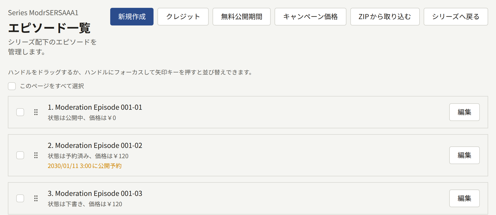

エピソードは、作品がマンガかどうかにかかわらず、ページ画像で構成します。テキストで書かれた小説には、まだ対応していません ([#505](https://github.com/publira/publira/issues/505))。

## エピソードの並び順

エピソードは、一覧でもサイトでもシリーズの並び順で表示され、サイトではこの順に番号が付きます。新しく作成したエピソードは最後に追加されます。順番を変えるには、ハンドルをドラッグするか、ハンドルにフォーカスを合わせて矢印キーで動かします。一覧には1ページに20件ずつ表示され、エピソードを動かせるのは同じページの中だけです。

サイトでは各エピソードに並び順どおりの番号を付け、**第1話**のように表示します。この番号には、読者にまだ見えないエピソードも数に入ります。公開済みのエピソードの番号が飛ばないように、下書きや予約済みのエピソードは並び順の最後に置いてください。

並び順を変えると、保存した時点でサイトに反映されます。

## エピソードの作成

エピソードの一覧で**新規作成**を選び、次の項目を入力します。

- **タイトル**には、サイトのデフォルトの言語でエピソードのタイトルを入力します。たとえば`Episode 1 — A beginning morning`のようにします。タイトルは[あとから変更](#タイトルの変更)でき、そこでほかの言語のタイトルも追加できます。
- **価格**は、テナントの通貨での価格です。どの通貨かは欄に表示されます。小数点以下は、その通貨の桁数までしか入力できません。たとえば500円なら`500`、4.99米ドルなら`4.99`と入力します。`0`にするとエピソードは無料になります。
- **閲覧可能期間**は、購入したエピソードを読める時間数です。`0`にすると無期限に読めます。初期値はシリーズの[閲覧可能期間](./1-series.md#閲覧可能期間)です。
- **レンタル価格**と**レンタル期間**は、レンタルの料金と、レンタルしたエピソードを読める時間数です。レンタル価格は**価格**より低くします。レンタルしない場合は**レンタル価格**を空欄にします。**レンタル期間**の初期値はシリーズの[レンタル期間](./1-series.md#レンタル期間)です。
- **試し読みページ数**は、有料のエピソードの先頭から何ページを、購入前に誰でも読めるようにするかです。[試し読みページ](#試し読みページ)で説明します。初期値は`0`で、どのページも公開しません。**価格**が`0`の間は、無料のエピソードはすべてのページを読めるので、この欄は表示されません。
- **公開日時**は、エピソードを公開する日時で、テナントのタイムゾーンで解釈されます。空欄にすると下書きとして作成されます。過ぎた日時を入力すると、作成と同時に公開されます。
- **表示先**と**販売先**は、読者がエピソードを見つけられる場所と購入できる場所です。初期状態ではどちらもシリーズの設定に従います。詳しくは[表示先と販売先](#表示先と販売先)を参照してください。

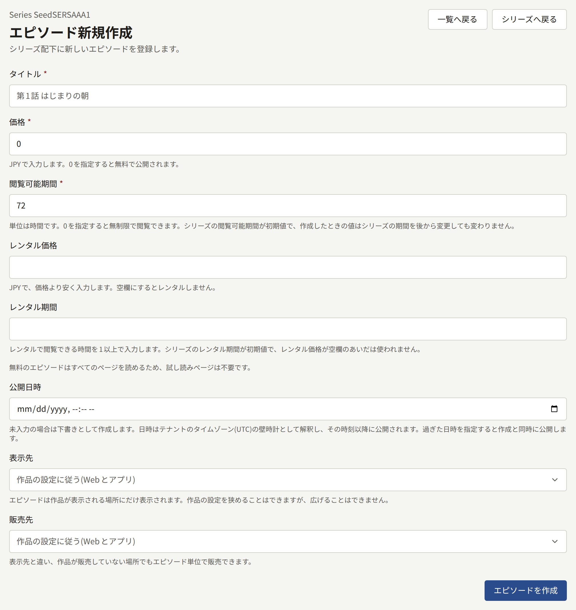

**価格**、**閲覧可能期間**、レンタルの設定、**試し読みページ数**は[あとから変更](#価格と閲覧可能期間の変更)できます。それぞれの意味は[エピソードの販売](../4-selling-episodes.md#価格と閲覧可能期間)で説明しています。

最後に**エピソードを作成**を選びます。エピソードはシリーズにクレジットされている著者をそのまま引き継いで作成され、ページを追加するための編集画面が開きます。

## タイトルの変更

エピソードの編集画面の上部にある**タイトル**では、サイトで提供する言語ごとにエピソードのタイトルを設定します。**言語**には言語ごとのタブが並び、その下の欄に選択中の言語のタイトルが表示されます。タイトルを書き換えて**タイトルを更新**を選びます。保存した時点で、サイトとアプリに新しいタイトルが表示されます。タイトルを空欄にはできません。

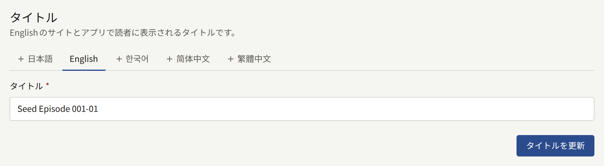

まだタイトルがない言語のタブには「**(未追加)**」と表示されます。そのタブを開くと欄が空なので、タイトルを入力して**翻訳を追加**を選びます。追加するまでは、その言語でサイトやアプリを使っている読者に、ほかの言語のタイトルが表示されます。タブの横の**この翻訳を削除**を選ぶと、選択中の言語のタイトルが削除されます。ただし、エピソードに残っている最後の言語のタイトルは削除できません。

エピソードの一覧など、管理画面でエピソード名を表示する画面では、サイトのデフォルトの言語のタイトルが表示されます。

## 価格と閲覧可能期間の変更

エピソードの編集画面の**価格と閲覧可能期間**では、エピソードを販売するときの値を変更できます。ルールは作成時と同じです。**価格**はテナントの通貨で入力し、`0`にすると無料になります。**閲覧可能期間**は時間数で、`0`にすると購入したエピソードを無期限に読めます。レンタルの設定は**レンタル価格**と**レンタル期間**で行います。**レンタル価格**を空にすると、そのエピソードのレンタルをやめます。レンタルしていないエピソードでは、**レンタル期間**にシリーズの[レンタル期間](./1-series.md#レンタル期間)があらかじめ入っているので、価格を入力するだけでレンタルを始められます。**試し読みページ数**には、エピソードの[試し読みページ](#試し読みページ)の数が入っています。値を変えたら**価格と閲覧可能期間を更新**を選びます。保存した時点から、サイトとアプリでは新しい値でエピソードが販売されます。

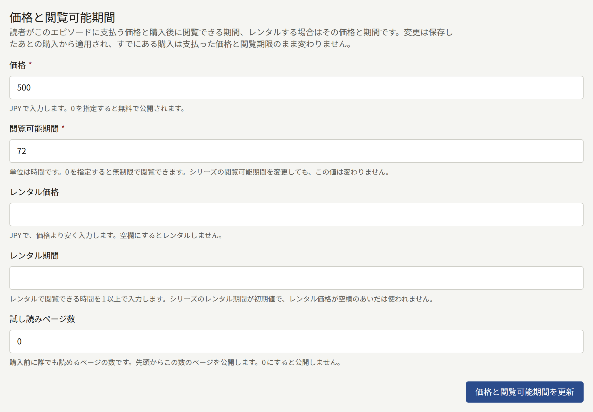

### 試し読みページ

**試し読みページ数**は、有料のエピソードのページのうち、読む順で先頭から何ページを、ログインしているかどうかにかかわらず購入前に誰でも読めるようにするかです。`0`にするとどのページも公開しません。負の数は受け付けません。ページは価格を決めたあとに追加することも多いので、エピソードにあるページより大きい数も受け付けます。その場合は今あるページ数が欄の下に表示され、公開されるのはそのページだけです。あとから追加したページも、この数までは順に公開されます。

この欄は**価格**が`0`より大きいときだけ表示されます。無料のエピソードはもともとすべてのページを読めるので、欄の代わりに試し読みページが不要だという案内が表示され、**価格**を`0`にして保存すると試し読みページ数も`0`になります。もう一度価格を付けると、欄は`0`から始まります。

変更が適用されるのは、保存したあとの購入です。すでに購入済みの分は、支払った価格も有効期限も変わりません。変更する前に決済サービスの決済ページを開いていた読者は、そのページに表示された金額を支払います。シリーズの**閲覧可能期間**や**レンタル期間**を変えても、これらには影響しません。

ストアを通じて販売するアプリでは、エピソードをその価格に対応するストアの商品として購入します。そのため、価格や[キャンペーン価格](#キャンペーン価格)を新しくすると、ストアの商品も新しく用意しなければならない場合があります。詳しくは[ストアの商品](../4-selling-episodes.md#アプリでの販売)を参照してください。

## ページの追加

エピソードの編集画面の**漫画ページ追加**では、**アップロード方法**で次の3つから方法を選んでページを追加します。

- **ページ画像を複数選択**では、JPEG、PNG、GIF、WebPのファイルを複数まとめて追加できます。ファイルを選ぶか、**ページ画像**にドロップします。ファイルはブラウザーから渡された順に追加されます。たいていはファイル名順ですが、追加したあとで順番を確認してください。
- **ZIPを使う**では、ZIPファイルの中にある`.png`、`.jpg`、`.jpeg`、`.gif`の画像を、パスの順に追加します。この順では`page2.png`が`page10.png`より前に並びます。それ以外のファイルは無視され、WebP画像も無視されます。1つのZIPに入れられる画像は1000枚までです。
- **ePubを使う**では、ePubファイルのページに表示されるJPEG、PNG、GIF、WebPの画像を、読む順に1000枚まで追加します。

アップロードするには、方法に応じて**ページ画像を追加**、**ZIPを追加**、**ePubを追加**のどれかを選びます。どの方法でも、画像は1枚20MBまで、1回のアップロードは128MBまでです。この範囲に収まれば、エピソード全体を1つのZIPやePubで追加できます。ZIPやePubを展開した画像の合計は256MBまでです。それより大きい場合は、何回かに分けてアップロードします。各回のページは、それまでに追加したページの後ろに加わります。これらの形式と上限は、カードのファイル選択の下にも書かれています。

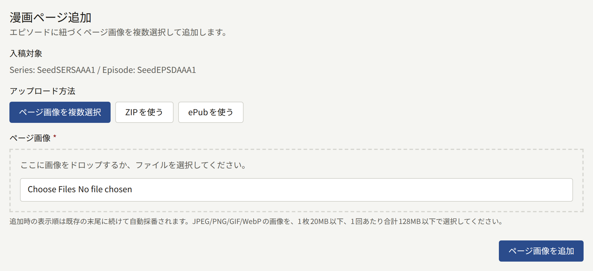

**登録済みページ画像**には、ページが順番に表示されます。ページを動かすには、ハンドルをドラッグするか、ハンドルにフォーカスを合わせて矢印キーで動かします。各ページの下には次のボタンがあります。

- **差し替え**では、そのページの位置に新しい画像を入れます。**新しいページ画像**で20MBまでのJPEG、PNG、GIF、WebP画像を1枚選び、**ページを差し替え**を選びます。ほかのページの位置は変わりません。
- **削除**を選び、**ページを削除**で確定すると、そのページがエピソードから削除され、後ろのページが1つずつ前に詰まります。削除したページは元に戻せないので、戻すには同じ画像をもう一度追加します。

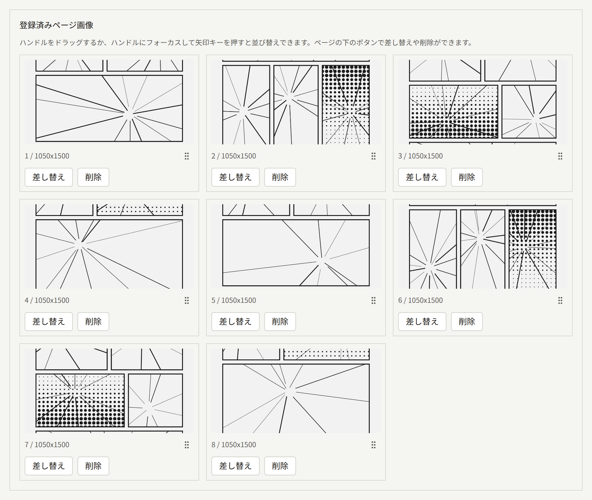

公開済みのエピソードでページを追加、差し替え、削除したり、並び順を変えたりすると、保存した時点で読者に反映されます。公開済みでもページが1つもないエピソードを開くと、ページがまだ公開されていないことが読者に表示されます。

ページを削除しても、[ページレイアウト](#ページレイアウト)でエピソードに設定した**見開きの開始**は変わりません。そのページが最後のページより後ろになると、ページ数がそこに届くまでエピソードは見開きなしで表示されます。

## ZIPからの取り込み

**シリーズ**の一覧とシリーズのエピソード一覧にある**ZIPから取り込む**を使うと、ページ画像をまとめた1つのZIPからシリーズとエピソードを作成できます。エピソードを1つずつ作成してページを追加する必要はありません。ほかのサービスからカタログを移すときや、複数のエピソードをまとめて入稿するときに使います。

ZIPには、任意のフォルダーに置いたページ画像と、ルートに置いた`publira-import.json`という名前のマニフェストを収めます。

```json
{
  "version": 1,
  "series": {
    "title": "シリーズのタイトル",
    "synopsis": "シリーズのあらすじ",
    "locale": "ja",
    "reading_direction": "rtl"
  },
  "episodes": [
    {
      "title": "第1話",
      "price": 0,
      "scheduled_at": "2030-01-01T00:00:00+09:00",
      "pages": ["ep01/001.png", "ep01/002.png"]
    }
  ]
}
```

- `version`は`1`です。
- `series`はエピソードの追加先を指定します。シリーズを作成するときは`title`を指定します。必要に応じて、`synopsis`、`reading_direction` (`rtl`か`ltr`で、省略すると右から左)、シリーズの文章とエピソードのタイトルの言語を表す`locale` (省略するとテナントの既定の言語) も指定できます。シリーズは下書きとして作成されます。既存のシリーズに追加するときは`{ "id": "<ID>" }`だけを指定します。IDは、シリーズの画面のアドレス`/series/<ID>`とエピソード一覧の上部で確認できます。シリーズのエピソード一覧から取り込むときは、マニフェストでそのシリーズを指定する必要があります。
- `episodes`には、作成する順にエピソードを並べます。シリーズに既存のエピソードがあれば、その後ろに追加されます。各エピソードには`title`と`pages`が必要です。`pages`には、ZIPに格納されているとおりのパスを読む順に並べます。`price`は**価格**と同じ書き方でテナントの通貨の金額を指定し、省略すると`0`です。`scheduled_at`にオフセット付きの未来の日時を指定すると、すべてのページが揃ったあとでエピソードは予約公開になります。省略すると下書きのままです。

マニフェストには、これ以外のキーは使えません。クレジット、アイキャッチ、翻訳、ジャンル、タグ、レンタルは、取り込んだあとに管理画面で設定します。

**ZIPファイル**でZIPを選びます。管理画面は何も送信する前にZIPを確認し、問題があればエピソードとパスを示してすべて一覧にします。確認する内容は、マニフェストに使えないキー、ZIPにないページ、重複したパス、JPEG、PNG、GIF、WebPのいずれでもないファイル、上限を超えるものです。確認に通るまで、何も作成されません。ZIPの中に見えているパスが見つからないと表示されたときは、フォルダー名とファイル名をASCII文字にしてください。ツールによっては、それ以外の文字をマニフェストと一致しない形で格納します。

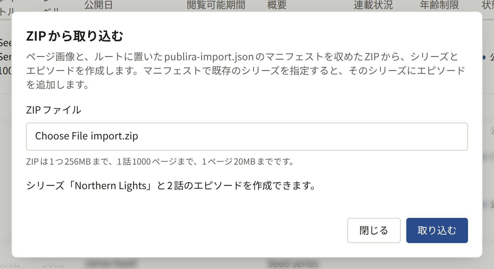

ZIPは1つ256MBまで、エピソードは1話1000ページまで、ページは1枚20MBまでです。これより大きいカタログは、同じシリーズをIDで指定した複数のZIPに分けて取り込みます。Cloud Run上のインストールでは、[#4239](https://github.com/publira/publira/issues/4239)が解決するまで、ZIPは1つ32MiBまでです。

**取り込む**を選び、結果が表示されるまでウィンドウを開いたままにしてください。ZIPは全体を一度に送信し、最後のエピソードの処理が終わってから応答するので、数分かかることがあります。結果にはエピソードごとの行があり、**取り込み済み**、**失敗**、**未実施**のいずれかが表示されます。

取り込みは、全体が成功するか何も起きないかのどちらかになる処理ではありません。エピソードは順に作成され、最初の失敗で以降のエピソードは止まり、作成済みのものは残ります。続けるには、取り込み済みのエピソードをマニフェストから外して、ZIPをもう一度取り込みます。失敗したエピソードに編集画面へのリンクがあるときは、下書きとして作成されていて、ページが揃っていないことがあります。そこで残りのページと公開日時を設定してマニフェストからも外すか、エピソードを削除してマニフェストに残します。結果が表示される前に接続が切れても、取り込みは完了している場合があります。もう一度取り込む前に、シリーズのエピソードを確認してください。

取り込んだエピソードは、手作業で作成したものと同じです。[監査ログ](../../3-operations/12-security/3-audit-logs.md)には同じ操作が記録され、テナントが審査を必須にしている場合、予約公開のエピソードは[審査](#公開前の審査)の対象になります。

## ページレイアウト

**ページレイアウト**では、通常はシリーズで決める次の2つを、このエピソードだけ別に設定できます。

- **読む方向**は**作品の設定に従う**、**右から左**、**左から右**のいずれかです。
- **見開きの開始**は、**作品の設定に従う**か**このエピソードで指定する**です。**このエピソードで指定する**を選んだ場合は、見開きを始めるページを1からエピソードの最後のページまでの範囲で指定します。ページが1つもないエピソードではシリーズに従うしかないので、先にページを追加してください。

**ページレイアウトを更新**を選んで保存します。シリーズに従う設定は、シリーズの設定を変えるとそれに合わせて変わります。それぞれの設定がビューアーでどう働くかは[読む方向と見開き](./1-series.md#読む方向と見開き)で説明しています。

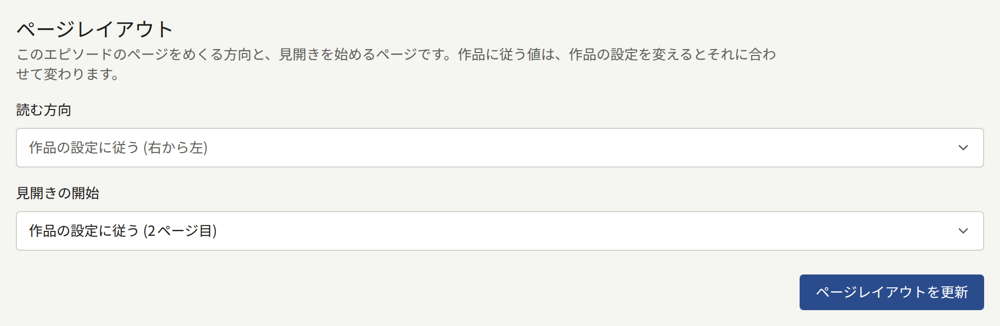

2ページを並べて表示するのは、サイトではビューアーの幅が768ピクセル以上で高さが幅以下のとき、アプリではタブレットか横向きにしたスマートフォンのときだけです。それ以外では1ページずつ表示されます。

## ページのプレビュー

エピソードの編集画面の下部にある**プレビュー**では、サイトと同じビューアーでエピソードのページを確認できます。ページは保存された順に並び、エピソードの読む方向にめくれ、レイアウトで指定したページから見開きになります。下書きや予約済みのエピソードも公開済みのエピソードと同じようにプレビューできるので、読者に公開する前にページを確認できます。

ページのめくり方は、サイトで読者が操作するときと同じです。矢印キーを使うか、ビューアーの左右の端の近くをクリックします。ビューアーの中央をクリックすると、**前のページ**と**次のページ**、ページの下に読書の進み具合を示すスライダーが表示されます。見開きのルールもサイトと同じなので、ウィンドウの幅が十分にあれば2ページが並んで表示されます。

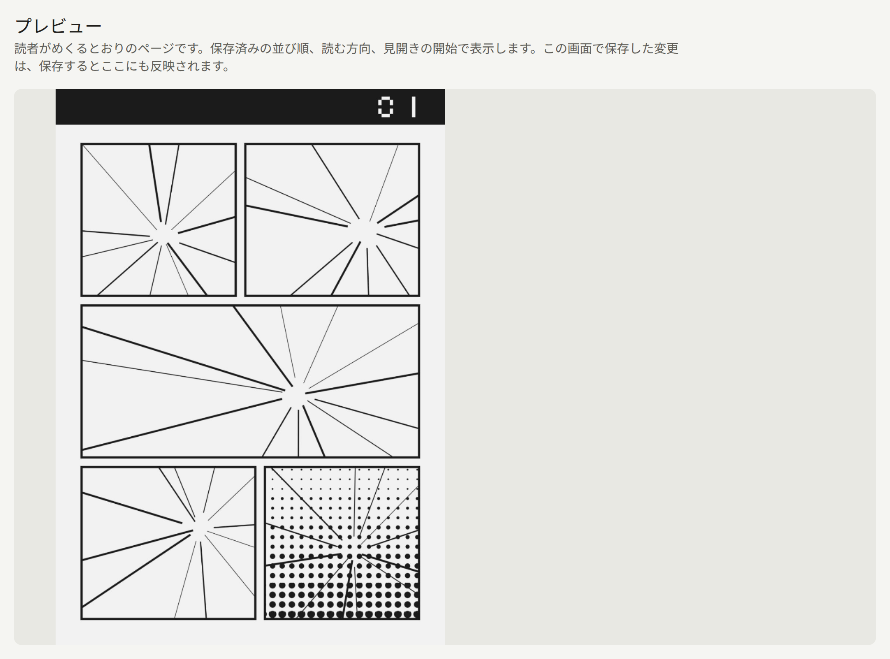

ページの追加、差し替え、削除、移動や、**ページレイアウト**の更新など、編集画面で保存した変更は、保存した時点でプレビューに反映され、プレビューは最初のページから表示し直されます。**ページレイアウト**で選んだだけでまだ保存していない値は反映されません。ページが1つもないエピソードでは、プレビューにそのことが表示されます。

エピソードを開ける人なら、エピソードを変更する権限がない人もプレビューでページをめくれます。

## アイキャッチ画像

独自のアイキャッチ画像がないエピソードは、サイトとアプリで画像を表示するすべての場所で、シリーズの[アイキャッチ画像](./1-series.md#アイキャッチ画像)を使います。そのため、新しく作成したエピソードでここを設定する必要はありません。シリーズとは違う画像を見せたいエピソードにだけ、独自のアイキャッチ画像を設定してください。エピソードとシリーズのどちらにも**リンクプレビュー (1200:630)** の画像がなければ、エピソードへのリンクを共有すると、サイトがエピソードのタイトルから作ったカードが表示されます。詳しくは[リンクのプレビュー](../3-setup/2-branding.md#リンクのプレビュー)を参照してください。

設定はエピソードの編集画面の**アイキャッチ**タブで行います。**アイキャッチ画像**で、10MB以下で2400 × 3200ピクセル以上のJPEG、PNG、WebP画像を選び、**アイキャッチを更新**を選びます。保存すると、シリーズのアイキャッチと同じ4つの比率に同じサイズで切り出され、**比率別画像**に**縦長 (3:4)**、**正方形 (1:1)**、**横長 (16:9)**、**リンクプレビュー (1200:630)** として表示されます。各枠の下の1行には、エピソードのアイキャッチでその比率の画像が使われる場所が書かれています。

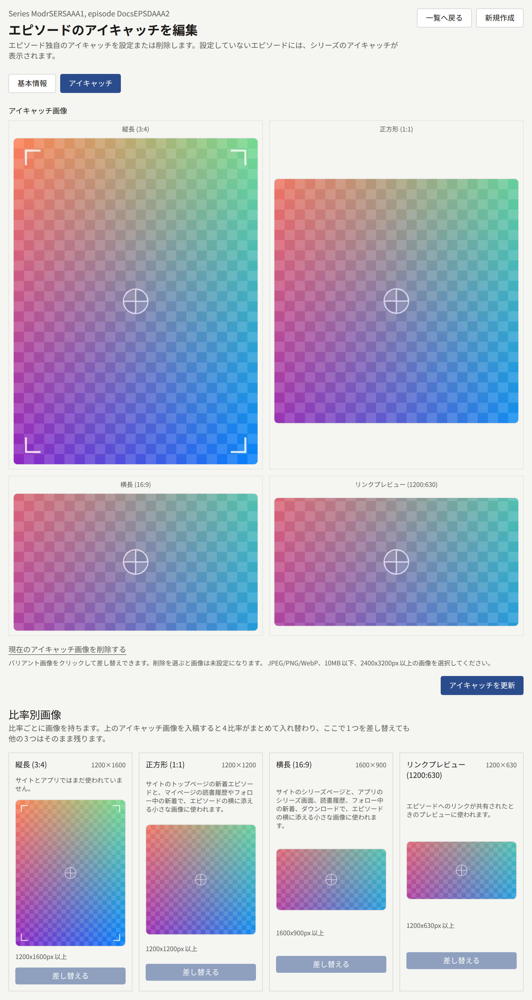

どの比率も、元の画像の中央から切り出されます。ある比率だけ切り出す範囲を変えたいときや別の画像を使いたいときは、**比率別画像**でその比率の画像をクリックし、枠に書かれたサイズ以上のJPEG、PNG、WebP画像を選びます。元と同じ画像を選んでもかまいません。続いて**枠を調整する**で表示する範囲を決め、**差し替える**で保存します。ほかの3つの画像はそのまま残ります。比率ごとの差し替えはエピソードにアイキャッチ画像があるときしかできないので、先に**アイキャッチ画像**で画像をアップロードしてください。**アイキャッチ画像**で新しい画像をアップロードすると、4つの画像がすべて差し替わります。

シリーズのアイキャッチに戻すには、**現在のアイキャッチ画像を削除する**を選んでから**アイキャッチを更新**を選びます。

## クレジット

エピソードの編集画面の**著者**には、このエピソードにクレジットされている著者が、役割と売上の取り分と一緒に表示されます。新しいエピソードはシリーズのクレジットを引き継ぎ、ここでエピソードごとに変更します。あとでシリーズのクレジットを変えても、エピソードには反映されません。ここで追加したクレジットは、このエピソードだけに参加したゲストのためのもので、**このエピソードのみ**と表示されます。**著者を保存**を選んで保存します。

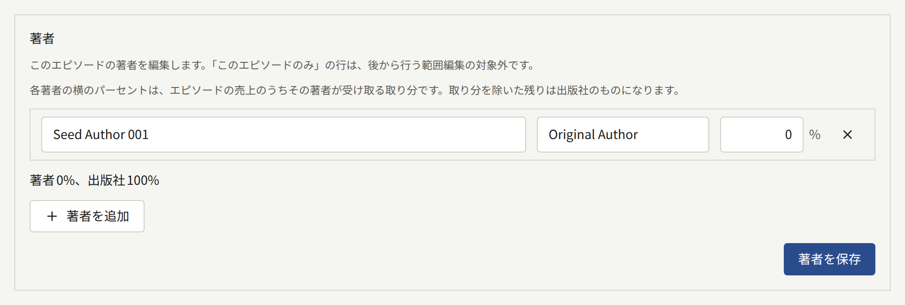

サイトのエピソードのページにはここで設定したクレジットが表示され、シリーズのページにはシリーズのクレジットが表示されます。印税の支払いも、エピソードのクレジットに基づいて計算されます。詳しくは[レポートと印税](../6-reports-and-royalties.md#著者に支払う額)を参照してください。また、読者アカウントに紐付けた著者は、自分がクレジットされたエピソードを読めます。詳しくは[著者と役割](./4-authors.md#著者と読者アカウントの紐付け)を参照してください。

12話から作画担当が加わる場合など、複数のエピソードのクレジットをまとめて変更するには、一覧でエピソードを選んで**クレジット**を選びます。**操作**では次の4つから選べます。

- **追加**を選ぶと、選んだエピソードのうち、その著者がその役割でまだクレジットされていないすべてのエピソードに、取り分なしでクレジットを追加します。
- **置き換え**を選ぶと、あるクレジットを別のクレジットに置き換えます。
- **削除**を選ぶと、クレジットを外します。
- **取り分を設定**を選ぶと、クレジットの取り分を変更します。

操作の対象にする**著者**と**役割**を選び、**エピソード**でエピソードにチェックを入れて、**適用**を選びます。**エピソード**にはシリーズのすべてのエピソードが表示され、一度に扱えるのは1000件までです。**置き換え**、**削除**、**取り分を設定**は、**このエピソードのみ**のクレジットには影響しません。実行すると、変更されたエピソードの数と、変更されなかったエピソードごとにその理由が表示されます。

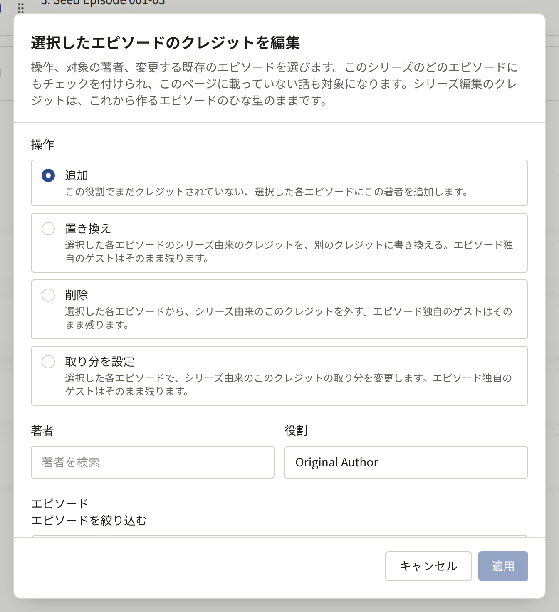

## 表示先と販売先

エピソードにはそれぞれ**表示先**と**販売先**があり、初期状態ではどちらもシリーズの設定に従います。

- **表示先**では、シリーズの表示先より狭くすることはできますが、広げることはできません。たとえば**アプリのみ**のシリーズでエピソードを**Webのみ**にすると、そのエピソードはどこにも表示されず、画面に警告が出ます。**表示先を更新**を選んで保存します。
- **販売先**には、シリーズの**販売先**に含まれない場所も指定できます。ただし、エピソードが販売されるのは、そのエピソードが表示される場所だけです。**販売先を更新**を選んで保存します。

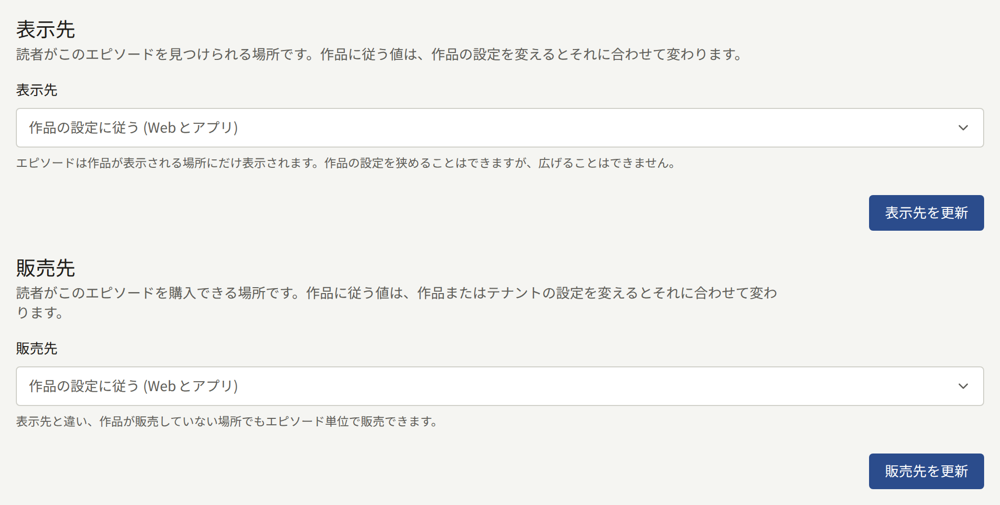

**表示先**をどこにも表示しない設定にすると、公開済みのエピソードを、公開を取り消さずにサイトから下げられます。エピソードを販売しない場所で読者に何が表示されるかは、[エピソードの販売](../4-selling-episodes.md#エピソードの販売先)で説明しています。

## 無料公開期間

無料公開期間を設定すると、その期間中は有料エピソードをログインの有無にかかわらず誰でも読めます。エピソードの価格はそのまま残り、期間が終わると再びその価格で販売されます。無料のエピソードに期間を設定しても何も変わりません。

エピソードの編集画面の**無料公開期間**には、そのエピソードの期間が**無料公開中**、**予定**、**終了**のいずれかの状態で表示されます。期間を追加するには、**開始日時**と**終了日時**をどちらもテナントのタイムゾーンで入力し、**無料公開期間を追加**を選びます。**終了日時**は、**開始日時**より後で、かつ現在より先にしてください。**開始日時**は過去でもよく、その場合はエピソードがすぐに無料になります。1つのエピソードに期間を重ねて設定することはできませんが、ある期間が終わる時刻ちょうどに次の期間を始めることはできます。

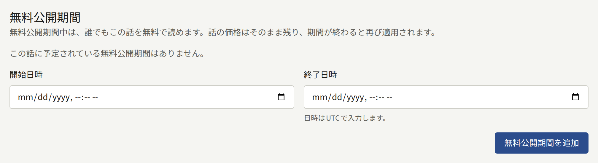

期間は編集できないので、変えるときは**削除**してから追加し直します。すでに始まっている期間を削除すると、エピソードはすぐに有料に戻ります。

**シリーズのルールによる**と表示され、終了日時のない期間は、シリーズの[公開後に無料](./1-series.md#公開後に無料)のルールで追加されたものです。このルールは、有料エピソードを公開から決まった日数が過ぎたところで無料にします。この期間には**削除**ボタンがなく、ルールを無効にするか、エピソードがルールの対象から外れるとなくなります。詳しくは[定期ジョブとメンテナンスジョブ](../../3-operations/10-scheduled-jobs.md#その他の定期ジョブ)を参照してください。

複数のエピソードに同じ期間を設定するには、エピソードの一覧で**無料公開期間**を選びます。**対象の話**では、一覧でチェックを入れたエピソードを対象にする**選択した話**、シリーズの並び順で最初から指定した数のエピソードを対象にする**最初の話から**、**すべての話**のいずれかを選びます。続いて**開始日時**と**終了日時**を入力し、**追加する**を選びます。対象のエピソードのどれか1つにでも重なる期間がすでにあると、どのエピソードにも追加されません。

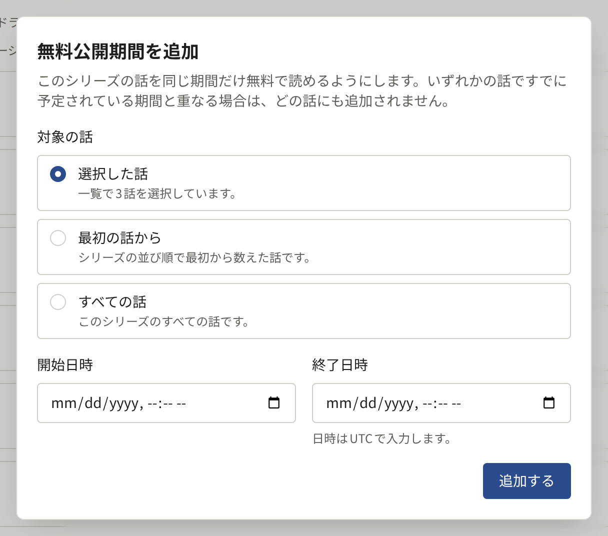

サイトでは、期間が始まった時点で無料公開が表示され、終わった時点で表示が消えます。期間の開始時と終了時に、`publira worker`がキャッシュされたページを更新するからです。詳しくは[定期ジョブとメンテナンスジョブ](../../3-operations/10-scheduled-jobs.md#無料公開期間とキャッシュ)を参照してください。

## キャンペーン価格

キャンペーン価格を設定すると、その期間中は有料エピソードを値下げして販売できます。キャンペーン中にエピソードを購入すると、サイトでも**アプリ内課金**で販売するアプリでも、キャンペーン価格が請求されます。[シリーズの残り](../4-selling-episodes.md#シリーズの残りのエピソード)をまとめて購入する場合も、そのエピソードにはキャンペーン価格が使われ、そのあとでシリーズの**まとめ買い割引**が差し引かれます。エピソードの**価格**自体は変わらず、キャンペーンが終わると再びその価格で販売されます。レンタルは**レンタル価格**のままです。キャンペーン価格で購入した分の支払額は、あとから変わりません。

エピソードの編集画面の**キャンペーン価格**には、そのエピソードのキャンペーンが価格と一緒に**セール中**、**予定**、**終了**のいずれかの状態で表示されます。キャンペーンを追加するには、**キャンペーン価格**をテナントの通貨でエピソードの**価格**より低く入力し、**開始日時**と**終了日時**をどちらもテナントのタイムゾーンで入力して、**キャンペーン価格を追加**を選びます。**終了日時**は、**開始日時**より後で、かつ現在より先にしてください。**開始日時**は過去でもよく、その場合はエピソードがすぐにセールになります。1つのエピソードにキャンペーンを重ねて設定することはできませんが、あるキャンペーンが終わる時刻ちょうどに次のキャンペーンを始めることはできます。無料のエピソードには値下げする価格がないので、このセクションに入力フォームは表示されません。

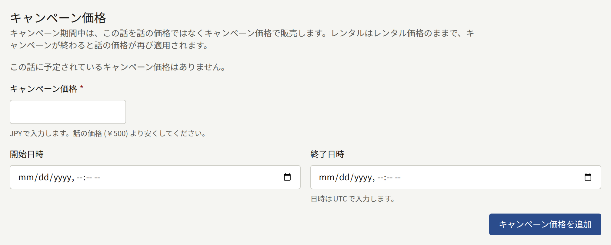

キャンペーンは編集できないので、変えるときは**削除**してから追加し直します。すでに始まっているキャンペーンを削除すると、エピソードはすぐに元の価格に戻ります。エピソードの**価格**をキャンペーン価格以下に下げると、エピソードは自身の価格で販売されるので、そのキャンペーンは効果がなくなります。

複数のエピソードを同じ価格と期間でセールにするには、エピソードの一覧でエピソードにチェックを入れて**キャンペーン価格**を選びます。**キャンペーン価格**、**開始日時**、**終了日時**を入力し、**追加する**を選びます。キャンペーン価格がチェックを入れたエピソードのどれか1つの**価格**以上だった場合や、どれか1つにでも期間が重なるキャンペーンがすでにある場合は、どのエピソードにも追加されません。

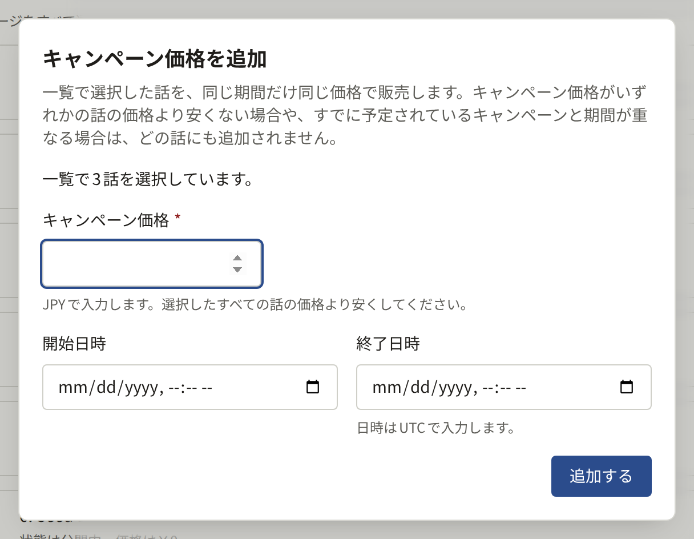

サイトでエピソードの価格を表示するすべての場所で、キャンペーン中のエピソードにはキャンペーン価格が表示されます。その横には取り消し線を付けた元の**価格**と、テナントのタイムゾーンでのキャンペーンの終了日時が並びます。価格は読者が購入手続きを始めた時点で決まります。そのため、キャンペーンが終わってから購入を始めた読者は、購入を始めたページにまだキャンペーン価格が表示されていても、エピソードの**価格**を支払います。決済ページにもその価格が表示されます。

サイトでは、キャンペーンが始まった時点でキャンペーン価格が表示され、終わった時点で表示が消えます。キャンペーンの開始時と終了時に、`publira worker`がキャッシュされたページを更新するからです。詳しくは[定期ジョブとメンテナンスジョブ](../../3-operations/10-scheduled-jobs.md#無料公開期間とキャッシュ)を参照してください。

アプリでは、シリーズのエピソード一覧、ロックされたエピソード、エピソードを読み終えたところに出る次のエピソードの案内に、キャンペーンが表示されます。表示されるのは、キャンペーン価格と、その横の取り消し線を付けたエピソードの**価格**、キャンペーンの終了日時です。アプリのほかの日時と同じく、終了日時は読者の端末のタイムゾーンで表示されます。この表示は、アプリがWebの決済で販売する場合も[**アプリ内課金**](../4-selling-episodes.md#アプリでの販売)で販売する場合も同じです。アプリ内課金では、キャンペーン価格に対応するストアの商品としてエピソードを購入するので、ストアの支払い画面でもアプリに表示された価格が請求されます。

## エピソードの公開

エピソードの状態は次の3つのいずれかです。

| 状態 | 意味 |
| --- | --- |
| **下書き** | 公開日時が設定されていません。読者には表示されません |
| **予約済み** | 公開日時がまだ先です。その日時になるまで読者には表示されません |
| **公開中** | 公開日時を過ぎています。シリーズが公開されていて、読者が使っているサイトかアプリが表示先に含まれていれば、読者はエピソードを開けます |

公開されるまで、エピソードのページは存在しないものとして扱われ、どの一覧にも表示されません。前後のエピソードにある前の話と次の話へのリンクも、このエピソードを飛ばします。

### 公開日時の設定

作成済みのエピソードの公開日時を設定したり変更したりするには、エピソードの編集画面の**公開設定**を使います。テナントのタイムゾーンで日時を入力するか欄を空にして、**公開日時を更新**を選びます。

- 過去の日時 (現在の日時など) を入力すると、下書きや予約済みのエピソードがすぐに公開されます。ただし、テナントが[公開前の審査](#公開前の審査)を必須にしている場合は除きます。予約済みのエピソードが公開日時を迎えたときと同じように、フォロワーに通知され、検索インデックスにも登録されます。公開中のエピソードは公開されたままなので、表示されている日時のまま保存しても何も変わりません。
- 未来の日時を入力すると、エピソードはその日時に公開されるよう予約されます。
- 空欄にすると、エピソードは下書きになります。

公開中のエピソードで未来の日時を入力するか欄を空にすると、エピソードはサイトから取り下げられます。詳しくは[エピソードの取り下げ](#エピソードの取り下げ)を参照してください。

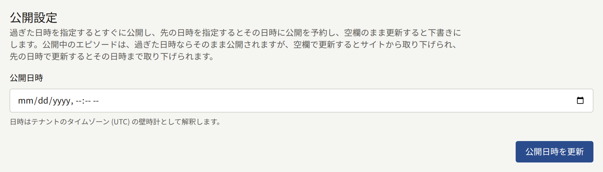

公開中のシリーズに新しいエピソードを公開するときは、通常次の手順で進めます。

1. **公開日時**を空欄にして、下書きとしてエピソードを作成します。
2. ページを追加してレイアウトを設定し、どちらも[プレビュー](#ページのプレビュー)で確認します。
3. **公開設定**で、すぐに公開するなら現在の日時を、予約するなら公開したい日時を入力して保存します。

### 予約したエピソードが公開されるタイミング

予約したエピソードを公開するのは`publira worker`で、公開日時を過ぎたエピソードを1分ごとに探します。見つかったエピソードは次のように扱われます。

- サイトのエピソードのページとシリーズのエピソード一覧、アプリで開けるようになります。
- エピソード、シリーズ、クレジットされた著者のどれかをフォローしているすべての読者に通知されます。エピソードを表示するサイトとアプリのそれぞれで、通知とプッシュ通知が届きます。サイトに表示するエピソードであれば、メールでも通知されます。このうちどれを受け取るかは、読者ごとの通知設定で決まります。
- 検索インデックスに登録されます。

たとえば12:00に予約したエピソードは、12:01ごろには読めるようになります。同じタイミングで、**更新順**に並べたシリーズの一覧など、サイトの一覧にも表示されます。

公開日時を大きく過ぎても**予約済み**のままなら、ワーカーが動いていないか、公開処理に失敗しています。このときテナント管理者には「エピソードの公開に失敗しました」という通知が届きます。原因の対処はオペレーターが行います。詳しくは[定期ジョブとメンテナンスジョブ](../../3-operations/10-scheduled-jobs.md#予約公開)を参照してください。問題が解決すれば、エピソードは自動で公開されます。解決を待たずに公開したい場合は、**公開設定**で現在の日時を入力して保存します。

シリーズが非公開の間に公開日時を迎えたエピソードは、シリーズの公開を待ちます。通知から開いたページが見つからない、ということが起きないようにするためです。エピソードが通知されるのはシリーズが公開されたときで、**シリーズを更新**で公開しても、シリーズの**公開日時**を迎えて公開されても同じです。それまでは誰もエピソードを開けなかったので、以降はシリーズが公開された日時がエピソードの公開日として表示されます。以前シリーズが公開されていた間にフォロワーへ通知済みのエピソードは、日付がそのままで、改めて通知されることもありません。

**表示先なし**の状態で公開日時を迎えたエピソードは誰にも通知されず、あとで表示先を設定しても通知されません。サイトとアプリの一方にだけ表示するエピソードは、その一方でだけ通知されます。読者の通知一覧に通知が出るのはその一方だけで、プッシュ通知もブラウザーかスマートフォンのどちらかにしか届きません。どこに通知するかは`publira worker`が通知を送る時点で決まり、そのあとで**表示先**を変えても、送信済みの通知は変わりません。エピソードの表示先は、公開日時より前に設定しておいてください。

### 公開前の審査

テナントは、エピソードを公開する前にテナント管理者の承認を必須にできます。編集担当が予約したエピソードを、公開前に別の人が確認できるようにするためです。テナント管理者が[**設定**](../3-setup/1-settings.md#公開前の審査)で**公開前の審査を必須にする**をオンにするまでは審査は無効で、無効のあいだは上で説明したとおり、エピソードは公開日時だけで公開されます。

審査が必須のときは、次のように扱われます。

- **公開日時を保存すると審査に提出されます。** エピソードの作成時や**公開設定**で公開日時を保存すると、エピソードは**予約済み**になり、そのまま予約されるのではなく審査待ちになります。過去の日時を保存した場合もすぐには公開されず、ほかのエピソードと同じく判断を待ちます。審査が必須のあいだは、**公開設定**の入力欄の上にもそう表示されます。
- **テナント管理者が承認するか差し戻します。** エピソードの編集画面では、**公開設定**の下に**審査**セクションがあります。審査中のエピソードでは、テナント管理者にはそこに**コメント**の入力欄と**承認**、**差し戻す**が表示されます。承認されたエピソードは、ほかの予約済みのエピソードと同じく公開日時に`publira worker`が公開します。公開日時をすでに過ぎていれば、承認した時点で公開されます。承認するときのコメントは省略できますが、差し戻すときは直すべき点をコメントに書く必要があります。
- **差し戻されたエピソードは公開日時を保ったまま公開されません。** 審査に提出したスタッフには、管理画面に「エピソードが差し戻されました」という通知が届き、コメントを引用したメールも届きます。直したら、**公開設定**の**審査に提出**でもう一度提出します。公開日時は変わりません。別の公開日時を保存しても提出されます。
- **審査の各回が残ります。** **審査**セクションには、そのエピソードの審査の各回が古い順に並びます。誰がいつ提出したか、誰がいつ承認または差し戻したか、そのときのコメントが表示されます。セクションの見出しの横には、現在の状態が**審査中**、**差し戻し**、**承認済み**のいずれかで表示されます。このセクションはどのスタッフも読めます。監査担当には操作できるものは表示されず、編集担当には**承認**と**差し戻す**は表示されません。
- **承認後に変更すると審査に戻ります。** 承認されたエピソードのページ、タイトル、価格、レイアウト、アイキャッチ画像、クレジット、**表示先**と**販売先**を変更したり、別の公開日時を設定したりすると、もう一度承認が必要になります。承認された内容と、公開される内容が変わってしまうためです。公開中のエピソードは改めて審査されません。
- **審査待ちは失敗ではありません。** 審査待ちのエピソードは公開日時を過ぎても**予約済み**のままで、公開に失敗したという通知は誰にも届きません。
- **下書きは審査の対象になりません。** **公開設定**で公開日時を空にすると、予約と一緒に審査からも外れます。

審査を有効にすると、予約済みのエピソードがすべて審査に提出されます。以前に審査が有効だったときに承認されたものも含まれるので、テナント管理者が承認するまでどのエピソードも公開されません。審査を無効にすると、審査待ちや差し戻し、承認済みのどれであっても、予約済みのエピソードはすべて公開日時に公開されます。審査が無効のあいだは、編集画面に**審査**セクションも**審査に提出**も表示されず、エピソードの一覧に**審査中**や**差し戻し**も付きません。

審査への提出と承認、差し戻しは、どれも**監査ログ**に記録されます。

### 公開予定の確認

サイドバーの**作品**グループにある**カレンダー**には、テナントの全シリーズの公開予定が1か月単位で表示されます。各日には、その日に公開される予定のエピソードや、その日に公開されたエピソードが、シリーズのタイトル、エピソードのタイトル、状態 (**予約済み**か**公開中**) と一緒に並びます。エピソードを選ぶと、その編集画面が開きます。日付はテナントのタイムゾーンで区切られ、どのタイムゾーンかは画面に表示されます。たとえばテナントのタイムゾーンで23:30に予約したエピソードは、カレンダーを見ている人がどこにいても、その日の欄に表示されます。下書きには公開日時がないので、カレンダーには表示されません。

カレンダーを開くと当月が表示され、今日の日付に印が付いています。**前の月**と**次の月**で1か月ずつ移動し、**今月**で当月に戻ります。ダッシュボードの**公開キュー**の横にある**カレンダーを開く**からも開けます。カレンダーはスタッフ全員が開けますが、ここから変更できることはありません。公開日時を変えるには、各エピソードの**公開設定**を使います。

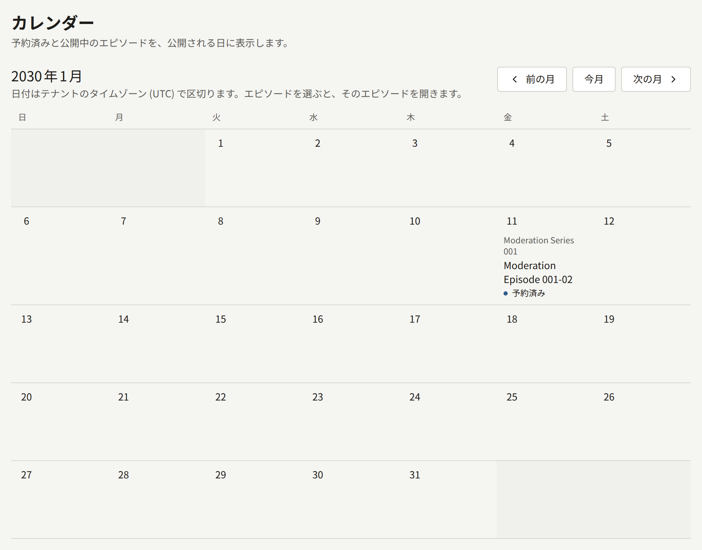

### エピソードの取り下げ

販売済みのエピソードや、残す必要のある記録が参照しているエピソードは、[エピソードの削除](#エピソードの削除)で説明するとおり削除できません。公開中のエピソードをサイトから取り下げるには、代わりに次のどれかを行います。

- **公開設定**で欄を空にして保存します。エピソードは**下書き**に戻ります。
- **公開設定**で未来の日時を入力して保存します。エピソードはその日時までサイトから取り下げられ、その日時に再び公開されます。フォロワーに改めて通知されることはありません。
- **表示先**をどこにも表示しない設定にします。エピソードは公開中のままで、設定を戻せばすぐにまた表示されます。

どの方法でも、エピソードを購入した読者は、エピソードが再び表示されるまで読めなくなります。

### エピソードの削除

テナント管理者は、エピソードの編集画面にある**基本情報**タブの最後で、**このエピソードを削除**からエピソードを削除できます。編集担当と監査担当には表示されません。ダイアログではエピソードのタイトルの入力を求められ、タイトルを正確に入力するまで**エピソードを削除**は押せません。押すと、エピソードはページ、アイキャッチ画像、翻訳、クレジット、無料公開期間、キャンペーン価格、審査の履歴と一緒に削除されます。読者が残したコメントとその通報、フォロー、リアクション、読書履歴も削除されます。少し後に、エピソードとそのコメント、審査についての通知も、読者とスタッフの両方の通知から削除されます。エピソードはサイトとアプリ、検索インデックスからすぐに消え、管理画面はシリーズのエピソード一覧に戻ります。削除は取り消せません。**監査ログ**には、エピソードのタイトルとともに記録されます。

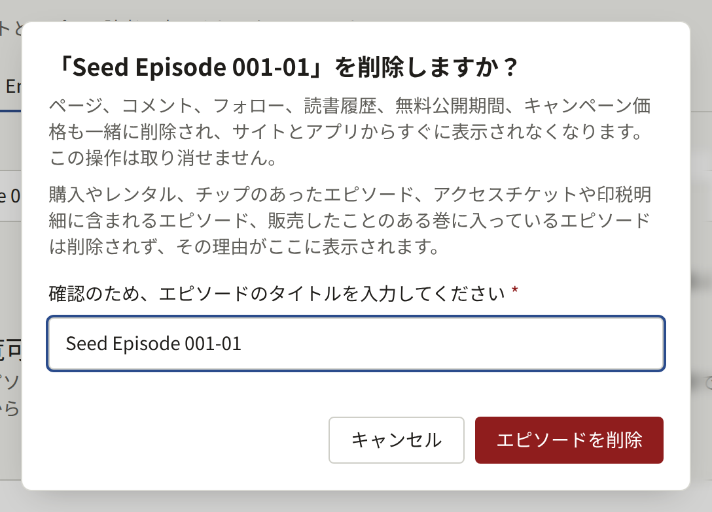

次のどれかがエピソードを参照している間は、エピソードは削除されず、ダイアログにその理由が表示されます。

- 購入やレンタル、チップ。読者が支払ったものもスタッフが付与したものも含みます。App StoreやGoogle Playでの購入、コインでの購入、エピソードを含む巻やまとめ買いでの購入も同じです。**このエピソードの購入を表示**で、このエピソードに絞り込んだ**購入**が開きます。
- まだ完了する可能性のある、このエピソードの支払い。
- アクセスチケット。取り消し済みや期限切れのチケットも含みます。**このエピソードのアクセスチケットを表示**で、このエピソードに絞り込んだ**アクセスチケット**が開きます。
- このエピソードを含む印税明細。
- 読者が使った、このエピソードのプロモーションコード。
- このエピソードが入っていて、販売したことのある巻。今も販売しているかどうかは問いません。

これらはどれもお金か、読者に与えた権利の記録です。そのため、記録もエピソードも削除されません。代わりにエピソードをサイトから取り下げてください。一度も販売していない巻と、誰も使っていないこのエピソードのプロモーションコードからは、エピソードを削除するとそのエピソードが外れるだけです。
