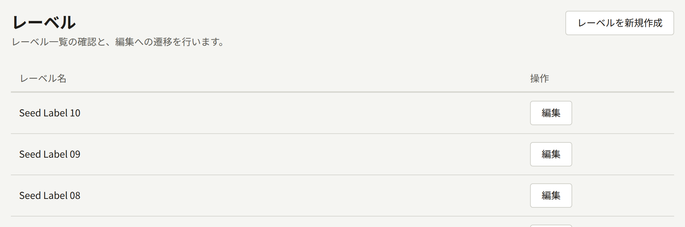
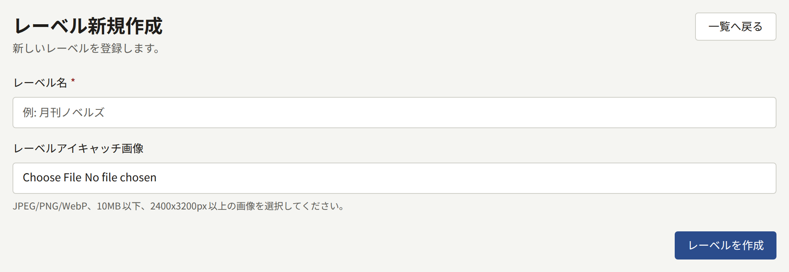
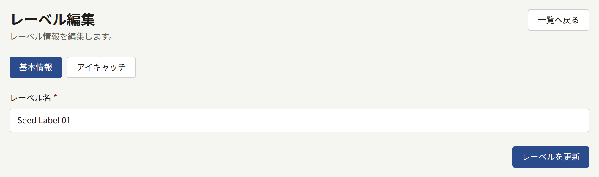

レーベルは、出版社が作品のまとまりに付ける名前で、雑誌や叢書などにあたります。どのシリーズもちょうど1つのレーベルに属します。そのため、レーベルが存在するまでシリーズは保存できません。レーベルが1つしかない出版社は、レーベルを1つ作成し、すべてのシリーズをそこに入れます。

サイドバーの**作品**グループにある**レーベル**には、レーベルが新しい順に、1ページに20件ずつ表示されます。

## レーベルの作成

**レーベルを新規作成**を選び、**レーベル名**を入力して、**レーベルを作成**を選びます。**レーベルアイキャッチ画像**（10MB以下、2400 × 3200ピクセル以上のJPEG、PNG、WebP画像）は任意で、あとから追加できます。

レーベルのページには2つのタブがあります。**基本情報**では名前を変更し、**レーベルを更新**で保存します。**アイキャッチ**では画像を差し替えたり削除したりし、画像から切り出される4つの形を調整します。シリーズについて[アイキャッチ画像](./1-series.md#アイキャッチ画像)で説明しているのと同じです。

2つのレーベルに同じ名前を付けることができ、レーベルは削除できません。作成する前に一覧を確認してください。

## サイトでの表示

- サイトのヘッダーにある**レーベル**には、すべてのレーベルが、公開中のシリーズの数とともに表示されます。
- 各レーベルには、名前、横長のバナーとしてのアイキャッチ画像、公開中のシリーズをタイトル順に並べたページがあります。
- シリーズのページにはレーベル名が表示され、そのレーベルにリンクしています。
- トップページの**注目のレーベル**には、公開中のシリーズがあるレーベルのうち、最も新しく作成された6つが、すべてのレーベルへのリンクとともに表示されます。

レーベルは、作成した時点から、そこに属するシリーズが公開される前でも、**レーベル**に表示され、ページも表示され、「公開中シリーズ0件」と示されます。**注目のレーベル**に表示されるのは、シリーズの1つが公開されてからなので、それまでに名前とアイキャッチ画像を設定しておいてください。

公開中のシリーズがすべて**表示先**によってある場所から外されているレーベルは、その場所では一覧に表示されません。
