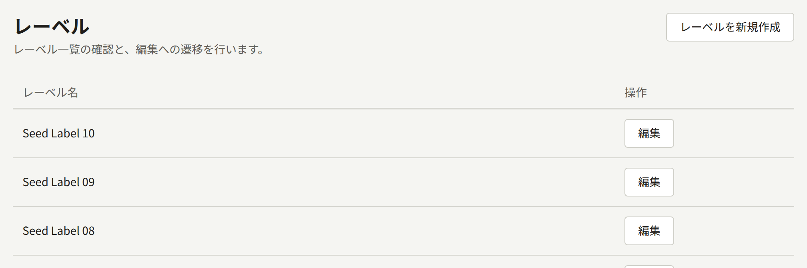
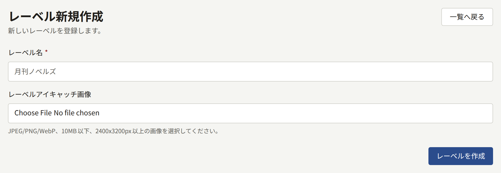
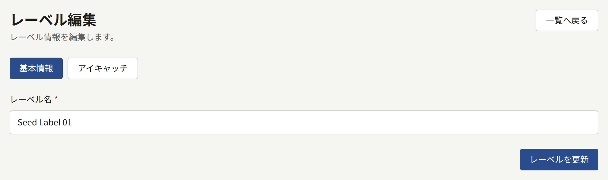
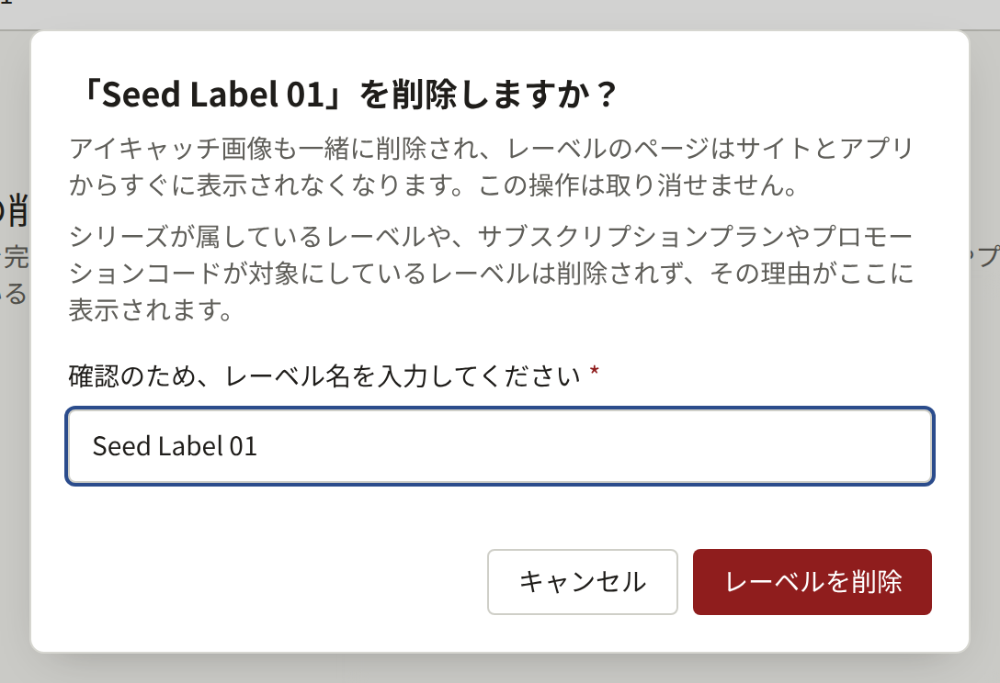

レーベルは、雑誌や叢書のように、出版社が作品のまとまりに付ける名前です。どのシリーズも必ず1つのレーベルに属するので、レーベルを作成するまではシリーズを保存できません。レーベルが1つしかない出版社は、レーベルを1つだけ作成し、すべてのシリーズをそこに入れます。

サイドバーの**作品**グループにある**レーベル**を開くと、レーベルが新しい順に1ページ20件ずつ表示されます。

## レーベルの作成

**レーベルを新規作成**を選び、**レーベル名**を入力して**レーベルを作成**を選びます。**レーベルアイキャッチ画像**は省略でき、あとから追加することもできます。画像は10MB以下で2400 × 3200ピクセル以上のJPEG、PNG、WebP画像にしてください。

レーベルの画面には2つのタブがあります。**基本情報**タブでは名前を変更し、**レーベルを更新**で保存します。**アイキャッチ**タブでは、画像を差し替えたり削除したり、画像から切り出される4つの比率の画像を調整したりできます。操作はシリーズと同じで、[アイキャッチ画像](./1-series.md#アイキャッチ画像)で説明しています。

同じ名前のレーベルを複数作成できてしまうので、作成する前に、同じレーベルがないか一覧で確認してください。誤って作成したレーベルは、何からも参照されていなければ、[レーベルの削除](#レーベルの削除)で説明するとおり削除できます。

## サイトでの表示

- サイトのヘッダーにある**レーベル**を開くと、すべてのレーベルが、公開中のシリーズの数と一緒に表示されます。
- レーベルごとにページがあり、レーベル名、横長のバナーとして表示されるアイキャッチ画像、タイトル順に並んだ公開中のシリーズが表示されます。
- シリーズのページにはレーベル名が表示され、レーベルのページへのリンクになっています。
- トップページの**注目のレーベル**には、公開中のシリーズがあるレーベルのうち、作成日が新しいものから6つが表示されます。すべてのレーベルを見るためのリンクもあります。

レーベルは、属するシリーズがまだ1つも公開されていなくても、作成した時点で**レーベル**の一覧に表示され、ページも開けるようになります。その間、ページには「公開中シリーズ0件」と表示されます。**注目のレーベル**に表示されるのは属するシリーズが1つ公開されてからなので、それまでに名前とアイキャッチ画像を設定しておいてください。

公開中のシリーズがどれも**表示先**の設定でサイトかアプリの一方から外れているレーベルは、その一方では一覧に表示されません。

## レーベルの削除

テナント管理者は、レーベルの画面にある**基本情報**タブの最後で、**このレーベルを削除**からレーベルを削除できます。編集担当と監査担当には表示されません。ダイアログではレーベル名の入力を求められ、正確に入力するまで**レーベルを削除**は押せません。押すと、レーベルはアイキャッチ画像と一緒に削除されます。レーベルのページはサイトとアプリ、検索インデックスからすぐに消え、管理画面は**レーベル**の一覧に戻ります。削除は取り消せません。**監査ログ**には、レーベル名とともに記録されます。

レーベルを削除できるのは、何からも参照されていないときだけです。次のどれかがある間は、レーベルは削除されず、ダイアログにその理由と、それがある画面へのリンクが表示されます。

- このレーベルに属するシリーズ。状態は問いません。シリーズの**基本情報**タブの**レーベル**で1つずつ別のレーベルに移すか、[シリーズの削除](./1-series.md#シリーズの削除)で説明するとおりシリーズを削除してください。**このレーベルのシリーズを表示**で、このレーベルで絞り込んだ**シリーズ**の一覧が開きます。
- **読める範囲**にこのレーベルを含むサブスクリプションプラン。[プランの変更、非公開、削除](../5-subscription-plans.md#プランの変更非公開削除)で説明するとおり、プランの読める範囲からレーベルを外してください。**サブスクリプションプランを表示**で、**サブスクリプションプラン**が開きます。
- 削除していないか、読者が使った、このレーベルのプロモーションコード。[コードの確認、一時停止、削除](../4-selling-episodes.md#コードの確認一時停止削除)で説明するとおり、誰も使っていないコードを削除してください。読者が使ったコードがあると、レーベルは削除できません。**プロモーションコードを表示**で、**プロモーションコード**が開きます。

ダイアログは、この順で最初に当てはまるものを表示します。そのため、複数に当てはまるレーベルは、1つを解消すると次の理由で再び削除できないと表示されます。
