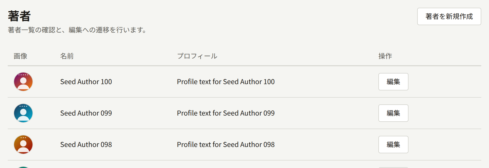
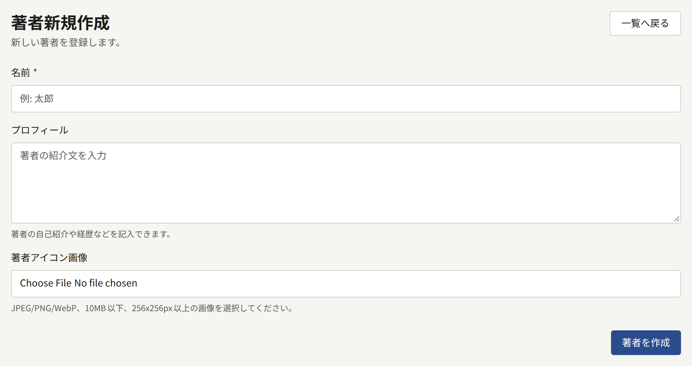
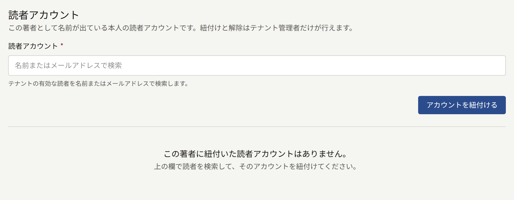
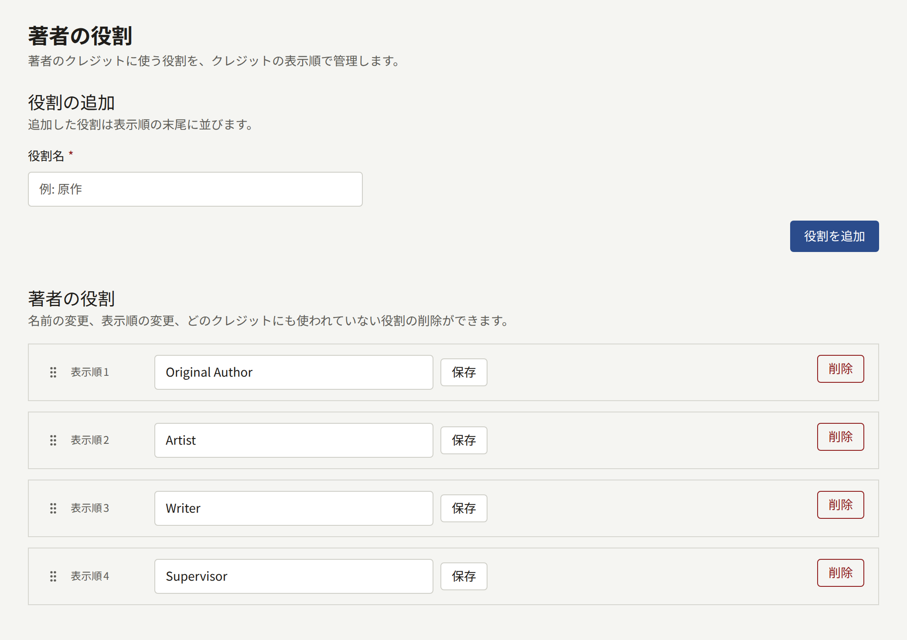
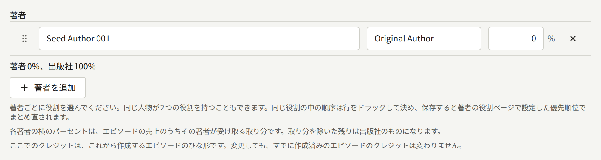

著者は、作品にクレジットされる人です。原作者、作画担当、翻案作品の原作者などがこれにあたります。シリーズとその各エピソードには、著者を著者の役割と一緒にクレジットします。読者はタイトルの横でこのクレジットを目にし、印税もこのクレジットに基づいて支払われます。

## 著者

サイドバーの**作品**グループにある**著者**を開くと、テナントの著者が新しい順に1ページ20件ずつ表示されます。**著者を新規作成**を選び、次の項目を入力します。

- **名前**は、読者に表示される名前です。ペンネームで活動している人なら、ペンネームを入力します。
- **プロフィール**には、必要に応じて経歴を入力します。改行も含め、入力したとおりに著者のページに表示されます。
- **著者アイコン画像**は省略できます。10MB以下で256 × 256ピクセル以上のJPEG、PNG、WebP画像を指定し、**枠を調整する**で画像から切り出す正方形の範囲を選びます。

**著者を作成**を選んで保存します。あとで著者の情報を変えるときも同じフォームを使い、**著者を更新**で保存します。著者は削除できず、同じ名前の著者を複数登録できてしまうので、作成する前に一覧で確認してください。

2つのペンネームで活動している人は、2人の著者として登録します。

### サイトでの表示

- 公開中のシリーズが1つ以上ある著者には、著者のページがあります。ページには、アイコン、名前、プロフィールと、その著者がクレジットされたシリーズがタイトル順に表示されます。読者はこのページで著者をフォローでき、その著者がクレジットされた新しいエピソードが出るたびに通知を受け取ります。
- サイトの著者一覧と、トップページの**注目の著者**には、こうした著者が名前順に表示されます。
- 公開中のシリーズがない著者には、ページがありません。

シリーズやエピソードのページに表示されるクレジットはただのテキストで、著者のページへのリンクにはなっていません。

### 著者と読者アカウントの紐付け

テナント管理者は、著者の画面の**読者アカウント**で、その著者がサイトのどの読者と同一人物かを記録できます。編集担当と監査担当には、このセクションは表示されません。

**読者アカウント**で読者を名前かメールアドレスで検索し、**アカウントを紐付ける**を選びます。紐付けられるのは、メールアドレスを確認済みのアカウントをサイトですでに持っている読者だけです。スタッフのアカウントは紐付けられません。1つのアカウントを複数の著者に紐付けることも、1人の著者に複数のアカウントを紐付けることもできます。

紐付けた読者は、次のように扱われます。

- エピソード自体のクレジットにその著者が含まれていれば、そのエピソードを購入せずに読めます。エピソードには、著者なので読めることが表示されます。シリーズにだけクレジットされていても、エピソードは読めるようになりません。シリーズの年齢制限は紐付けた読者にも適用されます。
- それらのエピソードでは購入を勧める表示が出ず、評価もできません。
- それらのエピソードにその読者が書いたコメントには**著者**バッジが付き、名前が著者のページへのリンクになります。

テナントが著者ページを有効にするまで、紐付けた読者に著者のことがこれ以上表示されることはありません。有効にすると、読者は紐付けられた著者ごとに次の内容を読めます。

- その著者をいまフォローしている読者の数。
- その著者がクレジットされ、サイトで公開されている各エピソードの、直近28日間の会員閲覧数と完読数。数え方は**アナリティクス**の**エピソード**と同じです。完読率もそちらと同じく、この2つから求めます。
- テナントが著者に売上も表示している場合は、それらのエピソードの同じ28日間の販売数と返金を除いた売上、そして締め済みの印税明細のうちその著者の分。詳しくは[レポートと印税](../6-reports-and-royalties.md#紐付けた著者が読める明細)で説明します。

読者が読めるのは紐付けられた著者の分だけです。同じエピソードに並んでクレジットされている著者であっても、ほかの著者の数値や明細の行は読めません。スタッフのアカウントは、スタッフになる前に紐付けられていたとしても、どの著者の分も読めません。

**解除**を選ぶと紐付けがなくなりますが、読者のアカウントはそのまま残ります。紐付けと解除は、どちらも監査ログに記録されます。

## 著者の役割

著者の役割は、著者をどの立場でクレジットするかを表します。どのクレジットにも役割が1つ付き、同じ著者を1つのシリーズに2つの役割でクレジットすることもできます。

新しいテナントには、**Original Author**、**Artist**、**Writer**、**Supervisor**の4つの役割があります。名前は英語のまま保存されていて、読者にもそのまま表示されるので、サイトが英語以外の言語なら名前を変更してください。

**著者の役割**には、役割が表示順に並んでいます。この画面では次の操作ができます。

- 役割を追加するには、**役割の追加**で**役割名**を入力して**役割を追加**を選びます。名前は50文字までで、大文字と小文字の違いを無視して、ほかの役割と重複しないものにします。追加した役割は表示順の最後に並びます。
- 役割の名前は一覧の中で書き換え、**保存**で保存できます。その役割を使っているすべてのクレジットに新しい名前が表示されます。
- 表示順を変えるには、役割のハンドルをドラッグします。
- **削除**では、どのクレジットにも使われていない役割を削除できます。使われている役割は削除できず、使っているクレジットの数が画面に表示されます。先にそれらのクレジットを別の役割に変更してください。

役割が1つもないと、誰もクレジットできません。

## 著者のクレジット

クレジットは、シリーズのフォームと各エピソードの編集画面の**著者**で入力します。1行ごとに**著者**と**役割**、取り分を指定します。取り分は、売上のうちその著者に印税として支払う割合です。割り当てなかった残りは出版社の取り分です。取り分の合計は100%を超えられません。

保存すると、行は役割ごとにまとめられ、役割の表示順に並びます。同じ役割の中での著者の順番は、行をドラッグして決めます。

サイトでもクレジットは同じ並びで、「Original Author Name1, Name2 / Artist Name3」のように役割ごとに著者が続きます。シリーズのページにはシリーズのクレジットが、エピソードのページにはエピソード自体のクレジットが表示されます。

シリーズのクレジットは、新しいエピソードのひな形になります。エピソードは作成時にシリーズのクレジットのコピーを受け取り、その後シリーズのクレジットが変わってもコピーは変わりません。エピソードごとのクレジットの変更や、複数のエピソードでのまとめての変更は[クレジット](./2-episodes.md#クレジット)で、取り分から印税を計算する方法は[レポートと印税](../6-reports-and-royalties.md#著者に支払う額)で説明しています。
