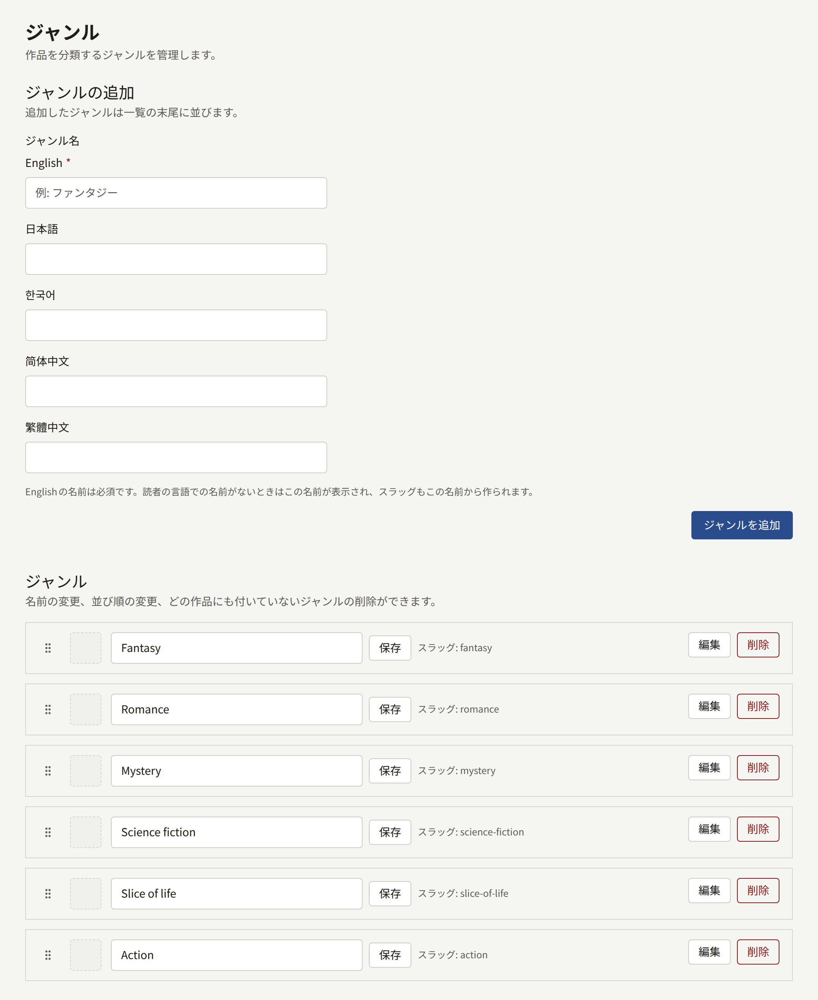
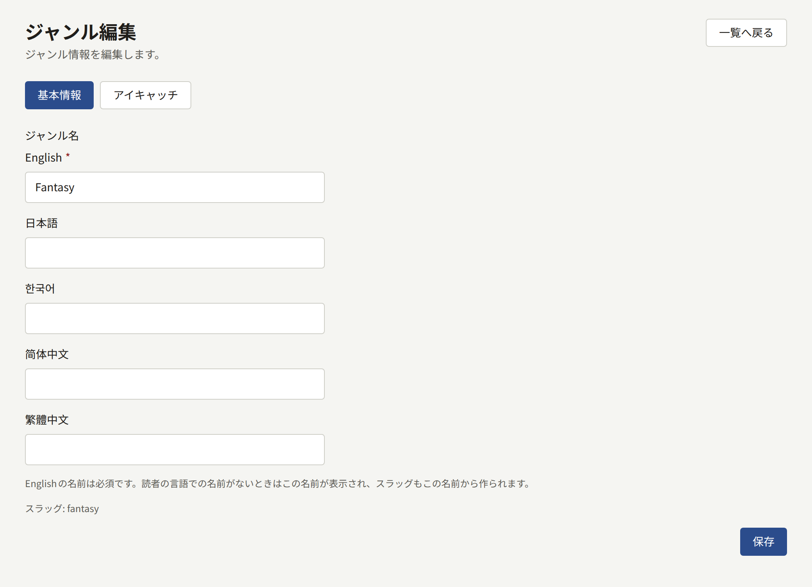

ジャンルは、テナントがシリーズを分類する区分で、ファンタジーや恋愛などがあたります。シリーズはいくつのジャンルにでも属すことができ、ジャンルはシリーズのフォームで選びます。読者はジャンルで作品を探します。ジャンルはテナント独自のものです。あらかじめ用意されたものはなく、階層のない1つの一覧になっています。

サイドバーの**作品**グループにある**ジャンル**には、一覧全体が1ページに表示されます。

## ジャンルの管理

- **ジャンルの追加**で、**ジャンル名**を入力して**ジャンルを追加**を選ぶと、ジャンルを追加できます。**ジャンル名**には、[各言語でのジャンル名](#各言語でのジャンル名)で説明するとおり、サイトが提供する言語ごとに欄があります。名前は50文字までで、デフォルトの言語での名前は一意でなければなりません。新しいジャンルは一覧の最後に加わります。
- 各ジャンルのデフォルトの言語での名前はその場で変更し、**保存**で保存できます。
- ジャンルをハンドルでドラッグすると、位置を変えられます。この順序は、サイトでジャンルが並ぶ順序であり、シリーズのジャンルが表示される順序でもあります。
- **編集**でジャンルのページを開きます。その**基本情報**タブには、サイトが提供するすべての言語でのジャンル名があります。**アイキャッチ**タブでは、シリーズについて[アイキャッチ画像](./1-series.md#アイキャッチ画像)で説明しているのと同じように、ジャンルに画像を付けます。
- **削除**は、どのシリーズも属していないジャンルを削除します。使われているジャンルは削除できません。先にすべてのシリーズからそのジャンルを外してください。

## 各言語でのジャンル名

ジャンルには、サイトが提供する言語ごとに名前を付けられます。提供する言語は、テナント管理者が[**設定**](../3-setup/1-settings.md#言語)で選びます。**ジャンルの追加**とジャンルの**基本情報**タブにある**ジャンル名**には、それらの言語ごとに欄があります。各欄のラベルはその言語自身で書いた言語名で、サイトのデフォルトの言語が最初です。

- デフォルトの言語での名前は必須です。ジャンルに名前がない言語の読者には、この名前が表示されます。
- 名前とともに表示されるジャンルのスラッグは、デフォルトの言語での名前から作られます。2つのジャンルが同じような名前にならないようにしているのはこのスラッグです。大文字と小文字や空白だけが異なる名前は同じスラッグになるので、2つ目は受け付けられません。
- サイトでのジャンルのアドレスはスラッグではなく公開IDです。そのため、ジャンル名を変更してもアドレスは変わらず、どの言語でも同じです。
- ほかの言語での名前は任意です。欄に入力すると、その言語での名前が追加されます。ジャンルの**基本情報**タブで欄を空にして**保存**を選ぶと、その名前は削除されます。
- サイトが提供していない言語には欄がありません。その言語ですでに保存されている名前は保持され、その言語が再び提供されると欄も戻ります。

## サイトでの表示

- トップページの**ジャンルから探す**には、すべてのジャンルが一覧の順に、公開中のシリーズの数とともに表示されます。テナントにジャンルがない間、このセクションは表示されません。
- サイトのヘッダーにある**ジャンル**には、すべてのジャンルがタイルで表示されます。タイルにはジャンルのアイキャッチ画像、なければそのジャンルのいくつかのシリーズのアイキャッチが表示されます。
- 各ジャンルには、そのジャンルで今週人気のものと、そのジャンルのシリーズを示すページがあります。シリーズは、読者が状態などの条件で絞り込めます。
- シリーズのページは、そのシリーズの各ジャンルにリンクしています。
