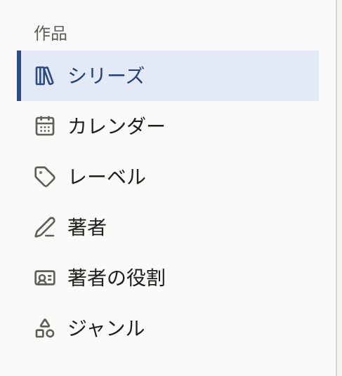

読者がサイトで開けるものはすべてシリーズのエピソードで、シリーズはレーベルに属し、著者をクレジットします。サイドバーの**作品**グループには、これらを作成する画面と、それらが公開される日のカレンダーがあります。

| 画面 | 扱うもの |
| --- | --- |
| **シリーズ** | 作品とそのエピソード |
| **カレンダー** | 予約済みと公開済みのすべてのエピソードを、公開される日に表示 |
| **レーベル** | シリーズが刊行されるレーベル |
| **著者** | シリーズとエピソードにクレジットされる人 |
| **著者の役割** | **Original Author**や**Artist**など、著者がどの立場でクレジットされるか |
| **ジャンル** | 読者が作品を探すときの分類 |

テナント管理者と編集担当は、これらの画面のすべてを作成・変更できます。ただし、著者に紐付けられた**読者アカウント**を表示・変更できるのはテナント管理者だけです。監査担当はどの画面も開けますが、フォームは読み取り専用で、何かを作成するボタンは表示されません。作品の中で削除できるのは、エピソードのページと、何にも使われていない著者の役割とジャンルだけです。そのため、もう読まれるべきでないシリーズやエピソードは、削除するのではなくサイトから取り下げます。

## 空の作品一覧から最初のエピソードまで

以下の順序は、管理画面が必要とする順序です。シリーズはレーベルがないと保存できず、著者はすでに存在する著者の一覧からクレジットし、エピソードはシリーズに属します。最初のエピソードを準備している間はシリーズを非公開にしておき、最後の手順で両方を読者に公開します。

1. **レーベルを作成します。** **レーベル**で**レーベルを新規作成**を選び、**レーベル名**を入力して**レーベルを作成**を選びます。レーベルが1つしかない出版社は、このレーベルを1つだけ作成し、以降のシリーズもすべてこのレーベルに入れます。シリーズごとにレーベルを作るのではありません。[レーベル](./3-labels.md)を参照してください。
2. **著者を作成します。** **著者**で、クレジットする人ごとに**著者を新規作成**を選び、**名前**と、あれば**プロフィール**と**著者アイコン画像**を入力します。[著者と著者の役割](./4-authors.md)を参照してください。
3. **著者の役割を確認します。** 新しいテナントには、**Original Author**、**Artist**、**Writer**、**Supervisor**の4つが英語で用意されています。読者には各名前の横に役割が表示されるので、サイトがほかの言語の場合は**著者の役割**で名前を変更します。
4. サイトにジャンルを設ける場合は、**ジャンル**で、読者が作品を探すときに使う**ジャンルを作成します**。シリーズはジャンルなしで保存でき、ジャンルはあとから設定できます。[ジャンル](./5-genres.md)を参照してください。
5. **シリーズを作成します。** **シリーズ**で**シリーズを新規作成**を選びます。**タイトル**、**概要**、**レーベル**を入力し、**著者**で著者をクレジットし、**アイキャッチ画像**を選びます。**公開日時**は空のままにして、作業中はシリーズを非公開にしておきます。**シリーズを作成**を選びます。[シリーズ](./1-series.md)を参照してください。
6. **最初のエピソードを作成します。** **シリーズ**の一覧で、そのシリーズの行の**エピソード**を選び、続けて**新規作成**を選びます。**タイトル**と**価格**を入力し、**公開日時**に現在時刻を設定すると、エピソードは作成と同時に公開されます。ただし、シリーズがまだ非公開なので、この時点ではまだ読めません。**エピソードを作成**を選びます。[エピソード](./2-episodes.md)を参照してください。
7. **ページを追加します。** エピソードの編集画面の**漫画ページ追加**でページ画像を追加し、**登録済みページ画像**で順序を確認します。
8. **シリーズを公開します。** シリーズに戻り、**公開日時**に現在時刻を設定して**シリーズを更新**を選びます。これで、シリーズとその最初のエピソードがサイトに公開されます。
9. **読者として開きます。** ログアウトするかプライベートウィンドウを使い、サイトのトップページ、**レーベル**、またはタイトルでの検索からシリーズを見つけます。エピソードを開いてページをめくります。有料のエピソードでは代わりに価格が表示され、[エピソードの販売](../4-selling-episodes.md)で説明するとおりに開きます。

その後のエピソードは、すでに公開されているシリーズに追加することになります。そのため、[エピソードの公開](./2-episodes.md#エピソードの公開)で説明するとおり、下書きとして準備し、ページがそろってから公開日時を設定します。

## このセクションの内容

- [シリーズ](./1-series.md)：シリーズの作成、表示する場所と時期、年齢制限、読む方向、コメント、アイキャッチ画像、**待てば無料**。
- [エピソード](./2-episodes.md)：エピソードの作成、ページの追加、価格と閲覧可能期間、ページレイアウト、クレジット、表示する場所と販売する場所、無料公開期間、予約公開、何がいつ公開されるかを示すカレンダー。
- [レーベル](./3-labels.md)：シリーズが刊行されるレーベルと、読者が見るレーベルのページ。
- [著者と著者の役割](./4-authors.md)：作品にクレジットされる人、その立場、サイトでのクレジットの表示、著者と読者アカウントの紐付け。
- [ジャンル](./5-genres.md)：読者が作品を探すときの分類と、その並び順。
