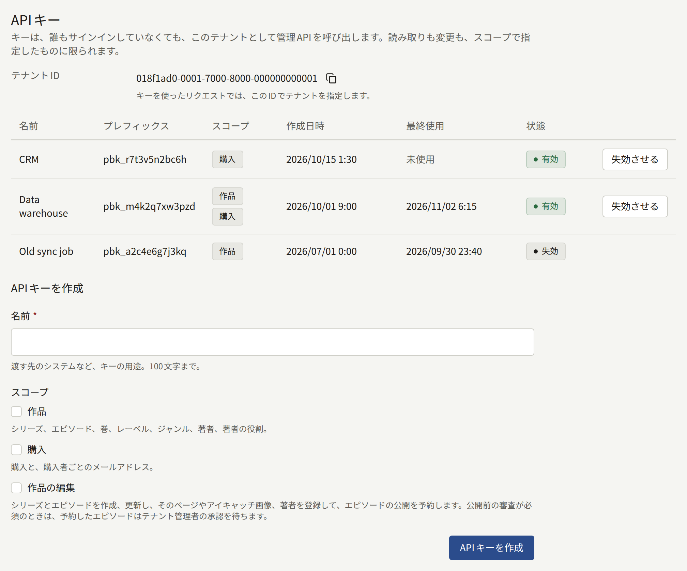
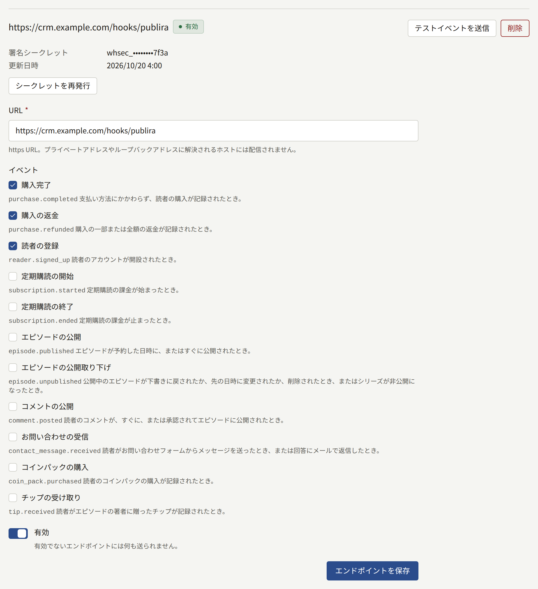
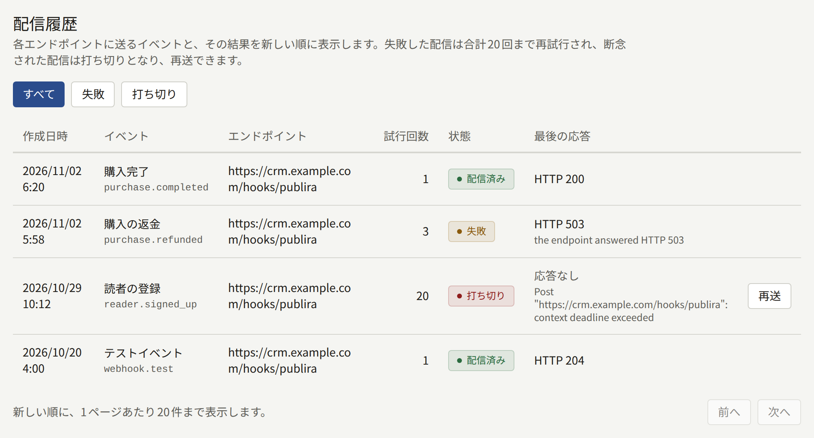

**外部連携** › **APIキーとWebhook**では、CRMやデータウェアハウス、会計システムのような、出版社が自分で運用するシステムとテナントをつなぎます。システムは**APIキー**を使って、テナントの作品と購入を読み取ったり、作品にシリーズとエピソードを登録したりします。また、販売、返金、新しい読者の登録、サブスクリプションの発生は、**Webhookエンドポイント**でその都度知ることができます。Webhookエンドポイントはシステム側のURLで、イベントが起きるたびにそこへ送信されます。**配信履歴**には、各エンドポイントに送ったものと、送るのを断念したものが表示されます。

**APIキーとWebhook**の画面はテナント管理者にだけ表示され、この画面での変更はすべて**監査ログ**に記録されます。記録される操作は、**APIキー作成**、**APIキー失効**、**Webhookエンドポイント作成**、**Webhookエンドポイント更新**、**Webhookエンドポイント削除**、**Webhook署名シークレット再発行**、**Webhook配信の再送**です。

## APIキー



キーを使うと、誰もログインしていなくても、このテナントの管理APIを呼び出せます。読み取りも変更も、スコープで指定したものに限られます。何かを変更できるのは、**作品の編集**を持つキーだけです。

### キーの作成

1. **APIキーを作成**の下の**名前**に、渡す先のシステムなど、キーの用途がわかる名前を100文字以内で入力します。
2. **スコープ**を1つ以上選びます。

   | スコープ | キーでできること |
   | --- | --- |
   | **作品** | シリーズ、エピソード、巻、レーベル、ジャンル、著者、著者の役割の読み取り |
   | **購入** | テナント全体または1人の読者の購入と、購入者ごとのメールアドレスの読み取り |
   | **作品の編集** | シリーズとエピソードの作成と変更、エピソードのページの追加、差し替え、並べ替え、削除、アイキャッチ画像のアップロード、エピソードの著者の設定、エピソードの公開予約。詳しくは[キーによる作品の変更](#キーによる作品の変更)で説明します |

   システムが必要とするものだけを選んでください。**購入**を選ぶと、すべての購入者のメールアドレスをそのシステムに渡すことになります。**作品の編集**を選ぶと、読者に見える内容をそのシステムが変えられるようになります。スコープは互いを含まないので、作品を変更したうえで読み取って確かめるシステムには**作品**も必要です。

3. **APIキーを作成**を選びます。

キーは**新しいAPIキー**の下に一度だけ、コピーするボタンとともに表示されます。この場でコピーし、キーを使うシステムが読める場所に保管してください。保存されるのはキーのハッシュだけなので、あとから表示し直すことはできません。ページを離れたり再読み込みしたりすると、キーは画面から消えます。コピーしなかったキーは失効させ、新しいキーを作成してください。

キーはその後、一覧に**プレフィックス**で表示されます。プレフィックスは`pbk_`とそれに続く12文字で、システムが持っているキーの先頭部分にあたります。**最終使用**には、キーが最後に使われた日時が分単位で表示されます。

### リクエストの送り方

システムは、管理APIへのリクエストに`Authorization: Bearer <key>`としてキーを付け、一覧の上に表示される**テナントID**でテナントを指定します。テナントのシリーズを取得するリクエストは次のとおりです。

```bash
curl <server>/rpc/publira.admin.v1.AdminSeriesService/ListSeries \
  -H "Authorization: Bearer pbk_…" \
  -H "Content-Type: application/json" \
  -d '{"tenant": {"tenantId": "<Tenant ID>"}}'
```

インストールの前段に置くリバースプロキシは、管理APIを転送しません。そのため、キーを使うのは`publira server`に直接届くシステムで、Webアプリが`publira server`を呼び出すのと同じネットワークから接続します。接続先のアドレスは、インストールのオペレーターに尋ねてください。

プロシージャーとそのフィールドは、[管理APIの定義](https://github.com/publira/publira/tree/main/proto/publira/admin/v1)にあります。キーを使ったリクエストには、次の場合にエラーが返ります。

- 失効したキーや存在しないキーを使ったとき、またはリクエストが別のテナントを指定しているときは`unauthenticated`が返ります。
- どのスコープでも許可されないプロシージャーを呼び出したときは`permission_denied`が返ります。**作品の編集**を持たないキーでの書き込みも、これにあたります。
- キーを使ったリクエストがインストールの上限を超えたときは、`Retry-After`を付けた`resource_exhausted`が返ります。上限は、オペレーターが変更していなければ1分あたり600件、1日あたり100,000件です。

### キーによる作品の変更

**作品の編集**を持つキーは、コンソールと同じように、プロシージャーを1つずつ呼び出してエピソードを登録します。シリーズは`CreateSeries`と`UpdateSeries`、エピソードは`CreateEpisode`、ページは`UploadEpisodeImages`で登録します。ページはZIPやePubにまとめて送ることもできます。公開日時は`UpdateEpisodePublishSchedule`で設定します。そのほかの変更には、`UpdateEpisodeTitle`、`UpdateEpisodePricing`、`UpdateEpisodeLayout`、`ReplaceEpisodeImage`、`ReorderEpisodeImages`、`DeleteEpisodeImage`、`ReplaceEpisodeCredits`、`UploadSeriesEyeCatchAspectImage`、`UploadEpisodeEyeCatchImage`、`UploadEpisodeEyeCatchAspectImage`を使います。キーで変更できるのはこれだけです。テナントの設定やメンバー、決済、読者と、[公開前の審査](./1-catalog/2-episodes.md#公開前の審査)の判断は、サインインしたメンバーにしか変更できません。

キーによる変更は、コンソールでの変更と同じように[監査ログ](./3-setup/8-audit-log.md)に記録されます。**操作者**にはキーの名前とプレフィックスが表示され、ロールの代わりに**APIキー**と表示されます。キーによる変更も、ほかのリクエストと同じくキーのリクエスト数の上限に数えられます。

**公開前の審査を必須にする**がオンのあいだは、キーで公開日時を保存すると、編集担当が保存したときと同じようにエピソードが審査に提出されます。エピソードが公開されるのは、テナント管理者が承認したときだけです。

### キーの失効

キーの横の**失効させる**を選び、続けて**キーを失効させる**を選びます。それ以降、そのキーを使ったリクエストはすべて拒否され、キーは**失効**として一覧に残ります。失効したキーは二度と使えません。

キーを途切れなく入れ替えるには、新しいキーを作成してシステムをそちらに切り替えます。古いキーの**最終使用**を見て、古いキーが使われなくなったことを確かめてから、古いキーを失効させてください。

## Webhookエンドポイント



エンドポイントは出版社自身のhttps URLで、購読しているイベントが起きるたびに、署名付きの`POST`が送られます。1つのテナントにつき5件まで登録でき、エンドポイントごとにフォームが分かれています。

### エンドポイントの追加

**エンドポイントを追加**の下で、次のように操作します。

1. **URL**を入力します。`https`で始まり、ホスト名があり、ユーザー名、パスワード、フラグメントを含まない、2048文字以内のURLです。`http`のURLは受け付けられません。
2. 送る**イベント**を1つ以上選びます。各イベントについては[イベント](#イベント)を参照してください。
3. すぐに送信を始めるなら、**有効**をオンのままにします。
4. **エンドポイントを追加**を選びます。

エンドポイントの署名シークレットは、**エンドポイントの署名シークレット**の下に一度だけ表示されます。この場でコピーして、受信側に渡してください。受信側はこのシークレットで各配信の署名を検証します。検証の方法は[配信の検証](#配信の検証)で説明します。以後、エンドポイントには**署名シークレット**の下にヒントだけが表示されます。ヒントは、`whsec_`と伏せ字、シークレットの末尾4文字です。

プライベートアドレス、ループバックアドレス、リンクローカルアドレス、共有アドレスに解決されるホストには、インストールのオペレーターが[そのアドレスを許可](../3-operations/12-security/index.md#自社ネットワーク内へのwebhook)していない限り、配信を送りません。リダイレクトには従いません。ホストの解決先は配信のたびに確かめるので、あとから別のアドレスに解決されるようになったURLは、その時点で拒否されます。

### エンドポイントの変更、テスト、削除

- **エンドポイントを保存**は、そのエンドポイントのフォームの内容を保存します。保存されるのはURL、イベント、**有効**です。有効でないエンドポイントには何も送られません。無効にしている間に起きたイベントはそのエンドポイントには送られず、無効にした時点でまだ送信を待っていた配信は断念されます。
- **テストイベントを送信**は、エンドポイントに`webhook.test`イベントを送ります。エンドポイントが有効かどうかにも、どのイベントを購読しているかにもかかわらず送られます。テストはほかの配信と同じく**配信履歴**に表示されるので、実際のイベントが届く前に、新しい受信側が正しく動くかを確かめられます。
- **シークレットを再発行**を選び、続けて**シークレットを再発行**を選ぶと、署名シークレットが新しくなり、新しいシークレットが**新しい署名シークレット**の下に一度だけ表示されます。それ以降の配信は、以前の配信の再試行も含めてすべて新しいシークレットで署名されます。古いシークレットで検証し続けている受信側は、それらを拒否します。すぐに受信側を更新し、その間に受信側が拒否した配信は再送してください。
- **削除**を選び、続けて**エンドポイントを削除**を選ぶと、エンドポイントと、そのエンドポイント宛ての配信がすべて削除されます。

## イベント

| イベント | 送られるとき | `data` |
| --- | --- | --- |
| **購入完了** (`purchase.completed`) | 読者の購入が記録されたとき。決済プロバイダ、アプリストア、テナントのコイン、価格の全額を割り引くプロモーションコードのどれで支払われたかにはかかわりません | 購入 |
| **購入の返金** (`purchase.refunded`) | 購入の一部または全額の返金が記録されたとき。一部の返金は、1回ごとに別のイベントになります | 返金後の購入 |
| **読者の登録** (`reader.signed_up`) | 読者のアカウントが開設されたとき。メールアドレスとパスワードでの登録も、AppleやGoogleでのログインによる登録も含みます | 読者 |
| **定期購読の開始** (`subscription.started`) | サブスクリプションの課金が始まったとき | サブスクリプション |
| **定期購読の終了** (`subscription.ended`) | サブスクリプションの課金が止まったとき | サブスクリプション |
| **テストイベント** (`webhook.test`) | **テストイベントを送信**を選んだとき | 空 |

### 本文

配信の本文は、どれも次のようなJSONオブジェクトです。

```json
{
  "id": "evt_…",
  "type": "purchase.completed",
  "created_at": "2026-11-02T06:20:00Z",
  "tenant_id": "<the tenant's public ID>",
  "data": {}
}
```

`id`はイベントのIDです。イベントを送るどのエンドポイントでも、どの試行でも同じ値なので、受信側はこれを記録しておき、処理済みのイベントは捨ててください。前の試行への応答が失われたときなど、同じイベントが複数回届くことがあります。`type`は上の表のイベント名、`created_at`はイベントが起きた日時です。

`data`は、レコードを管理APIが返すときのIDで示します。データベース内部のIDは使いません。

| オブジェクト | フィールド |
| --- | --- |
| 購入 | `purchase_id`は`GetPurchase`に渡すIDです。`kind`は`purchase`、`rental`、`tip`のいずれかです。`item`は`episode`、`volume`、`series_bundle`、`coin_pack`のいずれかで、該当する場合は`series_public_id`、`episode_public_id`、`volume_public_id`が付きます。`reader_public_id`と`reader_email`は、読者がアカウントを削除するとどちらも空になります。`price`は読者が支払った金額、`list_price`はプロモーションコードで割り引く前の金額で、どちらも通貨の最小単位で表し、`currency`が付きます。ほかに`refunded_amount`、`purchased_at`、`expires_at`、`refunded_at`があります。`provider`は決済プロバイダか`coins`、`store`は`app_store`か`google_play`で、プロモーションコードで付与された購入ではどちらも空です。最後に`test`があります |
| 読者 | `reader_public_id`、`email`、`name`、`email_verified` (読者がメールアドレスを確認するまではfalse)、`signed_up_at` |
| サブスクリプション | `plan_public_id`と`plan_name`があります。`reader_public_id`と`reader_email`は、読者がアカウントを削除するとどちらも空になります。`provider`は`stripe`、`app_store`、`google_play`のいずれかです。ほかに`status`、`current_period_end`、`cancel_at_period_end`、`started_at`、`test`があります |

配信には、次のヘッダーも必ず付きます。

| ヘッダー              | 値                                            |
| --------------------- | --------------------------------------------- |
| `X-Publira-Event`     | イベント名                                    |
| `X-Publira-Delivery`  | 配信のID。同じ配信のすべての試行で同じ値です  |
| `X-Publira-Signature` | 署名。形式は次の節で説明します                |
| `Content-Type`        | `application/json`                            |
| `User-Agent`          | `Publira-Webhooks/`とインストールのバージョン |

## 配信の検証

`X-Publira-Signature`は`t=<unix seconds>,v1=<hex>`の形式です。hexの部分は、タイムスタンプ、ピリオド、受け取ったままの本文をこの順につなげたものについて、エンドポイントの署名シークレットを鍵として計算したHMAC-SHA256です。受信側はこの値を計算し直し、署名が一致しない配信と、タイムスタンプが自分の時計から数分以上ずれている配信を拒否してください。記録した配信を送り直すリプレイでは、タイムスタンプがこのようにずれます。

```js
import { createHmac, timingSafeEqual } from "node:crypto";

// body is the raw request body, before any JSON parsing.
const verify = (secret, header, body, toleranceSeconds = 300) => {
  const parts = new Map(header.split(",").map((part) => part.split("=")));
  const timestamp = Number(parts.get("t"));
  const signature = Buffer.from(parts.get("v1") ?? "", "hex");
  const expected = createHmac("sha256", secret)
    .update(`${timestamp}.${body}`)
    .digest();

  return (
    Math.abs(Date.now() / 1000 - timestamp) <= toleranceSeconds &&
    signature.length === expected.length &&
    timingSafeEqual(signature, expected)
  );
};
```

受け付けた配信には`2xx`のステータスで応答し、配信が求める処理はそのあとで行ってください。応答に10秒より長くかかると、応答がなかったものとみなされます。

## 再試行と再送



配信の結果は、エンドポイントの応答によって次のように決まります。

- `2xx`が返ると、**配信済み**になります。
- `408`と`429`以外の`4xx`が返ると、何度送っても受信側は受け取らないので、すぐに断念されます。
- それ以外の場合は**失敗**になり、再試行されます。`3xx`、`408`、`429`、`5xx`が返ったとき、タイムアウトしたとき、応答がなかったときがこれにあたります。待ち時間は1秒から始まり、試行のたびに2倍に延びて、最大1時間になります。合計20回試行すると、最初の試行からおよそ8時間後に断念されます。

断念された配信は**打ち切り**になります。**配信履歴**にはすべての配信が新しい順に表示され、**失敗**か**打ち切り**を選ぶと、その状態の配信だけに絞り込めます。配信ごとに、作成日時、イベント、エンドポイント、試行回数、状態、エンドポイントの最後の応答 (応答がなければその理由) が表示されます。

打ち切りになった配信の横の**再送**を選ぶと、同じ本文とイベントIDで配信がもう一度送られ、改めて20回まで試行されます。**試行回数**は、それまでの回数から数え続けます。再送の前に、受信側が拒否した原因を取り除いてください。そうしないと、再送も同じように断念されます。
