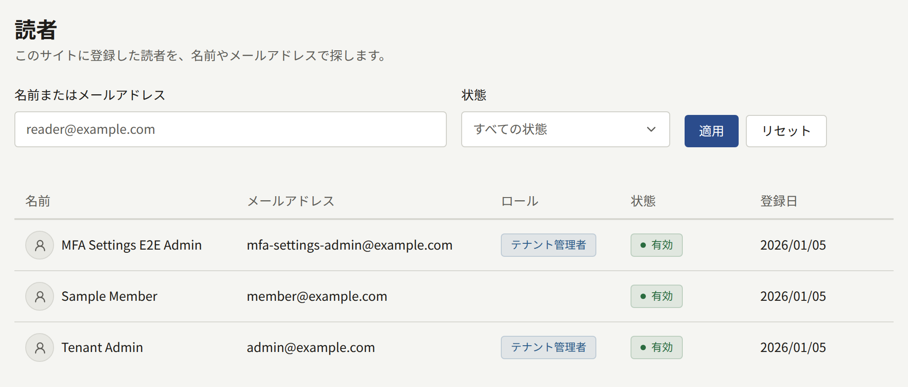
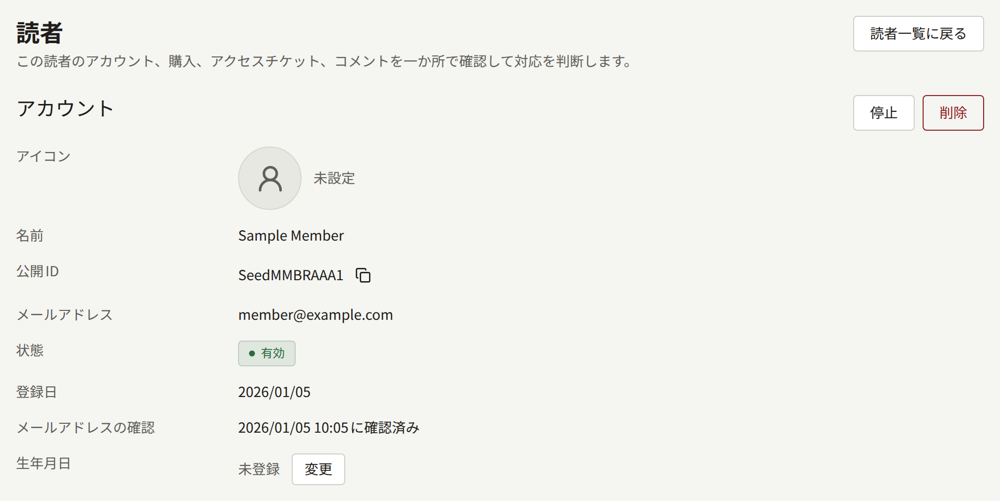

**読者**には、テナントのサイトのすべてのアカウントが、登録日の新しい順に1ページ20件ずつ表示されます。管理画面のアカウントはサイトのアカウントを兼ねているので、スタッフのアカウントもここに含まれます。**ロール**には、スタッフが持つロールのうち最も上位のものが表示され、読者の場合は空欄です。この画面を使えるのはテナント管理者だけです。

アカウントを探すには、名前かメールアドレスの一部を**名前またはメールアドレス**に入力し、**適用**を選びます。名前とメールアドレスのどの位置に含まれていても一致し、大文字と小文字は区別しません。たとえば`tanaka`で検索すると、`Tanaka Hanako`も`h.tanaka@example.com`も見つかります。**状態**を指定すると、その状態のアカウントだけに絞り込めます。

| 状態 | 意味 |
| --- | --- |
| **有効** | ログインできるアカウントです |
| **無効** | 会員登録はしたものの、まだメールアドレスを確認していない読者です。確認するまではログインできません |
| **停止中** | テナント管理者が利用停止にしたアカウントです。停止を解除するまでログインできません |

各行の先頭には読者がアカウントに設定したアイコンが表示され、設定していない読者には輪郭だけの簡素な画像が表示されます。**コメント**の投稿者のアイコンも同じです。一覧で読者の名前を選ぶと、その読者のページが開きます。テナント管理者は、**コメント**の投稿者の名前や、ログインした状態で送られたお問い合わせの送信者の名前からも、読者のページを開けます。

## 読者のページ

**アカウント**には、読者の**アイコン**、名前、コピーボタン付きの**公開ID**、メールアドレス、状態、登録日、メールアドレスを確認したかどうかと確認した日時、**生年月日**が表示されます。

その下の3つのセクションには、読者に関するものが新しい順に1ページ20件ずつ表示されます。

| セクション | 表示されるもの |
| --- | --- |
| **購入** | 読者が購入したすべてのもの。購入したエピソード、巻、シリーズの残り、コインのパックのどれか、金額、支払い方法、購入したものをまだ読めるかどうかが表示されます。タイトルを選ぶと購入したものが開き、**表示**を選ぶと**購入**画面でその購入が開きます。返金はその画面で行えます |
| **アクセスチケット** | スタッフがその読者に発行したチケット。対象のエピソードとチケットの状態が表示されます。**失効**と**チケットを発行**は、[アクセスチケット](./4-access-tickets.md)の画面と同じ操作を、このページから移動せずに行えます |
| **コメント** | 読者が書いたすべてのコメント。読者が自分で削除したコメントも、完全削除されるまでは表示されます。[コメント](./2-comments.md)の画面と同じ操作ができます |

## 生年月日の訂正

読者は、いったん保存した生年月日を自分では変更できないので、誤って入力した読者はサイトに訂正を依頼することになります。[年齢確認](../3-setup/1-settings.md#年齢確認)で設定した年齢のチェックは、保存されている生年月日をもとに行われます。訂正するには、**生年月日**の横の**変更**を選び、日付を入力して**保存**を選びます。日付を空にして保存すると生年月日が消去され、読者は年齢制限のあるシリーズを開くときに改めて生年月日の入力を求められます。新しい日付は、読者が次に作品を読むときから適用されます。

## 読者のアイコンの削除

読者のアイコンはコメントの横に表示され、サイトを読む人なら誰でも目にするので、サイトのルールに反するアイコンはここから削除します。**アイコン**の横の**アイコンを削除**を選び、**削除する**で確定します。画像はサイトと管理画面からすぐに消え、代わりに輪郭だけの簡素な画像が表示されます。読者は、自分でアイコンを削除したときと同じように、あとから別のアイコンを設定できます。

**アイコンを削除**は、アカウントにアイコンが表示されているときだけ選べます。

読者が自分で画像をアップロードできるか、テナントが用意したアイコンから選ぶか、アイコンをまったく表示しないかは、**設定**で決めます。詳しくは[読者のアイコン](../3-setup/1-settings.md#読者のアイコン)を参照してください。

## 読者の利用停止

**停止**を選ぶと、読者はすべての端末でログアウトされます。停止を解除するまでは、パスワードでも、AppleやGoogleのアカウントでもログインできません。アカウントのそれ以外は変わりません。公開済みのコメントはサイトに残り、購入したものやアクセスチケットも読者のもののままで、ログインできない間だけ使えなくなります。

同じページの**停止を解除**を選ぶと、アカウントは**有効**に戻ります。メールアドレスを一度も確認していないアカウントなら**無効**に戻ります。停止で終了したセッションは戻らないので、読者はもう一度ログインします。利用停止中の読者を探すには、**状態**で**停止中**を選びます。

## 読者の削除

**削除**を選ぶと、読者が自分で退会したときとまったく同じようにアカウントが削除されます。この操作は取り消せません。

| 読者のデータ | 削除後の扱い |
| --- | --- |
| コメントと、読者が行った通報 | 削除されます |
| 購入 | 購入者の情報を外して残ります。そのため、売上と印税は変わりません |
| プランのサブスクリプション | テナントのStripeアカウントですぐに解約され、以降は請求されません。支払い済みの期間の分は返金されません。読者がアプリで購読したサブスクリプションは、App StoreまたはGoogle Playが請求しています。ストアで解約できるのは読者本人だけなので、購読者の情報を外して残り、読者がストアで解約します |
| アクセスチケット、フォロー、閲覧履歴、評価、通知、AppleとGoogleのログイン連携 | 削除されます |
| お問い合わせ | 残り、送信者は**ゲスト**と表示されます |
| スタッフのロール | 外されます |

あとで元に戻す可能性があるなら、削除ではなく利用停止にしてください。

自分がログインしているアカウントと、テナントで最後の有効なテナント管理者のアカウントは、利用停止も削除もできません。先にほかの人をテナント管理者にしてください。利用停止、停止の解除、削除、生年月日の変更と消去、アイコンの削除は、[監査ログ](../3-setup/8-audit-log.md)にそれぞれ**読者の停止**、**読者の停止解除**、**読者削除**、**読者の生年月日変更**、**読者の生年月日の消去**、**読者のアイコン削除**として記録されます。
