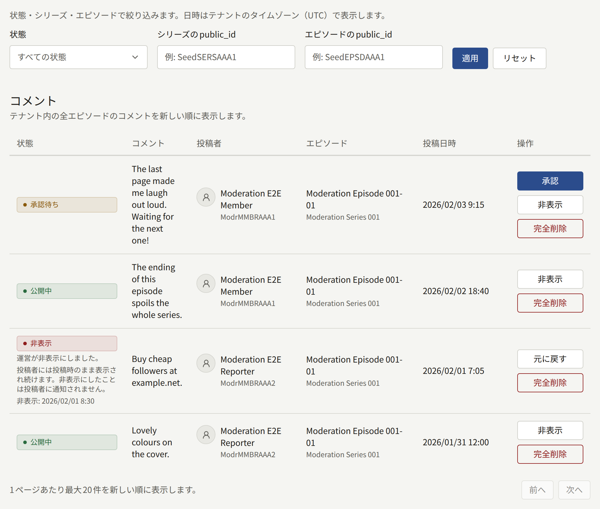
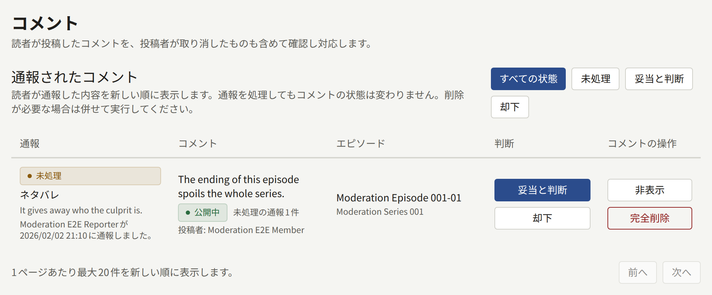

読者がエピソードにコメントできるのは、テナント全体については**設定** › **読者のコメント**で、シリーズについてはシリーズのフォームで、コメントが有効になっているときだけです。3つの選択肢（**受け付けない**、**すぐに公開する**、**承認してから公開する**）と、コメントを自動で非表示にする通報の件数は、[読者のコメント](../3-setup/1-settings.md#読者のコメント)で説明しています。

コメントできるのはログインした読者だけで、1件あたり1000文字までです。コメントはエピソードに属します。返信やスレッドはないので、1つのコメントへの操作がほかのコメントに影響することはありません。

**コメント**には2つの一覧があります。先に**通報されたコメント**、次にテナントのエピソードへのすべてのコメントが新しい順に表示されます。監査担当には、操作のない状態で両方が表示されます。

## コメントの状態の意味

| 状態 | コメントが見える人 |
| --- | --- |
| **承認待ち** | 投稿者だけ。**承認待ち**と表示されます |
| **公開中** | 全員 |
| **非表示** | 投稿者だけ。投稿者には投稿したとおりに見えます |
| **投稿者が削除** | サイトではだれにも見えません。投稿者自身も含みます。完全削除されるまで、スタッフにはここで見えます |

## 各操作の内容

| 操作 | 表示される状態 | 内容 |
| --- | --- | --- |
| **承認** | **承認待ち** | コメントを公開し、投稿者にコメントが公開されたことを通知します |
| **非表示** | **承認待ち**、**公開中** | 投稿者以外のすべての人に対して、コメントをサイトから取り下げます。「**理由（任意）**」は監査ログに記録されます |
| **元に戻す** | **非表示** | コメントを元の状態に戻します。公開されていたものは再び公開され、そうでなければ**承認待ち**に戻ります。そのコメントに対して未処理の通報はすべて却下されます |
| **完全削除** | すべての状態 | コメントとその通報を完全に削除します。コメントについて残るのは監査ログの記録だけなので、**理由**は必須です |

非表示にされたコメントの投稿者には、モデレーターが非表示にした場合でも、読者の通報によって非表示になった場合でも、知らされることはありません。投稿者には投稿したとおりにコメントが見え続けるので、コメント欄を荒らそうとしている人には、再投稿を促すきっかけが何も与えられません。

一覧を読み込んだあとで別のモデレーターが同じコメントを処理していた場合、あなたの操作は「他の担当者がこのコメントをすでに処理しました。一覧を再読み込みして現在の状態を確認してください。」というメッセージで拒否されます。

## 承認待ちの処理

承認待ちのコメントがある間は、メニューの**コメント**にその件数が表示されます。また、スタッフ全員に管理画面で「承認待ちのコメントがあります」という通知が、エピソードごとに1時間に1回まで届きます。通知を開くと、そのエピソードの承認待ちのコメントに絞り込んだ一覧が開きます。

1. **コメント**を開き、**状態**を**承認待ち**にして**適用**を選びます。
2. 各コメントを読み、公開するなら**承認**を、サイトに出さないなら**非表示**を選びます。
3. 一覧が空になるまで、ページを順に処理します。

コメントは承認されるまで投稿者以外のだれにも見えないので、承認待ちを処理せずに放置すると、コメント欄は空のままになります。承認待ちから非表示にしたコメントは、投稿者には引き続き**承認待ち**として表示されます。

## 通報されたコメント

ログインした読者は、自分のもの以外の公開中のコメントを、**スパム・宣伝**、**暴言・嫌がらせ**、**ネタバレ**、**その他**のいずれかを選び、任意のメモを添えて通報できます。各読者が1つのコメントを通報できるのは1回だけで、もう一度通報しても何も変わりません。投稿者には知らされません。

コメントに対する未処理の通報が**自動で非表示にする報告件数**に達すると、スタッフを待たずにコメントは自動で非表示になり、投稿者には知らされません。そのコメントには「通報がしきい値を超えたため自動で非表示になりました。」と表示され、監査ログには、操作者を**自動処理**として**通報によるコメントの自動非表示**が記録されます。スタッフ全員に管理画面で「コメントが報告されました」という通知が、エピソードごとに1時間に1回まで届きます。

**通報されたコメント**には、通報ごとに1行が新しい順に表示され、理由、メモ、通報者、コメント、その投稿者が示されます。通報は判断されるまで**未処理**です。

- **妥当と判断**は、通報が正しかったことを記録します。コメントはそのままです。公開中のコメントを取り下げるには、あわせて**非表示**を選びます。
- **却下**は、通報が誤りだったことを記録します。自動で非表示になったコメントは元に戻りません。元に戻すには**元に戻す**を選びます。

通報を処理するには、絞り込みを**未処理**にし、コメントごとに残すかどうかを決めます。残さない場合は、コメントを**非表示**にし、その通報を**妥当と判断**にします。残す場合は、非表示になっていれば**元に戻す**を選ぶと、未処理の通報がまとめて却下されます。非表示になっていなければ、各通報を**却下**します。通報を判断すると自動非表示までの件数が減るので、却下した通報によって、あとでコメントがしきい値を超えることはありません。

## 取り下げられたコメント

読者はいつでも自分のコメントを削除できます。コメントは本人を含むすべての人に対してすぐにサイトから消え、スタッフが元に戻すことはできません。**コメント**では、引き続き**投稿者が削除**として、削除された日時と完全削除される日時とともに表示されます。そのため、投稿者が取り下げたあとでも、だれかが通報したり苦情を寄せたりしたコメントをスタッフが読めます。そのコメントへの通報は処理待ちの一覧に残り、引き続き判断できます。

取り下げられたコメントは、**設定** › **制限と保持** › **保持期間** › **取り下げられたコメント**で設定した期間が過ぎると、その通報とともに完全削除されます。`publira worker`は1時間ごとにそれらを完全削除します。行には、現在設定されている期間から数えて、あと何日で完全削除されるかと、その日付が表示されます。早く削除するには**完全削除**を選びます。非表示にしたコメントは自動で完全削除されることはなく、モデレーターが完全削除するまで残ります。

## コメントの検索

コメントの一覧は、**状態**、**シリーズのpublic_id**、**エピソードのpublic_id**で絞り込めます。公開IDは、`/series/<series public ID>/episodes/<episode public ID>`のように、管理画面でのシリーズやエピソードのアドレスの最後の部分です。各コメントの**エピソード**は、そのアドレスにリンクしています。何にも一致しないIDでは、一覧が空になります。

エピソードにクレジットされた著者に紐付けられたアカウントからのコメントには、サイトでもここでも**著者**バッジが付きます。これによってコメントのモデレーションの方法が変わることはありません。

コメントの承認、非表示、元に戻す操作、完全削除と、通報の妥当と判断と却下は、入力した理由とともに監査ログに記録されます。
