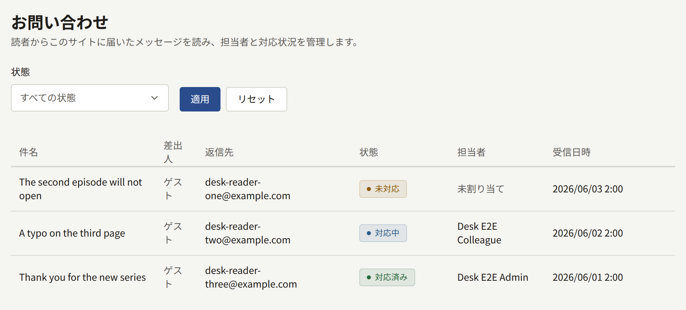
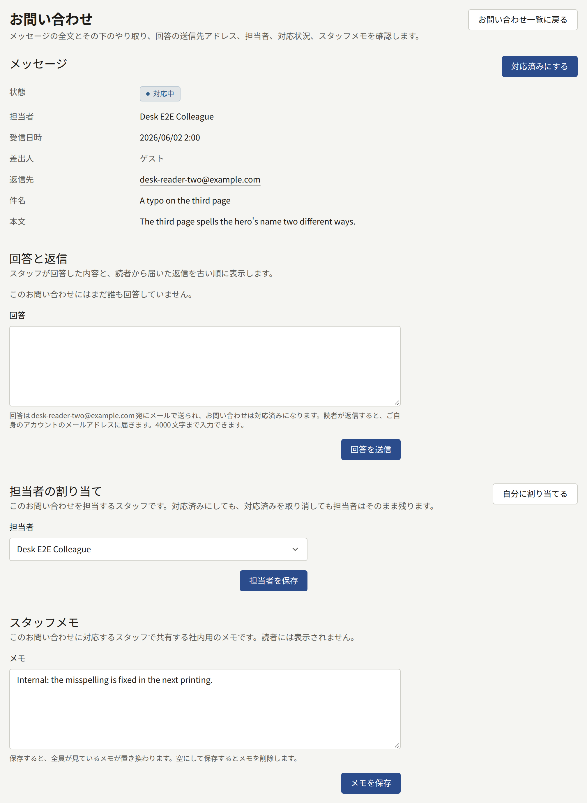

読者は、サイトの各ページのフッターとアプリにある**お問い合わせ**から、ログインしていなくてもサイトにメッセージを送れます。入力するのは、回答を受け取るメールアドレス、件名(省略可、200文字まで)、本文(4000文字まで)です。ログインしている読者には、メールアドレスがあらかじめ入力されていて、変更もできます。

新しいメッセージが届くと、有効なテナント管理者全員に、アカウントのメールアドレス宛てで通知メールが送られます。メールには読者のメールアドレス、件名、本文がすべて記載されます。編集担当と監査担当は**お問い合わせ**を開けないので、メールは送られません。利用停止中のアカウントにも送られません。有効なテナント管理者がいないテナントでは誰にもメールが送られませんが、メッセージは**お問い合わせ**で待っています。管理画面には新しいメッセージの件数も通知も表示されないので、**お問い合わせ**を確認するか、通知メールを見逃さないようにしてください。

**お問い合わせ**には、メッセージが新しい順に1ページ20件ずつ、**件名**、**差出人**、**返信先**、**状態**、**担当者**、**受信日時**と一緒に表示されます。**差出人**には、読者がログインして送った場合はその読者のアカウントが、そうでなければ**ゲスト**と表示されます。**状態**はメッセージの対応状況から自動で決まり、手動では設定できません。

| 状態         | 条件                                                         |
| ------------ | ------------------------------------------------------------ |
| **未対応**   | 対応済みになっておらず、担当者も割り当てられていない         |
| **対応中**   | 対応済みになっていないが、テナント管理者が担当者になっている |
| **対応済み** | 対応済みにしたか、回答を送った                               |

## メッセージへの回答

1. **お問い合わせ**でメッセージを開きます。
2. **担当者の割り当て**で、**自分に割り当てる**を選ぶか、テナント管理者を選んで**担当者を保存**を選びます。担当者を決めておけば、対応中であることがほかのテナント管理者にもわかります。担当者にできるのはテナント管理者だけです。
3. **回答**に回答を4000文字以内で入力し、**回答を送信**を選びます。

送信した回答は**回答と返信**に保存され、メッセージは**対応済み**になります。続いて`publira worker`が、メッセージの**返信先**のアドレスに回答を次のようにメールで送ります。

- [メール](../3-setup/7-email.md)で設定したメールサーバーから、そのサーバーに設定したアドレスで送られます。テナントが独自のメールサーバーを設定するまでは、プラットフォームのメールサーバーから送られます。
- 件名は、読者が入力した件名の前に「Re:」を付けたものです。読者が件名を入力しなかった場合は、「Re: Example Comicsへのお問い合わせ」のようにサイト名を入れた件名になります。
- 回答の下に、読者のメッセージが引用されます。
- 読者がどの言語で書いたかにかかわらず、テナントのデフォルトの言語で送られます。

メールが相手に届いたかどうかは、管理画面では確認できません。メールの設定が間違っていると、回答は保存されてメッセージも**対応済み**になるのに、メールは送られません。テナントが独自のメールサーバーから送信しているなら、読者に回答する前に**送信メール**の**接続テスト**で設定を確認してください。同じアドレスに送れる回答の数には、管理画面から送るほかのメールと同じく、1時間あたりと1日あたりの上限があります。

## 読者から返信があったとき

読者の返信の届き先は、**外部連携** › **メール情報**の**受信メール**のセクションが**利用可能**かどうかで変わります。設定方法は[お問い合わせへの読者の返信](../3-setup/7-email.md#お問い合わせへの回答に対する読者の返信)で説明しています。

- **利用可能**になるまでは、回答メールの返信先は回答したスタッフ自身のアカウントのメールアドレスです。読者の返信はそのスタッフのメールボックスに届き、管理画面には記録されず、メッセージも**対応済み**のままです。読者には、自分のメールから返信するか、管理画面からもう一度回答してください。
- **利用可能**になると、回答メールの返信先は、そのメッセージ専用に作られたサイトのアドレスになります。読者の返信は**回答と返信**に「reader@example.comからの返信」のように読者のアドレス付きで記録され、メッセージの対応済みが取り消されます。テナント管理者には、新しいメッセージが届いたときと同じように通知メールが送られます。

テナントがどちらに当たるかは、**回答**の下のヒントに表示されます。

## 対応状況の管理

- **スタッフメモ**は、テナント管理者がメッセージごとに共有する1つのメモで、4000文字まで入力できます。読者には表示されません。保存すると全員の見る内容が置き換わり、空にして保存するとメモが消えます。
- **対応済みにする**は、スパムなど回答せずに対応を終えるメッセージを対応済みにします。**対応済みを取り消す**を選ぶと、メッセージは**対応中**か**未対応**に戻ります。どちらの操作でも担当者は変わりません。

メッセージは削除されることがなく、保持期間もありません。あとでアカウントを削除した読者のメッセージも残り、差出人は**ゲスト**と表示されます。対応済みにする操作、対応済みの取り消し、担当者の割り当て、メモの編集、回答の送信は監査ログに記録されます。回答の本文は記録されません。
