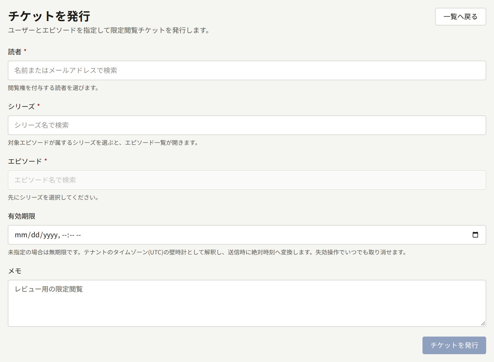
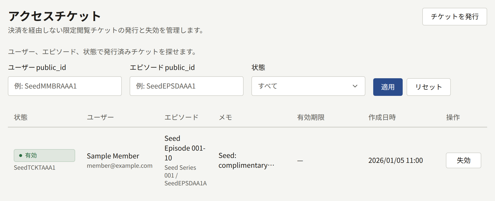

アクセスチケットを発行すると、1人の読者が1つのエピソードを、有効期限が来るか失効させるまで、サイトでもアプリでも購入せずに読めます。レビュアーや報道関係者に読んでもらうとき、賞品として提供するとき、購入で問題が起きた読者に返金と再購入を待たせずに読んでもらうときなど、購入せずに読んでもらいたい場面で使います。**アクセスチケット**を使えるのはテナント管理者だけです。

チケットは販売ではありません。著者の印税は発生せず、エピソードは読者の**購入**にも表示されません。年齢の確認も免除されないので、シリーズの年齢制限に満たない読者は、チケットがあっても読めません。チケットで開けるのは公開中のエピソードだけで、無料のエピソードには何の効果もありません。チケットが発行されたことは読者に通知されないので、発行したスタッフから読者に伝えてください。

## チケットの発行

1. **アクセスチケット**を開き、**チケットを発行**を選びます。
2. **読者**に読者の名前かメールアドレスの一部を入力し、候補から読者を選びます。候補に表示されるのは、状態が**有効**の読者だけです。
3. **シリーズ**を選び、続いて**エピソード**を選びます。
4. 必要に応じて、**有効期限**をテナントのタイムゾーンで入力します。空欄にすると、チケットは無期限になります。
5. 必要に応じて、発行の理由などを**メモ**に1000文字以内で入力します。
6. **チケットを発行**を選びます。

読者のページを開いているときは、[読者のページ](./1-accounts.md#読者のページ)の**アクセスチケット**で**チケットを発行**を選んでも発行できます。**読者**の欄を除いた同じフォームがページの上に開き、発行したチケットはページの一覧に加わります。

スタッフが同じ読者の同じエピソードに発行できるチケットは、同時に1枚だけです。

- 有効なチケットがすでにあれば、新しいチケットは発行されず、既存のチケットの有効期限とメモもそのままです。管理画面にはその旨が既存のチケットとともに表示されます。チケットの有効期限やメモを変えたいときは、一覧で既存のチケットを失効させてから発行し直してください。
- 期限切れのチケットがあれば、先に一覧でそのチケットを失効させるよう管理画面に表示されます。

## チケットの失効

一覧か読者のページで、有効なチケットの**失効**を選ぶと、読者はすぐにそのエピソードを読めなくなります。失効は取り消せないので、もう一度読めるようにするには新しいチケットを発行してください。失効したチケットは、失効した日時とともに**失効**として一覧に残ります。

## 一覧の見方

一覧に表示されるのは、スタッフが発行したチケットだけです。[**待てば無料**](../4-selling-episodes.md#無料公開期間と待てば無料)で読者が自分で受け取るチケットは一覧に表示されず、ここで失効させることもできません。待てば無料のチケットはスタッフが配ったものではなく、シリーズのルールによって読者が無料で読める権利だからです。同じ読者の同じエピソードにスタッフがチケットを発行しても、待てば無料のチケットは置き換えられず、両方が並んで存在します。

一覧には、各チケットの**状態**、**ユーザー**、**エピソード**、**メモ**、**有効期限**、**作成日時**が、新しい順に1ページ20件ずつ表示されます。**状態**は**有効**、**期限切れ**、**失効**のいずれかです。絞り込みで**有効のみ**を選ぶと、期限切れと失効のチケットがどちらも除かれます。**ユーザーpublic_id**と**エピソードpublic_id**には、読者のページや、管理画面のエピソードのURLからコピーした公開IDを、省略せずに入力します。IDの一部や名前では見つかりません。

チケットの発行と失効は、監査ログに**アクセスチケット発行**と**アクセスチケット失効**として記録されます。
