**管理**の下にある**設定**には、3つのタブがあります。**基本情報**には、テナントが自分のサイトについて決める項目があります。**制限と保持**には、オペレーターがすべてのテナントに設定する値があり、テナントは一定の範囲内でそれを変更できます。**読者のアイコン**には、読者がアイコンとして表示できるものと、テナントが読者に選択肢として用意するアイコンがあります。

これらのタブのカードには、それぞれ専用の保存ボタンがあり、保存されるのはそのカードの項目だけです。そのため、次のカードに移る前に、そのカードを保存してください。**設定**はスタッフ全員が開けますが、保存できるのはテナント管理者だけです。編集担当と監査担当には、各カードに「この設定はテナント管理者のみ編集できます。現在は閲覧専用です。」と表示されます。

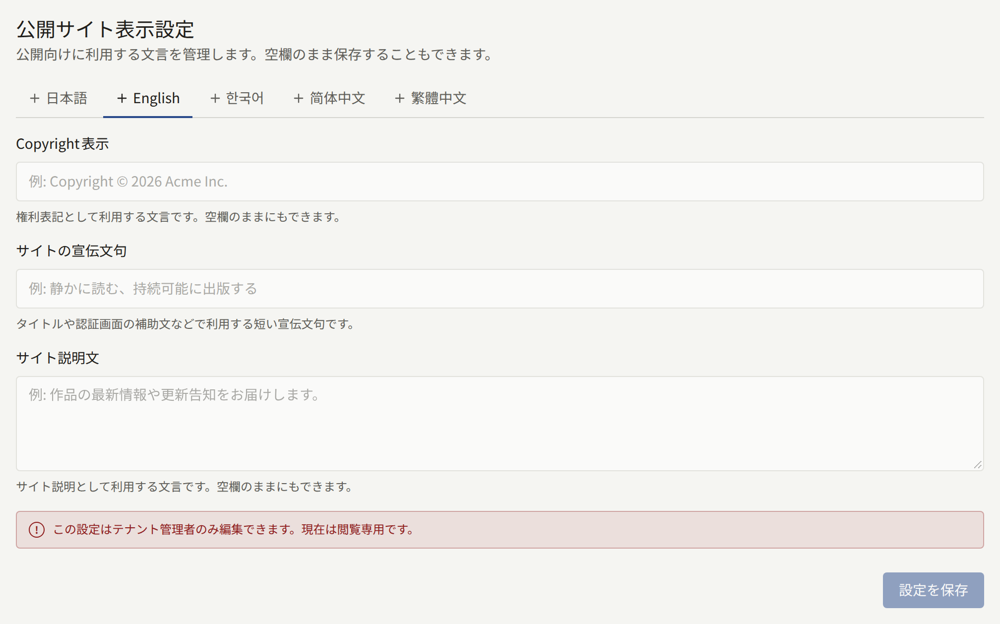

## 基本情報

### 公開サイト表示設定

3つの文言があり、どれも空欄のままにできます。

- **Copyright表示**：サイトのすべてのページと、そのログイン画面の下部に表示されます。
- **サイトの宣伝文句**：ログイン、会員登録、パスワードの各画面と、サイトのホームページへのリンクが共有されるときの画像に表示される短い1行です（[リンクのプレビュー](./2-branding.md#リンクのプレビュー)を参照）。
- **サイト説明文**：サイトのフッターに表示され、サイトの説明として検索エンジンとリンクのプレビューに渡されます。

[言語](#言語)で選んだ、サイトが提供する言語ごとに、**言語**の下にタブがあり、それぞれに3つの文言があります。カードは既定言語のタブで開き、独自の文言がない言語には「**（未追加）**」と表示されます。**設定を保存**は、開いているタブの3つの項目を保存し、他の言語の文言はそのまま残します。タブを切り替える前に保存してください。保存していない編集は残りません。3つの項目をすべて空にして保存すると、その言語の文言が削除されます。

サイトは読者に、その読者が閲覧している言語の文言を表示し、その言語の文言がない場合は既定言語の文言を表示します。独自の文言がある言語では、その文言だけが表示されます。そのタブで空欄にした項目は、既定言語の文言で補われず、空のままになります。

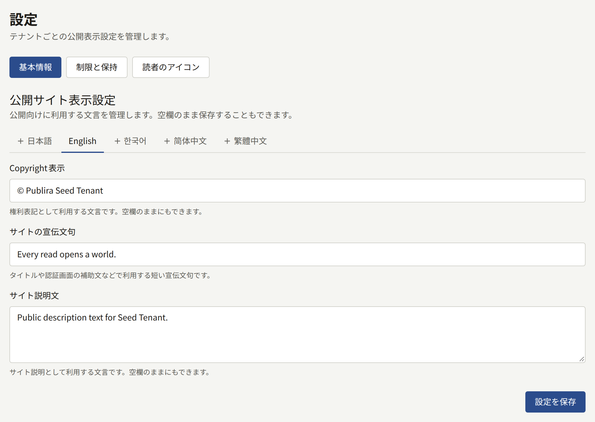

### タイムゾーン

**タイムゾーン**は、管理画面と公開サイトの両方で、すべての日時を表示・入力するときに使うタイムゾーンです。シリーズやエピソードに入力する公開日時はこのタイムゾーンで解釈され、バナーの掲載終了時刻や、レポートと監査ログを日ごとに集計するときの区切りも同様です。また、印税のためにある月の売上がどこで終わり、次の月がどこから始まるかや、読者の年齢を数える暦日もこのタイムゾーンで決まります。都市名や地域名を入力して一覧を絞り込み、**タイムゾーンを保存**を選びます。

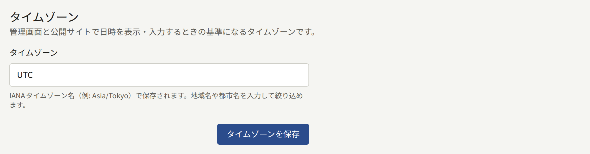

最初の売上が発生する前に設定してください。後から変更すると、締めていない月の区切りの位置が変わります。一方、印税のためにすでに締めた月は、締めたときのタイムゾーンのまま残ります。

新しいテナントは、プラットフォームの既定のタイムゾーンで始まります。オペレーターが別のタイムゾーンを選んでいなければ`UTC`です。

### 言語

**言語**では、サイトが読者に提供する言語と、そのうちどの言語でサイトを始めるかを決めます。

**提供する言語**には、Publiraが翻訳されている言語ごとにチェックボックスがあります。日本語、English、한국어、简体中文、繁體中文です。読者がサイトを使える言語にチェックを入れます。言語の提供をやめると、その言語で書かれたページの翻訳は削除されずに非表示になり、[翻訳](./3-pages.md#翻訳)で説明しているとおり、その言語の提供を再開すると元に戻ります。

読者に見えるのは、チェックを入れた言語だけです。サイトの**表示言語**メニューにはそれらの言語が並び、サイトマップや検索エンジンが読む言語別のリンクも同様です。ブックマークや検索結果から、提供をやめた言語のアドレスを開くと、代わりに同じページが既定言語で開きます。

テナントのアプリも同じ選択に従います。アプリには**表示言語**メニューがなく、代わりに読者の端末に設定されている言語を読み取ります。そのうちサイトが提供する最初の言語で開き、どれも提供していない場合は既定言語で開きます。

**既定言語**は、まだ言語を選んでいない人に対して、サイトとこの管理画面が最初に使う言語です。すでに言語を選んでいる読者やスタッフは、その言語のままです。既定言語は、次のものにも使われます。

- テナントが送るメールの言語（新しいスタッフへの招待メールも含みます）
- 新しいページを最初に書く言語

既定言語は常に提供されます。そのチェックボックスはチェックが入ったままで外すことができず、チェックの入っていない言語を既定言語に選ぶと、その言語にチェックが入ります。既定言語はオペレーターがテナント作成時に選んだもので、オペレーターがほかの言語も選んでいなければ、新しいテナントが提供するのはその言語だけです。**言語を保存**で両方を保存します。

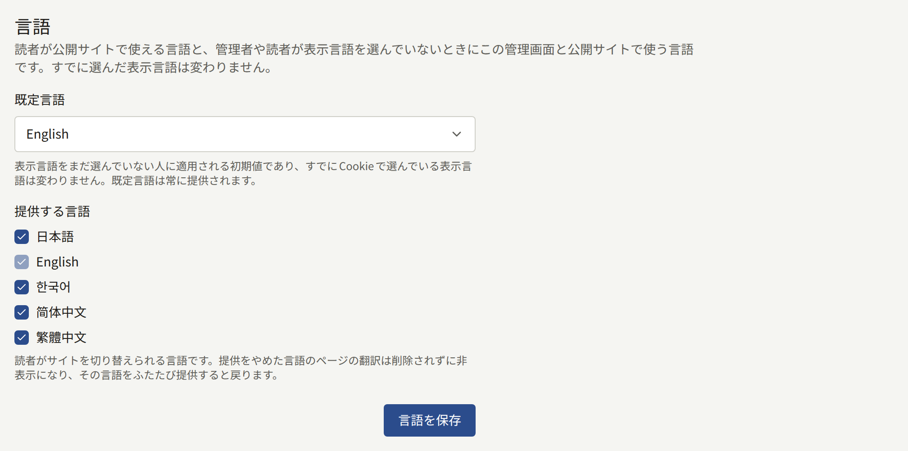

### 読者のコメント

**コメントの公開方法**では、読者がエピソードにコメントできるかどうかと、コメントがいつほかの人に見えるようになるかを決めます。

| 選択肢 | 動作 |
| --- | --- |
| **受け付けない** | エピソードページにコメント欄が表示されず、コメントを投稿できません。新しいテナントはこの設定で始まります |
| **すぐに公開する** | コメントは投稿された時点から誰でも読めます |
| **承認してから公開する** | [承認待ちのコメントの処理](../2-readers/2-comments.md#承認待ちの処理)で説明しているとおり、モデレーターが**コメント**で承認するまで、コメントは投稿者にだけ表示されます |

**自動で非表示にする報告件数**は、スタッフの対応を待たずにコメントを非表示にするために、何人の異なる読者からの報告が必要かを表します。非表示になったコメントは**コメント**の[報告キュー](../2-readers/2-comments.md#通報されたコメント)で待機し、投稿者には引き続き表示され、スタッフは元に戻すことができます。初期値は`3`です。`0`にすると、削除はすべてモデレーターに任されます。

シリーズはフォームで独自の**コメント**の選択肢を設定でき、その場合はこの設定の代わりにそのシリーズの設定が適用されます。**テナントの設定に従う**のままのシリーズは、ここで後から行った変更にも従います。**コメントの設定を保存**を選んで保存します。

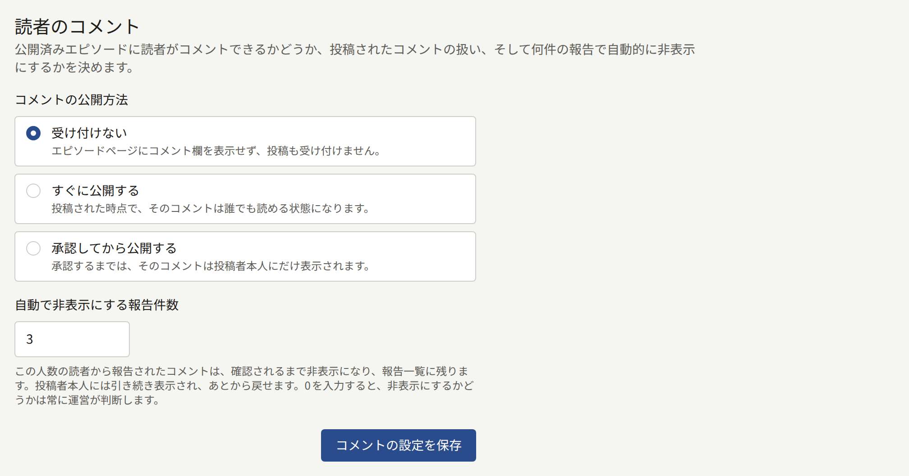

### 年齢確認

すべてのシリーズには**年齢制限**があり、**全年齢**、**R15**、**R18**のいずれかです。**年齢の証明を求める年齢制限**では、サイトが読者にそれをどれだけ厳しく守らせるかを決めます。

| 選択肢 | R15のシリーズ | R18のシリーズ |
| --- | --- | --- |
| **年齢を確認しない** | 読者が15歳以上であることを自分で確認します | 読者が18歳以上であることを自分で確認します |
| **R18のみ確認する** | 読者が15歳以上であることを自分で確認します | 生年月日から18歳以上であるとわかる読者だけが閲覧できます |
| **R15とR18を確認する** | 生年月日から15歳以上であるとわかる読者だけが閲覧できます | 生年月日から18歳以上であるとわかる読者だけが閲覧できます |

新しいテナントは**年齢を確認しない**で始まります。**全年齢**のシリーズに制限がかかることはありません。

「確認する」とは、読者が**15歳以上です**または**18歳以上です**を押すことで、ブラウザーがそのサイトについてそれを記憶します。年齢を「証明する」とは、読者がログインし、アカウントに生年月日が保存されていることです。読者は生年月日を会員登録のときか、後で設定画面から入力でき、一度保存すると変更できません。生年月日のない読者には**生年月日を登録する**が表示され、年齢が足りない読者には、その作品はその年齢では閲覧できないと表示されます。生年月日を誤って入力した読者はサイトに問い合わせ、テナント管理者が**読者**にあるその読者のページから修正します。

**年齢確認を保存**を選んで保存します。

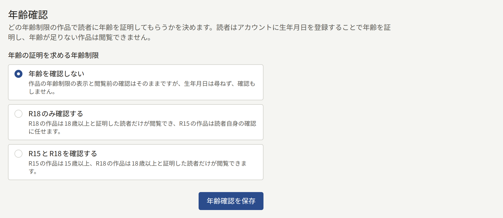

### 利用規約とプライバシーポリシー

**利用規約**と**プライバシーポリシー**には、それぞれテナントの公開中のページを1つ指定します。サイトとアプリはそれらにリンクし、読者はアカウントを作成するときにそれらに同意します。また、[新しいバージョンの公開](./3-pages.md#新しいバージョンの公開)で説明しているとおり、どちらかの新しいバージョンが読者に同意を求めたときにも、改めて同意します。まず[ページ](./3-pages.md#利用規約とプライバシーポリシー)で説明しているとおりにページを書いて公開し、ここでそれらを選んで**利用規約とプライバシーポリシーを保存**を選びます。**なし**を選ぶと、そのページは未設定のままになります。

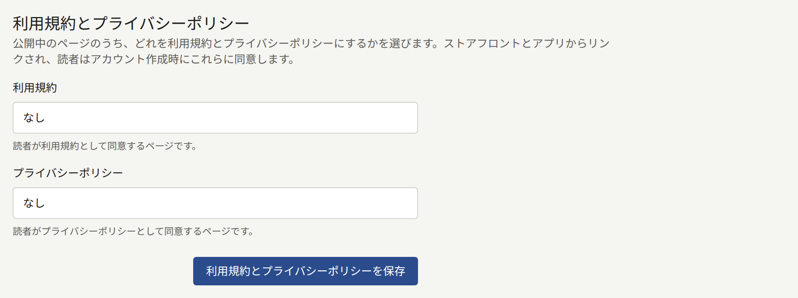

ここで選んだページが後でサイトから取り下げられると、カードにはそのページがどこからもリンクされていないと表示され、会員登録では読者にそのページへの同意を求めなくなります。もう一度公開するか、別のページを選んでください。

### 読者の新規登録

訪問者がサイトで読者アカウントを作成できるかどうかです。新しい読者を受け入れずに、既存の読者へのサービスを続けたいときに新規登録を停止します。たとえば、公開前に招待したグループだけにサイトを開いているときや、望まない会員登録が大量に押し寄せていて対処しているあいだです。すでにアカウントを持っている読者は、引き続きログイン、購入、閲覧ができます。

- **新しい読者を受け付ける**は、オフにするまでオンのままです。オフのあいだは、メールアドレスでも、AppleやGoogleでの初回ログインでも、誰もサイトでアカウントを作成できません。サイトの会員登録ページには、フォームの代わりに**新規登録を受け付けていません**とメッセージが表示され、**ログイン**でも、**新規登録**を案内する位置に同じ通知が表示されます。
- **新規登録の停止中に表示するメッセージ**は、訪問者に表示する文章で、1000文字まで入力でき、改行も含めて書いたとおりに表示されます。空欄にすると、サイトには「このサイトは現在、新しいアカウントの登録を受け付けていません。」と表示されます。メッセージは新規登録を受け付けているあいだも保持されるため、再び停止すると同じ文章が表示されます。

**新規登録の設定を保存**を選んで保存します。新規登録を停止しているあいだは、カードのスイッチの上に「新規登録を停止しています。再開するまで、メールアドレスでもAppleやGoogleでも、サイトで新しい読者アカウントは作成できません。」と表示されます。スイッチをオンに戻して保存すると、すぐに新規登録が再開されます。

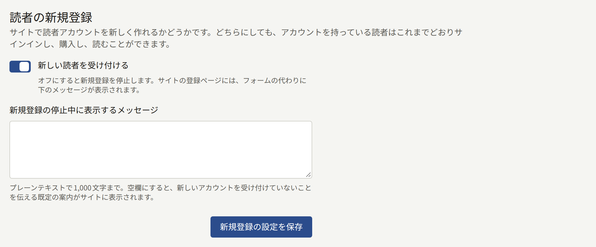

保存は[監査ログ](./8-audit-log.md)に**読者の新規登録の設定更新**として記録されます。

### 受け付けないメールアドレス

読者が会員登録に使ったり、変更後のメールアドレスにしたりできないアドレスです。このようなアドレスを使おうとした読者には「このサイトではこのメールアドレスは使えません。別のメールアドレスを入力してください。」と表示されます。

- **使い捨てメールのドメインを受け付けない**は、プラットフォームが管理する一覧をもとに、使い捨てメールサービスのドメインを受け付けないようにします。オペレーターが一覧を設定していない場合、スイッチには効果がないと表示されます。
- **受け付けないアドレスとドメイン**には、1つの欄に1件ずつ、最大1000件を入力します。`@`を含む項目は1つのアドレスを表し、そのアドレスに`+tag`を付けたものも受け付けなくなります。それ以外の項目は`example.net`のようなドメインを表し、そのサブドメインも受け付けなくなります。1つの欄に複数行を貼り付けると、行ごとに欄が追加されます。ワイルドカードはありません。

**受け付けないメールアドレスを保存**を選んで保存します。一覧は、次の会員登録またはアドレスの変更から適用されます。受け付けないアドレスですでに会員登録している読者のアカウントは、そのまま残ります。

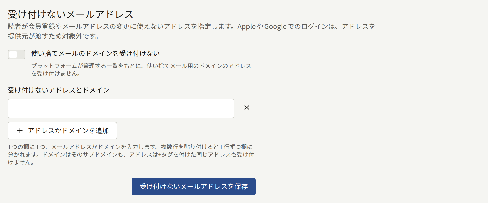

AppleやGoogleでのログインは、アドレスをプロバイダーが提供するため、ここで拒否されることはありません。このカードの内容を見られるのはテナント管理者だけです。

### クローラーの除外

サイトの`robots.txt`で、クローラーに近づかないよう求める対象です。`robots.txt`に従うクローラーは、ここで除外したものの取得をやめます。読者からは何も隠されず、このファイルを無視するクローラーは引き続きすべてのページを取得できるため、ページを非公開にする手段にはなりません。

- **サイト全体から除外するクローラー**には、Publiraが把握しているクローラーが、ページを取得する目的ごとにまとめて並んでいます。**AIの学習**、**AIアシスタント**、**画像検索**です。それぞれのクローラーは、その運営者が`robots.txt`向けに公開しているトークンで示され、その下に運営者が表示されます。チェックを入れたクローラーには、サイトのどのページも取得しないよう求めます。一覧はPubliraが決めたもので、一覧にないクローラーは追加できません。
- **すべてのクローラーから除外するパス**には、1つの欄に1つずつ、`/drafts`のようなパスを最大100件入力します。パスは`/`で始め、その下にあるものもすべて対象になります。1つの欄に複数行を貼り付けると、行ごとに欄が追加されます。ワイルドカードはなく、パスには空白、`*`、`$`、`?`、`#`を含められません。`/robots.txt`、`/sitemap.xml`、`/sitemap`は、クローラーがサイトを読むために必要なので除外できません。

**クローラーの除外を保存**を選んで保存します。各パスは末尾の`/`を除いて保存され、一覧はアルファベット順に表示されます。

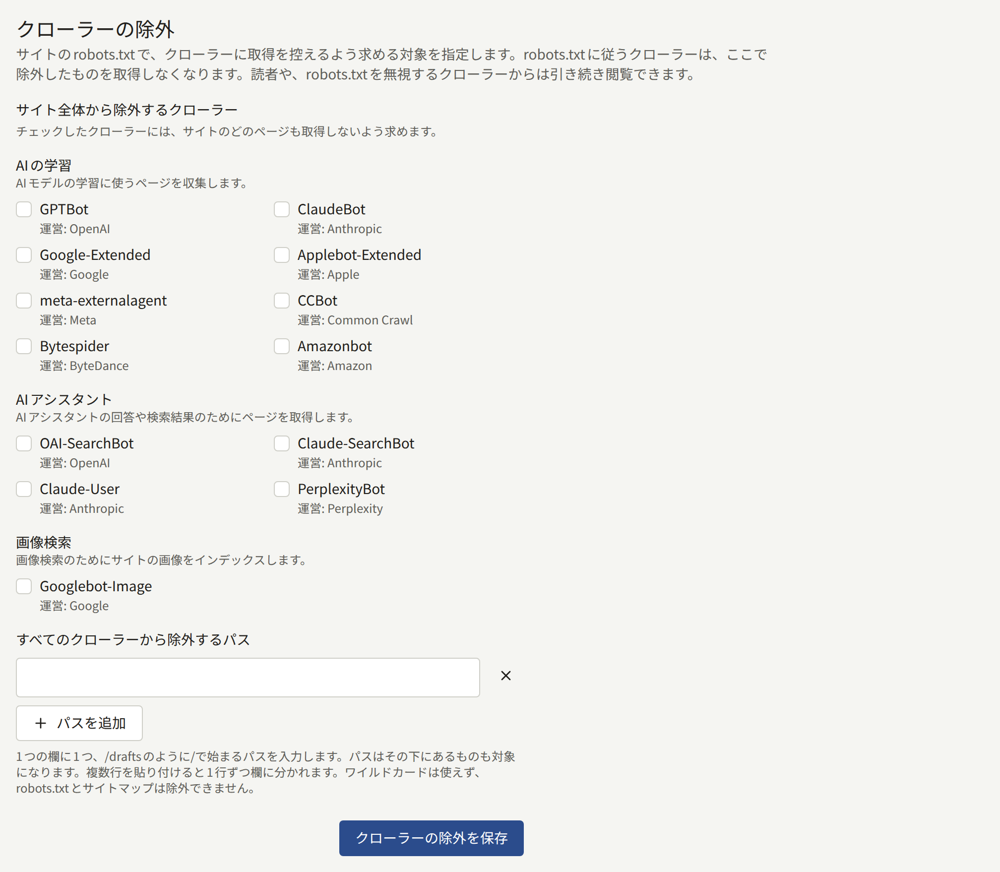

保存は[監査ログ](./8-audit-log.md)に**クローラーの除外の更新**として記録されます。

### 検索エンジンの所有権確認

Google Search ConsoleとBing Webmaster Toolsが、サイトの所有者であることを証明するために発行するコードです。設定したコードは、それぞれ`<meta>`タグとしてサイトのすべてのページに追加されます。これは、両サービスが**HTMLタグ**または**HTML Meta Tag**と呼ぶ方法です。

- **Google Search Console**には、サイトをURLプレフィックスプロパティとして追加したときにSearch Consoleに表示されるタグを入力します。`<meta name="google-site-verification" content="…" />`のようなものです。
- **Bing Webmaster Tools**には、Bing Webmaster Toolsに表示されるタグを入力します。`<meta name="msvalidate.01" content="…" />`のようなものです。

タグ全体を貼り付けても、`content`の値だけを貼り付けてもかまいません。保存されるのは値だけで、欄からフォーカスを外すと値だけが表示されます。もう一方のサービスからコピーしたタグは受け付けられません。欄を空にすると、そのタグがサイトから削除されます。

**所有権確認のコードを保存**を選んで保存し、それからサービスにサイトの確認を依頼します。

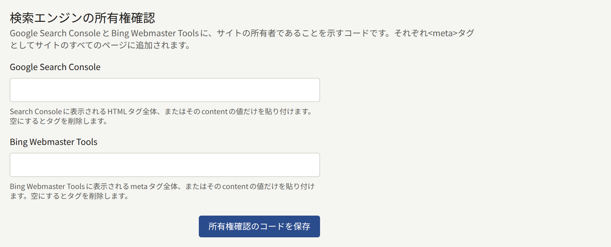

このカードの内容を見られるのはテナント管理者だけです。保存は[監査ログ](./8-audit-log.md)に**検索エンジンの所有権確認の更新**として記録されます。

## 制限と保持

**制限と保持**には、2つのフォームがあります。

- **コミュニティの上限**：1人の読者がどのくらいの頻度で、コメントの投稿や報告、エピソードの評価、お問い合わせフォームからの送信、ビューアーのレイアウトの保存、通知設定の保存を行えるか、そして同じコメントを再投稿しようとした読者をどのくらいの時間拒否するかです。
- **保持期間**：取り下げられたコメント、コンテンツイベント、日次と週次のランキングのスナップショットを、削除するまでどのくらいの期間保持するかです。

これらのフォームの各グループは、**プラットフォームの既定値を使う**にチェックが入った状態で始まり、その横にオペレーターの値が表示されます。既定値のままのテナントは、オペレーターが後から行った変更に従います。テナント独自の値を設定するには、チェックを外して値を入力し、**コミュニティの上限を保存**または**保持期間を保存**でフォームを保存します。プラットフォームの値に戻すには、もう一度チェックを入れて保存します。

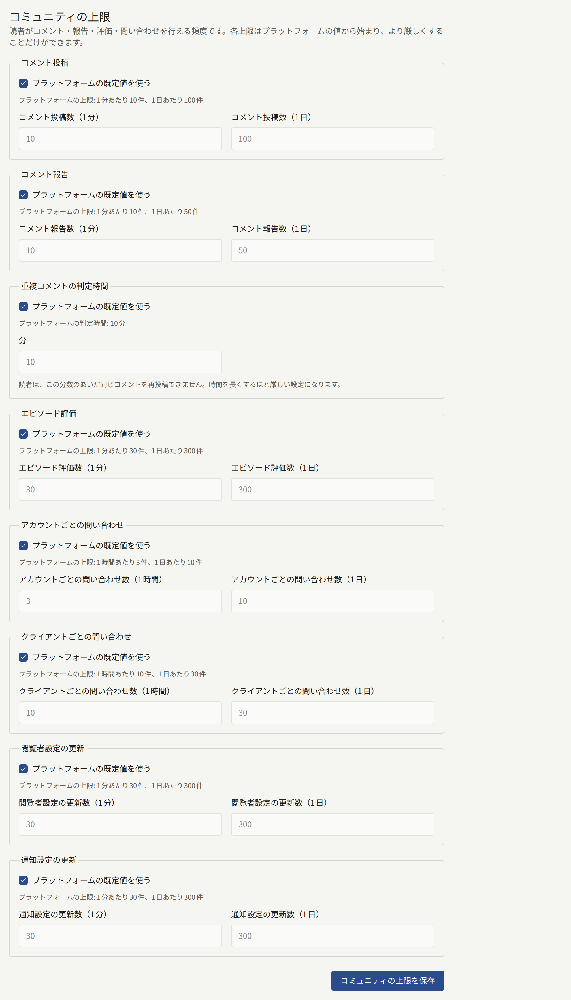

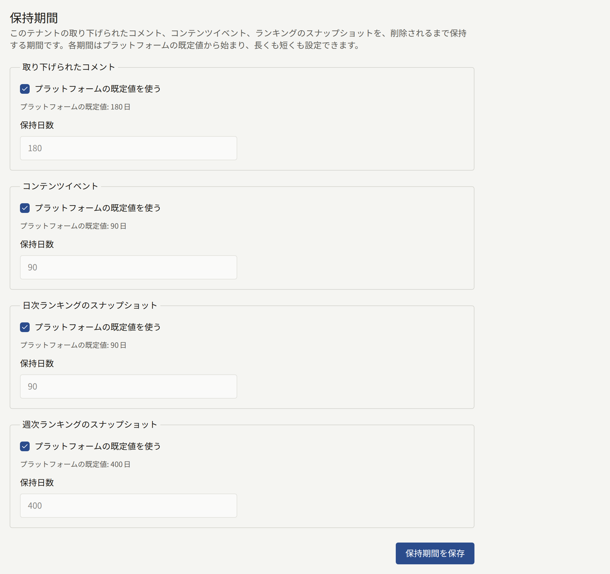

- コミュニティの上限は、プラットフォームの値より厳しくすることしかできません。つまり、件数を少なくするか、重複コメントの判定時間を長くするかです。緩い値は、その設定の名前を示すメッセージとともに拒否されます。オペレーターが後でプラットフォームの上限をテナントの値より厳しくした場合は、プラットフォームの値が適用されます。
- 保持期間は、プラットフォームの既定値より長くも短くもでき、1日から36500日までです。ただし**コンテンツイベント**の下限は30日で、それより短い期間は拒否されます。サイトのおすすめは、直近28日分の丸1日のコンテンツイベントから作られるためです。

自分がフォームを開いた後に、ほかの誰かが同じフォームを保存していた場合、保存は「このページを開いている間に、別の場所でこの設定が変更されました。ページを再読み込みしてから、もう一度入力してください。」というメッセージとともに拒否されます。

それぞれの上限と記録が何を表し、それぞれの削除処理が何を残すかは、オペレーター側から[プラットフォームの既定値とポリシー](../../3-operations/9-platform-policies.md#コミュニティ)で説明しています。このタブでの保存は、[監査ログ](./8-audit-log.md)に**コミュニティの上限更新**と**保持期間更新**として記録されます。

## 読者のアイコン

### 読者のアイコンの設定

**読者が表示できるもの**では、読者が自分の名前の横、つまりコメントとアカウントに、アイコンとして何を表示できるかを決めます。

| 選択肢 | 動作 |
| --- | --- |
| **自分の画像をアップロード** | 読者が好きな画像をアップロードします。新しいテナントはこの設定で始まります |
| **プリセットから選択** | 読者は[プリセットのアイコン](#プリセットのアイコン)のアイコンから1つを選び、画像はアップロードできません |
| **アイコンなし** | どの読者もアイコンを表示せず、サイトには全員に無地の輪郭が表示されます |

**読者のアイコンの設定を保存**を選んで保存します。**プリセットから選択**または**アイコンなし**を保存すると、その選択肢で認められないアイコンが取り下げられるため、管理画面は先に「読者のアイコンを削除しますか？」と確認します。

- **プリセットから選択**は、読者がアップロードした画像をすべて削除します。プリセットを選んでいた読者は、そのままです。
- **アイコンなし**は、読者が表示しているアイコンをすべて削除します。

続けるには**保存して削除**を選びます。ページを開いた後に別のテナント管理者が設定を変更している可能性があるため、管理画面は、カードに保存済みとして表示されている設定がどれであっても確認を求めます。削除したアイコンは元に戻せないため、再びアイコンを認める設定にしたときは、読者がそれぞれアイコンを選び直します。**自分の画像をアップロード**は何も削除しないため、確認なしで保存されます。

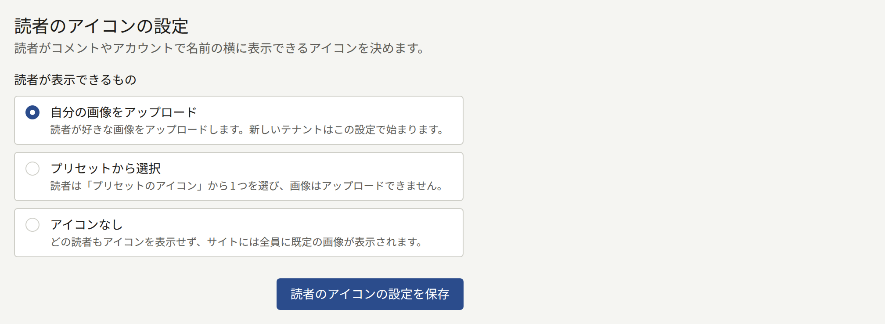

### プリセットのアイコン

**プリセットから選択**で読者が選ぶアイコンで、最大50個まで登録できます。プリセットはどの設定のときでも追加できるため、その設定に切り替える前にそろえておいてください。一覧が空のあいだ、読者は何も選べません。

追加するには、**アイコン画像**で10MB以下のJPEG、PNG、WebPのいずれかの画像を選び、**アイコンを追加**を選びます。画像の中央から正方形が切り出され、その大きさは128 × 128 px以上でなければなりません。各プリセットは、サイトがアイコンを描くときと同じ形で、保存されたサイズとともに表示されます。

削除するには、その下の**削除**を選び、**削除**で確定します。そのアイコンを選んでいた読者はアイコンがない状態になり、別のアイコンを選ぶまで無地の輪郭が表示されます。

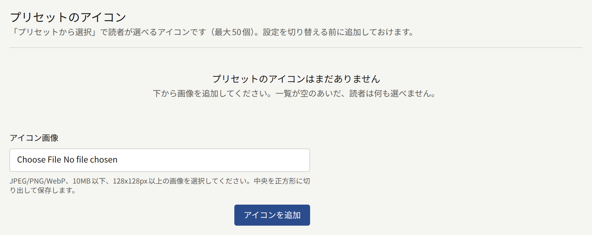

このタブでの保存は、[監査ログ](./8-audit-log.md)に**読者のアイコンの設定更新**、**読者のアイコンのプリセット追加**、**読者のアイコンのプリセット削除**として記録されます。
